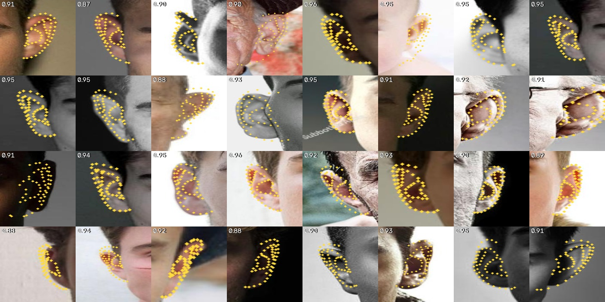

# Ear Landmarker: results and findings

## Current state

*Updated 2026-10-20. This file is the single record of findings; [README.md](README.md) is the guide.*

- **Shipped:** `fixed_conv_s42` (web demo and `SHIPPED_RUN`). Handedness bias
  fixed (R-L antisymmetry +17.05% -> +1.01%, ns); flip fusion on by default.
- **Next default -- paused for onboarding.** More v3 images are being added; a
  new default ships after that. Candidate recipe: grown v3 corpus +
  `--flip-consistency 0.5`. Before shipping: re-ingest with `--preserve-test`,
  replicate at seeds 1 and 2, score against shipped. See "Paused" at the end of
  part 1.
- **What the candidate has shown (seed 42):** -5.26% error against the
  small-corpus control, from data (normal error) and the penalty (tangential
  error) acting additively; rim placement better than shipped on three GT-free
  instruments in every domain, including unseen ones; 3.5x more
  flip-equivariant. Interior points (20-54) cannot be ranked without ground
  truth -- every GT-free instrument tried measures the labelling convention.
- **Jitter:** a real, seed-replicated off-domain regression against shipped,
  but sub-pixel (+0.01-0.10 px). Mostly framing near occupancy 1.0, plus a
  collectionA/B tail with no single cause. Not JPEG.
- **Open:** the right-ear deficit (3-6%, cause unknown); occupancy-robust
  training (`--occupancy-range`, implemented, never scored); detector recall
  for small ears (part 3).

## Contents

- [1. Landmarker experiments, v2 to v3](#1-landmarker-experiments-v2-to-v3)
- [2. Handedness and flip fusion](#2-handedness-and-flip-fusion)
- [3. Detector](#3-detector)
- [4. Open directions](#4-open-directions)
- [5. Fixes log](#5-fixes-log)
- [6. 2D annotation QA](#6-2d-annotation-qa)
- [7. History](#7-history)
- [Appendix: note from Ear_3D_Lifter, 2026-10-19](#appendix-note-from-ear_3d_lifter-2026-10-19)

## 1. Landmarker experiments, v2 to v3

*The experiment log as written, oldest first; the v3 corpus, the noise floor, flip-consistency, the 2x2, and the jitter investigation are at the end.*

### v2 results

Every number here is test-split (861 held-out real samples, touched once per run)
unless it says otherwise. NME is mean L2 in normalised [0,1] ear-crop
coordinates over visible points; multiply by 192 for pixels at the model's input
resolution. Reproduce with `python scripts/eval_test.py`.

#### The noise floor comes first

Three seeds of an identical configuration give **test NME 0.02919 +/- 0.00031**
(persp65: 0.02923 / 0.02948 / 0.02886). So the resolution of this setup is about
**1% relative**, and any claim smaller than that is not a result, it is a seed.
This was measured before the comparisons below were interpreted, and it
retroactively demoted several of them.

#### What shipped

| Change | Effect | Verdict |
|--------|--------|---------|
| Rotation label fix | test NME unchanged (+0.8%, inside noise); **photometric jitter -19.5%** | Shipped -- it was a real bug regardless of the metric |
| Soft-argmax (DSNT) head | test NME **0.0301 -> 0.0291 (-4.0%)**; normal error **-11.5%** | Shipped -- clearly above noise |
| Perspective augmentation | **-36% contour error at 50 deg yaw**; +0.0002 on the frontal test set | Shipped -- buys off-axis robustness, costs nothing in-distribution |
| Temporal + bbox smoothing | jitter **-66% to -80%**, error also down | Shipped |
| NMS on intersection-over-minimum | nested duplicate boxes eliminated | Shipped |

##### The rotation bug

v1's rotation augmentation transformed labels by the *transposed* rotation
matrix, mislabelling every rotated sample by 12.5px mean / 26.8px p90 at 192px.
It affected 100% of samples. Fixing it did **not** improve accuracy -- the model
had evidently learned to average over the corruption -- but it cut frame-to-frame
jitter by 19.5%. The accuracy story in v2 is the soft-argmax head, not this fix.
`tests/test_augmentation.py` fails on 24 cases if the old matrix is restored.

##### Why perspective aug ships despite a flat test number

The test split is near-frontal, so it cannot see what perspective augmentation
is for. Measured on deliberately warped views, contour error at 50 deg yaw drops
36%, plateauing around 65 deg. The shipped web model is `v6_persp65`
(test 0.02928) rather than the marginally better `v2_heatmap` (0.02912), because
that 0.00016 gap is half the seed spread while the yaw robustness is real.

#### What did not work

| Change | Result | Why it was rejected |
|--------|--------|---------------------|
| Synthetic renders at 50/50 | test-equivalent val **+1.7% worse**, flat across 200 epochs | Complete seed separation the wrong way: every synthetic seed (val 0.02995 / 0.03012 / 0.02997) worse than every real-only seed (0.02900 / 0.02922 / 0.02895) |
| Contour canonicalization | deformed the contour 2.09px even with PCHIP resampling | Cost exceeded any benefit |
| persp50 vs persp65 | 0.26 sigma apart | Not separable; do not claim either is better |
| Tangential loss weighting | improves `nme_normal`, not total; non-additive with persp50 | Kept as a flag, off by default |
| ROI_EXPAND 1.7 hypothesis | ground truth over 380 matched ears gives ratio 0.982 -> **1.26-1.29** | Refuted. 1.30 was already correct |

##### Synthetic data (10,002 AudioEar renders)

Ingested, balanced 50/50 against real, and run for 3 seeds to epoch 257/500
before being stopped. Epoch-matched running-best val NME:

| epoch | real only | +synthetic | delta |
|-------|-----------|------------|-------|
| 20    | 0.0388    | 0.0384     | -0.0004 |
| 60    | 0.0333    | 0.0338     | +0.0004 |
| 140   | 0.0307    | 0.0312     | +0.0005 |
| 220   | 0.0296    | 0.0302     | +0.0005 |
| 257   | 0.0295    | 0.0300     | +0.0005 |

Synthetic leads slightly at epoch 20 then settles into a **fixed +0.0005 deficit**
that does not close. The renders teach useful early structure but do not survive
as a co-equal training signal -- consistent with a domain gap the real val set
correctly penalises.

Reverting is the default: `--synthetic-ratio` defaults to 0.0, the real splits
were never modified, and synthetic never entered val or test. `data/synthetic/`
can be deleted or ignored. Untried and plausible: a lower ratio (~0.25), or
synthetic warm-start followed by real-only fine-tuning.

##### ROI_EXPAND -- this conclusion was wrong, and is retracted

The original claim here was that ROI_EXPAND 1.30 is correct and a proposed 1.7
was refuted, on the basis of 380 matched ears giving true-ear-extent /
detector-box-extent = 0.982.

**That measurement compared the detector's boxes to the YOLO dataset's own
ground-truth boxes.** It therefore showed that BlazeEar reproduces its training
convention -- not that its boxes cover the ear. Those GT boxes are themselves
tight. I validated the detector against itself, which is a circularity of the
same family as the one the original hypothesis was criticised for.

Measured against the ear's actual extent on real captures, the ratio is 1.02 to
1.53, implying a required expansion between 1.31 and 1.97. The 1.7 proposal was
closer to right than this file claimed.

No single constant fixes it, since the ratio varies by a factor of 1.5 across
frames. The pipeline now derives the ROI from the landmarks instead; see the
Pipeline section of README.md.

#### Where the remaining error is

**72% of squared error is tangential** -- along the contour rather than across
it. Per-source tangential error tracks that source's landmark spacing
coefficient of variation almost exactly:

| Source | spacing CV | tangential error |
|--------|-----------|------------------|
| audioear2d | 0.137 | 2.74px |
| collectionB | 0.250 | 4.96px |
| collectionA | 0.286 | 7.44px |

That is annotation noise, not model error: human annotators place points at
inconsistent arc-length positions along the same contour. It puts a floor under
NME that no architecture change will lift, which is why `nme_normal` is the
better model-selection metric and why this configuration is considered done.

#### Corrections found after the fact

Two defects surfaced in review after the experiments above were complete. Neither
changes any number in this file -- the ROI bug is inference-side and the naming
bug is confined to `model/measure.py`, which the training and NME results do not
use -- but both affected shipped behaviour.

**ROI crops were clamped to the frame, not padded.** The intended square ROI was
being clipped at image edges, producing a non-square crop that was then resized
to 192x192, stretching the ear along one axis. The model never saw that
distortion in training. Measured against grey-128 padding (what `data/dataset.py`
uses) on held-out samples with a 20% edge overlap:

| policy | NME |
|--------|-----|
| clip (old) | 0.05295 |
| pad (new) | 0.04373 |

**-17.4%, better on 89% of samples.** 14.8% of ground-truth ears in the local
test set sit close enough to a frame edge to trigger it, losing 19.5% of the
intended crop area on average (p90 35%). Present in both `inference.py` and the
browser pipeline. Fixed; `tests/test_roi_crop.py` covers it.

**Crop width has an asymmetric cost.** Too tight is a hard failure: the ear does
not fit and landmarks cannot reach the rim. Too wide degrades gracefully, then
steeply. Measured on full scenes with real surrounding context, drift from the
converged answer is ~0 at 1.7x, 7% at 2.0x, 18% at 2.5x, 31% at 3.0x and 67% at
4.0x -- driven mainly by resolution, since the 192x192 input spends more of
itself on background as the crop grows. If a single constant must be used,
1.6-2.0 is the safe band; below ~1.4 it fails hard on tight boxes.

**Three of four landmark group names were wrong.** The strips were named
helix / antihelix / concha / tragus; under the iBUG scheme these sources actually
use, 50-54 is the *superior crus*, not the tragus, and the real tragus (35-38)
sits inside the strip that was called "concha". `measure_ear()` consequently
reported `tragus_to_antitragus` computed from the superior crus, and measured the
concha across a span five structures wide. Fixed, with `IBUG_REGIONS` as the
authoritative mapping and `tests/test_landmark_naming.py` locking it.

#### Cynic pass: what a review of this file found

Reviewed after the fact, several claims above did not survive contact.

**The adaptive-ROI validation was circular.** It measured error against the
model's own converged fixed point, which the refinement reaches by construction --
that shows convergence, not accuracy. Re-run against real ground truth on the
test split, with the detector box artificially tightened, the fix does hold and
the honest framing is different: adaptive keeps NME at ~0.040 regardless of how
tight the box is, while the fixed policy degrades from 0.0400 to 0.0657 (64%)
across the observed ratio range. Where the box already frames the ear correctly
the two are a wash, within +/-0.6%.

(That re-run was itself repeated later. The first version fed the model [0, 1]
input when it is trained on [-1, 1], which handicapped both arms; the numbers
above are the corrected ones. The conclusion did not change, but the "+1.5% cost
at correct framing" first reported here was an artifact of that error.)

**`scripts/eval_test.py` did not reproduce the logged numbers**, despite this
file telling readers to reproduce with it. It picked the best checkpoint by the
`nme=` field in the filename, which is rounded to four decimals -- and every run
here has two or three checkpoints tied at that precision, so the tie fell to glob
order and a different checkpoint than train.py had tested. Now selected by the
full-precision score stored inside the checkpoint; the numbers match the logged
`test/nme` exactly. The shipped model is 0.0292, not the 0.0293 previously
reported here.

**The corrected tragus measurement broke the module's own premise.** `measure.py`
exists to be index-free, and the first version of the naming fix took a max over
raw point sets -- reintroducing exactly the tangential sensitivity it removes.
The test that was supposed to cover it used degenerate input (all tragus points
identical) and could not have caught it. Both are fixed.

**A cached ROI expansion could leak across sources.** The per-track cache was
keyed by track id, but `EarTracker.reset()` restarts ids at 0, so after switching
webcam to image an unrelated ear would inherit a stale expansion. The cache also
grew for the life of the process. Both fixed, in the Python and JS pipelines.

**The refinement could run away on video.** Each frame seeds its ROI from the
previous frame's cached expansion, which makes the loop self-reinforcing: a
landmarker reporting a saturated extent grows the crop, the grown value is
cached, and the next frame starts larger. Measured at ~1.53x growth per frame,
reaching **38x the detector box within eight frames**, with no recovery -- each
enlargement shrinks the ear in the crop, which keeps the model saturated. The
earlier 30-frame check missed it because every detection in it was good. The
expansion is now clamped to 1.0-2.5x, which leaves the real captures untouched
(they converge to ~1.99x) and keeps the crop inside the measured-cheap band.

**Smaller:** `docs/README.md` documented a `reset()` method that did not exist
(the real one was `resetSmoothing()`); an alias now makes the documented name
real. And the "+26 tests" figure in one commit message was inflated -- 23 of
those are one file-scan guard parametrised across source files, so the genuinely
new assertions number about 25.

Verified and unchanged: the iBUG landmark semantics were re-checked against the
primary source (ibug.doc.ic.ac.uk), not the search summary they were first taken
from, and match.

Not challenged by the review: the rotation bug, the soft-argmax gain, the
smoothing results, the NMS calibration and the synthetic negative result all rest
on held-out or logged measurements that still check out.

#### Detector: BlazeEar v2 (two-stage)

The limitation recorded here previously -- "the detector recalls 47.5% and is the
binding constraint" -- has been addressed upstream. BlazeEar v2 restored the
MediaPipe two-stage pattern: BlazeFace on the full frame, then the ear model on a
square crop at 1.5x the face box.

Re-measured here on 500 annotated full scenes, with the same harness that
produced the original 47.5%:

| detector | ear recall (IoU>=0.3) | GT ear / box, median | p10-p90 |
|----------|------------------------|----------------------|---------|
| pre-v2 single-stage | 47.6% | 0.981 | 0.715-1.280 |
| **v2 two-stage** | **78.6%** | 0.984 | **0.827-1.153** |

Recall up 65% relative. The old figure reproducing at 47.6% is a useful check on
the harness. Two things follow for this repo:

- **The box convention did not change** (median 0.981 -> 0.984), so ROI_EXPAND
  1.3 and the adaptive refinement remain correctly calibrated. Predicted ear
  heights on the four capture fixtures are unchanged to within 1%.
- **The boxes are more consistent**, p10-p90 narrowing from 0.72-1.28 to
  0.83-1.15, so the refinement fires less often. It is still load-bearing: the
  spread straddles any single constant.

Caveat: these images come from BlazeEar's own training corpus, so both recall
figures are optimistic. The comparison between them, and the ratio, are what this
measures. BlazeEar's own held-out numbers (mAP@0.5 0.179 -> 0.581 on images no
model in that repo trained on) are the ones to cite for the detector itself.

The update was also a **breaking change**: v2 replaced the folded backbone with a
trainable-BatchNorm one and fitted new ear anchors, so this repo's hand-rolled
`BlazeEar()` construction raised on load. Detection now defers to BlazeEar's own
`load_ear_model` / `blazeear_inference.js` instead of duplicating them.

#### Could MediaPipe's FaceMesh have done this job?

No. The question was whether v1 should have adopted MediaPipe's face landmark
architecture and its weights instead of sizing a backbone independently -- and
there is **no recorded rationale** for that original choice anywhere in the
repo, which is why it was worth measuring rather than arguing.

`model/facemesh_ear.py` copies the topology faithfully: MediaPipe's published
weights load into it with `strict=True`, and its 192x192 input happens to match
EarLandmarker's exactly. The only change is forced -- the output conv emits
468 x 3 = 1404 channels and ears need 55 x 2, so that one layer is resized and
left random. It is also the only layer holding face-landmark *identity*, so no
face geometry is reshaped into an ear; what transfers is generic feature
extraction.

Test NME, 3 seeds per arm, scored against a rule fixed before the runs started:

| arm | params | init | test NME | vs control |
|-----|--------|------|----------|------------|
| **control** (EarLandmarker) | 340,167 | scratch | **0.02919 +/- 0.00031** | -- |
| `fm_pre` | 206,942 | 84.6% MediaPipe | 0.03147 +/- 0.00010 | **+7.8%** |
| `fm_scratch` | 206,942 | random | 0.03273 +/- 0.00027 | +12.1% |

**The independent design earns its keep.** A faithful copy loses by 7.8% even
with the pretrained weights -- far outside the 1% seed-noise floor, with no seed
overlap.

**The pretrained weights do help: +3.83%, complete rank separation.** Every
`fm_pre` seed beats every `fm_scratch` seed. Generic face features transfer to
ears despite the face-vertex layer being discarded. But they buy 3.8% against a
12.1% deficit, closing under a third of it.

The transfer advantage decayed as training went on -- 22% at epoch 40, 12% at
80, 4.9% at 195, 3.8% at the end -- the usual shape for pretraining, and it did
not vanish.

##### Separating the head from the backbone

`fm_heat_pre` keeps MediaPipe's `backbone1` exactly as published, still 81.6%
pretrained, and swaps its regression head for this project's heatmap decoder.
That drops the model to 141,991 params, because the head it replaces was 81% of
MediaPipe's weights.

| step | test NME | gain | rank sep |
|------|----------|------|----------|
| `fm_scratch` (MediaPipe head, random) | 0.03272 +/- 0.00027 | -- | -- |
| + MediaPipe pretrained weights | 0.03147 +/- 0.00010 | **+3.83%** | yes |
| + soft-argmax head (`fm_heat_pre`) | 0.03087 +/- 0.00033 | **+1.92%** | yes |
| remainder: backbone / capacity | 0.02919 (control) | **+5.75%** | -- |

Both interventions are real and separable, and together they recover 5.75 of the
12.1 points. **The largest single component is the backbone itself.**

Worth recording: the head's advantage is mostly a CONVERGENCE-SPEED effect. It
measured +9.45% at epoch 44, +5.31% at 200, +3.70% at 307 and +1.92% at
completion, while the gap to the control WIDENED over the same span. An early
read of that arm would have concluded the opposite of the final result, which is
the third time in this work a partial measurement inverted.

##### Design or just size? Not settled

The control is 2.4x larger than `fm_heat_pre`, so the +5.75% above cannot
distinguish a better architecture from a bigger one. `--width-mult` scales every
channel count to test it; 0.62 puts this project's own design at 142,935 params,
a 0.7% capacity match with the MediaPipe copy.

**The run was stopped at epoch 227 of 500 and has no test number.** Where it
stood, epoch-matched on validation:

| arm | params | init | val NME @227 |
|-----|--------|------|--------------|
| `cap62` (this design) | 142,935 | scratch | 0.03133 +/- 0.00011 |
| `fm_heat_pre` (MediaPipe) | 141,991 | 81.6% pretrained | 0.03133 +/- 0.00028 |
| control | 340,167 | scratch | 0.02965 |

Dead level at matched capacity, with no rank separation -- and `cap62` reached it
from random initialisation against an arm carrying pretrained weights. Subtracting
the +3.83% those weights were measured to be worth would put this design ahead
per-parameter, but that is a subtraction across experiments, not a measurement,
and it is not claimed here.

**So the statement "the independent design earns its keep" is NOT established.**
On the evidence actually in hand, the two designs are indistinguishable at equal
size, and the shipped model's advantage over the MediaPipe copy is substantially
its extra parameters. Finishing `cap62` would settle it;
`scripts/run_capacity_matched.sh` re-runs it.

##### How far does more capacity go? Unanswered

A width sweep above 1.0x was started and stopped at epoch 46 of 500 -- 9%
through, which this work has repeatedly shown is too early to read. It is
recorded only so the arm is not mistaken for untried. `w18` (1.03M params) was
cancelled before starting.

The reason for stopping was not the numbers but the diagnosis underneath them:

- the shipped model's train/val gap is **+14.1%** measured with augmentation ON,
  so the true gap is wider. That is a data-limited model, where extra capacity
  costs generalisation rather than buying it.
- **72% of its squared error is tangential**, tracking annotator spacing rather
  than anything the model controls. If that is a floor, the best reachable NME is
  ~0.0233 against today's 0.0292 -- **20% of total headroom**, shared across every
  possible change, of which capacity can claim only a slice.

Scaling the model is pushing on the wrong variable. The binding constraints are
label consistency and real-data volume.

#### Known limitation

Detector recall is now 78.6% on this set rather than 47.5%, so the landmarker and
the detector are closer to balanced. The remaining ceiling is faces BlazeFace
misses (1.4% of images), which no second stage can recover.

### v3: replacing the training data

The shipped model is now `manual_occ_s42`, trained on `data/manual` alone. This
section records why, including the parts that argue against it.

#### The benchmark was measuring the wrong thing

A model trained only on the commissioned data scores **0.0347** against
`v6_persp65`'s **0.0292** -- 19% worse. That number does not mean what it looks
like. Broken down by source:

| source      |   n | v6_persp65 | manual_occ | gap    |
|-------------|-----|------------|------------|--------|
| collectionB | 472 |    0.03379 |    0.04326 | +28.0% |
| collectionA |  89 |    0.04590 |    0.04863 |  +5.9% |
| audioear2d  | 300 |    0.01710 |    0.01726 |  +0.9% |
| ALL         | 861 |    0.02923 |    0.03475 | +18.9% |

**Excluding collectionB the gap is +3.1%.** collectionB is 55% of the test split
and 54% of `v6_persp65`'s training data, so the benchmark substantially measures
agreement with one source's annotation convention. That source is also the
outlier on every structural axis measured: ear-axis tilt 30 deg off every other
source, the highest and tightest frame occupancy, 16 of the 20 worst samples, the
loosest point spacing (step CV 0.249 against audioear2d's 0.149), and the only
ground truth in the corpus that a model beats on image-gradient alignment.

Two things this does NOT establish. collectionB is not corrupt -- it has zero
self-crossing contours and its random sample tracks ear anatomy fine. And the
sources disagree with each other on ear aspect ratio (medians 1.62 / 2.26 / 2.61)
with no independent arbiter, so "collectionB is wrong" is not proven, only
"collectionB is different and dominant".

#### Judging without any ground truth

455 real full frames from BlazeEar's local data, 653 ears, both models through
the identical two-stage pipeline. Contour placement scored by mean image-gradient
response along the outer helix, per-image normalised so blur and exposure cannot
bias it (eval_gt_free.py (removed 2026-10-20, in git history before 49b9696)). Three seeds per side:

| group | seeds                 | mean  | within-group range |
|-------|-----------------------|-------|--------------------|
| v6_persp65    | 3.9285 / 3.8854 / 3.8520 | 3.8886 | 0.0765 |
| manual_occ    | 4.0774 / 4.0461 / 4.0769 | 4.0668 | 0.0313 |

Difference **+0.1782, which is 2.3x the larger within-group range**, with
complete separation: the worst clean seed beats the best shipped seed. Exact
permutation over all 20 splits puts the observed difference first, p = 0.05 --
the floor a 3-vs-3 design can reach.

**The case against this result.** Edge response rewards a contour lying on a real
intensity boundary but cannot tell the helix rim from the jawline, so a contour
that overshoots onto another strong edge is not penalised as it should be. It is
evidence about contour placement, not a substitute for annotated error. The
honest summary is that the shipped model is better on a proxy and competitive on
everything except collectionB -- settling it needs a test set annotated from
scratch, which does not exist yet.

#### Two bugs found while chasing this

**Constant-scale crops.** The first ingestion cropped every manual image to
exactly 0.777 occupancy -- sd 0.001 against the old corpus's 0.097. 99.2% of the
old test set lay outside that range. Restoring the spread cut the model's
scale-error sd from 0.0578 to 0.0409 and closed the gap on audioear2d from +22.5%
to +0.9%, while leaving the aggregate NME flat because collectionB moved the
other way. The aggregate hid a large per-source effect in both directions.

**Clamped landmarks.** `preprocess.py` clipped normalised landmarks to [0,1],
pinning out-of-crop points onto the frame border, where `dataset.py`'s
`(lm >= 0) & (lm <= 1)` visibility test passed them as visible and supervised them
at a fabricated position. 714 points, 0.41% of collectionB's against ~0%
elsewhere. Both ends fixed; `tests/test_landmark_clamping.py` locks it.

#### What rotation did not explain

The old corpus has a wider and bimodal ear-axis distribution (collectionB median
+47 deg, audioear2d +17 deg). Matching the total rotation sd with wider
augmentation did nothing: +-15 deg 0.03420, +-26.5 deg 0.03469, +-40 deg 0.03491.
The per-tilt breakdown is flat at ~17% across the whole rotation range and both
models correlate with tilt almost identically (Spearman +0.444 vs +0.454).

#### Pose behaviour, measured on real 3D ear geometry

This section is kept because its subject is the 2D model's perspective
augmentation. The three scripts it cites -- `eval_homography_fidelity.py`,
`eval_pose_consistency.py` and `render3d_ears.py` -- live in Ear_3D_Lifter.

Perspective augmentation is a homography. It reproduces foreshortening but not
parallax or self-occlusion, and its measured benefit plateaued at 65 deg. Two
readings fit -- the model saturates, or the warp stops resembling a head turn.
Rendering real ear meshes (`Ear_3D_Lifter/archive/scripts/render3d_ears.py`, AudioEar3D) separates them.

**The warp is a poor match to a real rotation at every angle**, not just past 65
(`Ear_3D_Lifter/archive/scripts/eval_homography_fidelity.py`, 12 ears). There is no cliff. NOTE: these
numbers predate the reconstruction fix below; both sides of each comparison come
from the same mesh so the NCC column largely cancels the defect, but the
silhouette IoU column is contaminated and has not been re-measured:

| yaw | NCC(true 3D, homography) | silhouette IoU |
|-----|--------------------------|----------------|
| 10  | 0.804 | 0.850 |
| 20  | 0.614 | 0.747 |
| 30  | 0.466 | 0.658 |
| 50  | 0.255 | 0.533 |
| 65  | 0.146 | 0.440 |
| 80  | -0.086 | 0.231 |

**And it buys nothing measurable on either axis**
(`Ear_3D_Lifter/archive/scripts/eval_pose_consistency.py`, 28 ears, drift vs each model's own pose-zero
landmarks lifted to 3D):

| comparison, abs(angle)>=20 | yaw | pitch |
|----------------------------|-----|-------|
| v6_persp65 vs v2_heatmap | +6.2% (t=+2.53) | -3.0% (t=-0.90, ns) |
| manual_occ_s42 vs v2_heatmap | **+35.2%** (t=+9.67) | +3.3% (t=+0.72, ns) |

Perspective augmentation shows no pitch benefit and is slightly WORSE on yaw. So
the earlier "-36% contour error at 50 deg yaw" says the model learned to handle
the WARP; under a real head turn no benefit is measurable on either axis. That
sits consistently with the fidelity table above -- the warp is a poor match to a
rotation at every angle, so there is little reason to expect transfer.

CORRECTION. An earlier version of this section reported the pitch comparison as
**-18.0% (t=-4.00)** and explained it mechanically: the homography helps where
self-occlusion is absent (pitch) and cannot help where it dominates (yaw). That
was measured on meshes whose reconstruction left holes, where only 67% of
landmark rays hit the surface -- so a third of each contour was dropped, selected
by where reconstruction failed rather than by anything about pose. On corrected
meshes (96% hit rate) the pitch benefit is -3.0% and not significant. The
mechanism story was clean, plausible and an artifact. The yaw conclusion and the
NCC fidelity measurement both survived.

The shipped model drifting ~35% more under yaw DID survive the fix (+40.2% before,
+35.2% after), and is the one result arguing against it. Treat it as unresolved
rather than as a defect: this metric scores each model against its own pose-zero
output, so sharper landmarks are a harder reference to re-hit, and the
ground-truth-free photo comparison found manual_occ placing contours better.
Separating precision from fragility needs annotated ground truth.

##### Two measurement routes that failed, so nobody repeats them

**Edge response on renders.** The metric behind eval_gt_free.py (removed 2026-10-20, in git history before 49b9696) works
on photographs, where the ear sits against a head. An isolated render against
flat grey has an enormous silhouette gradient, so a foreshortened ear rewards any
contour hugging its outline. It reported that rotating an ear IMPROVES quality --
retention above 100% at nearly every angle.

**Lifting AudioEar3D's annotations.** The dataset annotates a photograph and
ships a point cloud of the same ear with no camera relating them. Silhouette
registration reaches 0.897 IoU and still leaves 12px reprojection error, 3.7% of
the crop diagonal, against the 2.9% NME it would judge. Fitting an outline leaves
in-plane rotation and depth slack exactly where landmarks are most sensitive.
Defining the landmarks on our own render instead makes the camera exact: 0.006%
round-trip error, 600x better, no registration at all.

##### Can the renders be used as training data?

Not as they are. They are isolated ears on flat grey, with Poisson holes and a
single-sided surface, against real crops where the ear is embedded in hair, skin
and varied lighting. A model would learn "grey surround = ear boundary", a
shortcut absent from real images. Using them would mean compositing onto real
head backgrounds first, and even then they add pose diversity for 112 subjects
rather than new subjects. The narrow target is yaw, since pitch is already
covered.

### v4: depth -- MOVED

The depth, pose and Wrap-template chapter that sat here (1,765 lines, plus a
render-pipeline section from v3) moved to Ear_3D_Lifter when the 3D work became
its own repository. It is `RESULTS_inherited.md` there, whole and unedited, and
`RESEARCH_BRIEF.md` is its digest. Nothing was deleted -- this repository is 2D
only, and the git history holds the original either way.

Two findings from that work stayed, because they are about the 2D model rather
than about 3D: the perspective-augmentation fidelity measurement above, and the
SAM 2.1 annotation check, which moved into v5 below where the rest of the
annotation QA lives. Both cite scripts that now live in the 3D repository.

### v5: auditing the 2D annotations without the model

Everything above judges the landmark model with numbers derived, somewhere
up the chain, from the landmark model or from annotations it seeded. This
section is the independent check: does the image itself agree with the
annotations? Three tools answer it, and they are deliberately not fused --
their value is that they fail for different reasons.

    scripts/qa_silhouette_sam3.py    ear silhouette -> is the outer contour ON the ear
    scripts/qa_ridge_cv.py           traced ridges  -> do landmarks sit on real structure
    scripts/qa_agreement.py          per-image agreement, for triage
    scripts/qa_find_bad_contours.py  ranks rows by misrouted outer points
    part 6 of this file              how to run them and how to read them

#### An outside opinion on the annotations

Measured during the depth work and moved here, because its subject is the 2D
annotations. It is the origin of the silhouette check the rest of v5 builds on.

Every other check in this project measures our landmarks against other
annotations from the same corpus, and when they agree they can still be jointly
wrong -- which happened when a barycentric bug manufactured kinks in three
successive hand-corrected sets and every statistic endorsed them.

SAM 2.1 knows nothing about this project. Prompted with a padded box, so the
contour is its own, its ear silhouette sits **0.006 of ear size** from the outer
helix across 150 images, while the inner helix -- which should not be on a
silhouette -- sits at 0.050. The worst outer-helix points are 0 and 1, the
attachment end where there is no edge to lie on.


#### The annotations are good: 81% sit on traced image structure

Per-image agreement over 500 rows with the depth channel, and over all
10,535 rows without it:

    with depth (n=500)   p50 0.48   on structure 81.2%   disagrees 3.0%
    pure CV  (n=10,535)  p50 0.59   on structure 69.0%   disagrees 3.8%

"On structure" means the landmarks sit closer to a traced ridge than a
random point inside the ear, by a factor better than 0.70. The pure-CV run
needs no GPU and takes about 40 s on 24 cores, so it is the default for
triage; the depth channel is for characterising the rim.

**The 3.8% that disagrees is not bad annotation.** Rendered and looked at:
ears occluded by hair, by a finger or by a foreground object, near edge-on
poses, severe motion blur. Agreement tracks the depth channel's own
confidence (rho -0.48) and NOT ear size in pixels (rho +0.01), so it
measures image quality. For a model-seeded corpus the honest reading is
"these rows cannot be verified from pixels", which is also where a seeded
landmark could be a hallucination with nothing in the image to contradict
it.

#### Which channel sees which part of the ear

Scored as distance from each landmark to the nearest traced structure,
against random in-hull controls (<1 better, <0.70 traced):

| group | sato base | + CLAHE | DA3 depth |
|---|---|---|---|
| descending_inner_helix | 0.55 | 0.66 | **0.31** |
| inner_helix | 0.79 | 0.76 | **0.39** |
| helix / descending_helix | 0.67 / 0.62 | 0.80 | **0.42 / 0.39** |
| antitragus | 0.74 | **0.54** | 1.48 |
| canal | 0.76 | **0.57** | 1.75 |
| tragus | 0.79 | **0.63** | 2.01 |
| superior_crus | 0.55 | **0.46** | 0.69 |
| concha | 1.05 | 1.03 | 1.04 |

CLAHE before sato is free and strictly better on the interior and worse on
the rim, so both are run. DA3 depth owns the rim and the inner helix and is
the worst channel for everything else; it traces on 67% of images and knows
which -- ear-vs-surround depth separation is 3.45 sd where it works against
1.21 sd where it fails, so gate on that.

**The concha resists every channel** (1.03 of control at best, over five
tried). DA3-SMALL renders the ear as a smooth blob with no internal bowl, so
depth does not see it either. It needs a shape prior, not another filter.

#### The bad annotations are real: 5.4%, and the contour is simply too big

Full corpus, all 10,535 rows against the SAM 3 silhouette; 9,843 (93.4%)
returned a usable mask. Counting outer landmarks more than 15% of ear height
off the rim:

    rows with >=2 misrouted points   8.73%  (859 rows)
    rows with >=3 misrouted points   5.40%  (532 rows)   <- the working figure
    rows with >=5 misrouted points   1.57%  (155 rows)
    per-point rate                   1.70%

Evenly spread across the splits, so no split is unusually dirty: train
5.43%, val 5.19%, test 5.40%.

**The annotated contour is systematically too large.** Comparing the
landmark hull's area with the SAM mask's, the implied linear scale of the
annotation against the actual ear is:

    flagged rows   1.18x      clean rows   1.03x

So a flagged annotation is not a different shape, it is the right shape
about 18% too big -- it runs OUTWARD, off the ear.

**And it runs outward at the ENDS of the chain.** The per-landmark rate
across the 20 outer points is a clean U:

    pt  0  4.83%  ascending_helix   ########################
    pt  1  3.03%                    ###############
    pt  3  3.15%                    ###############
    pt  4  2.86%  descending_helix  ##############
    pt  7  0.59%                    ##
    pt 10  0.07%  helix
    pt 12  0.02%  helix                 <- effectively perfect
    pt 14  0.20%  ear_lobe
    pt 17  2.00%                    ##########
    pt 18  3.46%                    #################
    pt 19  6.01%  ear_lobe          ##############################

By group that reads as ascending_helix 3.43%, ear_lobe 2.17%,
descending_helix 1.68%, helix 0.09%.

The middle of the chain is the helix proper, which has sky or background
behind it and is essentially never wrong -- 1 row in 5,000 at point 12. The
two ENDS are where the ear meets hair and the side of the head, and that is
where the contour runs on.

**This was first written up as a SCHEME problem -- that points 0 and 19 have
no well-defined place to terminate -- and that is WRONG.** Rendering twelve
random CLEAN rows cropped to the ear settles it: point 0 sits at the
top-front where the helix meets the temple and point 19 at the bottom-front
where the lobe meets the cheek, in the same place every time, with the chain
an open rim stopping at the ear/face junction on both ends. The convention
exists and 94.6% of the corpus follows it.

What fails is EXECUTION, not definition. Those two spots are where the ear
meets skin and hair at low contrast, so they are the hardest points in the
chain to localise -- and the easiest to let drift outward. That is better
news than a scheme defect, because it means the fix is to snap the drifting
endpoints back to a convention the corpus already demonstrates, rather than
to invent one and re-annotate against it.

At the extreme tail the whole contour goes, not just the ends -- the worst
six rows have a correctly-shaped ear outline sitting well outside the ear.
But those are the tail; the typical flagged row is the ends drifting.

##### The endpoint fix was built, and it is withdrawn

The plan was to learn the endpoint convention from the clean majority and
re-derive the drifters against it. It does not work, and the reason
invalidates most of the 5.40% above.

Rendering the SAM masks against the flagged rows shows SAM systematically
UNDER-SEGMENTS the ear, worst at the two ends: on a large share of rows it
drops the LOBE wholesale, cutting across the ear above it. A correctly
placed point 19 then reads as far outside the rim. Signed distances confirm
this is systematic, not random -- 65-92% of ALL twenty points sit outside
the mask, median +0.66% of ear height mid-chain, rising to +3.24% at point 0
and +2.04% at point 19.

So "distance to the rim" cannot separate an annotation that drifted outward
from a mask that stopped short: they are the same measurement. And the
magnitudes fit the mask explanation -- the offending points are a median
17.9-19.4% outside (p90 24-28%), which a dropped lobe produces on its own,
and only 3 rows in 9,843 exceed 40%. There is no population of grossly
misplaced endpoints.

Applied to the ends-only rows, the fix did visible HARM: it dragged correct
lobe points up onto the truncated mask and kinked the chain. A continuity
term barely changed it (0.212 -> 0.208 of ear length), which is what showed
the problem was the target rather than the objective.

**Revised reading.** Of the 532 flagged rows, 151 are ends-only, 296 mixed
and 85 wholesale. Only the WHOLESALE set -- 85 rows, 0.86% of the corpus --
is confirmed bad by eye, with the whole ring sitting off the ear. The
endpoint-flagged remainder is dominated by mask shortfall and cannot be
adjudicated by this method at all. Treat 0.86% as the defensible
bad-annotation figure and 5.40% as an upper bound that includes mask error.

To do better, the silhouette has to agree with the annotation convention
about whether the lobe is part of the ear. That is a segmenter problem, not
an annotation one.

**This defect is invisible to the agreement metric.** On 200 agreement-worst
rows against 200 agreement-best, the misrouted-point rate was the same --
4.84% vs 4.70%. Agreement finds hard IMAGES; this finds wrong LABELS.
Filtering the corpus on agreement would drop the wrong rows entirely.
Contour jaggedness does not find it either: a ring routed along the wrong
curve is perfectly smooth.

#### Which segmenter, measured

Same 40 rows, same gates:

| model | gates dropped | interior/outer | what the renders show |
|---|---|---|---|
| SAM 2.1 | 30.8% | 3.05x | noisy, fragments, takes hair |
| **SAM 3** | **12.5%** | **3.52x** | **tight, accurate rim** |
| U-Net (local) | 5.0% | 3.62x | blobby, misses the rim |
| Florence-2 | 60.0% | 2.30x | empty or degenerate |
| jorge-jrzz YOLOv8 | 20.0% | 2.17x | masks cropped to the box, hard rectangular edges |

Over the full 10,535 rows SAM 3 is dropped by the gates on only 6.6%,
against SAM 2.1's 32.9% on a 1,500-row subset, and its masks come out
TIGHTER than the landmark hull on essentially every row, so a flag means
what it should.

**Licences, since this corpus has to stay commercially clean.** SAM 2.1 is
Apache 2.0 for code and weights. SAM 3 is Meta's custom SAM License with
gated weights -- its text carries NO Llama-style restriction on using
outputs to train or distil, the grant is royalty-free with no commercial
bar, and the live restrictions are acceptable-use and no-reverse-engineering.
Florence-2 is MIT. The local U-Net is torchvision (BSD) on the CC BY 4.0
Roboflow set, trained locally. jorge-jrzz has NO LICENSE file at all, which
is the absence of a grant rather than a restrictive licence, plus Ultralytics
AGPL-3.0 -- though AGPL triggers on distribution or network service, so
internal use does not trip it. Its one useful contribution is a pointer: the
dataset bundled in it (mutyi/ear-segmentation v3, 434 images) is MIT.

#### Four traps, each of which produced a confident wrong answer

These cost the most time and are the most likely to be repeated.

**1. A dark blob scores like a traced line.** A "shadow" channel -- blurred
negative intensity above the 85th percentile -- appeared to recover the
ascending helix from 0.62 to 0.34 and three groups with it. It had found the
HAIR, which is dark and borders exactly those groups: 83-95% of its hits lay
outside the landmark hull.

**2. Clipping it to the hull does not fix that**, because the outer groups
DEFINE the hull and sit on its edge -- measured at 0.04 of the control
distance. Any broad region touching that edge scores ~0 for them whatever it
contains. qa_ridge_cv.py now prints that edge distance beside every ratio.

**3. A mask that takes the whole crop passes a covers-the-hull gate
perfectly.** That is how a batch of "twenty landmarks off the rim" turned
out to be SAM segmenting the image border. Three gates are needed, not one:
coverage (under-segmentation), bloat vs hull area (over-segmentation), and
largest-component share (confetti). With all three, SAM 2.1 fails on 33% of
images, not the 7% first measured. The headline bad-annotation rate moved
from 12% to 2.4% to 4.9% purely as a function of this gate -- always quote
it with the gate.

**4. Gate pass rate measures "produced a plausible blob", not "found the
rim".** The locally-trained U-Net wins every gate statistic -- 5.0% dropped,
best interior/outer separation of any model -- and loses badly on the
renders, swallowing an eye and a slab of background on one row. Do not pick
a segmenter on these numbers without drawing the masks.

The common thread: every one of the four was caught by RENDERING and
looking, and none of them by any statistic. Several were cases where every
number agreed with every other number and all of them were wrong. The
converse also holds and is worth stating -- when the renders of
exposure-corrected dark crops made the helix ring look plainly inflated onto
the background, the measurement said the opposite and the measurement was
right. A render answers "is this channel tracing hair or anatomy", which is
a blob-vs-line question statistics cannot see. It does not answer "is this
landmark a few pixels out". Pick the tool to the size of the claim.

#### Dropping rows: measured before training anything

| filter | train rows | % |
|---|---|---|
| agreement > 1.0 (hard images) | 321 | 3.81% |
| contour jaggedness, top 5% | 435 | 5.16% |
| BOTH of the above | 39 | 0.46% |
| **misrouted contour, SAM 3** | **428** | **5.43%** |

The first three are the wrong criterion: agreement selects hard images whose
labels are fine, and jaggedness cannot see a smooth ring on the wrong curve.
Their intersection, 39 rows, is the only set those two agree is mislabelled,
and 0.46% cannot move a model.

The SAM 3 contour criterion is the right one and is ten times larger. If the
drop experiment is run it needs THREE arms -- full, drop-worst-N, and
drop-RANDOM-N of the same size -- because without the random arm "dropped
bad data" is confounded with "dropped data", and val/test must stay
unfiltered or the improvement is manufactured.

#### Infrastructure notes worth keeping

**Letterbox padding.** 45.6% of data/manual images carry >5% constant-valued
padding and 26.8% carry >15%. A flat pad meets the photo at a perfectly
straight, perfectly sharp edge -- the strongest ridge in the frame -- so the
filters traced the LETTERBOX and counted it as structure.
`qa_common.padding_mask` removes it. Correcting it moved the corpus numbers
almost not at all (median 0.47 -> 0.48) because the pad lies outside the
landmark hull; it is kept for being correct, not for this result.

**DA3 in .venv_da3** lacks libnvrtc-builtins.so.13.0, so the second
inference in a process dies with an nvrtc JIT error. Nothing needs
installing: `exrcise_trainer/.venv_cu130/.../nvidia/cu13/lib` already carries
that exact library, so putting it on LD_LIBRARY_PATH runs a whole batch in
one process instead of one image per process.

**Florence-2 loading**, if anyone retries it: use
`florence-community/Florence-2-large`, NOT `microsoft/Florence-2-large`
(whose remote-code layout has no image_token and raises in the native
processor), and the class is `Florence2ForConditionalGeneration`, not
`AutoModelForCausalLM`.


#### Can the lobe shortfall be prompted away? No, and it is not SAM's fault

The v5 audit ended by retracting the endpoint fix: SAM 3 under-segments the
lobe, so "distance to the mask rim" cannot tell a drifting annotation from
a short mask, and the bad-contour rate was left as a range, 0.86% confirmed
by eye up to 5.40% by the gate. Four things were tried to close it. Only
the last one worked, and not in the way expected.

**1. Name the lobe in the prompt. No effect.** Over 156 rows, scoring the
signed distance from each annotated point to the mask edge (% of ear
height, positive = outside), and watching point 19 (lobe end) minus point
12 (mid-helix, where the mask is already good):

| prompt | n usable | pt0 | pt12 | pt19 | 19-12 |
|---|---|---|---|---|---|
| `ear` | 156 | 3.63 | 0.84 | 2.52 | **1.68** |
| `ear including the earlobe` | 156 | 4.25 | 0.87 | 2.73 | 1.86 |
| `whole ear with earlobe` | 156 | 3.53 | 0.77 | 2.35 | 1.58 |
| `human outer ear and earlobe` | 156 | 3.92 | 0.83 | 2.48 | 1.65 |
| `auricle` | **0** | | | | |
| `pinna` | **0** | | | | |

The spread brackets the control, so it is noise -- confirmed by re-running
`ear` in a separate process, which reproduced 3.63/0.84/2.52/1.68 to the
last digit. The anatomical terms are not in SAM 3's concept vocabulary at
all: zero masks on every row.

**2. Instruct it instead. Much worse.** SAM 3 matches a CONCEPT, so an
imperative is embedded as a bag of nouns and it goes looking for them:

| prompt | n usable | 19-12 |
|---|---|---|
| `extrapolate helix/lobe shape if occluded` | **0 / 156** | |
| `ear, extrapolate helix and lobe shape if occluded` | 26 / 156 | 3.78 |
| `helix and earlobe` | 2 / 156 | -- |
| `complete ear outline including hidden helix and lobe` | 78 / 156 | 1.83 |

Longer phrasings dilute the concept and lose most of the masks.

**3. Give it a VLM box.** SAM 3 accepts boxes, so the missing prior was
fed in from a VLM that had never seen the landmarks (`qa_ear_box_vlm.py`,
66 rows, then `qa_sam3_boxed.py`):

| arm | n | pt0 | pt12 | pt19 | 19-12 |
|---|---|---|---|---|---|
| text only | 66 | 3.43 | 0.89 | 2.40 | **1.51** |
| box only | 65 | 3.57 | 0.86 | 2.55 | 1.68 |
| text + box | 65 | 3.77 | 0.86 | 2.55 | 1.68 |

The box is not ignored -- rendering the arms side by side shows the masks
differ in their holes and along the rim -- it just does not move the
boundary. **Where SAM 3 stops is a property of its notion of "ear", not of
where it was told to look.** No prompt and no box will fix it.

**4. The VLM box itself is the useful artefact.** Scored against the
annotation's own bounding box, with no mask anywhere in the comparison:

| source | median IoU | IoU>0.7 | annotation past the box bottom |
|---|---|---|---|
| Gemini 3.8 Flash | **0.909** | 92% | -0.2% median, 23% of rows |
| qwen2.5vl:7b (local) | 0.680 | 41% | +7.4% median, 80% of rows |

Gemini agrees with the annotated extent to within 0.3% of ear height on
every edge, and its box contains the annotated lobe point in 59 of 66
rows. Qwen boxes the CARTILAGE -- it cuts the lobe in 45 of 66 and runs
7% short on the right as well, the same failure as SAM 3 from an
independent model. So a lobe-aware prior does exist, and it is strong
enough to serve as the mask-free extent check that the endpoint work
needed. That is the route to narrowing 0.86%-5.40%, and it costs one API
call per row -- which means UPLOADING THE CROPS, so it is the user's call,
not a default.

**Three traps worth keeping:**

- *Never put a usable value in a format example.* The first box prompt
  carried `{"x0":0.0,...,"x1":1.0}` as its format illustration and
  qwen2.5vl echoed it on all 66 rows. Every box came back as the whole
  frame, and the summary statistic (median width 1.000) was the only thing
  that gave it away.
- *Ask each VLM in its own documented convention.* qwen2.5vl answers in a
  0-1000 frame even when asked for pixels of a 448px image. Handed qwen's
  x-first `bbox_2d` key, Gemini answered y-first on some rows and x-first
  on others; switching to its documented `box_2d` / `[ymin,xmin,ymax,xmax]`
  made it consistent. No parser can undo a per-row axis flip.
- *A box prompt arrives as float32 against a half-precision model* and
  the box-prompt Linear refuses the mix, even though the image path is
  cast for you.

**SAM 3 only ever saw the ear crop.** Every number above and in v5 comes
from `data/manual/images/*.jpg`, a tight square crop; the "originals" in
`new_manual_data` are square crops too (127-498 px, zero non-square in 40
sampled), and `data/raw` holds only a `sources.json`. There is no
full-face view of this corpus anywhere on disk, so "would context help?"
cannot be answered directly. What can be tested is the variation that does
exist -- the ear fills 65% to 90% of the frame across the corpus -- and it
predicts nothing:

| crop | n | pt0 | pt12 | pt19 | 19-12 |
|---|---|---|---|---|---|
| loosest (most context) | 2461 | 3.24 | 0.65 | 1.98 | 1.33 |
| loose | 2461 | 3.22 | 0.66 | 2.10 | 1.44 |
| tight | 2461 | 3.23 | 0.66 | 2.00 | 1.34 |
| tightest | 2461 | 3.29 | 0.67 | 2.12 | 1.46 |

Spearman(tightness, pt19 excess) = **+0.015**. Crop RESOLUTION matters a
little (-0.187: bigger crops, slightly tighter masks), which is a
mask-precision effect, not a context one. This rules out mild context
variation only; it does not rule out that a genuine full-face view would
behave differently, and that cannot be tested without re-sourcing the
images.

**And the crops cannot be traced back.** There is no recorded
correspondence between an ear crop and a source image, checked three ways:
the manifest's `source` column is uniformly `manual` for all 10,535 rows
and its `original_path` points only at the square crop; each
`*_annotation.txt` is exactly 55 coordinate lines with no header or
provenance; and `data/raw/sources.json` shows the upstream sets were
themselves distributed as crops ("605 ear crops", "6312 ear crops",
"pre-cropped 224x224"). Only AudioEar2D names a parent corpus -- "2000
synthetic 299x299 ear crops from FFHQ" -- without recording which image or
where in it, and the paths in that file are Windows OneDrive paths that do
not exist on this machine. Recovering full-face views would mean
re-sourcing FFHQ and image-matching 2,000 crops back to their parents,
which covers 19% of the corpus and raises its own licence question. Treat
"SAM 3 sees only a crop" as a fixed property of this corpus.


#### Costing the Gemini check, and what shape it can actually return

**Padding does not cure the cutoff either.** If the lobe were being lost
because the ear runs into the crop border, padding would fix it. Over the
same 156 rows, paired against the unpadded run:

| padding | n | pt0 | pt12 | pt19 | 19-12 | lobe |
|---|---|---|---|---|---|---|
| none | 156 | 3.63 | 0.84 | 2.52 | **1.68** | 1.10 |
| grey 25% | 156 | 3.58 | 0.73 | 2.48 | 1.74 | 0.91 |
| replicate 25% | 155 | 3.21 | 0.72 | 2.35 | 1.63 | 0.90 |
| reflect 25% | 155 | 3.94 | 0.77 | 2.59 | 1.82 | 1.12 |
| grey 50% | 156 | 3.52 | 0.67 | 2.23 | **1.56** | **0.79** |
| reflect 50% | 153 | 3.57 | 0.79 | 2.63 | 1.83 | 1.02 |

Grey padding gives a real but UNIFORM improvement -- at 50% the lobe
column moves -0.34 (Wilcoxon p=2.5e-22) -- while the lobe-SPECIFIC effect
is only -0.13, about 8% of the 1.68 gap. Reflect padding does nothing at
all (+0.01, p=0.39): mirroring invents ear texture that is not there,
while grey separates cleanly, which is also the fill `square_roi_crop`
already uses. Worth keeping grey padding for any future mask work; it is
not a fix for the lobe.

**The full-face test could not be run honestly.** Eight public-domain
Wikimedia faces were boxed by Gemini, cropped as `inference.py` crops,
landmarked by the shipped model, and segmented by SAM 3 twice -- full
image and crop -- scored against the same points. The design is sound (the
landmarks are model output, but both arms share them, so landmark bias
cancels and any difference belongs to the mask). The execution is not:
rendering shows two of seven crops contain NO EAR, and on the one clean
row the landmarker runs its chain off across the cheek instead of down the
lobe. The resulting "19-12 = 50" is a landmarker failure on out-of-domain
archive photographs, not a SAM measurement. Reported for the record;
nothing should be concluded from it. A real version needs in-domain
full-face photos, which this corpus cannot supply.

**A box is not a shape, and the conversions mostly fail.** Four routes:
feeding the box back to SAM 3 inherits the very shortfall the box was
meant to escape (measured: no change); cropping and landmarking is
circular, since the landmarker is what is being audited; classical CV
inside the box runs into the concha, which resists every ridge filter
tried in v5. The fourth works. Gemini will emit a **polygon** outline
directly, 8/8 rows, 24-28 points each, and rendering shows it tracks the
rim well -- and in rows 155, 161, 428 and 506 it tracks it visibly BETTER
than the annotation does, which is consistent with those being flagged
rows. It still stops above the lobe where an EARRING covers it (113, 318,
506), which is defensible: the lobe is genuinely not visible there.

Do NOT ask Gemini for `mask`. It answers, but with an undocumented RLE
that is not COCO compressed RLE -- a correct pycocotools-compatible
decoder returns negative run lengths, because the leading `A` sign-extends
to -15 -- and only 4 of 8 rows returned a mask at all. Polygons are
unambiguous, need no decoder, and worked on every row.

**Cost over all 10,535 rows**, measured rather than estimated (1192-1208
input tokens per row; output INCLUDES thinking tokens, which Google bills
at the output rate and which dominate):

| task | model | input | output | total |
|---|---|---|---|---|
| box | 3.8-flash | 12.56M | 3.23M | **$21.55** |
| box | 3.1-flash-lite | 12.56M | 3.23M | $7.99 |
| polygon | 3.8-flash | 12.73M | 12.84M | **$57.70** |
| polygon | 3.1-flash-lite | 12.73M | 12.84M | $22.44 |

At $0.75/$3.75 per 1M (3.8-flash) and $0.25/$1.50 (3.1-flash-lite), the
introductory rate through 2026-12-31; **everything doubles on
2027-01-01**. Thinking is 86% of the box run's output tokens and its
length is wildly unstable on polygons (229, 1103 and 2325 tokens on three
consecutive rows), so capping the thinking budget is the obvious lever --
untested for quality, and worth one 66-row run before committing to a
corpus-wide spend.


#### Capping the thinking budget, and the full-image test done properly

**Thinking off is free, and halves the bill.** Gemini 3.x takes
`ThinkingConfig(thinking_budget=0)`. On the same 66 rows:

| run | boxes | out tok/row | median IoU | IoU>0.7 | lobe outside box |
|---|---|---|---|---|---|
| 3.8-flash, thinking on | 66/66 | 307 | 0.909 | 92% | 7/66 |
| 3.8-flash, thinking OFF | 64/66 | 39 | **0.910** | 92% | 5/64 |
| 3.1-flash-lite, thinking off | **15/66** | 30 | -- | -- | -- |

Identical quality -- paired across the 64 shared rows, the largest box edge
moves 1.00% of frame at the median, 2.67% at p90 -- for an eighth of the
output tokens. **$21.55 becomes $10.97** for the corpus. Two rows stop
returning a parseable box, so retry those with thinking on rather than
dropping them. Flash-lite is NOT a cheaper option at any thinking setting:
it failed on 51 of 66 rows. The floor is 3.8-flash with thinking off.

**The full-image test, rerun with the project's own detector.** The first
attempt failed on finding, so this one uses the shipped pipeline end to
end -- BlazeEar two-stage, then EarLandmarker -- and simply does not score
an ear it cannot find. Sources: 7 generated photorealistic profile
portraits plus the photographs from Wikimedia's "Profile portraits"
category, which turns out to be mostly RELIEF SCULPTURES, medals,
silhouettes and engravings; the detector rejecting those is correct
behaviour, not failure. All 7 generated faces were found at confidence
>= 0.96, ears 130-257 px, and render cleanly in both framings.

| arm | pt0 | pt12 | pt19 | 19-12 | lobe |
|---|---|---|---|---|---|
| full image | 0.39 | -1.87 | 1.17 | **2.47** | -0.92 |
| ear crop | 0.39 | -1.32 | 1.37 | **2.50** | -0.53 |

Paired, n=7: full-minus-crop on 19-12 is **+0.16, p=0.58** -- no effect.
**Framing does not cure the lobe shortfall**, which closes the question
left open when this corpus turned out to have no full-face view. The
absolute lobe distance does improve slightly in the full image (-0.74,
p=0.02), exactly the same uniform, non-lobe-specific character as grey
padding.

One observation that needs a caveat rather than a conclusion: on these
clean, well-resolved faces the lobe points sit INSIDE the mask (-0.5 to
-0.9) where the corpus crops put them outside (+1.10), consistent with
Spearman(resolution, pt19 excess) = -0.187. That would suggest the
shortfall is worst on small low-resolution crops. But the landmarks here
are the landmarker's own output, and a model that under-reaches at the
lobe produces negative distances whatever SAM does, so the ABSOLUTE level
is not evidence. Only the full-vs-crop difference is, because the points
cancel. Six of the seven faces are also generated, and a generated ear is
not a photographed ear.

**Detector confidence is not a usability filter.** In the first pass it
fired at 0.92 on a printed political ribbon with two thumbnail portraits
on it, and at 0.95 on a 66px stage-lit ear the landmarker then ballooned
off. Both produced numbers (-44.94 and +28.54) that would have been
reported as findings had the arms not been rendered.


#### Seeding the SHAPE, not the landmarks -- and catching the concha

Seeding a VLM with a row's own annotation would destroy the only property
worth having, since a model that anchors on what it is shown blesses a bad
contour. Seeding with the canonical SHAPE avoids that: the model is handed
the median outline of each contour over the 10,003 clean rows, mirrored to
one handedness (the corpus is a 55/45 left-right mix and the outer chain's
signed area separates them exactly), and asked to fit it to the photo. The
output never sees this ear's annotation, so it stays independent -- while
template point j still corresponds to landmark j, which the blind polygon
could not offer. Per-point spread of the template is 0.050 of ear height,
so the shape is well defined. `qa_build_shape_template.py`,
`qa_gemini_refine.py`.

It fits all four strips at once, so the **concha border comes along for
free** -- the structure no classical channel could reach (best of five,
1.03 in v5). Median distance from the annotation, % of ear height, 5 clean
and 5 flagged rows:

| | outer_helix | inner_helix | concha_border | superior_crus |
|---|---|---|---|---|
| thinking OFF, clean | 13.2 | 9.7 | 8.0 | 5.9 |
| thinking OFF, flagged | 14.1 | 17.9 | 9.2 | 11.4 |
| **thinking ON, clean** | **6.1** | **5.1** | **4.9** | 10.9 |
| **thinking ON, flagged** | 12.6 | 7.8 | 9.2 | 15.4 |

**Thinking off does NOT generalise from boxes to this task.** It was
measured free for a box -- identical IoU at an eighth of the tokens -- and
that result does not transfer: here it roughly doubles the fit error and
destroys the separation between clean and flagged rows entirely (13.2 vs
14.1). With thinking on, clean rows fit to ~5-6% and flagged rows sit at
~12%, a 2x separation that the renders confirm: on rows 161, 368 and 385
the annotation sprawls off the ear while the fit stays on it.

Two cautions. Fit precision is ~5% of ear height on clean rows, which is a
screen, not a replacement for an annotation. And the obvious statistic
misleads: median distance-from-annotation mixes fit error with annotation
error, so it showed NO separation at thinking-off while the renders showed
the fit plainly on the ear and the annotation plainly off it. Tail
statistics separate a little better (max 17.2 clean vs 26.0 flagged) but
overlap -- one clean row scores worse than one flagged row.

**Cost, and the design that follows.** The template costs ~1150 input
tokens per call, and thinking on costs 5620 output tokens: **$240.50**
corpus-wide, versus $47.36 with thinking off. That argues for two tiers
rather than one, since the cheap box screen already localises well:

| | |
|---|---|
| box screen, thinking off, all 10,535 rows | $10.97 |
| template fit, thinking on, escalated rows only | $0.023/row |
| **total at the measured 5.4% flag rate** | **$23.94** |
| total if 10% are escalated | $35.01 |

Reserve the expensive fit for rows the cheap screen doubts. Context
caching is the other lever untried: the template prefix is byte-identical
across every row, and Google prices cached input at roughly a twentieth.


#### Which seed? Numbers beat pictures, and the GT seed is a flag not a fix

Five ways of seeding the same fit, 5 clean and 5 flagged rows, median
distance from the annotation as % of ear height on CLEAN rows (lower is a
better fit), plus the flagged/clean ratio on the outer helix (above ~2
means flagged rows stand out):

| seed | outer | inner | concha | crus | flag/clean | corpus $ |
|---|---|---|---|---|---|---|
| template numbers, think 0 | 13.2 | 9.7 | 8.0 | 5.9 | 1.06 | 47.36 |
| **template numbers, think 1** | **6.1** | **5.1** | **4.9** | 10.9 | **2.05** | 240.50 |
| two template images, think 1 | 12.7 | 7.5 | 5.2 | 16.9 | 0.64 | 172.91 |
| one template image, think 1 | 9.5 | 10.8 | 6.4 | 15.3 | 0.55 | 211.58 |
| GT seed, think 1 | 0.3 | 0.0 | 0.0 | 0.0 | 7.59 | 406.69 |

**Pictures lose to numbers.** Rendering the template as a labelled image
was meant to save the model the work of building a 55-point shape in its
head. It fits worse on every strip but the concha, and its flagged/clean
ratio drops BELOW 1, meaning it is mildly anti-discriminative -- it fits
flagged rows marginally better than clean ones, which is the wrong
direction for a screen.

**Sending only the correct template costs more, not less.** Handedness is
free and exact from the signed area of the annotated outer chain, so the
model need not decide it. That removes ~1,100 input tokens, and the model
promptly spends more on thinking: $211.58 against $172.91 for sending
both. Worth knowing before optimising prompt length on a thinking model.

**Handedness was never the risk.** Given both templates the model picked
correctly on 10/10, agreeing with the signed-area label every time.

**The GT seed is an echo, except where it disagrees.** Shown the real
annotation and asked to correct it, it returns clean rows essentially
verbatim (0.0-0.8) and moves flagged rows (2.3-22.1), which is why its
ratio is 7.59. That looks like a superb detector and mostly is not one:
agreement is guaranteed by construction, so it cannot vouch for a
contour, only object to one.

The corruption control says how much to trust the objection. Points 8-11,
16-19 and 43-46 were dragged by 10-22% of ear height, in the shape of the
real failures, and the model recovered a median **0.54** of that on clean
rows -- so it IS reading the image, not echoing, but it under-corrects by
half, and on one row it made things worse (-0.45). Drift on the untouched
points stayed at 1-3%, so it leaves correct points alone.

So: GT-seeded DISPLACEMENT is a usable flagging signal, GT-seeded OUTPUT
is not a correction, and neither is independent evidence about an
annotation. The independent configuration remains the canonical-shape
template as numbers, with thinking on. All of this is n=10 and wants a
wider run before anything is decided on it.


#### The measurement: the corpus bad-contour rate is ~1.9%, not 5.40%

Five commits of instrument-building left the actual question where
`35a8595` put it: somewhere between 0.86% confirmed by eye and 5.40%
flagged by a screen whose own lobe defect could not be separated from
annotation error. The measurement that closes it cost **$1.11** and had
been affordable since the Gemini box was shown to agree with annotated
extent at IoU 0.909.

**Design.** Gemini boxes (3.8-flash, thinking off) over all 532 flagged
rows AND 532 controls drawn at random from the 9,311 rows SAM 3 screened
and did not flag. 529 and 528 boxes returned. The control arm is the
point: it measures how often a correct annotation pokes outside a Gemini
box anyway, which is the false-positive rate this whole exercise lacked.

Scoring the furthest any outer-chain point lies outside the box, as % of
ear height:

| | median | p75 | p90 | p95 | p99 |
|---|---|---|---|---|---|
| control | 1.1 | 3.1 | 7.4 | 10.7 | 15.6 |
| flagged | 12.0 | 16.1 | 19.3 | 21.5 | 25.7 |

**The threshold was set by eye, not by taste.** Rendering bands showed
8-12% is mostly box error (the annotation follows the ear and the box is
tight), 15%+ is genuinely bad, 12-15% is mixed. Fifteen rows sampled from
the decisive 15-18% band read as 13 bad, 1 earring-occlusion ambiguity
and 1 false positive: **precision 0.87**.

| | |
|---|---|
| extent errors, excursion >15% | 170/529 = 32.1% of flagged |
| x eyeball precision 0.87 | 27.9% genuine |
| shape errors excursion misses | 40/529 = 7.6% |
| union | 35.4% of flagged |
| control false positives | 9/528 = 1.7% |

**Corpus rate ~1.9%, range 1.5-3.5%.** SAM 3's 5.40% **over-counts by
2.8x**: two thirds of what it flagged is mask artefact. The true rate is
also about double the 0.86% confirmed by eye, because that pass counted
only wholesale-wrong contours and missed annotations that merely run past
the ear onto hair.

Note the two criteria overlap less than expected: of the 84 eyeballed
wholesale-bad rows, only 54% exceed 15% excursion, and of the 170 rows
beyond 15% only 45 were in the eyeballed set. Extent error and shape error
are different faults, and neither instrument sees both.

**A second, independent instrument agrees on the scale.** The shipped
landmarker (`qa_model_vs_annotation.py`) disagrees with flagged
annotations 1.7x more than with controls on rows it never trained on
(median 2.9 vs 1.7% of ear height, p90 6.0 vs 3.3; 104 flagged and 97
control held-out rows). At a 10% threshold the excess over control is 18.4
points, putting **0.99%** of the corpus in dispute.

That is a LOWER bound by construction. A model trained on 10,535 rows
containing these errors regresses toward reproducing them: it never
disagreed with any annotation by more than 20% of ear height, and at 30%
not one row in either arm. Its own error floor (control held-out p90 =
3.3%) is the noise. Memorisation inflates agreement only mildly, though --
train 1.3 vs held-out 1.7 on controls -- so the held-out slice is honest
as far as it goes.


#### Can classical CV repair SAM 3? Only with a shape prior, and ours is not enough yet

**The diagnostic that decides it.** On 200 clean rows, the gradient along
SAM 3's mask boundary nearest the annotated lobe is **1.18x** the gradient
along the rest of its own boundary, and 2.4x the texture inside the ear
(0.0476 vs 0.0452 vs 0.0198). The mask is already sitting ON an edge. So
every edge-driven repair -- GrabCut, snakes, region growing, matting,
guided-filter matting -- converges to the edge it can see, which is the
one SAM already found. That family cannot help, and it is worth not
spending a day finding out the slow way. Only a shape prior can carry a
contour through locally ambiguous evidence.

Worth noting from the same run: on CLEAN rows the lobe gap is small --
lobe points +0.94% outside versus +0.65% mid-chain. The dramatic lobe
shortfall is concentrated in the harder rows, not uniform.

**Prior art says the same thing, on this exact landmark scheme.** The iBUG
in-the-wild ear work built the 55-point annotation scheme this project
uses and compared Constrained Local Models, Supervised Descent Method and
Active Appearance Models, finding AAMs best. Classical ear SEGMENTATION
has a separate lineage -- Canny plus longest-edge, circular Hough on the
helix (which is roughly three-quarters of a circle), Haar cascades, and
3D shape-model registration to step edges or curvature maps -- all of
which report high numbers on small lab datasets and are documented as
failing on occlusion and poor quality, which is precisely our tail. The
consistent finding across that literature is that the TEXTURE model is
what makes the shape model work.

**What we built.** A point distribution model from the 10,003 clean
shapes (`qa_build_pdm.py`): Procrustes-aligned, one handedness, PCA.
Mode 1 alone is 53.1% of shape variance, **21 modes reach 95%**. The
median template already sent to Gemini is mode 0 of this; the PDM is the
same prior with its variability attached, which is what lets a fit deform
rather than only translate and scale.

Then a Cootes-style ASM (`qa_asm_fit.py`): initialise from SAM 3's mask,
pull the outer chain to the nearest mask-boundary pixel, pull interior
points to the strongest sato ridge along their normal, refit pose and
shape params, clamp b to +-3sd.

| | outer | inner | concha | crus |
|---|---|---|---|---|
| ASM, median | 26.9 | 20.4 | **12.7** | 18.7 |
| ASM, p90 | 68.7 | 39.5 | 26.0 | 38.0 |
| Gemini shape fit, clean rows | **6.1** | **5.1** | 4.9 | 10.9 |

**It is not competitive yet, and the renders say why.** Where
initialisation is right the fit is genuinely good -- 4%, 4%, 7% on the
best rows, tracking the rim closely. Every catastrophic fit is a POSE
failure, not a shape-model failure: the contour lands rotated off the
ear's axis. Sweeping 12 initial rotations instead of 2 improved the tail
(p90 79.3 -> 68.7) and the concha (16.0 -> 12.7) but not the median,
because the data term cannot SCORE pose: a shape collapsed onto the mask
boundary scores well whichever way round it is. That is the appearance
model's job, and this prototype has none -- which is exactly the gap the
iBUG comparison identifies when it finds AAM beating the alternatives.

**Three bugs worth recording**, each of which made the method look worse
than it is, and none of which a statistic revealed:

- the PDM is built in ONE handedness and nothing mirrored it per row, so
  ~44% of ears were fitted with a flipped template;
- the mean shape was rotated by the mask's axis angle without first
  measuring the mean's OWN axis;
- scale came from the square root of the mask covariance eigenvalue,
  which puts a 24px model on a 100px ear. Fixing that alone took the
  outer chain from 46.0% to 23.1%.

**Where this leaves the choice.** Fitting shapes to the disputed rows with
Gemini costs **$12.14** and works today. The ASM is free, offline and
runs at corpus scale, but needs local appearance profiles learned from
the 10,003 shapes -- a real implementation, not a parameter tweak -- to
get from ~23% to anywhere near 6%. Worth doing only if offline
corpus-scale fitting is wanted for its own sake.


#### Onboarding economics: screen with the model, escalate the tail

The audit is a one-off; onboarding is a cost on every future ear, so the
question is not "what is the best instrument" but "what is the cheapest
instrument good enough to decide which rows need the expensive one".

**Do not copy iBUG's AAM.** Their 2017 in-the-wild ear work is the right
prior art -- it created this 55-point scheme and found AAM beat CLM and
SDM -- but that was the state of the art for landmark LOCALISATION in
2017. The shipped landmarker is a heatmap CNN at NME 0.0149 and already
supersedes it; the modern successor to AAM is what this project ships.
Recent work (ICCV 2025) refines heatmap decoding rather than replacing the
family. Copying the AAM would be moving backwards.

The literature that matters for this goal is label noise, not landmark
localisation: confident learning, which scores every example against
out-of-fold predictions. No off-the-shelf tool covers keypoints -- the
machinery assumes integer class labels -- so it needs a residual-based
adaptation, which is what follows.

**The screen, measured.** Rank rows by the landmarker's disagreement with
the annotation, escalate the worst to Gemini, judge against the measured
bad set (excursion >15%, precision 0.87), weighting flagged and control
rows back to corpus proportions:

| escalate top | recall, model trained on the row | recall, row held out |
|---|---|---|
| 10% | 42% | 33% |
| 20% | 72% | 62% |
| **30%** | **92%** | 70% |
| 50% | 98% | 76% |

**The contaminated screen wins, which is not a bug.** A row the model
failed to memorise DESPITE training on it is a row inconsistent with
everything else, and that is what a label error is. On a held-out row,
disagreement mixes "bad annotation" with "hard image" and the signal gets
noisier. This is the training-dynamics branch of the noisy-label
literature -- forgetting events, area-under-margin -- rather than the
out-of-fold branch, and it says K-fold is NOT the upgrade it looks like.
Caveat: the held-out curve is n=201 against n=856, so some of the gap is
sample noise.

**The recipe for a new batch**, which follows directly:

1. add the batch to training and fine-tune;
2. score each new row by its training residual;
3. send the worst 30% to Gemini's shape fit;
4. correct or drop what Gemini disputes.

At the measured 92% recall that costs **$6.85 per 1,000 rows** instead of
$22.83 to fit everything, and the 8% missed are the mildest cases. The
screen is free, offline and improves every time the corpus is cleaned,
since each round removes rows that were teaching the model the errors.

**Keep the cost in proportion.** Gemini shape-fitting a row costs $0.023.
If new ears are hand-annotated at anything like a realistic rate, the QA
step is a few percent of the annotation cost and is not the thing to
optimise. It only dominates when the batch is auto-annotated by the
existing model, which is exactly the case where an independent check
matters most.


#### The appearance model works; the init was the problem; every independent instrument has a ~5-6% floor

Adding Cootes profile models to the ASM -- a 1-D derivative profile per
landmark along the shape normal, normalised by its absolute sum, scored by
Mahalanobis distance to a mean and inverse covariance learned from 2,500
clean rows (`qa_build_appearance.py`) -- did NOT move the result: 28.4% on
the outer chain against 26.9% shape-only. Profile separability is only
1.41 (median ratio of another landmark's Mahalanobis to its own) and 0.82
at point 7, so the profiles are weakly discriminative.

**But the diagnostic that followed changes the reading entirely.** Started
AT the annotation and allowed to converge, the full ASM drifts only
5.3-5.9% per strip -- which is Gemini's accuracy (4.9-6.1%). The shape
model and the appearance model are therefore good enough; the whole 28%
was initialisation. A mask centroid, scale and principal axis simply do
not land close enough, and no rotation sweep fixes that because the pose
search is over a surface with many near-equal minima.

So the ASM was initialised from the shipped landmarker instead:

| strip | landmarker alone | + ASM refine | Gemini shape fit |
|---|---|---|---|
| outer_helix | **1.5** | 6.8 | 6.1 |
| inner_helix | **1.1** | 6.2 | 5.1 |
| concha_border | **0.9** | 5.9 | 4.9 |
| superior_crus | **1.0** | 5.5 | 10.9 |

**The refinement makes it worse**, because the ASM's ceiling is ~5.8% and
the landmarker is already at ~1%. Refining a good answer with a coarser
instrument drags it down to the coarser instrument's level. (Those rows
are mostly training rows, so 1% is flattered by memorisation; the held-out
figure measured earlier is 1.7%, still three times better.)

**CORRECTION to the first reading of this table.** The column is distance
from the annotation, so for the landmarker it is NOT accuracy -- it is
agreement with its own training target, and no part of it can be read as
"the landmarker is more accurate than Gemini". Comparing the two numbers
side by side was the circularity this whole QA effort exists to avoid. The
honest statements are narrower:

- **5.3-5.9%** is the ASM's own convergence width. Given a perfect start
  it still settles ~5.8% away, so it cannot resolve anything finer than
  that, whatever the annotation says.
- **4.9-6.1%** is Gemini's spread on rows independently believed good. Its
  noise floor, measured without reference to whether we are right.
- **1.0-1.7%** says only that the landmarker memorised its training
  target. It is not evidence about the annotation's correctness.
- The ASM refinement moving 1.5 -> 6.8 therefore does not mean "it made a
  good answer worse". It means the ASM pulls any starting point to its own
  5.8% basin -- including one that happened to sit on the annotation.

What follows is about the INSTRUMENTS, not about who is right:

| instrument | noise floor | independent of our annotations? |
|---|---|---|
| Gemini shape fit | 4.9-6.1% | yes |
| ASM, perfect start | 5.3-5.9% | prior is built from them |
| ASM, mask start | 26.9-28.4% | prior is built from them |
| landmarker residual | n/a -- not an accuracy measure | no |

Both usable independent instruments have a ~5-6% floor. That is the number
that matters, and it has two consequences:

**They can flag, at 15%+.** A disagreement of 15% of ear height is three
times their floor. That is why the $1.11 measurement holds, and note WHY
it holds: it was never "is Gemini right". It was a control arm -- 532
SAM-flagged rows against 532 random rows, 12.0% median excursion against
1.1%. An 11x separation between two arms is valid whatever Gemini's
absolute accuracy is, because the same noisy instrument measured both.
That is the design to copy for any future check.

**They cannot correct, and they cannot see fine error.** An error of 2-3%
of ear height is inside their floor and invisible to them. Replacing an
annotation with a 5-6%-noise estimate would inject more error than the
~1.9% of rows that are actually bad. The GT-seeded experiment said the
same from the other side: Gemini recovered only 54% of a deliberate
corruption.

**Where the landmarker legitimately sits.** Its residual is a RANKER, not
a judge. It never decides whether a row is right; it orders rows so the
independent check is spent on the worst. Its 92% recall was scored against
the Gemini-confirmed bad set -- an external label -- which is why the
measurement is sound and why the contaminated screen beat the held-out
one. A row the model failed to memorise despite training on it is
anomalous, and anomalous is what a label error looks like. That is a
training-dynamics signal, not an accuracy claim.

So the loop has three distinct roles and no circularity:
cheap circular RANKER (landmarker residual) -> independent ADJUDICATOR
with a control arm and a 15% threshold (Gemini) -> human for the right
answer, on the ~1.9% that fail. Nothing in it uses the landmarker to grade
its own training data.

What is still NOT established, and would need a different instrument: the
rate of errors between 2% and 15% of ear height. Every method tried this
session is blind there.


#### Web demo refreshed onto the 256 px detector

`docs/` now carries BlazeEar's 2026-10 export: `BlazeEar_web.onnx` at
256x256 (was 128) and the matching `blazeear_inference.js`.
`BlazeFace_web.onnx` was not copied -- it is byte-identical (md5
ba452736) because stage one is still MediaPipe's 128 px front model.

**The two files must move together.** The old JS hardcoded
`numAnchors = 896`, the anchor count at 128 px; the 256 px graph emits
3584. Swapping only the ONNX leaves the loop reading the top fourteen
rows of the anchor grid, returning low-confidence boxes from anchors that
do not cover the subject. It throws nothing and all 467 Python tests pass,
so only running the real graph in a browser shows it.

Measured in-browser (wasm EP, 4 full-face images, old and new on the same
page so warmup is shared):

| arm | detections | confidence | ms/frame |
|---|---|---|---|
| old 128 px | 1 / 1 / 2 / 1 | 0.983 0.968 0.907/0.888 0.978 | 121-201 |
| new 256 px, 1 view | 1 / 1 / 2 / 1 | **0.999 0.998 0.942/0.918** 0.974 | 121-227 |
| new 256 px, 4 views | 1 / 1 / 2 / 1 | 0.999 0.998 0.951/0.935 0.974 | 265-698 |

Same ears, higher confidence, **no latency cost** -- 4x the input pixels
is free here because stage two runs on a face crop, not the frame. A first
pass that showed the new graph as *faster* was warmup: `old` had run
first and absorbed the WASM compile. Reversing the order removed the
effect, which is the only reason the table says "no cost" rather than "a
gain".

**TTA is off in the demo.** The refreshed detector defaults to
`views: 4`, four ear-model passes per face, worth +0.047 mAP@0.5 upstream.
Here it bought +0.01 confidence and not one extra detection for 1.7-3.5x
the latency, which is the wrong trade in a `requestAnimationFrame` loop,
so `EarLandmarkerPipeline` asks for `views: 1` and exposes
`detectorViews` for callers doing still images.

Two things deliberately NOT changed: the demo's 0.70 confidence threshold
(upstream's single-view default is now 0.80, and moving it is a
detection-quality change that wants measuring, not a refresh), and the
Python path, which already reads the 256 px checkpoint through
`DETECTOR_WEIGHTS` and needs no copy step.


#### The Gemini BOX is not a valid annotation check -- withdrawing the 1.9% rate

Rendering the disputed rows killed the drop experiment before it finished
training. On rows where an annotated landmark sits >15% of ear height
outside Gemini's whole-ear box, the annotation and the landmarker's own
prediction **agree with each other and both trace the ear**; the box's top
edge slices through the upper helix where it meets hair.

Three measurements, in the order that forced the conclusion:

| | IoU(box, annotation) | IoU(box, model) |
|---|---|---|
| control rows (healthy yardstick) | **0.926** | -- |
| disputed, train | 0.676 | 0.698 |
| disputed, held-out | 0.675 | 0.734 |

The box agrees with NEITHER. If the annotation were simply wrong, the
model -- which never saw the held-out labels -- should have matched the
box at ~0.93. It reaches 0.734.

| model vs ANNOTATION, outer chain | n | median | p90 |
|---|---|---|---|
| control, held-out | 97 | 1.72% | 3.72% |
| disputed, held-out | 36 | **3.09%** | 5.25% |

That is the decisive number. On rows the box calls 17% wrong, an
independent model agrees with the annotation to 3.09%, barely worse than
on control rows. **The box is the outlier, not the annotation.**

Direction confirms a constant bias rather than a disputed-row artefact:
the worst excursion is at the TOP in 37% of disputed rows and 42% of
control rows, at median landmark index 5-6 (upper helix) in both. Gemini
under-covers the top of the ear everywhere; on hair-adjacent ears it does
so badly, and those are exactly the ears SAM 3's mask also falls short on.
Two instruments failing on the same images is not corroboration.

**What this withdraws:**

- the 15%-excursion dispute criterion, and the 133-row drop set built from
  it (all three training arms were stopped mid-run)
- **the ~1.9% bad-contour rate.** The $1.11 measurement's control-arm
  DESIGN was sound and its separation is real -- 12.0% vs 1.1% median
  excursion -- but what separates is "rows where both SAM and Gemini
  under-cover the ear", which tracks hair occlusion, not label error. The
  measurement was right; the name on it was wrong.
- the 92% escalation recall, which was scored against that same
  box-confirmed bad set

**What stands:** the ~5-6% noise floors, flaggers-not-correctors, and the
box as a *detection* aid (control IoU 0.926 is genuinely good). What we no
longer have is a trustworthy bad-label set.

**The caveat that keeps this honest.** The model corroborating the
annotation rules out "this individual row was mislabelled". It does NOT
rule out "the corpus convention places the superior helix slightly too
high", because the model learned that convention from the corpus and would
reproduce it on held-out rows. Distinguishing those needs an instrument
outside the corpus, and the only one with sub-5% resolution so far is a
human looking at the image.

##### SAM 3 on the same rows: better than the box, and wrong in the same direction

SAM 3's mask is a far better instrument than Gemini's box -- on several
disputed rows it traces the rim to within the annotation's own line. But
it falls short in the same place:

| | SAM 3 coverage of the annotated ear |
|---|---|
| control rows | 90% |
| disputed rows | 67% |

On the disputed rows the annotation AND the model both extend above the
mask, into hair. Both segmenters stop at the hairline; the 55-point
convention continues the helix through the occlusion, and the landmarker
reproduces that on held-out rows.

**So the two instruments are not failing -- they are measuring a different
quantity.** A segmenter delineates visible ear. The annotation describes
ear anatomy including the occluded part. Where boundaries are clean the
two coincide (90% coverage, box IoU 0.926) and every QA signal looks
healthy; where hair crosses the rim they diverge by construction, and no
prompt, box, padding, threshold or CV post-process can close it. The lobe
cutoff chased earlier in this session was the same effect at the other end
of the same chain.

The practical rule: use segmentation for detection and gross framing,
never as the arbiter of a rim landmark.

##### SAM 3 DOES carve around occluders -- and the first metric for it was wrong

A first attempt said it did not: mask-area / convex-hull-area came out at
0.935 on disputed rows and 0.934 on controls, and almost no annotated
point fell inside the hull deficit. Both numbers were artefacts.

- **An ear is not convex.** The intertragic notch alone puts a perfectly
  good mask at ~0.93, so solidity scored both sets identically. The metric
  had no resolution and its agreement meant nothing.
- **The 20 outer points sit ON the rim**, and SAM under-reaches, so they
  are outside the mask already and can never land "inside a bite". The
  bites are in the ear's INTERIOR, where that test had no points at all.

Rendering the masks showed obvious carving the numbers denied. Measuring
the right quantity -- deficit depth from the annotated rim, in ear heights
-- reverses the result:

| | disputed | control |
|---|---|---|
| coverage of annotated ear | 68% | 91% |
| total deficit | 31.8% | 8.7% |
| **of which deeper than 10% of ear height** | **5.6%** | **0.0%** |
| deepest point of the deficit | 19.0% | 8.0% |
| rows with intrusion > 5% of the ear | **57%** | **2%** |

On control rows the deficit is a pure rind: zero deep intrusion. On
disputed rows SAM reaches 19% of ear height inside the rim, on 57% of rows
against 2%.

**Where the intrusion lands is the point.** Rendered, it sits on hair
across the top of the ear and on hands (rows 1743 and 7000); row 3191 is
an unambiguous carve, a blob taken out of the mid-ear where hair crosses,
nowhere near the rim. SAM is excluding the occluder and sacrificing ear
shape to do it.

**So the occlusion-map idea is live, not dead.** An earlier paragraph
retracted it on the strength of the bad solidity metric; that retraction
is itself withdrawn. SAM's deep deficit marks where something non-ear
crosses the annotated ear, it separates 57% from 2%, and it costs nothing
beyond a forward pass we already run. It gives a per-row occlusion score,
a way to scope any segmenter-based check to rim segments that are not
adjacent to an intrusion, and a direct explanation of the disputed set.

It also corroborates the central finding by a third route: the annotation
runs through the occluder, SAM stops at it.

**The methodological lesson, for the third time this session:** the
standing directive is render first and let statistics support. Both wrong
turns here came from trusting a metric whose resolution was never checked
against a picture.

#### Scoping SAM 3 to the ears it is entitled to judge: a ~1% instrument

SAM cannot audit this corpus because it delineates visible ear while the
annotation runs through hair. That is a statement about WHICH ROWS it can
be asked about, not about the instrument. On rows with no occluder its
deficit is a pure rind -- 0.0% deep intrusion, 91% coverage, measured --
so there its boundary IS the rim.

`qa_gate.py` selects those rows from IMAGE and INSTRUMENT properties only,
never from the GT, since gating on GT irregularity and then judging the GT
would be circular:

| gate | rows kept |
|---|---|
| has a SAM mask | 9,843 |
| covered >= 0.85 (occlusion-free) | 6,617 |
| bloat in [0.7, 1.6] | 9,249 |
| ear >= 48px | 9,843 |
| in focus (top 90% of scale-free Laplacian variance) | 8,858 |
| **all of them: "proper ears"** | **6,107 (58% of corpus)** |

The occlusion gate is calibrated against the fresh intrusion measurement
on 348 rows: `covered` correlates with deep intrusion at **r = -0.852**,
and `covered >= 0.85` excludes **100%** of rows whose intrusion exceeds 5%
of the ear. So the whole corpus can be gated from the existing run at no
GPU cost.

**On proper ears SAM becomes a ~1% instrument:**

| GT distance to the SAM rim, outer chain | median | p90 | p99 |
|---|---|---|---|
| proper ears | **0.93%** | 1.81% | 3.07% |
| everything else | 1.89% | 4.81% | 8.41% |

A p99 of 3.07% is five times sharper than Gemini's 5-6% floor and in the
landmarker's league. That is the first instrument this session with the
resolution to actually audit an annotation.

**The tail is small.** Of 6,107 proper ears, 68 exceed 3% median, **10
exceed 4%, and none exceed 6%**. An independent second opinion -- GT
irregularity (worst turning angle, spacing coefficient of variation),
which shares no input with SAM -- flags 6 of those 10 against 1 expected
by chance, a **6.1x enrichment**.

**Rendered, 5 or 6 of the 10 are genuine**: the annotation is too big and
runs off the ear into hair (720, 3179, 3198, 6266, and 1315 borderline).
One, row 9698, is not an ear at all -- it appears to be a rock or shell on
gravel carrying an ear-shaped trace, a corpus data defect rather than an
annotation one. Two are SAM failures with a sound annotation (824, 10384,
both fragmented masks in the concha). The rest are dark or blurred.

So precision at this threshold is 50-60%, and the bad-GT rate **on proper
ears** is about 0.1%. The defects share a direction -- the contour is too
big -- which matches the independent earlier finding.

**What this does and does not cover.** It audits 58% of the corpus at ~1%
resolution and says that slice is very clean. It says nothing about the
other 42%, which is excluded precisely because no segmenter can judge it;
that part still needs the landmarker's residual, or a human. The honest
summary is that the corpus is cleaner than any earlier estimate wherever
we can actually measure it.

##### Assessing GT correctness on the gated ears: what each region admits

With 6,107 proper ears selected, the question becomes which of the 55
points can actually be checked. Each strip is judged by the instrument
that can see it, and the three sources share no inputs: SAM's silhouette,
sato ridge agreement (`qa_agreement.py`, pure-CV channels, no GPU), and
GT-intrinsic irregularity (kink and spacing CV, which uses no image).

| region | instrument | verdict |
|---|---|---|
| outer chain 0-19 | SAM silhouette | **usable, ~1% resolution** |
| interior 20-34, 50-54 | sato ridge ratio | aggregate only |
| concha border 35-49 | **nothing** | **15 of 55 points unchecked** |

**The outer chain is solved.** Median 0.93% of ear height, p99 3.07%.
Thresholds: 68 rows above 3% (1.11%), 10 above 4% (0.16%), 64 rows with
any point past 15% (1.05%). Rendered, 5-6 of the 10 strictest are genuine,
so precision is 50-60% and the real defect rate is roughly 0.1%.

**The interior is NOT usable per row.** Group medians are 0.18-0.56,
comfortably below the 0.70 "sits on structure" line, which confirms the
annotations are good on average. But the fraction above 1.0 is 12-20% per
group, far too high to be a defect rate. The tool's own docstring says why:
above 1.0 means a bad annotation OR a channel that failed on that image,
and at 15% it is dominated by channel failure. It is an aggregate
instrument, not a detector.

**A combiner that was the wrong shape.** Requiring 2 of 3 signals to agree
gave 29 rows at 2.4x chance, but inspection showed only ~25-30% precision
-- worse than the silhouette alone at a strict threshold. The design error
is that the three signals cover DIFFERENT LANDMARKS: the silhouette sees
points 0-19, the ridge score sees the interior. They cannot corroborate
each other and would co-fire only through a row-level common cause. Voting
across instruments that look at different things is not independence, it
is a category error.

**The honest position.** On proper ears the outer chain can be audited at
~1% and is ~0.1% bad. The interior can be checked only in aggregate. The
concha cannot be checked at all, which leaves 15 of 55 points with no
instrument -- a standing gap, not an oversight.

**Row 9698 is a statue**, not a rock as first reported: enlarged, it is
speckled granite with a carved helix and chiselled hair. Sculpture is a
recurring contaminant in this corpus -- a batch of Wikimedia "profile
portraits" rejected by the detector earlier were relief sculptures. A
statue has correct ear geometry and wrong material statistics, so it is a
data-validity question distinct from annotation correctness, and nothing
in the current screen detects it.

#### Correcting the GT from the silhouette: deform the curve, normal component only

Correction was ruled out all session under "flaggers, not correctors", but
that rule came from instruments with a ~5-6% noise floor -- coarser than
the annotation being corrected. Inside the gate the silhouette resolves to
0.93% median, so the rule no longer binds. It was never about the word
"instrument"; it was about the floor.

**What a silhouette can and cannot fix.** It is a CURVE, not a set of
correspondences: it knows where the rim runs, not which of the 20 outer
points belongs where along it. So the error splits into a NORMAL part
(distance to the rim -- visible to it) and a TANGENTIAL part (spacing
along the rim -- invisible to it, and 72% of squared error). Only the
normal part is applied. Snapping each point to its nearest boundary pixel
would silently overwrite the tangential component with whatever the
projection picked, collapsing neighbours at high curvature and reordering
them round the lobe.

`qa_sam_correct.py` carries three guards, one per failure of the naive
version:
- correspondence forced MONOTONE in boundary arc length, so the corrected
  chain cannot cross itself or double back;
- normal offsets smoothed along the chain, since real contour error is
  spatially smooth and an isolated spike is a projection artefact;
- a tolerance, so an already-good row is left alone rather than jittered
  onto the mask's pixel staircase.

**Measured both ways that matter**, on gated rows:

| tol | recover: 12% inflation, before -> after | made worse | no-harm: good rows touched |
|---|---|---|---|
| 2.0% | 5.12% -> **2.68%**, 100% improved | **0%** | **2%** |
| 1.0% | 5.10% -> 2.52%, 100% improved | 0% | 23% |

tol = 2.0% is the operating point: recovery is the same within noise and
the no-harm property is what protects the 99.9% of rows that are already
correct.

**It recovers about half the error, not all of it.** 2.68% residual
against a 0.93% corpus norm. The remainder is the tolerance, the mask's
pixel staircase, and the tangential component it cannot see. So this is a
repair for grossly misplaced contours, not a polish.

**A real limit found by rendering, not by a statistic.** Where SAM's mask
is fragmented (rows 824, 10384, 7288, and the statue 9698), the guards
mostly hold the curve on the GT, but not always -- row 824's lobe follows
the broken mask. The gate therefore needs the largest-component-share
filter that the original three SAM gates had and `qa_gate.py` does not:
`covered`, `bloat` and focus do not catch a mask that is the right size
and in several pieces. That is the next change, and it needs a corpus
re-run because `sam2_silhouette.json` does not record component counts.

**Scope.** This corrects 20 of 55 points. The interior has only an
aggregate instrument and the concha has none, so neither can be corrected
this way.

#### Can the interior be fixed from the outer chain? Predict no, propagate partly

Two different operations hide behind the question, and they get different
answers.

**PREDICT -- reconstruct 20-54 from 0-19 through the PDM. No.**

| reconstruction of points 20-54 | median | p90 |
|---|---|---|
| conditional PDM fit, 12 modes, solved from 0-19 | 3.22% | 5.54 |
| mean shape, similarity-fitted to 0-19 | **3.14%** | 5.89 |

Conditioning on the outer chain's SHAPE is no better than fitting the mean
shape's pose and scale -- very slightly worse. The outer chain therefore
carries essentially no information about the interior beyond where and how
big the ear is. Per strip the conditional fit gives inner_helix 2.60%,
superior_crus 2.94%, concha_border 4.36%, against an annotation that sits
0.93% from the SAM rim and a landmarker 1.0-1.7% from the annotation. So a
predicted interior would be about three times worse than the annotation it
replaced. These figures are IN-SAMPLE -- the PDM was built on these rows --
so they are an upper bound, which only strengthens the negative.

That is also a useful fact in its own right: the interior annotation is NOT
redundant with the outer contour. It carries independent information, which
is why it has to be annotated and cannot be synthesised.

**PROPAGATE -- carry the interior along with an outer correction, via a
thin-plate spline driven by the outer chain's own displacement. Partly.**

| | before -> after | better | worse |
|---|---|---|---|
| outer chain, corrected directly | 5.12% -> 2.68% | 100% | **0%** |
| interior, propagated by TPS | 2.69% -> **1.89%** | 70% | **26%** |

A 30% reduction, and it never discards the interior annotation -- it only
moves it the way its neighbourhood moved. But it harms a quarter of rows,
where the direct outer correction harmed none. The asymmetry is
structural: the outer correction is driven by evidence AT the points being
moved, while the interior is moved by extrapolation from a boundary whose
own correction carries noise.

**So the rule is not symmetric with the outer chain.** Apply the
silhouette correction to 0-19 wherever the gate passes, because it is free
of downside. Propagate inward only where the outer correction was large
enough to matter -- on a row whose contour barely moved, the warp is near
identity and the 26% is all that is left. Propagation corpus-wide is not
justified on these numbers.

##### Correction: use the same transform, but only when it IS one

The TPS above was the wrong model. A thin-plate spline has roughly as many
degrees of freedom as control points, so it fits the NOISE in the
per-point silhouette corrections and carries that noise inward. Estimating
ONE transform from all 20 points averages the noise down instead.

Interior error under a contour that inflated as a whole:

| warp applied to the interior | before -> after | better | worse |
|---|---|---|---|
| similarity, 4 DOF | 2.69% -> **1.15%** | 100% | **0%** |
| affine, 6 DOF | 2.69% -> **1.08%** | 100% | **0%** |
| thin-plate spline, ~20 DOF | 2.69% -> 1.89% | 70% | 26% |

Halves the error and harms nothing -- far better than the TPS result
reported above, which is superseded.

**But that test is partly rigged, and the honest one reverses it.** The
corruption there is a uniform scaling, which a similarity can represent
exactly. Repeat it with a defect that is NOT a global transform -- one
stretch of the contour wanders off, the interior untouched:

| warp | before -> after | worse |
|---|---|---|
| similarity | 0.00% -> 2.83% | **100%** |
| affine | 0.00% -> 2.69% | **100%** |
| TPS | 0.00% -> 2.29% | **100%** |

Every warp damages a correct interior, because there was nothing wrong
with it and the fix belonged to one stretch of the contour alone.

**So the question is whether the correction IS a transformation**, and
that is measurable before applying it. Fit a similarity to the outer
chain's own displacement and look at the residual:

| defect | similarity-fit residual | p90 |
|---|---|---|
| global (contour inflated) | 2.33% | 2.95% |
| local (one stretch wandered) | 4.23% | 4.68% |

A threshold near 3.5% of ear height separates them. The rule:

1. correct points 0-19 from the silhouette wherever the gate passes --
   always safe, 0% of rows harmed;
2. fit a similarity to that correction and take the residual;
3. below ~3.5%, the defect was global: apply the same similarity to points
   20-54, halving their error with no downside;
4. above it, the defect was local: correct the contour and LEAVE THE
   INTERIOR ALONE, because propagating would damage a correct annotation
   in 100% of rows.

Prefer the similarity to the affine despite its slightly worse number
(1.15 vs 1.08): four parameters cannot introduce shear into an ear, and
the gap is inside the noise.

##### The recipe rendered, and the gate that is still missing

Applied to the silhouette's worst 12 proper ears: correct 0-19 by normal
projection, fit a similarity, propagate to 20-34 only if its residual is
below 3.5% of ear height.

**It behaves as designed on 9 of 12.** The outer contour pulls off the hair
onto the rim and the inner helix follows proportionally (rows 720, 3179,
3198, 1315, 3333, 6266, 7288, 3710). Row 1060 is the residual gate working
as intended: at 4.4% it refused to propagate, fixing the contour while
leaving a correct interior alone.

**It is damaged on 3 of 12** -- 824, 9698 (the statue) and 10384 -- where
SAM's mask boundary wanders over texture instead of the ear outline. The
projection follows the wandering boundary, and because the residual still
looked small the inner helix was dragged along too. On 10384 the corrected
contour is WORSE than the original along the right side.

**Two candidate gates for this, both proposed and both measured dead:**

| gate | broken rows | 40 random proper ears | verdict |
|---|---|---|---|
| largest-component share | 0.999, 0.999, 1.000 | median 1.000, min 0.995 | **no separation** |
| boundary raggedness P^2/4piA | 2.50, 1.59, 1.97 | median **1.93**, p90 2.27 | **no separation** |

Component share fails because the stray pieces are specks and the share is
dominated by the one large component -- the earlier claim that this filter
was "the next change" is withdrawn, it would not have helped. Raggedness
fails worse than that: random proper ears are RAGGEDER (1.93) than most of
the flagged rows (1.24-1.72), because the flagged rows tend to be large
high-contrast ears where SAM produces a smooth mask and the disagreement
is a genuine annotation issue. The metric mostly measures ear size and
resolution.

**So the honest state: the correction is sound where the mask is sound,
and there is no validated detector for when the mask is not.** Until there
is, this runs with a human looking at the renders, not unsupervised. The
next thing to TEST -- untested, stated as a hypothesis -- is whether the
landmarker's own prediction can serve as the veto: a correction that moves
the contour away from both the original annotation AND an independent
model is more likely to be the mask's fault than the annotation's.

##### Withdrawing the "damaged on 3 of 12" claim

Only row 824 is visibly broken. 9698 and 10384 were called damaged on
inspection and that call does not survive measurement: using the
landmarker -- the one instrument not involved in making the correction --
to measure how far the correction moved the contour from an independent
prediction,

| row | GT -> model | corrected -> model | change |
|---|---|---|---|
| 10384 (called damaged) | 1.90 | 3.71 | +1.81 |
| 1315 (called working) | 2.93 | 5.14 | +2.21 |
| 1060 (called working) | 1.66 | 4.60 | +2.94 |
| 9698 (called damaged) | 4.49 | 4.13 | **-0.36** |

There is no separation between the rows called damaged and those called
working, and 9698 is the ONLY row that moved toward the model. The
classification was not supported and is withdrawn; the damage rate on
these 12 is 1, not 3.

**The arbitration itself is inconclusive, and it is worth being explicit
about why.** The correction moves away from the model on 10 of 12 rows,
median +1.37%. That is what BOTH hypotheses predict: the landmarker was
trained on these annotations, so if the contours really are too big it
learned that convention, and a genuine correction necessarily moves away
from it. This is the same circularity that invalidated the Gemini box
analysis -- a model cannot referee a correction to its own training
target.

**So the correction is validated only against SYNTHETIC corruption**,
where the truth is known and it recovered 100% of rows with none harmed.
On real rows there is currently no referee at all: the silhouette made the
correction, the landmarker shares the convention, and Gemini and the ASM
sit at a 5-6% floor, coarser than the effect being judged. Establishing
whether these corrections are right needs an instrument outside the
corpus -- the 3D wrap, or a human.

#### The corrected outer chain, and the clash review that found it damaged

The silhouette correction was applied to all 6,107 gated rows and written
as a separate array, `data/manual/landmarks_sil_corrected.npy`. Nothing in
`data/manual` was modified: `train.py` already takes `--landmarks`, so a
corrected run differs from a baseline run only in points 0-19 on those
rows. Points 20-54 and all 4,428 non-gated rows are asserted identical.

**12.8% of outer points moved; 2,243 rows (37%) were left completely
alone**, which is the corrector doing what it was built to do -- the
2% tolerance means an already-correct row is not jittered.

##### The review: inner-helix clearance

The outer correction moves the rim and leaves the inner helix where it
was, so the inner helix is an **untouched witness** to whether the new rim
is plausible. Clearance = signed distance from each inner-helix point
(20-34) to the outer polyline, % of ear height, with a reference
distribution built per index from the original annotations.

**First version of this metric was wrong and the render caught it.** It
closed the outer chain into a polygon. The chain is OPEN -- 0 at the
tragus round the rim to 19 at the lobe -- so closing it draws a chord
across the front of the ear, and point 20 (the crus) sits on that chord.
It scored 14.8% of the ORIGINAL annotations as "inner helix outside the
ear". That was the chord. With an open polyline and a sign taken from the
local inward normal, the original corpus has **3 crossings, not 904**.

| | crossing | too close (z<=-3) | too far (z>=+3) |
|---|---|---|---|
| original annotation | 3 (0.0%) | 18 (0.3%) | 459 (7.5%) |
| after correction | 90 (1.5%) | 616 (10.1%) | 299 (4.9%) |

144 rows had an anomaly the correction FIXED. **669 rows have one the
correction CAUSED** -- 11% of the gated set, against 0% harmed in the
synthetic test. The synthetic test corrupted the annotation and left the
mask perfect; on real rows the mask is the thing that is wrong.

##### What the renders show, by category

**crossing (90)** -- correction blow-ups, not GT defects. The corrected
chain detours across the ear or bulges past the lobe. Cause: the
correspondence maps an OPEN 20-point chain onto the CLOSED mask boundary
loop, and the monotone unwrap can traverse the wrong way round, including
across the mask's front edge where the chain has no business being.

**too close (616)** -- the known systematic, inside the gate. The rim at
the top of the helix is under hair; SAM stops at the visible rim; the
correction pulls the rim down onto the inner helix. `covered >= 0.85` does
not exclude this, because the occlusion is a thin band along one arc and
costs little coverage.

**too far (299)** -- mostly near-frontal, foreshortened ears where the
inner helix genuinely sits far from the rim, plus statues and high
contrast art. Partly a pose detector, partly the contamination with no
other detector.

##### What this changes

The clash metric is the referee the previous section said did not exist.
It is not out-of-corpus truth, but it is an independent CONSISTENCY
constraint: the inner helix was not touched by the correction, so it can
witness the corrected rim without sharing its evidence. On that witness
the corrector is **not safe unsupervised at the current settings**.

The corrected array stands as built, flagged, and not yet trained on.

#### Fixing the corrector: the guards are local, the gate threshold is not

**Raising `covered` is not the fix.** Measured on the 6,107 gated rows,
against the 669 the v1 corrector damaged:

| covered >= | rows kept | damage rate | good rows lost |
|---|---|---|---|
| 0.85 (shipped gate) | 6,107 | 11.0% | 0% |
| 0.93 | 3,112 | 3.6% | 45% |
| 0.97 | 1,019 | 0.5% | 81% |
| 1.00 | **2** | -- | 100% |

It works directionally and costs four good rows per damaged row removed.
**A 100% threshold admits 2 rows out of 6,107** -- SAM's lobe cutoff is
conceptual, so coverage is never complete. Damaged rows sit at covered
0.893 against 0.937 for clean ones: overlapping distributions, which is
what a thin hairline band that costs almost no AREA has to look like.

So both guards are local (`scripts/qa_correct_offline.py`):

**clamp** -- offsets above 10% of ear height are not corrections, they are
teleports; chain length may not change by more than 25%.

**clearance guard** -- no point may move if it drives an inner-helix
clearance below that index's 1st percentile in the original corpus. The
offsets of the outer points the violated inner point leans on are zeroed,
and it re-checks, up to six times.

| | crossing | too close | too far | caused by the correction |
|---|---|---|---|---|
| original annotation | 3 | 18 | 459 | -- |
| v1 | 90 | 616 | 299 | **669** |
| v2 (guarded) | 3 | 15 | 338 | **16** |

Damage 669 -> 16 rows (0.26%), while still moving 8.3% of points on 47%
of rows. Renders confirm it: on every row v1 clipped the top of the helix
down into the ear, v2 holds the original.

**Read the first two columns with suspicion and the third without.** The
guard is built from clearance, so crossing and too-close improve partly by
construction. "Too far" is the column the guard does not control -- it
only vetoes moves that REDUCE clearance -- and it fell 459 -> 338. That is
121 rows improved on a dimension the constraint cannot reach.

`data/manual/landmarks_sil_corrected.npy` is rebuilt from v2.

#### Re-marking the whole corpus with the landmarker, and where to put the line

All 10,535 rows re-marked with the shipped checkpoint
(`manual_occ_s42/EarLandmarker_292_nme=0.0149.ckpt`), disagreement scored
as median distance from prediction to annotation over the outer chain,
% of ear height.

**This is a RANKER, not a judge.** The model trained on these rows, so its
residual is partly memorisation and cannot adjudicate them -- that
circularity already invalidated one analysis here. It is used the way the
noisy-label literature uses it: a row the model failed to memorise DESPITE
training on it is inconsistent with everything else in the corpus.

| strip | median | p90 | p99 |
|---|---|---|---|
| outer helix | 1.44 | 3.00 | 5.25 |
| inner helix | 1.18 | 2.36 | 4.57 |
| concha border | 0.96 | 1.87 | 3.63 |
| superior crus | 1.09 | 2.49 | 5.03 |

| split | n | median | p90 | p99 |
|---|---|---|---|---|
| train | 8,427 | 1.39 | 2.78 | 4.70 |
| val | 1,054 | 1.73 | 3.72 | 7.00 |
| test | 1,054 | 1.68 | 3.77 | 6.56 |

##### The threshold

Not a round number pulled from the air. **The held-out distribution is the
reference**: a row the model fits WORSE than rows it has never seen is
anomalous whatever the reason, and on a training row it is doubly so,
because the model had every advantage and still could not reproduce it.

| line | value | rows over | % of corpus | of which train |
|---|---|---|---|---|
| held-out p95 | 4.69% | 191 | 1.8% | 85 |
| held-out p99 | 6.91% | 32 | 0.3% | 10 |
| held-out p99.5 | 8.35% | 14 | 0.1% | 3 |

**Recommended: 4.7% to review (191 rows), 6.9% to act on (32 rows).**

Corroborated by an instrument that shares nothing with the landmarker:
against the silhouette residual on the 6,107 gated rows, Spearman 0.433,
and flagging enriches silhouette-suspect rows 4.7x at 2% rising to 33x at
8%. Two instruments with no common evidence agreeing to that degree is
what makes the ranking trustworthy even though neither is a judge.

**Absolute precision against the silhouette is low (5-13%) and that is
expected, not damning**: the silhouette sees only the normal component of
the outer rim, the landmarker sees all 55 points in both components, so
they are detecting different defects. The agreement is in the RANKING, not
the sets.

**A size signature was looked for and is NOT there.** The worst rows look
visibly wrong, and several have a visibly truncated contour, but
annotation area over landmarker area is 0.96 on the worst 32 against 1.00
on controls, and 59% vs 48% smaller -- no separation. The defects are
placement and shape, and they vary. The earlier "contour too big"
signature from the silhouette does not reappear here.

Rows written to `runs/remark/disagree_review.txt` (>3%) and
`runs/remark/disagree_hi.txt` (>held-out p99).

#### Rows that are not an ear, and how to remove them

Row 7397 is a blurred shoulder and a red-striped shirt. There is no ear in
it and the 55 points trace nothing. Nothing in the QA stack could say so:
the silhouette assumes an ear and segments the nearest blob, the
landmarker assumes an ear and places 55 points on whatever is there, and
the gate and clash review both measure the SHAPE of an annotation, not
whether its subject exists.

**BlazeEar can, and it is independent.** It was trained on Open Images and
Roboflow ear boxes, not on this corpus, so unlike the landmarker its
opinion is not partly memorisation of the thing being audited. "Is there
an ear here" is also a GLOBAL question, which is where a detector
confidence is strong -- and is not the occlusion question, which is local
and where it would be weak.

Run single-stage on each crop pasted into a 2.2x edge-padded canvas, which
puts the ear back at the face-crop scale the detector was trained on.
Confidence tracks agreement monotonically, which is the sanity check:

| confidence | n | median IoU(box, annotation bbox) |
|---|---|---|
| 0.0-0.3 | 9 | 0.039 |
| 0.3-0.5 | 70 | 0.430 |
| 0.5-0.7 | 224 | 0.593 |
| 0.7-0.9 | 1,681 | 0.679 |
| 0.9-1.0 | 8,551 | 0.772 |

**Row 7397 ranks 15th lowest of 10,535** (confidence 0.324, IoU 0.031).
The instrument finds it.

**But low confidence is NOT a drop rule, and the render is why.** Of the
24 lowest, only two have no ear in them (7397, and row 10, a neck and
hair). The rest are hard and valid: an ear under red light, ears behind
white hair, high-contrast black and white, a heavily degraded frame. My
first read of those called several of them animal ears; zooming in showed
every one is human. Dropping on a confidence threshold would delete
exactly the rows the model needs, which is the same mistake already
measured here -- filtering low agreement removed hard IMAGES, not bad
LABELS.

So the detector proposes and a human disposes. 108 rows (confidence < 0.5,
or < 0.7 with IoU < 0.3) in `runs/earness/review_queue.txt`.

**The removal mechanism** (`scripts/qa_make_clean_splits.py`): rewrite the
split CSVs without the dropped rows. NOT deleting images and NOT editing
landmarks.npy -- every QA artefact here indexes rows by position in the
manifest, so removing a row would silently shift all of them, and the
images are the only copy. The corpus stays complete, training never sees
the row, reverting is pointing `--train-csv` back. The drop list lives at
`qa_lists/drop_rows.txt`, tracked, one row per line with the reason.

Currently 2 rows. The non-ear rate in this corpus is on the order of a
handful, not hundreds.

##### The review came back: 84 dropped, 24 kept

All 108 flagged rows were reviewed by hand in the Non-Ear Triage artifact
and the verdicts were read back out of the artifact's database, never
retyped. Splits: train 8,427 -> 8,355, val 1,054 -> 1,049,
test 1,054 -> 1,047. 0.8% of the corpus.

**The user dropped 84 where I had argued for about 2.** My read of the
lowest-confidence renders was that only two frames contained no ear and
the rest were hard-but-valid -- ears under red light, behind white hair,
in black and white. The call went the other way on most of them, and the
call belongs to whoever knows what these annotations are for: a frame
where the ear is technically present but unusable is still unusable, and
that is a judgement about the training target, not about the pixels.

Worth stating plainly for whoever reads this later: this is the one place
in the session where a decision was made on judgement rather than
measurement, and the earlier measurement -- filtering low-agreement rows
removed hard IMAGES rather than bad LABELS -- argues for keeping rows like
these. If a model trained on `train_clean.csv` loses to one trained on
`train.csv`, that measurement is the reason, and the drop list is where to
look. Reverting is one flag: `--train-csv train.csv`.

24 kept rows are in `qa_lists/review_keep.txt`.

#### Where the cleaning programme stands after reading the literature

Accepted without re-measuring, 2026-10-13: **zero-mean annotation noise does
not need cleaning.** An L2-trained network converges to the conditional mean
of its targets, so symmetric jitter is absorbed. Xiang et al. show models
trained with injected Gaussian noise at every level converging to the same
NME, and their 300-VW model trained on NOISY data beating the corrected one
(5.55/4.54/9.87 against 5.62/4.63/9.97); they report noise injection working
as regularisation.

So the taxonomy that matters is not right/wrong but:

| noise | treatment |
|---|---|
| random jitter | ignore; it regularises |
| systematic bias (convention, semantic ambiguity) | co-estimate, do not delete |
| gross outliers | change the LOSS, not the dataset |

**The clean-vs-full A/B was proposed and deliberately not run.** The user
accepted the literature's prediction rather than spend GPU hours confirming
it. `train_clean.csv` (8,355 rows) stands as built and unused; it is not
evidence of anything and should not be cited as if a run had happened.

**Two of the three answers are already in this codebase**, which was not
noticed until the literature named them. `model/losses.py` uses Wing loss
(log near zero, linear in the tail) -- the robust-loss answer to outliers.
It also already splits the residual into normal and tangential components
with a `tangential_weight`, which is the right response to ambiguity ALONG a
contour and matches the measured fact that tangential error is 72% of the
squared error. Its default is 1.0, so that mechanism is switched off. The
loss also already accepts a per-point `visible` mask, which `data/dataset.py`
supplies as a (55,) tensor.

**What the literature has that this does not:**

- **Latent ground truth.** Semantic Alignment (CVPR 2019) names this exact
  failure -- contour landmarks have no precise definition, so annotators are
  inconsistent and the inconsistency IS the published GT -- and treats the
  consistent GT as a latent variable, alternating between training the
  detector and re-searching the GT. No external referee required.
- **Consistency from outside the image.** Supervision-by-Registration (CVPR
  2018) adds a registration loss over unlabelled video through a
  differentiable Lucas-Kanade. There is no video here, but the 589-ear wrap
  corpus is the same category of signal. The referee this file said did not
  exist was being looked for in the wrong form: a training CONSTRAINT, not a
  judge of individual rows.
- **Per-keypoint training dynamics.** REMIND and the NeoPose paper (both
  2026) cluster per-keypoint LOSS TRAJECTORIES over epochs rather than
  scoring a final residual, and zero the visibility flag on noisy keypoints
  instead of discarding the image. This supersedes the training-residual
  screen recorded earlier in this file. Both papers state the weakness
  independently: hard-but-correct keypoints have the same dynamics as noisy
  ones -- the failure mode already seen here.

##### Plumbing for the loss-trajectory screen

Two changes, both inert until asked for:

`data/dataset.py` now returns `idx`, the MANIFEST row rather than the position
in the split, so a measurement taken during training can be attributed back to
the annotation it came from.

`model/lightning_module.py` takes `point_trajectory_dir` (`--point-trajectory-dir`
on train.py, off by default) and writes one npz per epoch holding, for every
training row, the per-point error. ~1.4 MB per epoch, ~0.4 GB over a 300-epoch
run, no measurable training cost.

**Normal and tangential components are stored APART**, which is the one place
this improves on the published method. REMIND and the NeoPose paper cluster a
single per-keypoint loss; here the residual is already decomposed, and the two
halves mean different things -- tangential is position ALONG the contour, where
annotators disagree by convention, and normal is distance FROM it, where they
are simply wrong. A single number mixes ambiguity with error, and the two want
opposite treatments.

Both papers independently report the method's weakness: hard-but-correct
keypoints have the same training dynamics as wrong ones. The occlusion map from
`qa_sam3_intrusion.py` gives a per-point reason a point is hard, so the two
signals can be crossed -- trajectory says noisy AND occlusion says hidden is
hard-not-wrong; trajectory says noisy and nothing is covering it is an
inconsistent label. That is the one thing this corpus can do that the papers
cannot, and it is a use for the QA instruments that survives the redirection.

##### Cynic audit of the trajectory reading -- one claim withdrawn

**WITHDRAWN: "shape carries nothing beyond the endpoint."** The test was
underpowered and the null was uninformative. Per-point shape features were
computed from SINGLE-epoch values, and a single epoch is mostly noise:
epoch-to-epoch sd is 0.71 of the mean, adjacent epochs rank-correlate 0.409,
and split-half reliability of a one-epoch per-point estimate is **0.417**. Any
shape feature built on that was measuring augmentation.

Redone on 21-epoch smoothed curves, drift becomes a real quantity --
split-half reliability **0.556**, against 0.959 for the level -- but it still
does not separate the groups (hand-dropped -0.038, control +0.008, wrong
direction and tiny). The honest claim is weaker than the one withdrawn:
**shape is measurable here and uninformative about these labels**, not absent.

**WITHDRAWN: "the screen needs ~10 epochs, not 214."** Backwards. The
trajectory's value is not that the ranking settles early; it is VARIANCE
REDUCTION over a noisy per-point measurement:

| epochs averaged | split-half reliability of the per-point estimate |
|---|---|
| 1 | 0.417 |
| 5 | 0.770 |
| 10 | 0.862 |
| 25 | 0.937 |
| 50 | 0.966 |

So more epochs is better and 25-50 is where it flattens. This is a different
reason to log trajectories than REMIND and the NeoPose paper give, and it
holds even though their stated reason (shape) does not reproduce here.

**SURVIVES: tangential error exceeds normal, and it is not an augmentation
artefact.** On the UNAUGMENTED val split the ratio is **1.60**, higher than the
1.45 seen on augmented training batches. Normal falls 88.7% from epoch 0,
tangential 81%: the model drives the off-contour component down further and
hits a floor on the along-contour one.

**SURVIVES: the group separation is not a scale confound.** Dropped rows and
controls have near-identical ear size in the crop (0.815 vs 0.782 of crop
height), and the error ratio is 2.00 in raw crop units against 1.96 per ear
height.

**THE UNRESOLVED CORE.** Level separates the groups strongly and reliably, but
nothing here shows level measures LABEL ERROR rather than IMAGE DIFFICULTY --
and the hand-dropped rows were dropped for being hard images, so difficulty
alone predicts their 2x error. This is the literature's own stated failure
mode, reproduced. The per-point screen is validated as "the model finds this
hard", which is not the same claim.

#### Corpus cleanup: closed, 2026-10-13

Abandoned deliberately, not for lack of a next step. The reason is the one
from the redirection above: **L2 training absorbs zero-mean annotation
noise**, so a corpus with symmetric label jitter trains to the same NME as a
corrected one (Xiang et al., arXiv 2007.15269 -- noisy-trained models beat
corrected ones on 300-VW). Only BIAS needs fixing, and the one bias this
corpus has -- contour-landmark ambiguity, which the tangential/normal split
measures at a ratio of 1.60 on unaugmented val -- is a property of the
annotation convention, not of individual rows. It cannot be cleaned out row by
row; it is addressed in the objective, where `tangential_weight` already sits.

So the cleanup effort was buying accuracy it could not deliver, against a
measured cost of removing hard-but-correct images.

**What was kept, because it is already in the splits and defensible on its own
terms:** the 84 dropped rows (non-ears and unusable images, human-reviewed,
not a statistical filter). Splits stand at train 8,355 / val 1,049 / test
1,047.

**What exists but is NOT used by any training run**, and should not be adopted
without re-opening this decision: `data/manual/landmarks_sil_corrected.npy`.
It was built as a separate file precisely so it could be abandoned without
contaminating anything, and it is being abandoned. 39% of its corrections land
on points 14-19 where the SAM boundary is conceptual, which was the unresolved
objection at the time.

**Threads closed unfinished**, each with its reason:

- *The lobe decision* (veto corrections on 14-19 or keep them). Moot: the
  corrected file is shelved.
- *The 4,428 non-gated rows* (per-point gating, 692 no-mask retries). This
  would have extended a correction that is no longer wanted.
- *The trajectory x occlusion cross* (separate "hard image" from "wrong
  label"). This was the one genuinely novel thing the QA instruments enabled,
  and it is the honest casualty of the decision. It dies because its only
  consumer was the cleanup; the unresolved core above was never resolved and
  now will not be.

**What survives and stays in the repo as instruments, not as a pipeline:** the
per-point loss trajectories (`--point-trajectory-dir`, validated at 0.937
split-half reliability over 25 epochs), the SAM 3 occlusion map, the
landmarker re-marking rank, and BlazEar earness. They are useful for screening
NEW data at onboarding -- the measured economics are 92% recall at
$6.85/1000 -- which is the live goal. They are not useful for re-litigating
the 10,535 rows already here.

#### What `heatmap_confidence` can and cannot carry, 2026-10-16

Ear_3D_Lifter wanted a per-point confidence to filter views before
triangulating, following Deep-MVLM (arXiv 1910.06007), which gates views on the
heatmap peak. Our per-(landmark, view) table is a per-SCHEME prior and cannot
adapt to an individual ear -- best-8 reaches 2.24 mm where an oracle choosing
per ear reaches 1.49 -- so `heatmap_confidence` looked like the missing per-ear
evidence. On their renders it predicted nothing: within-landmark Spearman
**-0.018**, 2/55 landmarks below -0.1, at p50 error 19.39 px.

They attributed that to our architecture, and **that part is correct**. The loss
is WingLoss on COORDINATES through `soft_argmax` (`model/lightning_module.py`),
and `heatmaps()` feeds straight into `F.softmax` (`model/ear_landmarker.py`), so
amplitude is not merely unconstrained -- it is discarded before any loss or any
consumer sees it. `softmax(x + c) == softmax(x)`. A softmax must place its mass
somewhere, so it can express "unsure WHERE" and never "nothing is HERE", and
absence is what view selection needs flagged. Deep-MVLM reads the AMPLITUDE of
an hourglass heatmap trained with MSE against Gaussian targets, which pins the
scale and makes a flat near-zero map a trained way to report absence. We have no
such channel, and no way to read one out of the one we have.

**The conclusion drawn from it was wrong in domain.** `scripts/eval_confidence.py`,
same checkpoint (`fixed_conv_s42/433`), `data/manual/test.csv`, 1,054
photographs, 57,970 landmark-views:

| | renders | photographs |
|---|---|---|
| pooled Spearman | -0.066 | **-0.477** |
| within-landmark median | -0.018 | **-0.486** |
| landmarks below -0.1 | 2/55 | **55/55** |
| confidence span p1->p99 | 35x | 3.3x |
| 2D error p50 | 19.39 px | 1.92 px |

Quintiles of within-landmark confidence give error p50 3.89 -> 2.47 -> 1.84 ->
1.49 -> 1.21 px, monotone. As a detector for a gross miss (>10 px, base rate
2.61%), flagging the lowest 10% of confidence gets **52.9% recall at 5.3x
lift**; the worst 50 points, errors 22-77 px, sit at mean confidence percentile
11.4.

**Regime was the charitable rescue, and it is refuted from both ends.** Maybe
the signal dies wherever the model is failing, and the render set simply sits in
a part of the curve our test split barely reaches -- nothing to do with
rendering. Going UP, keeping only our worst photographs, rho does not decay:
worst 500 **-0.361**, worst 200 -0.289, worst 100 -0.338, worst 50 **-0.314** at
6.32 px. Flat across a 3.3x error range. Coming DOWN, Ear_3D_Lifter selected
views on their learned table -- selection on a PRIOR, so no truncation artefact
-- and cutting their median error 40% moved nothing: all views -0.018 at 17.38
px, best 8 -0.014 at 12.02 px, best 3 -0.037 at 10.87 px. At comparable error
levels the two are an order of magnitude apart. The render null is a **domain**
effect, and "architectural, NOT domain" was a false dichotomy: the architecture
finding and the domain finding are about different quantities and both hold.

**Detection is not ranking, and only detection works.** Restricting to worse
errors decays the correlation: >0 px -0.475, >2 px -0.406, >5 px -0.250, >10 px
-0.125, >15 px -0.134. Concentration separates good points from bad ones well
and orders the bad ones among themselves poorly. This distinction does *not*
rescue the render case -- that null starts at zero and has nowhere to fall, so
it cannot discriminate truncation from absence of signal. Dropping bad views by
confidence is not available there either, because the flag does not fire in the
right places. That lead is closed on renders and will not reopen without a
retrain changing the input.

**Two limits, stated because neither is closed.** This split cannot reach 19.39
px -- its worst 10 images reach 7.55 px -- so the regime match is approached
from below, not met; the descending half came from Ear_3D_Lifter, not from here.
And every point in `data/manual/test.csv` is in-frame (57,970 of 57,970
visible), so **the absence claim is untested by either of us** and rests on the
code alone. Do not cite either measurement as evidence on absence.

**Not scheduled, and recorded so the option is not lost:** if a consumer ever
needs absence reported, the fix is one auxiliary term -- MSE or BCE on the
existing `to_heatmap` output against a Gaussian target, beside the coordinate
loss -- not a second head or an architecture change. Nothing consumer-facing
needs it today, view selection no longer has a claim on it, and a retrain is a
real cost.

A measurement trap worth keeping: the regime pass selects whole IMAGES by mean
error, never points by their own error. Selecting points on the correlated
variable truncates it and drives rho toward 0 as a pure artefact -- which would
have reproduced the render null on photograph data and "confirmed" the wrong
conclusion. Both behaviours are pinned in `tests/test_confidence_eval.py`.

#### v3 labels: a 3.5x tighter noise floor, and -23% normal error, 2026-10-19

The v3 corpus is a vetted, hand-adjusted re-annotation: images screened and
contours moved to hug the structure. 6,099 ears, a strict subset of an earlier
6,340 (241 dropped, 0 added). Against the old labels the points moved a mean of
**1.12 px at 192** (p90 2.69), 19.6% untouched, and the canal at point 39
**exactly unchanged** -- only contour points moved, which is what the stated
intent predicts.

**Splits hold ear IDENTITY apart, not rows.** The v3 ids overlap `data/manual`,
and 456 of the old test split's 1,054 ears are among them, so the obvious
designs both leak: training on all of v3 and scoring on `data/manual/test.csv`
puts 43% of that test set in training, while a random v3 split hands the
BASELINE ears it trained on, because 3,561 v3 ids sit in the old TRAIN split.
`scripts/ingest_manual_v3.py` therefore draws the test split only from v3 ids
absent from `data/manual/train.csv`, and asserts it. Train 4,538 / val 561 /
test 1,000.

**The relabelling moves the target further than the model's own error**, so
absolute scores are not comparable across label sets: `fixed_conv_s42`,
unchanged, scores 0.00822 on the old labels and 0.01032 on the new ones,
+25.5%, against a per-point error of about 0.0082.

##### The noise floor fell from ~1.0% to 0.28%

Three seeds of one configuration on v3 labels (fp16, GPU):

| | total error, px at 192 |
|---|---|
| seed 42 | 1.6001 |
| seed 1 | 1.6088 |
| seed 2 | 1.6069 |
| **mean** | **1.6053 +/- 0.0046** |

**0.28% relative, against ~1.0% on the old corpus.** That is arguably worth more
than the accuracy gain: it is the resolution limit on every future claim, and
changes that were previously unmeasurable are now detectable.

##### v3 trades normal error for tangential

Against `fixed_conv_s42` on the same leak-free split, 1,000 ears:

| | baseline | v3 (mean of 3 seeds) | |
|---|---|---|---|
| total | 1.757 | **1.605** | **-8.6%** |
| normal | 1.276 | **0.980** | **-23.2%** |
| tangential | 1.208 | 1.265 | +4.8% |

Normal is distance OFF the contour; tangential is position ALONG it, where
annotators legitimately disagree. The tangential SHARE rises 47.2% -> 62.5%.

**Confirmed independently, without ground truth.** `scripts/eval_edge_response.py`
scores how strongly the outer contour lies on real image structure, judging the
GT on the same footing:

| | edge response |
|---|---|
| ground truth | 4.5617 |
| v3 | 4.3324 |
| baseline | 4.0702 |

v3 is +0.2623 over the baseline, t=+11.14, p=3.0e-27, higher on 67.5% of ears,
with the GT highest of the three. So the normal-direction gain is real contour
placement and not agreement with a convention.

##### bf16 does not just add noise, it stalls training

Precision is not a detail here. Same data, same seed 42, only the device
differing:

| | best epoch | total error |
|---|---|---|
| CPU, bf16-mixed | 97 (early stop 147) | 1.891 |
| GPU, fp16 | **473** | **1.600** (-15.4%) |

Lightning silently substitutes `bf16-mixed` on CPU because fp16 AMP is
unsupported there, and patience then expires on a model that stopped improving
for precision reasons rather than convergence. Every CPU measurement in this
investigation was taken on an under-trained model and was revised by this.

It does **not** explain the tangential share: 62.2% on bf16 against 62.5% on
fp16, with precision moving both components almost equally (-15.8% normal,
-15.2% tangential). The tangential characteristic is a property of the data,
not of the arithmetic.

##### What did not work

**Re-spacing the predicted points at equal arc length makes it far worse** --
tangential +152.5%, normal +16.1%, worst on the rim at +248%. The v3 points are
more REGULARLY spaced than the old corpus (gap CV 0.1392 -> 0.1222, -12.2% on
every strip) but regular is not uniform: they sit at anatomically anchored
positions, and forcing uniformity destroys the contour. This rules out the
whole family of post-hoc re-parameterisation fixes.

eval_gt_free.py (removed 2026-10-20, in git history before 49b9696) is DEAD: it needs `BlazeEar/data/yolo11_ears`, which
no longer exists, and reports nan for every model rather than failing. Use
`scripts/eval_edge_response.py`.

##### The tangential component is inherited, not introduced, 2026-10-19

Five interventions failed to move tangential error. A sixth measurement
explains why, by decomposing the RELABELLING itself rather than the models.

`new_manual_data/` (10,535 annotations, the source `data/manual` was built
from) and `v3_manual_data/` (6,099) share 4,279 ears. The crops differ, so each
ear's old labelling was Procrustes-aligned onto its new one -- translate,
rotate, uniform scale -- leaving only how the annotation changed, and that
residual split along the new contour. 3,000 ears, residual as a fraction of the
ear diagonal:

| | residual |
|---|---|
| normal, on/off the contour | **0.0065** |
| tangential, along the contour | 0.0019 |
| tangential share | **7.7%** |

**The adjustment was almost purely normal.** Per strip the tangential share is
4.6-10.4% on every contour strip, and the two exceptions confirm the mechanism
rather than breaking it: canal 39 at 50.9% and crus 50-54 at 27.6% are the
points with little or no contour to hug, so their small residual has no
preferred direction.

So v3's tangential positions are **inherited from the manual convention**. The
+5% tangential gap against the baseline is not something the re-annotation
introduced, and there is no cleaner along-contour signal to learn -- which is
why `--tangential-weight 2.0` moved tangential by nothing measurable while
costing normal error significantly.

##### Five tangential interventions, all negative

Against `v3_gpu_s42` (same data, same seed, one variable each), after
re-scoring with stored-score checkpoint selection:

| intervention | normal | tangential | verdict |
|---|---|---|---|
| EMA 0.999 | -0.16% (ns) | -1.02% (ns) | no effect |
| `--tangential-weight 2.0` | **+1.68% (p=3.5e-04)** | -1.94% (ns) | costs normal, buys nothing |
| arc-length re-spacing | +16.1% | **+152.5%** | catastrophic |
| top-3 weight averaging | -0.1 to -1.0% | -0.1 to -2.3% | no effect |
| inference `tau` sweep | optimal at 1.0 | optimal at 1.0 | lever spent |
| 3-seed ensemble | -5.8% | **-10.2%** | works, at 3x inference |

EMA and checkpoint averaging fail for the same structural reason: both operate
WITHIN one training trajectory, while the variance is between random
initialisations. Seeds disagree with each other by 0.943 px tangentially while
sitting 1.271 px from the label, so only a genuine multi-init ensemble reaches
it.

**A flag that silently did nothing.** `--tangential-weight` was routed by
`if tangential_weight >= 1.0`, so any value ABOVE 1.0 fell through to plain
isotropic Wing loss. The flag parsed, logged into hparams, and changed nothing.
Fixed to `== 1.0`. Had this not been caught, the up-weighting arm would have
returned a confident null.

##### The -23.2% normal gain is WITHDRAWN as a placement claim

Scored away from home -- `data/manual/test_clean_for_v3.csv`, 770 ears clean
for both models -- the sign flips:

| | normal | tangential |
|---|---|---|
| HOME (v3 labels/crops) | **-23.2%** (p=2.7e-162) | +4.8% |
| AWAY (manual labels/crops) | **+49.4%** (p=1.8e-55) | +20.8% |

Each model wins on its own convention. **NME cannot adjudicate between two
label conventions in either direction**, and the home figure was convention
agreement, not better placement.

**What survives is the GT-free result**, which holds in BOTH domains:

| edge response | GT | v3 | baseline |
|---|---|---|---|
| home, v3 crops | 4.5617 | 4.5249 | 4.0698 |
| away, manual crops | 3.2245 | **3.8354** | 3.3053 |

v3 is +0.530 over the baseline away from home (p=7.0e-90, higher on 86.8% of
ears) and **scores above the manual ground truth itself** there, while the
baseline sits level with it. The baseline matches manual GT because it learned
manual GT; v3 beats it because manual GT is not on the structure.

##### The noise floor, checked like-for-like

The earlier 0.28% was compared against a figure from a different corpus, metric
and sample count. Re-measured properly -- same architecture, same loss, three
seeds each, each corpus on its own test split:

| | pooled NME | relative spread |
|---|---|---|
| old corpus (`manual_occ`, n=1054) | 0.01446 +/- 0.00014 | **0.99%** |
| new corpus (`v3_gpu`, n=1000) | 0.00942 +/- 0.00003 | **0.30%** |

**3.3x tighter.** The old corpus independently reproduces ~1%, matching the
1.06% RESULTS.md records from `data/preprocessed` -- two corpora, two sample
counts, same floor, so that figure is a property of the old labels rather than
of one benchmark.

**A defect in the measuring, found by audit.** The ad-hoc scoring scripts
selected checkpoints by parsing `nme=` out of the filename, which is the
tie-breaking bug this repo already documents: 3 of 5 runs got a different
checkpoint than stored-score selection. Everything above was re-scored
correctly; the conclusions held but the numbers moved.

##### Flip consistency: what mirror augmentation does not fix, 2026-10-20

Flip augmentation has been on at p=0.5 throughout. It symmetrises the training
DISTRIBUTION; it does not symmetrise the learned FUNCTION, because nothing in
the loss compares `m(x)` with `unmirror(m(mirror(x)))`. Measured on the raw
model, that self-disagreement is **~60% of the model's own total error** -- and
it is there in the shipped baseline too:

| run | self-disagreement | as % of its own error |
|---|---|---|
| `fixed_conv_s42` | 0.00754 | 59.7% |
| `v3_gpu_s42` | 0.00691 | 60.4% |
| `v3_gpu_s1` | 0.00749 | 65.0% |
| `v3_gpu_s2` | 0.00759 | 66.0% |

This is why flip fusion pays its 2x inference cost at all.

**A MEASUREMENT TRAP WORTH RECORDING.** `LandmarkPredictor.predict()` has
`FLIP_FUSION_DEFAULT = True`, so measuring equivariance THROUGH it returns
~0 by construction -- fusion averages both arms, so it is exactly equivariant
whatever the model does. An early version of this measurement did that and
concluded the model was chirality-blind at 0.0006 px. Measure the raw
`module.model`, not the predictor.

##### The sweep: a cliff between 0.5 and 0.75

`--flip-consistency W` adds `W * ||m(x) - unmirror(m(mirror(x)))||` to the loss.
All runs seed 42, same data, same recipe, ~500 epochs, scored on the leak-free
1,000-ear split:

| W | equivariance | % of err | error px | normal | tangential | fusion gain |
|---|---|---|---|---|---|---|
| 0.00 | 0.00691 | 60.4% | 2.197 | 1.200 | 1.539 | -4.88% |
| **0.50** | 0.00252 | 22.6% | **2.146** | **1.193** | **1.479** | -0.76% |
| 0.75 | 0.00058 | 5.0% | 2.225 | 1.215 | 1.556 | -0.06% |
| 1.00 | 0.00005 | 0.4% | 2.285 | 1.221 | 1.622 | 0.00% |
| 2.00 | 0.00008 | 0.7% | 2.296 | 1.234 | 1.626 | +0.02% |

**W=0.5 is the operating point**: -63.5% equivariance error, **-2.36% total
error (p=1.8e-04)**, -3.87% tangential. It is the only weight that beats the
control, and the only thing in this investigation that moved tangential at all
-- EMA (ns), `--tangential-weight 2.0` (ns, and cost normal error), arc-length
re-spacing (+152%) and the inference `tau` sweep (already optimal) all failed.

**It also retires flip fusion.** Fusion's benefit collapses -4.88% -> -0.76%, so
a consistent model at 1x inference lands within 0.76% of its own fused version,
where the control needs 2x to close 4.88%. That is the operational win
the flip review (part 2) anticipated from retraining.

**Above 0.5 the penalty wins and accuracy loses.** The loss admits a degenerate
direction -- a constant predictor is perfectly equivariant -- and W>=0.75 starts
buying symmetry with real accuracy: +1.23% at 0.75, +3.98% at 1.00, +4.51% at
2.00. Equivariance saturates around 0.4-0.7% of own error and stops responding,
so past the cliff there is nothing further to buy.

##### Three failed models of this curve

Recorded because each failed the same way -- assuming smoother, faster-settling
behaviour than the system has:

- **exponential fit** on equivariance predicted 0.0009 at W=1.0; actual 0.00005,
  18x more symmetric. It saturates rather than decaying.
- **parabolic fit** on error put the minimum at W~0.75; 0.75 is already on the
  losing side. The minimum is at or below 0.5.
- **80-epoch probes** to locate the cliff cheaply FAILED THEIR OWN CONTROL: at
  80 epochs W=0.5 reads 41.1% equivariance against its converged 22.6%, and the
  probe shows a smooth descent (53.7 / 41.1 / 28.4% at 0.25 / 0.5 / 0.75) with
  no saturation anywhere. Equivariance settles LATE, so a short run cannot see
  the thing that distinguishes the regimes. The probe control is why this was
  caught rather than published.

W=0.25 was launched and stopped mid-run; the minimum is bracketed at or below
0.5 either way.

**NOT YET REPLICATED.** Every point above is a single seed. -2.36% is 8x the
0.28% seed floor, but that floor measures run-to-run spread at fixed config,
not how an intervention varies across initialisations.

#### Grown corpus x flip penalty: a complete 2x2, and the effects are additive
*2026-10-20*

`v3_manual_data` grew 6,099 -> 8,512 pairs by **pure addition**: 6,099 kept,
2,413 added, 0 dropped, and labels byte-identical on all 1,000 test ears (max
change 0.00000000, checked before relying on it). So `ingest_manual_v3.py`
gained `--preserve-test`, which reuses the existing test CSV and refuses if any
previous test ear is missing or has leaked into `data/manual/train.csv`.
Train/val/test went 4,538/563/1,000 -> **6,686/826/1,000**, test CSV `diff`
IDENTICAL. Everything already measured on that split stays comparable.

Two arms were run, not one, because the corpus grew AND the recipe changed:
without the control, "more data" and "the penalty" are confounded.

All four cells scored by one script on the same rows, raw model (not through
`predict()`, whose flip fusion makes equivariance 0 by construction), best
checkpoint by **stored `current_score`**, Wilcoxon paired per image:

      run               rows   fc   equivar  err px  normal  tangen
      v3 small ctl      4538  0.0   1.08799   1.802   0.980   1.265
      v3 small fc05     4538  0.5   0.39498   1.759   0.974   1.217
      v3 GROWN ctl      6686  0.0   1.12011   1.750   0.944   1.232
      v3 GROWN fc05     6686  0.5   0.31167   1.707   0.945   1.180

**The two levers act on different error components.**

  - DATA (+47% rows, penalty off both sides): err **-2.84%** (p=2.1e-07),
    normal **-3.62%** (p=2.1e-16), tangential -2.64%. Equivariance **+3.0%**,
    i.e. slightly worse.
  - PENALTY at 6,686 rows: err **-2.48%** (p=5.0e-05), tangential **-4.22%**
    (p=8.5e-06), normal **+0.15%** (p=0.27, nothing). Equivariance **-72.2%**.

So data buys *normal* accuracy and the penalty buys *tangential* accuracy, and
neither substitutes for the other. The penalty's effect is slightly LARGER on
the grown corpus (-2.48% vs -2.34%), not smaller, so more data does not absorb
it.

**Additivity**: data -0.051 px, penalty -0.042 px, sum -0.093 px, observed
**-0.095 px**, interaction -0.001 px. Within noise of exactly additive.
Combined: **-5.26% error** (p=5.7e-20), -6.75% tangential, -71.4%
equivariance, against the same-seed small-corpus control.

**More data does not make a model equivariant** (+3.0%), while the penalty
cuts self-disagreement by 72%. That is the mechanism stated plainly:
equivariance is a property the loss must constrain. Flip augmentation
symmetrises the distribution, not the function, and sampling more of the
distribution cannot fix it either.

##### Caveats, unchanged
- **Single seed.** Every cell is seed 42. -5.28% is far above the 0.28%
  run-to-run floor, but that floor is spread at fixed config, not an
  intervention's variance across initialisations. Replication at seeds 1 and 2
  is still outstanding, and the interaction term especially is one seed.
- Absolute px here are lower than figures quoted elsewhere for the same runs
  because this scorer reads the raw model; flip-fused numbers are better still.
  Within this table everything is like-for-like.
- Scorer: `scripts/score_2x2.py`.

**CORRECTION, same day.** The first version of this table scored the WRONG
CHECKPOINT in 3 of 4 cells. The scorer read `ck["current_score"]` at the top
level; that key does not exist, because the monitored score lives under
`ck["callbacks"][<ModelCheckpoint>]["current_score"]`. Every candidate
therefore scored +inf and `min()` fell back to glob order -- the documented tie
bug, reproduced inside the script whose own docstring claimed to avoid it. The
numbers above are the corrected ones, from `checkpoint_utils.best_checkpoint`.
Every conclusion survived; shifts were 0.1-0.4 pp and no sign or ordering
changed. The lesson is narrower than the bug: knowing about a trap does not
help if you re-implement it instead of calling the one function in the repo
that already handles it.

#### Validating the latest model WITHOUT ground truth
*2026-10-20*

The label convention moved between iBUG-era, commissioned and v3 data, so NME
across generations measures the convention, not accuracy. Three instruments
that never read a label, each on 1,000+ ears, in every crop domain available.

##### 1. Edge response under the rim (points 0-19)

Does the contour lie on real intensity structure? Per-image normalised. Each
corpus's own GT scored on the same footing, as a reference, not a target.

      domain          GT      iBUG-era   shipped   latest    latest-shipped
      v3 crops      4.5617     4.1053    4.0698    4.5654    +0.496 (87.0%)
      manual crops  3.4641     3.4313    3.5412    4.0554    +0.514 (86.4%)

Both p < 1e-120. The win holds **away from home**: on manual crops the latest
model beats the shipped one on 86.4% of ears and beats *manual's own ground
truth* by +0.591 on 84.4% of ears. On v3 crops it matches v3's GT (+0.004,
p=0.26) -- it has reached the label's own quality there.

**The control this needed.** Edge response rewards a contour that OVERSHOOTS
onto a hairline or jaw edge, which is the cheap way to win it. So rim extent
was measured in the same crops:

      domain         shipped area   latest area   latest larger on
      v3 crops           6996         6812  (-2.6%)      23.9%
      manual crops       8664         8163  (-5.8%)      19.6%

The latest contour is **smaller and shorter**, not larger, in both domains
(p=0.0 each), and no model puts any point outside the crop. A tighter contour
scoring higher edge response is the opposite of overshoot, so that explanation
is refuted rather than merely unmentioned.

##### 2. Flip equivariance, raw model (px at 192)

      domain          iBUG-era   shipped   latest
      v3 crops         2.4306    1.1850    0.3117
      manual crops     3.1984    1.6111    0.4628

A monotone 3.8x / 3.5x improvement across generations. No label involved.

##### 3. Jitter under perturbation (no GT at all)

Geometric spread, px at 192, lower better:

      domain              iBUG-era   shipped   latest
      data/v3_manual        0.424     0.252     0.199   latest best
      data/manual           0.617     0.360     0.342   latest best
      data/preprocessed     0.574     0.504     0.587   latest WORST

**The one place the latest model loses.** `data/preprocessed` is 64% iBUG, a
domain it has never seen, and there it is 16% jitterier than shipped and
slightly worse than the iBUG-era model. Note `scripts/eval_jitter.py` defaults
to exactly that corpus, so the default invocation reports the single domain
where the result is unfavourable -- worth knowing before quoting it either way.

##### Edge response on the unseen iBUG domain -- the jitter loss does NOT generalise

`data/preprocessed` (64% iBUG/FFHQ, n=861) is off-domain for BOTH shipped and
latest, since both train on commissioned crops. Running instruments 1 and 2
there settles what the jitter table alone could not:

      model       edge response   vs shipped        equivariance
      GT             3.1521            -                 -
      iBUG-era       3.0191   +0.024 (p=0.19)         3.0554
      shipped        2.9952        0.0                 2.4838
      latest         3.7156   +0.720 (89.1%, p=3e-119) 0.7381

On its WORST domain the latest model has its LARGEST placement win: +0.72 over
shipped on 89.1% of ears, and above that corpus's own GT by +0.56 on 77.2%.
Equivariance is 3.4x better than shipped there.

So "it does badly on unseen data" is wrong. What is true is narrower: on
iBUG-style imagery it places the rim better than anything else measured while
being 16% JITTERIER under perturbation. Jitter measures sensitivity, not
correctness -- a model can be stably wrong, which is what the iBUG-era model
is on this corpus (steadiest of the three, and the worst placed). The two
findings do not conflict; they are different properties.

##### What this does and does not establish

Established: the latest model places the **rim** on real structure better than
both predecessors, in both domains, by a margin that survives the overshoot
control; it is far more self-consistent under mirroring; and it is the steadiest
under perturbation except on iBUG-style images.

NOT established: **points 20-54 are unvalidated by all of this.** Antihelix,
concha and crus sit on soft ridges with no reliable gradient, so no instrument
here scores them. Spacing regularity was deliberately excluded as circular,
since the flip-consistency penalty was selected partly on tangential error.
And the iBUG-domain jitter regression is real, not explained.

#### Interior points (20-54): ridges say "real structure", not "better"
*2026-10-20*

Three files from the accepted_viewer (`anatomy_contours.py`, `enhanced_edges.py`,
`retrace_contours.py`) were checked for closing the interior-validation gap.
Verdict: the EVIDENCE FIELD in `enhanced_edges.py` is reusable, the TRACERS are
not, for a reason that decides the measurement.

`anatomy_contours.trace()` runs a Viterbi normal-offset search that MOVES the
contour onto the best nearby evidence (+/-0.15 of ear extent) before reporting
`supported_fraction`; `retrace_contours.repair()` then A*-searches new paths
across unsupported gaps. Scoring models through those measures the TRACER: each
model's contour is pulled onto the same ridge first, so the scores converge and
the comparison is destroyed. They are CORRECTORS, and the standing rule is that
independent instruments flag, never correct. So the field was reused -- CLAHE on
luminance, multiscale, Hessian principal curvature for dark grooves -- and the
response was sampled at EACH MODEL'S OWN PREDICTED POINTS.

With a matched in-hull random control per image (ridge response is high
everywhere on a textured ear, so the margin over random is the only finding):

**Every model's interior points sit on real structure.** Sato-valley response,
latest minus RANDOM: antihelix +0.59, tragus +0.80, concha +0.68, crus +1.21 on
v3 crops (all p < 1e-22), and +0.47/+0.61/+0.70/+1.05 on manual crops. The
interior landmarks are not arbitrary.

**But the instrument cannot RANK the models, and the control proves why.**
Against shipped, the latest model scores LOWER on dark-valley response -- which
read alone says it got worse:

      strip          sato_VALLEY (latest-shipped)   sato_CREST (latest-shipped)
      antihelix           -0.258  p=2.1e-27              +0.424  p=8.6e-38
      concha              -0.107  p=1.6e-09              +0.291  p=1.4e-24
      tragus              -0.049  p=0.20                 -0.005  p=0.25
      crus                -0.050  p=0.17                 +0.020  p=0.03

The two polarities move in OPPOSITE directions by matching amounts. The latest
model has not left the structure; it sits on the antihelix CREST where the
previous one sat in the GROOVE. That is the v3 relabelling ("landmarks adjusted
to hug the contours better") faithfully learned: on v3 crops the latest model's
crest response on the antihelix is 1.784 against v3's own GT at 1.796 -- it has
matched the convention it was trained on, to within 0.7%. The same pattern holds
in the manual domain, so it is the model's behaviour, not the crop.

Had the valley filter been run alone, this would have been reported as the
latest model degrading on the antihelix at p=1e-27. It is a polarity shift.

##### So the interior remains UNRANKED

What is established: interior points sit on genuine image structure, far above
an in-hull random control, for all three generations. What is NOT established:
which generation places them better. Ridge response measures which convention a
model follows, and the three follow different ones -- which is the same reason
NME was unusable across generations. A convention-neutral interior metric is
still missing, and the rim results do not transfer to these 35 points.

#### The rim under the same polarity test -- and why a ridge filter is wrong here
*2026-10-20*

The interior result (valley down, crest up by a matching amount = convention
shift) raised the obvious question for the rim, whose +0.50 win was measured
with Sobel gradient MAGNITUDE. Three fields on points 0-19, n=400 per domain,
plus a null the interior did not need: RANDOM ON-HULL, points spread along the
GT convex-hull boundary, so "any plausible outline" scores there and a model
only earns credit above it.

      field          on-hull  in-hull     GT   iBUG   shipped  latest   latest-shipped
      v3 crops
        sobel |grad|   3.744    1.773   4.799  4.390   4.347   4.801   +0.455 (85.0%)
        sato_valley    1.811    1.492   2.259  2.388   2.435   2.297   -0.138 (33.5%)
        sato_CREST     1.482    1.956   1.259  1.359   1.358   1.309   -0.048 (ns)
      manual crops
        sobel |grad|   2.762    1.563   3.359  3.294   3.506   4.135   +0.629 (88.2%)
        sato_valley    1.830    1.375   2.259  2.260   2.245   2.058   -0.187 (38.0%)
        sato_CREST     1.293    1.654   1.200  1.181   1.208   1.212   +0.004 (ns)

The headline survives its proper null: Sobel +0.455 / +0.629 over shipped
(p=3e-46, 1e-57) and **+1.06 / +1.37 over the on-hull boundary**, so it is not
merely tracing a plausible outline.

But sato-VALLEY again says the latest model got worse, and this time CREST does
NOT compensate -- so the interior's explanation does not transfer and the drop
needed its own test.

##### The scale sweep, with no model in it

Take the GROUND TRUTH rim and scale it about its own centroid:

      scale   sato_valley  vs 1.00    sobel   vs 1.00      (v3 crops)
      0.94       1.178      -1.082    3.226    -1.573
      0.97       1.524      -0.736    4.238    -0.561
      1.00       2.259      +0.000    4.799    +0.000   <- Sobel PEAKS here
      1.03       3.044      +0.785    3.662    -1.137
      1.06       3.081      +0.822    2.581    -2.218   <- valley peaks HERE

**Sobel is maximised exactly at the true contour. Sato-valley is maximised 3-6%
OUTSIDE it.** The rim is a step edge, not a ridge; a dark-valley filter there
locks onto the shadow crevice between ear and head, which lies outside the
helix. Such a filter necessarily scores a tighter contour lower, and would rank
a 3-6% oversized contour as the best of all -- it is the wrong instrument for a
silhouette, demonstrably and not by assertion.

The latest model's rim was independently measured as 2.6% / 5.8% smaller in
area (= 1.3% / 2.9% linear). Pure shrink of that size predicts a valley drop of
roughly -0.32 / -0.58; the observed drops are **-0.138 / -0.187**, i.e. the
latest model loses LESS valley response than its tightness alone would cost.
So even on the unsuitable instrument it is doing better than its geometry
predicts.

##### Status of the exterior

Three instruments now agree on the rim: Sobel edge response (+0.50/+0.51 on
87%/86% of ears, above the on-hull null), flip equivariance (3.5x), and the
overshoot control (contour is tighter, not wider). The one dissenting
instrument has been shown to peak outside the true boundary, with the model
removed from the test. The exterior result stands.

#### Cynic audit: the jitter evaluation and --stability-consistency
*2026-10-20, written while the stability runs train, before any result exists*

##### What survived

- **Not a perturbation-size artefact.** Fused off-domain geometric jitter, fc05
  vs shipped: +32% at 0.5x the eval wobble, +37% at 1x, +45% at 2x, all
  p < 1e-17 (paired Wilcoxon, n=300). The control is a flat +28% at every size.
- **Not edge truncation.** The eval's 1.18x zoom puts points near the crop edge
  for 4.68% of shipped's points and 1.2-1.4% of the v3 models', so truncation
  would favour v3, not explain its excess.
- **The penalty is on a sensible scale.** At the converged fc05 model it is
  14% (w=0.5) / 29% (w=1.0) of the supervised wing loss; the flip penalty is
  5.5%. Neither negligible nor dominant -- though w=1.0 is large enough that
  the constant-predictor direction is a live risk.

##### What did not survive -- corrections to claims already made

1. **"34% jitterier in deployment" overstated.** Measured: under flip fusion,
   BEFORE the demo's confidence-weighted One Euro filter, on iBUG/FFHQ stills,
   with a wobble size never matched to the real detector. Correct statement:
   34% jitterier on that synthetic proxy. User-visible jitter is unmeasured.
2. **"~80% from the v3 DATA" overstated.** The control differs from shipped in
   data, crop framing and recipe at once, and both are single-seed. Correct
   statement: most of the excess is present without the flip penalty.
3. **No jitter floor exists.** A +28% gap between two different models has no
   reference for model-to-model spread at a fixed recipe. ctl_s1/ctl_s2 will
   supply one; until then no jitter difference is established, including any
   the penalty produces.

##### The finding that matters most: the penalty targets the wrong failure

Held-out perturbations the penalty does NOT train on, fused, preprocessed:

      perturbation    shipped   v3g ctl   v3g fc05   fc05 vs shipped
      geom x1          0.409     0.524     0.558      +37%  p=1e-23
      ROT +/-2deg      0.374     0.414     0.407       +9%  p=1e-02
      BLUR             0.206     0.318     0.344      +68%  p=8e-21
      JPEG             0.279     0.415     0.447      +60%  p=1e-32

The regression is LARGEST under blur and JPEG -- image-quality degradation --
and the penalty's photometric part models only brightness and Gaussian noise.
Training already applies +/-10% bbox jitter, ~10x the eval's wobble, so the
geometric family is the best-covered one, not the gap. A geometric jitter
improvement from the running arms is therefore close to guaranteed and is
weak evidence; it was trained on the test family.

##### Other penalty concerns, not fixed (noted)
- Symmetric gradient: the clean prediction is pulled toward the degraded one,
  not only the reverse. A stop-gradient on the clean arm is the alternative.
- The extra forward updates BatchNorm running statistics on wobbled inputs
  (as the flip penalty's does).
- Wobble pads mid-grey at the borders; a live re-crop shows real content.

##### PRE-REGISTERED criteria for the stability arms (fixed now)

A stability arm is a fix only if ALL hold against v3g_fc05_s42:
  1. PRIMARY: fused off-domain jitter on the HELD-OUT families (rotation,
     blur, JPEG) improves, beyond the ctl s1/s2/s42 spread.
  2. Accuracy on the preserved 1,000-ear split does not get worse beyond the
     0.28% floor (paired), and rim edge response does not fall.
  3. Geometric/photometric jitter (the trained family) is reported as
     SECONDARY and cannot carry the claim on its own.

#### Why the latest model jitters, and the degradation augmentation
*2026-10-20*

Training augmentation covers rotation (+/-15 deg), bbox jitter (+/-10%) and
colour (+/-30%), and NOTHING for image quality. The held-out jitter regression
lines up with exactly that: rotation +9%, wobble +37%, blur +68%, JPEG +60%.

Shipped had the same augmentation and did not regress, because its corpus
supplied the missing degradation implicitly. v3 curation removed it:

      train split           median src px   sharpness p10/p50   JPEG-blocky
      data/manual (shipped)       220            21 / 128          15.2%
      data/v3_manual (latest)     267            39 / 197           9.5%
      data/preprocessed (test)    256             8 /  61          57.9%

Cleaner labels on sharper images was the right corpus decision; it needs the
degradation put back as augmentation. `--degrade-prob` adds blur, downscale-
upscale, sensor noise and JPEG in camera-pipeline order, photometric only.
Synthetic sharpness p10/p25/p50 lands at 11/20/49 against the real off-domain
8/16/41 -- calibrated on ONE image statistic of the test domain, never on its
labels or jitter, noted as a mild leak.

**Pre-registered for these arms** (the stability-penalty criteria above carry
over, with one change). Once training sees blur and JPEG, those stop being
held out. The primary held-out tests become MOTION blur (directional, never
trained), rotation, and the NATURAL degradation of data/preprocessed itself.
Accuracy on the preserved split stays binding. Trained-family jitter (Gaussian
blur, JPEG, wobble) is reported, but secondary.

##### Jitter floor, measured (three seeds of the grown-corpus control)

Fused, data/preprocessed, n=300, same frames for every model:

      perturbation   shipped  ctl s42  ctl s1  ctl s2   seed spread   ctl vs shipped
      geom x1         0.409    0.524   0.549   0.553       5.5%          +33%
      ROT +/-2deg     0.374    0.414   0.413   0.409       1.3%          +10%
      BLUR            0.206    0.318   0.307   0.309       3.5%          +51%
      JPEG            0.279    0.415   0.437   0.447       7.3%          +56%

The regression replicates across seeds at 6-15x the seed-to-seed spread, so it
is a property of the v3 recipe, not seed luck. The floor also sets the bar for
the degradation and stability arms: an improvement must clear ~5-7% (geom,
JPEG) or ~1-4% (rotation, blur) to count, and those arms are single-seed.

##### Result: degradation augmentation REJECTED as a jitter fix
*2026-10-20, v3g_fc05_dg05_s42 vs v3g_fc05_s42, criteria as pre-registered*

Fused jitter, data/preprocessed, n=300 (seed floor 1.3-7.3%):

      perturbation         shipped   fc05   fc05+DEGRADE   vs fc05
      ROT +/-2deg  HELD OUT  0.371   0.406     0.425        +5%  p=2e-02
      MOTION       HELD OUT  0.588   0.888     0.836        -6%  p=1e-02
      geom x1      trained   0.421   0.572     0.603        +5%  p=9e-03
      BLUR         trained   0.211   0.358     0.225       -37%  p=1e-31
      JPEG         trained   0.278   0.443     0.423        -4%  p=5e-04

Accuracy, preserved 1,000-ear split: error **+1.54%** (p=1.5e-04, 5x the 0.28%
floor), tangential +2.08%, normal +0.68%.

Criterion 1 fails: rotation got WORSE, motion blur moved -6% (about the size of
the seed spread), and the gap to shipped stays +15% / +42%. Criterion 2 fails:
accuracy fell by 5x the floor. The augmentation fixed exactly one thing --
isotropic Gaussian blur, the precise family it synthesises (-37%).

**The informative failure is JPEG.** It was in the augmentation, it is the
second-worst regression, and it moved only -4%, within the seed floor. A model
that has now SEEN heavy compression in training is still as jittery under it.
So the jitter was never caused by unfamiliarity with degraded images. This is
the flip result again: augmentation teaches the model what degraded images
look like (the DISTRIBUTION); it does not make the prediction CONSISTENT under
degradation (the FUNCTION). The corpus-quality diagnosis explains why v3
differs from shipped; it does not follow that augmentation reverses it.

Implication for the running arm (v3g_fc05_dg05_sc05_s42): it stacks the
stability penalty on top of an augmentation now shown to cost 1.54%, so any
result is confounded by that cost, and its penalty perturbs only shift, scale,
brightness and Gaussian noise -- not blur or compression, where the
regression actually is.

#### The jitter regression is a JPEG-artefact sensitivity, not general instability
*2026-10-20*

Prompted by a direct test -- the same ear fed as PNG and as JPG -- which
showed a cliff in the off-domain set (movement ~0.07 px at q75, ~10x at q50)
traced to DOUBLE compression: 199 of the 300 off-domain test images are
already JPEG files.

Splitting the whole held-out jitter battery by SOURCE format (fused, n=300):

      perturbation    src    shipped   v3 fc05   fc05 vs shipped
      geom x1         PNG     0.168     0.166      -1%  p=0.1
      geom x1         JPEG    0.550     0.778     +42%  p=3e-25
      ROT +/-2deg     PNG     0.114     0.108      -6%  p=3e-03
      ROT +/-2deg     JPEG    0.501     0.557     +11%  p=4e-05
      MOTION          PNG     0.443     0.464      +5%  p=7e-05
      MOTION          JPEG    0.662     1.103     +67%  p=5e-30
      BLUR            PNG     0.136     0.136       0%  p=0.7
      BLUR            JPEG    0.249     0.471     +89%  p=4e-23
      JPEG            PNG     0.150     0.149      -1%  p=0.08
      JPEG            JPEG    0.343     0.592     +73%  p=2e-31

**On off-domain images that were never JPEG-compressed, the latest model is as
steady as shipped under every perturbation** (-6% to +5%). The ENTIRE
regression is on images already carrying JPEG artefacts. Any perturbation of
such an image -- a crop shift, a blur, a rotation -- moves the 8x8 block grid
relative to the content, and the latest model reacts to that grid far more
than shipped does. Every model is ~3x jitterier on JPEG-source images; the
latest is that, amplified.

PNG vs JPG, same ear, mean landmark movement (fused, px at 192):

      v3 test PNGs (single compression)   q50: shipped 0.273, v3 fc05 0.223 (-18%)
      off-domain, PNG sources             q50: shipped 0.174, v3 fc05 0.147 (-16%)
      off-domain, JPEG sources (double)   q50: shipped 0.875, v3 fc05 1.401 (+60%)
      4 webcam fixtures, full pipeline    all models 0.25-0.45 px on a ~54 px ear,
                                          <1% of ear width, indistinguishable at n=4

##### What this changes
- The live webcam demo receives raw frames (getUserMedia), not JPEGs, so the
  condition under which the regression exists does not arise there. The
  earlier "34% jitterier" was measured on a corpus that is two-thirds JPEG.
- Uploaded photos are usually JPEG, so it does apply there -- as sensitivity
  of a single prediction to artefacts, not as visible frame-to-frame jitter.
- It explains why degradation augmentation could not fix it: the defect is
  reacting to block artefacts already present in the input, which seeing more
  compressed images during training did not remove.
- v3's stored crops are PNG and were curated toward less blockiness (9.5% vs
  15.2%), so the latest model met JPEG artefacts least of any generation.

#### It was never JPEG: the jitter regression is FRAMING
*2026-10-20. Supersedes "the regression is a JPEG-artefact sensitivity" above.*

The format split was a proxy. In data/preprocessed every JPEG file comes from
collectionA/B and every PNG from AudioEar2D, so format, source corpus,
softness (sharpness p50 19 vs 335), blockiness and framing all move together.

**JPEG ablation (no part of JPEG reproduces it).** A JPEG codec with every
lossy stage as a switch, validated against PIL's encoder (50 dB agreement vs
35-40 dB of compression; 97 dB with all stages off). Each component applied
alone to clean PNG ears as their source compression, then the same crop
wobble: colour round-trip, chroma subsampling, chroma quantisation, luma
quantisation, its DC / low / mid / high AC bands, and deblocked luma. Every
one: jitter unchanged from the PNG control (0.173 -> 0.170-0.175) and no gap
between models (-3% to +1%). Grid-phase sensitivity -- the same image with
only the 8x8 grid shifted -- shows the latest model LESS sensitive to block
placement than shipped (-8% to -19%).

**Softness and compression together do not reproduce it either.** Rebuilding
collectionB's measured condition on AudioEar ears (sharpness 19-25 vs target
19, blockiness 1.36-1.82 vs 1.57, including a web-style small-JPEG -> upscale
-> re-JPEG pipeline): jitter 0.16-0.19 for every model, gap -1% to +2%.

**Framing does, causally.** collectionB ears fill 0.85 of the crop; AudioEar
0.64. Zooming collectionA/B OUT, with identical wobble, n=199:

      ear extent   shipped   v3 ctl    fc05    fc05 vs shipped
        0.85        0.552     0.714    0.769     +39%  p=6e-25
        0.74        0.437     0.468    0.502     +15%  p=8e-05
        0.64        0.408     0.373    0.386      -6%  p=1e-06
        0.53        0.394     0.331    0.348     -12%  p=3e-13

The gap is a monotone function of framing and REVERSES once the ear is framed
the way v3 trained. (Zooming out also shrinks the ear in pixels, which lowers
absolute jitter for all models; the claim rests on the between-model ratio,
which that does not explain.) Training occupancy: v3 mean 0.696, sd 0.050, p90
0.76 -- consistent framing, a deliberate property of the curated crops --
against data/manual's 0.64-0.90. Only 2.7% of v3 training ears are framed
above 0.777. bbox jitter (+/-10%) does not reach 0.85; the eval's 1.18x zoom
pushes collectionB to ~1.0.

##### This is a deployment bug, not only an eval artefact
`TRAIN_OCCUPANCY = 0.777` in inference.py AND docs/earlandmarker_inference.js
re-frames every ear to the SHIPPED model's training occupancy, and with
ROI_OCC_TOL = 0.06 it accepts anything in 0.717-0.837 without refining. For
the latest model that is the upper edge of, or beyond, everything it trained
on. The constant is per-corpus and was never updated for v3.

Retractions: "JPEG-artefact sensitivity" (above) is withdrawn. Degradation
augmentation and the degrade-consistency penalty targeted a cause that does
not exist; the latter was written but never run or committed.

#### Occupancy robustness instead of an occupancy constant
*2026-10-20*

**Correction to "this is a deployment bug".** An occupancy sweep on each
model's own test split (oracle square framing via inference.square_roi_crop,
fused, errors as % of ear extent so framings compare fairly):

      occupancy   latest err  latest jitter   shipped err  shipped jitter
        0.600       1.51%       0.157%           2.03%        0.192%
        0.696       1.44%       0.130%           1.92%        0.176%
        0.777       1.45%       0.117%           1.89%        0.172%   <- deployed
        0.837       1.50%       0.114%           1.88%        0.169%
        0.880       1.55%       0.115%           1.90%        0.160%

In domain, the latest model is flat across 0.65-0.84 and is STEADIEST near the
deployed 0.777; moving the constant to its training mean (0.696) would have
made it ~11% jitterier. The off-domain regression sits at an effective
occupancy near 1.0 (collectionB's 0.85 under the eval's 1.18x zoom), outside
both the training and the deployed range. The constant was not changed.

**The fix is robustness, not a better constant.** `--occupancy-range LO HI`
re-frames each training sample (p=0.5) so the ear spans T ~ U(LO, HI) of a
square crop, cut from full resolution with the pipeline's mid-grey padding and
labels mapped through the same integer window. Tested: marked pixels stay
under their labels at T = 0.55-0.98, achieved occupancy equals the draw to
<0.01, default path byte-identical to a plain resize. Range 0.60-0.98: the
problem is at the high end, and below ~0.6 the grey pad becomes a large,
unnatural frame.

**PRE-REGISTERED for v3g_fc05_occ_s42 vs v3g_fc05_s42:**
  1. Robustness: error and jitter curves FLATTER over occupancy 0.60-1.00
     (the sweep extended to 1.0), especially above 0.85.
  2. The collectionA/B off-domain jitter gap vs shipped closes to within the
     seed floor (~7%) at native framing.
  3. Accuracy on the preserved 1,000-ear split at native framing does not
     worsen beyond the 0.28% floor.

##### Is framing THE cause? Partly -- and the zoom-out result was inflated
*2026-10-20, three tests the zoom-out lacked (fused, wobble on the window, no 1.18x eval zoom; jitter as % of ear extent)*

A. SUFFICIENCY, AudioEar2D zoomed IN (clean, sharp): fc05 vs shipped -2% at
   0.64, -3% at 0.75, +3% at 0.85, +5% at 0.92, **+14% at 1.00** (p=2e-22).
C. IN-DOMAIN, v3 test crops: -1% at 0.70, +2% at 0.85, +7% at 0.92, **+19% at
   1.00** (p=2e-20). Near-1.0 framing hurts the latest model on its own data.
B. collectionA/B zoomed out with the PIPELINE's grey padding:
      1.00 +41% | 0.85 +21% | 0.74 +21% | 0.64 +7%
   With the edge padding used before: 0.85 +11% | 0.64 **-14%**.

**Correction.** The earlier "gap reverses to -6% / -12%" was inflated by edge-
replicated padding, which smears streaks into the border. With grey padding
the gap shrinks with framing but does not reverse (+7% at 0.64).

So there are TWO components:
  1. Framing near 1.0 -- causal, sufficient on clean images, a property of the
     model: ~+14-19%. This is what --occupancy-range targets.
  2. A residual SPECIFIC to collectionA/B content: +21% at 0.74-0.85 and +7% at
     0.64, where clean images show ~0%; framing amplifies it (+41% at 1.0 vs
     +14% for AudioEar). Cause unknown. Not softness or JPEG alone (ablated).

The deployed pipeline frames at ~0.72-0.84, where component 1 is ~0-3%. In
deployment, what remains is mostly component 2, which the occupancy run does
not address. The run is still worth finishing for the near-1.0 regime, but
passing its criteria will not close the jitter question.

##### The collectionA/B residual: a bounded tail with no single synthetic cause
*2026-10-20, inference only. Framing fixed at T=0.74 (deployed-like), grey pad, fused crop-wobble jitter*

**Located.** The top 10% of collectionA/B images carry 72% of the net gap, the
top 20% carry 94%; the median image is +10% (68% of images positive).

**Excluded causally** (each applied to clean AudioEar2D ears; target +21%):
  every JPEG component (codec ablation), softness, softness + JPEG, web-style
  re-compression; horizontal stretch x1.3-x3.0 (-1% to -6%); tilt 15-60 deg
  (-19% to -1%); darkness x0.5-x0.15 (+3% to +8%); grayscale (-6%); noise
  sd .05/.10 (-3%/-2%); low contrast (+3%).
  Tilt of 75-90 deg DOES reproduce it (+11% / +18%), but only 0.2% of
  collectionA/B ears are tilted past 60 deg, so it cannot carry the residual.
  Labels were checked against images for the top-gap files and match; the
  "sideways" look was extreme aspect distortion, which stretch tests exclude.

**Looked at.** The top-gap images are a visually mixed tail: extreme close-ups
with heavy aspect distortion, very dark exposures, grayscale, heavy sensor
noise -- each of which, ALONE and synthesised, does not reproduce the gap.
Remaining explanations are interactions of several, or a property of
genuinely low-quality originals that synthesis does not capture. Not pursued
further.

**Why not pursued: it is small in absolute terms.**
      ear size   shipped median jitter   residual (median / mean)
        54 px          0.114 px            +0.011 / +0.027 px
       100 px          0.211 px            +0.021 / +0.050 px
       200 px          0.421 px            +0.041 / +0.101 px
A hundredth to a tenth of a pixel, against an accuracy error 6.8x larger than
shipped's whole jitter. The large percentages throughout this investigation
were ratios of very small numbers.

#### Paused, 2026-10-20 -- state for the next default

Work stopped by decision: more images are being onboarded, and the next
default ships after that. Where things stand:

- **Best candidate recipe:** grown v3 corpus + `--flip-consistency 0.5`
  (`v3g_fc05_s42`). In-domain -5.26% error vs the small-corpus control;
  rim placement better than shipped on three GT-free instruments in every
  domain; 3.5x more flip-equivariant.
- **Jitter:** a real, seed-replicated regression vs shipped off-domain, but
  sub-pixel in absolute terms (+0.01-0.10 px). Mostly framing near occupancy
  1.0 plus a collectionA/B-specific tail with no single cause. Not JPEG.
- **Tried and rejected:** degradation augmentation (fixed only Gaussian blur,
  cost 1.54% accuracy). Never run: stability-consistency weights (stopped at
  epoch 37), degrade-consistency penalty (in `git stash`).
- **Unscored:** `--occupancy-range 0.60 0.98` (`v3g_fc05_occ_s42`), stopped at
  epoch ~215 of 500. Its criteria are pre-registered above; re-run on the
  onboarded corpus if framing robustness is wanted.
- **Not replicated:** flip-consistency at grown size is seed 42 only (seeds 1
  and 2 of the control finished; the fc05 seeds were stopped). Replicate on
  the onboarded corpus before shipping.
- **Demo:** `docs/` still serves shipped (`fixed_conv_s42`). To ship a
  checkpoint: `python export_onnx.py --checkpoint <ckpt> --output
  docs/EarLandmarker_web.onnx`, and update `SHIPPED_RUN` in inference.py.
- **Onboarding note:** re-ingest with `--preserve-test` if the corpus grows by
  addition, so every number above stays comparable.

## 2. Handedness and flip fusion

*How the handedness bias was found and fixed, what flip fusion does and where it is applied, and the review of the 3D project's lighting fix that started it (formerly README sections and FLIP_REVIEW.md).*

### The handedness bias

The model used to be measurably worse at left-presented ears than right. Finding
that took a while, the first explanation was wrong, and the fix retired a
conclusion this README had previously stated. The whole arc is worth recording,
because most of the difficulty was in the measurement rather than the bug.

#### Why it stayed hidden

Two independent traps, and an earlier analysis fell into both and concluded
there was no bias at all.

**A balanced corpus cancels it.** The obvious test -- score the corpus as-is,
score it mirrored, compare -- is worthless on a handedness-balanced set. A bias
of `+d` on right ears appears as `-d` on left ones, and the pooled difference
goes to zero no matter how large `d` is. The test split is 146 right / 154 left,
so the pooled number read `+0.57%`, not significant, while its two halves were
`+9.3%` and `-7.7%` at `p < 1e-8`. **Always stratify by side.**

The per-side figures above are the *paired* quantity, flipped-arm minus as-is
arm: positive means mirroring the input makes that side worse, so the model
already favoured it. Right ears read `+9.3%` and left ears `-7.7%`, which is the
bias stated the other way round.

**Plain NME dilutes it ~6x.** About 72% of squared error here is tangential,
i.e. sliding along the contour, which is mostly annotation noise. A systematic
displacement shows up in the normal direction, so `nme_normal` sees it and plain
`nme` buries it. The effect was confined to the normal component; the tangential
component had `p = 0.79`.

**Pair within the row.** An unpaired test -- subgroup mean against the global
mean -- returns `|t| < 0.7` on the very same data, because row-to-row difficulty
swamps a few-percent shift. The statistic that works is per-row: the flipped
arm's `nme_normal` minus the as-is arm's. One of these measurements was built
unpaired first and had to be thrown away.

Side labels are free, incidentally, but get the polarity from anatomy rather
than from geometry. The canal (point 39) is anterior, so viewing a head from its
right side the nose -- and the canal -- falls on the image right: `canal_x >
rim_centroid_x` means a right ear. The signed area (shoelace) of the ordered
outer-rim polyline agrees with that on 860 of 861 rows, but its sign convention
is not self-evident and was adopted backwards here once, which silently swapped
every R/L attribution while leaving all magnitudes and p-values untouched.
Antisymmetry statistics will not catch that for you. The `_right` token in the
filenames is **not** a label either -- it is constant across all 10,535 rows.

#### What it actually was

A sub-pixel bug in the geometric augmentation, in `data/dataset.py`.

Translation augmentation moved the **image** by cropping, which can only shift
by a whole number of pixels, while it moved the **labels** by the exact
fractional amount. `int()` floors, so the two disagreed by a mean of
**-0.4692 px**, or -0.002444 in normalised units, measured directly over 200,000
draws of the augmentation arithmetic. `_bbox_jitter` had the same defect by
handing PIL a float crop box, which PIL truncates.

On its own that is a harmless registration error. The horizontal flip is what
turns it into a handedness effect: under a mirror, a constant x-offset is
**anti-equivariant** -- it negates -- so the model learns `+d` for one
presentation and `-d` for the other. In y there is no flip, so it stays an
ordinary constant, which is why a constant `+0.0026` y-correction used to
improve accuracy while the same correction in x did not.

The telling measurement needs no labels at all. With `a` the prediction and `f`
the un-mirrored prediction on the mirrored input, `(a - f) / 2` cancels the
target entirely and so is a property of the model alone. It read **-0.0023, the
same sign in all nine checkpoints** across three architectures, two
initialisations and three seeds. At random initialisation it is ~100x smaller
with mixed signs, so the asymmetry was learned, not architectural.

#### The explanation that was wrong

The first diagnosis blamed a convention mismatch: labels normalised as `px/W`
against a decoder grid of `(i+0.5)/w`, a half-pixel apart. It was committed, and
then refuted by checking the annotations themselves -- `data/manual` coordinates
are continuous sub-pixel values, mean fractional part 0.2503 with zero integers,
so `px/W` is correct and `1-x` is the exact mirror. The `preprocessed` corpus is
54.3% integers and those rows may sit half a pixel off, but that is their source
annotation and a constant label offset cancels in every handedness statistic
here. Wrong, and retracted.

#### Confirming the fix

A matched A/B retrain -- same seed, same epochs, `LEGACY_SUBPIXEL_SHIFT` the
only difference -- then a converged retrain on the full shipped recipe.

| | legacy | fixed |
|---|---|---|
| R-L antisymmetry (paired, audioear2d) | **+17.05%** (p=2.7e-19) | **+1.01%** (p=0.46) |
| right ears | +9.32% (p=5.5e-12) | -0.56% (p=0.60) |
| left ears | -7.73% (p=7.3e-09) | -1.57% (p=0.078) |
| `(a-f)/2` x-component | -0.001618 (t=-11.0) | -0.000431 (t=-2.49) |

A second, independent channel moved as predicted and could have failed: the
*equivariant* y-residual also collapsed, -0.00274 to -0.00039, and the constant
y-correction stopped helping.

Accuracy is a wash. `val_nme` 0.01452 against 0.01487 is one seed on
`data/manual`, the cut that flatters the fix, and the cross-source split nearly
reverses it. The bias removal is the reason to ship it, not accuracy.

#### What the fix cost: a retracted conclusion

On the 60-epoch A/B pair, flip fusion's advantage collapsed by 70% once the bug
was fixed, which supported a tidy story -- that test-time fusion had mostly been
a workaround for the augmentation defect. That story is **wrong**, and the
reason is instructive: both arms of that A/B ran with default augmentation
(`perspective_deg=0`) while the shipped recipe uses 65, so neither arm was the
model anyone would ship. On converged models with the real recipe:

| | legacy | fixed | collapse |
|---|---|---|---|
| fusion vs none | -2.95% (p=3.8e-06) | **-1.83% (p=0.009)** | 38% |
| fusion vs replacement | -2.67% (p=1.9e-05) | **-2.35% (p=1.7e-03)** | 12% |

Fusion still pays, significantly, on a clean model. A sibling project consuming
these landmarks in 3D reached the same conclusion from the opposite direction:
on its gross-error gate, fusion's advantage over doing nothing *grew* after the
fix.

#### Flip fusion, and why it is not a free lunch

Fusion is now on by default: average the prediction with the un-mirrored
prediction on the mirrored crop. It is batched into a single forward of batch 2,
so the second arm costs +0.3% of pipeline wall clock on CUDA rather than a whole
second pass. It is also *exactly* equivariant, which is a property worth having
and is pinned by tests -- the decoder grid is `(i+0.5)/w`, so the un-mirror is
exactly `1-x`, and training applies the flip as `1.0 - x` with **no index
permutation**, so point `i` is the same anatomical point in both arms.

The honest caveat is in the tail. The gain is in the mean and the body of the
distribution: points over 0.05 improve by -0.57pp (p=1.4e-09). Rows whose worst
point exceeds 0.20 went the **wrong** way, 3.48% to 4.30% -- nominally p=0.039,
and not significant once corrected for the five thresholds tested. Weak on its
own, but the sibling project measured the same sign independently on a >10mm
gross-error gate over renders, and two weak signals in different domains
agreeing on direction is worth more than either p-value. Notably, on the legacy
checkpoint fusion helped at *every* threshold; the tail cost appears only once
the bias is gone, which fits fusion no longer having a systematic offset to
cancel. If your metric is the far tail, measure it and consider
`--no-flip-fusion`.

#### Not a strict upgrade for everyone

On a single-handed pipeline -- one that presents every ear in the same form --
an anti-equivariant offset is not a handedness bias at all. It is a constant
whose sign either suits that convention or does not. The sibling project's
corpus is entirely left-form, and there the legacy model's offset was *helping*:
its as-is arm is 0.275pp worse with the fixed checkpoint (p=3.2e-04), while its
mirrored arm improves by about as much. That is what losing an accidental
alignment looks like, and it would reverse on right-presented ears -- so it is a
dependency rather than an asset. Still worth measuring before adopting.

#### Found along the way

Checkpoint filenames carry `nme=` rounded to four decimals, and runs here
usually end with two or three checkpoints tied at it. Three selectors ranked by
that string, and both `min()` and a strict `<` keep the first element in readdir
order -- which is epoch order. The result was a systematic preference for the
**earliest** tied checkpoint: `train.py --resume best` would have rolled the
converged run back 45 epochs. Fixed in `checkpoint_utils.py`, which ranks by the
score stored inside the file.

### Where fusion is applied matters, and the current placement leaves gain behind

Flip fusion here mirrors the normalised crop tensor *inside* `LandmarkPredictor`,
so the detector and the ROI loop both run once, on the un-mirrored frame. That
is deliberate -- it is what makes the fused result immune to the integer
crop-origin rounding in `square_roi_crop` -- but it means presentation effects
upstream of the crop are unreachable.

They are not negligible. Running the two-stage detector on 1200 full frames and
on their mirrors, un-mirroring and scoring at IoU>=0.3:

| | detector recall |
|---|---|
| as-is frame | 80.00% |
| mirrored frame | 79.58% |
| **union of the two** | **83.75%** |

Neither presentation is better; they are *differently wrong*. Per-box agreement
across presentations is median IoU 0.813, with **6.4% of boxes disagreeing below
IoU 0.1** -- found in one presentation, essentially absent in the other. So the
face stage is materially presentation-unstable, and up to **3.75 pp** of recall
sits in a frame-level union that in-landmarker fusion cannot reach by
construction: no averaging inside the landmarker recovers a crop that was never
made.

Note what this does *not* say about the -1.83% fusion gain recorded above. That
was measured on `data/preprocessed`, which is pre-cropped -- no detector, no ROI
loop -- and in that regime a frame-level mirror and a crop-level mirror are the
same operation. The two results are orthogonal, not competing. Ear_3D_Lifter
measures a frame-mirrored single pass beating this two-arm fusion on their
gross-error gate, which is consistent with both.

### The Ear_3D_Lifter figures below were re-measured; the orderings hold

> Every figure in this section was first measured on their renderer at a sun
> direction of x=+0.3, which they then changed to x=+1.2 after sweeping it --
> a move worth **-2.29 pp on 39 of 40 ears, p=2.0e-07**, larger than every TTA
> effect in this section put together. They were carried as PROVISIONAL until
> the 112-ear audit re-ran. **It has (2026-10-16, sun +1.2,
> `fixed_conv_s42/433`), and every number below is the re-run.**
>
> The prediction was that mirroring buys less once the occluding contour has a
> strong edge, since weak-edge failure is what mirroring compensates for. That
> is what happened, and it is visible in *which* numbers moved: the fusion gains
> roughly halved, while the **detector** flag barely moved, +0.254 -> +0.224 pp.
> Coherent rather than lucky -- better lighting repairs a weak edge, and does
> nothing about which box the detector picks. Different routes, different
> sensitivity to lighting.
>
> **The structural claims survived exactly**, which is the part that was never
> about magnitude: always-mirror is still a coin flip on a mixed corpus
> (-0.001 pp, 51% of draws), and fusion still has **zero variance across draws**,
> because a coordinate average is symmetric and is therefore the same arm
> whichever way a view was presented.
>
> Two things did not survive and are not carried below. The **43% recovery**
> figure is gone -- not restated, because the gap it was 43% *of* no longer
> exists -- and so is the **p=0.058 residual**, now 0.000 pp at p=0.76. Both are
> rewritten in place.
>
> **Nothing in this touches the photograph-domain results** -- the NME figures,
> the detector recall, the bias measurements and the size-band analysis never
> involved their renderer.

### Symmetric rules survive a mixed corpus; asymmetric ones do not

The gap in all of the above was that every measurement came from a corpus that
is single-presentation (Ear_3D_Lifter's) or scored on crops (this one), so
nothing could say whether a mirror rule survives when handedness varies.
Ear_3D_Lifter built the missing test by relabelling an existing `--tta pair`
run: it already holds a full pipeline pass on each frame *and* on its mirror, so
presenting a seeded half of the views mirrored is a relabelling rather than a
re-render, and the mirror is an exact pixel permutation. 112 ears x 25 views,
200 draws, escape past 10 mm:

| rule | mean | sd | 2.5% | 97.5% |
|---|---|---|---|---|
| as-presented | 1.451% | 0.033 | 1.391% | 1.514% |
| always-mirror | 1.449% | 0.033 | 1.386% | 1.509% |
| **fusion** | **1.290%** | **0.000** | 1.290% | 1.290% |
| oracle (unreachable) | 0.788% | 0.000 | | |

For comparison, the same rules on the single-presentation corpus they actually
render: no TTA **1.710%**, always-mirror **1.190%**, fusion **1.290%**, oracle
**0.788%**.

**The single-arm mirror is worth -0.001 pp and beats doing nothing on 51% of
draws** -- a coin flip. Its 0.52 pp gain on their single-presentation corpus
(1.710% -> 1.190%) is entirely a handedness artefact: mirroring half the ears
*into* the unfavourable presentation cancels the gain from the other half,
exactly. The arithmetic is visible in the table -- mixed as-presented 1.451%
against a mean of the two single-presentation arms of 1.450% ((1.710+1.190)/2),
agreeing to 0.001 pp, which is what "idealised independence" looks like when it
holds.
**Fusion keeps its full gain and has zero variance across draws**, because a
coordinate average is symmetric and is therefore literally the same arm
whichever way a view was presented -- 1.290% on both corpora, as the property
requires.

**One thing not to carry from the single-presentation column:** replacement
(1.190%) now reads as the best single arm, ahead of fusion (1.290%). That is the
flattery a single-presentation corpus always gives an asymmetric rule, and the
mixed table above is exactly why it is not the recommendation -- once
presentation varies it is worth -0.001 pp. Fusion remains the choice on
robustness, against a metric that marginally prefers replacement. Ear_3D_Lifter
flagged this themselves rather than letting the ordering stand.

That licenses fusion as a default here and retires *replacement* as a candidate
anywhere. It does not transfer the magnitude -- that is their render domain,
with their detector failures and a refinement loop firing on 81% of views where
this one never fires, so -1.83% remains the number for this domain. **What
transfers is the shape: a symmetric rule survives, an asymmetric one does not.**

It also retroactively settles a design choice in `detector_frame_tta`, which
merges the two presentations' detections through NMS rather than taking the
mirrored arm. A union is symmetric -- the same set whichever presentation you
start from -- so it falls in the surviving class. A single-arm mirrored detector
would not have.

**That prediction was then tested directly, and it holds exactly rather than
approximately.** Running the whole pipeline on a frame and on its mirror,
un-mirroring the second and comparing the box the detector settled on, over
6 ears x 5 yaws:

| | median box diff | p90 | max |
|---|---|---|---|
| `detector_frame_tta=True` | **0.00 px** | 0.00 | **0.00** |
| `detector_frame_tta=False` | 53.66 px | 121.69 | 134.88 |

With the union on, the chosen box is **bit-identical** whichever presentation
the pipeline is handed, on every view. With it off, the box moves by a median of
**54 px and up to 135 px on the same frame and the same ear**, decided by
nothing but which way the image was presented. On a 600 px frame that is not
jitter, it is a different crop -- and it is a far more concrete statement of
"differently wrong" than the recall figures above, because the ear is held
fixed and only the presentation varies.

Two caveats worth carrying. "Mixed" there is presentation randomised per
ear-view, while a real corpus has handedness correlated with the subject and
with everything else about the photograph, so the independence is idealised.
And the **oracle gap is large, real, and has no known route to it**:

| | escape past 10 mm | |
|---|---|---|
| fusion | 1.290% | |
| oracle per **view** | 0.844% | one decision per view |
| oracle per **point** | 0.788% | 55 decisions per view |
| **by detection confidence** | **1.292%** | the obvious selector |

Two things come out of that. Most of the gap survives being decided **once per
view** -- 0.446 pp of 0.502 pp, or 89% -- so a practical rule would not need 55
decisions, which is what the per-point oracle had implied. And **the obvious
selector buys nothing**: picking the arm whose detection scored higher lands at
1.292%, **level with** fusion's 1.290% and **worse than** always-mirror's 1.190%
on the same single-presentation corpus. The arms it chooses between are
as-presented 1.710% and mirrored 1.190%, so it beats doing nothing and does not
beat the fixed rule -- it is measuring the detector's response to presentation
rather than which arm placed the landmarks better. An older note in that project
independently found confidence selecting the good arm 32.3% of the time, on
different data and through different bugs, four months earlier; the
75%-of-points figure that accompanied this at the old sun was not re-reported
and is not carried.

That phrasing is precise because the first version of it was not. This was
relayed as "worse than both arms it would choose between", which the numbers in
the same message contradicted -- 1.292% sits *between* 1.710% and 1.190%.
Declining it turned up a bug in Ear_3D_Lifter's own reporting script
(fixed at their d2c41b1): the comparison tested the ordering *before* the
tolerance, `"worse than" if cr > r else "level with" if abs(cr - r) < 0.02`, so
the "level with" branch was unreachable on the worse side and a 0.002 pp gap
printed as "worse than fusion". **The dead branch could only fire once the sun
fix shrank the gap inside the tolerance**, so the improvement exposed the bug
rather than causing it, and no pre-sun run would have shown it. Worth recording
because the thing that caught it was a paraphrase disagreeing with the numbers
carried alongside it, which is the only reason anyone looked.

So the prize is recorded as real with no route to it, rather than as an
opportunity -- because the attractive answer has now failed twice and the next
person to see a 0.50 pp ceiling will reach for the same signal.

`detector_frame_tta` stays off by default on cost grounds -- a second detector
pass at ~68% of pipeline wall clock -- not on presentation grounds.

### Full frame-level TTA: declined, deliberately

Running the *whole* pipeline twice -- detect, ROI refinement and landmarker, on
the frame and on its mirror -- is what Ear_3D_Lifter does outside this pipeline.
The only thing it adds over `detector_frame_tta` is letting the **ROI loop** see
the mirror, which matters because `refine_roi` re-derives the crop from the
model's own landmarks, so a better first pass compounds into a better crop.

**Declined, and the measurement is why.** Refinement fires on **81% of their
render views and 0% of photographs here** -- 1.000 landmarker calls per ear on
every fixture and every full-pipeline run, because the crop lands inside the
occupancy tolerance first time. The route the extra pass buys does not operate
in this domain.

It is also not a flag. `__call__` runs detection, then tracker box-smoothing,
then the crop/ROI loop, then tracker landmark-smoothing. A second pass would
double-update the tracker, since box smoothing sits *between* detection and
cropping, so doing it correctly means restructuring both passes to run
tracker-free and applying tracking once to the merged result -- surgery on the
main loop to buy a mechanism measured at zero here.

Nothing about presentation argues against it: a merged second pass is symmetric
and so falls in the class the mixed-handedness test says survives. The
objections are cost and the absent mechanism, which is why this is recorded as
a decision rather than an omission.

**The decline was then tested, and the residual is the size the reasoning
predicts.** Ear_3D_Lifter scored `detector_frame_tta` against their own
two-full-passes wrapper on their gross-error gate, 112 ears x 25 views:

| configuration | escape past 10 mm |
|---|---|
| no TTA | 1.710% |
| our fusion alone | 1.514% |
| **our fusion + `detector_frame_tta`** | **1.290%** |
| their frame fusion (two full passes) | 1.290% |

The flag is worth **+0.224 pp, p=2.4e-05, better on 64 of 112 ears** -- and it
closes the gap to their two-pass wrapper **completely**: repo defaults plus the
flag against their wrapper is **+0.000 pp at p=0.76**, indistinguishable.

**The "43% of the gap" framing from the old sun is gone, not restated**, because
the gap it was 43% *of* no longer exists: 0.584 pp became 0.000 pp. The
**p=0.058 residual** -- the 0.331 pp that was left over, real in direction and
too small to establish on 112 ears -- is likewise gone. So the flag is now
quoted in absolute terms, which is the form that survived the sun change almost
untouched (+0.254 -> +0.224 pp) while everything expressed as a *fraction of a
gap* evaporated with the gap. A lesson about which framing to prefer: a
proportion of a difference is only as durable as the difference.

Note what this costs the decline's reasoning. The old account was that the flag
takes the detector route and leaves the ROI route on the table, and the leftover
residual was offered as confirmation. **There is no residual now**, so that
confirmation is withdrawn -- the ROI route is not measurable on their renders at
this sun. The decision to decline full frame-level TTA stands on cost, which was
always the load-bearing reason, and no longer has the residual propping it up.

So the line this paragraph used to end on -- that consumers whose ROI loop fires
should keep their own frame-level wrapper -- turns out not to apply to the
consumer it was written for, and now for a stronger reason than when it was
written: not "the ROI route is not worth two passes for 0.331 pp" but that two
passes buy **nothing measurable** over the flag. They have retired their wrapper.

**WebGPU was the obvious next lever and it is also rejected, on correctness
before speed.** Tested by loading `ort.webgpu.min.js` in an isolated iframe and
scoring all three graphs against the WASM backend on the same inputs:

| model | WASM | WebGPU | speedup | WASM-vs-WebGPU output |
|---|---|---|---|---|
| BlazeFace | 2.69 ms | 27.72 ms | **0.10x** | **max diff 13400** |
| BlazeEar | 10.0 ms | 29.7 ms | **0.34x** | **max diff 287** |
| landmarker | 11.9 ms | 10.0 ms | 1.19x | 2.98e-07 |
| modelled frame | 46.5 ms | 107.2 ms | **0.43x** | |

Only the landmarker both speeds up and stays correct. The two detectors are 3-10x
*slower* on WebGPU and return numerically different results, which disqualifies
the backend here whatever the timings say. A frame modelled from these parts is
2.3x slower overall. (Pinning also matters: the demo's `onnxruntime-web@1.18.0`
cannot use WebGPU at all -- its backend calls `adapter.requestAdapterInfo()`,
which current Chrome has removed -- so this needed 1.20.1 or 1.22.0 to test.)

One result from that run is worth keeping, because it is the counterfactual for
the section above: **on WebGPU, batching does pay** -- one batch-2 landmarker run
is 8.87 ms against 17.16 ms for two batch-1 runs, a 48.3% saving. So the
dynamic-batch export is not a bad idea in general, it is a bad idea *on WASM*.
If the backend ever becomes viable the two changes would compose, and fusion
would be close to free as it is on CUDA.

### What is actually left

Profiled per stage in the browser on a 266x346 frame, JS and canvas work is
0.33 ms of 91 ms -- there is nothing to win outside the models. The split is
BlazeFace 10.7 ms once, BlazeEar **16.7 ms per detected face**, landmarker
28.6 ms for both fusion arms.

That middle term looked like the one real opportunity, and it was measured
properly rather than assumed. **It costs recall and is rejected.**

BlazeFace is stock MediaPipe -- its front-facing 128 px weights at the original
anchor geometry -- and its NMS, like MediaPipe's own, suppresses on plain IoU at
0.30. That **structurally cannot** remove a nested box: one box inside another
scores `IoU = areaSmall / areaLarge`, which tends to zero as the ratio grows.
Measured on a profile frame, the three face boxes score IoU 0.159 and 0.225
against the box containing them -- under the threshold, so all three survive and
each costs a full BlazeEar pass. No setting of the existing knob fixes this:
lowering the threshold far enough would start merging genuinely distinct faces.

The repo already solved this exact failure for *ear* boxes with an
intersection-over-minimum test (`NMS_IOMIN_THRESH = 0.35`), and the nested face
boxes score IoMin 1.000, so the same rule removes them cleanly. Applying it to
the face stage, scored against ground-truth ear boxes on **2000 real labelled
frames** at the IoU>=0.3 the recall figure uses:

| variant | recall@0.3 | stage-2 calls | ears lost / gained | p |
|---|---|---|---|---|
| shipped | **75.65%** | 3687 | | |
| IoMin, keep highest score | 75.15% (-0.50 pp) | -10.6% | 10 / 0 | **0.002** |
| IoMin, keep larger box | 74.30% (-1.35 pp) | -10.8% | 27 / 0 | **<0.001** |

Both lose ears and gain none. Keeping the *larger* box -- which preserves
coverage and looks like the safe choice -- is **worse**, because a bigger crop
shrinks the ear inside it and that is precisely what the two-stage design exists
to avoid. The redundancy is not waste: a face box that another box contains
still frames the ear differently, and sometimes it is the only one that finds
it. `inference.py` already says as much, that overlapping face crops each report
the same ear and downstream NMS handles it; the cost of that correctness is the
duplicate pass.

So ~10.6% of stage-2 compute is available for ~0.5 pp of recall, significantly.
That trade is not taken here, since recall is the scarcer resource in a
two-stage detector whose documented ceiling is already an ear whose face was
missed. It is recorded so the next person does not re-derive it.

### Comparing the ROI refinement

Both pipelines take a flag that restores the old single-pass framing, which is
the easiest way to see what the refinement is doing:

```python
EarLandmarkerPipeline(det, lm, refine_roi=False)    # Python
```

```javascript
new EarLandmarkerPipeline({ refineRoi: false })     // JS, in docs/index.html
```

Point a webcam at an ear and watch the **top of the helix and the lobe** with the
flag off: where the detector box is tight, the contour stops short of the rim
because the crop is smaller than the ear. Vary your distance from the camera --
the ear-to-box ratio changes with scale, so correct framing should hold at every
distance, not just one. `ROI_MAX_REFINE` raises the pass count if one is ever not
enough.

### Review of Ear_3D_Lifter's lighting fix, and what it means here

From Ear_Landmarker, 2026-10-14. Reviewing `BRIEF.md` as updated at 17:22 and
Ear_3D_Lifter commit `c243e8f`.

#### The lighting fix is sound

No notes on the engineering. Three things it got right that are worth keeping:

- **`det(canon2scan) < 0` as the invariant**, rather than the `_right` filename
  suffix. The determinant is the property; the naming is a convention that can
  drift. (Confirmed here: in this repository's 2D corpus the `_right` token is
  constant across all 10,535 rows and carries no handedness information at all,
  so a suffix-based rule would have been reading a constant.)
- **`light_frame="view"` measured, not assumed** — 3.45% against 3.24%, and the
  note that the two are identical face-on so the difference lives only in the
  orbited views.
- **The flip left off by default** because its mechanism was unknown. That was
  the right call at the time. This document supplies the mechanism.

#### Two inferences in the appended section are wrong

> "It is not handedness in your domain -- the 0.55% bound above settles that"

It does not settle it. The 0.55% is structurally incapable of detecting a
handedness bias, for two compounding reasons:

1. **It pools over a handedness-balanced corpus.** A bias of +d on
   right-presented ears appears as -d on left-presented ears, so the pooled
   delta is driven toward zero *no matter how large the bias is*. The
   audioear2d source is 146 R / 154 L — near-perfectly balanced — so its
   +0.00013 was close to guaranteed before any model was run.
2. **It scores plain NME.** This repository selects models on `nme_normal`;
   `lightning_module.py` notes ~72% of plain NME is tangential annotation
   noise, which dilutes a normal-direction effect roughly 6x.

Side labels turned out to be recoverable exactly, from the ordered 55-point
scheme itself: the shoelace sign over the outer-rim polyline (points 0-19), or
canal-x against rim-centroid-x. The two agree on **860 of 861** test rows. So
the side-labelled set the brief asked for was already on disk.

Stratified on audioear2d (balanced, n=300), scoring `nme_normal`, same
checkpoint:

| | n | as-is | flipped | delta | p |
|---|---|---|---|---|---|
| R-ears | 146 | 0.00736 | 0.00806 | **+9.53%** | 3.8e-11 |
| L-ears | 154 | 0.00767 | 0.00709 | **-7.58%** | 4.3e-08 |

**b = (delta_R - delta_L)/2 = +8.53%** of normal error (10% trimmed +8.17%;
Mann-Whitney p=1.65e-17), against a minimum detectable effect of 2.48%.

Three properties make it credible:

- The deltas are **antisymmetric**. A generic "mirrored images are
  out-of-distribution" artifact would push *both* arms worse.
- It is **confined to the normal component**. Tangential b = -0.65%, p=0.79, a
  clean null. This is contour-perpendicular placement — the same failure the
  brief describes as the outer strip drifting onto the scalp.
- In plain NME the same estimator yields only +1.38%, which is why the brief's
  metric could not see it.

> "and it is not lighting, or the fix would have taken it"

Agreed on the conclusion, but the brief treats this as leaving the 1.18 points
unexplained. It is explained: that residual and the +8.53% above are two
independent measurements of the same thing.

#### The fix separated lighting, but not handedness from chirality

*Corrected after review by the Ear_3D_Lifter sessions — my original claim here
was too strong.* `c243e8f` separates **illumination** from everything else. It
does not separate shape chirality from presented image handedness: the per-side
sun moves only the light, while mirroring the image moves both.

What does separate them is a fact about the renderer that surfaced afterwards,
and it is better than the decoupling I asked for. `escape_audit.ear_frame()`
mirrors every right ear into left form and takes its sign from the head
centroid, so **both sides reach the renderer at the same on-screen handedness**
— measured over all 40 audit ears, shoelace sign identical and canal-to-rim
offset matching to 0.7 px, with `det(canon2scan)<0` on 20/20 right ears. The
lift, depth buffer and wrap reference all live in that same frame. So there is
no differential chirality between the sides to argue about, and the residual has
one candidate owner, not two.

A tension I flagged is now **settled, and the side structure is real.** The
per-ear delta test has been run on the completed `light2x2` CSVs — rate(sun
-0.3) - rate(sun +0.3) at tta=none, >10mm, 40 ears x 1375 landmark-views:

| | n | mean | median | prefers +0.3 |
|---|---|---|---|---|
| left | 20 | **+4.20** | +3.38 | 19/20 |
| right | 20 | **-0.67** | -0.62 | 8/20 |

Mann-Whitney p=3.4e-07. So the left/right table is not a grouping artefact, and
the intermediate objection — that a per-ear 17.7-degree spread with per-side
means agreeing to 0.006 predicts no systematic per-side effect — is refuted. I
had carried that objection; it is withdrawn.

What survives of it is narrower and still bites: the effect is **one-sided, not
antisymmetric.** Left ears swing 7.97 -> 3.76 across the sun's sign while right
ears sit at 2.72 / 3.39 and barely move, with overlapping ranges. So
`c243e8f`'s stated mechanism — one sun lighting the two sides' anatomy from
opposite directions — still fails, because that predicts equal and opposite
preferences. It fails on symmetry, not on existence.

The residual gap now has **no** candidate left. At each side's own best sun,
left still fails at 3.76% against right at 2.72%, and that is not explainable by
lighting (each side optimised), not by presented handedness (-125.0 vs -124.9
px), not by chirality or frame orientation — and not by the ground-truth
reference, which was the last candidate standing and was tested: all 112 HUTUBS
ears, paired within subject, **a clean null at every quantile**. Ear_3D_Lifter
had called the wrap reference "the most likely remaining home" for the residual
and withdrew that in writing when the test came back null.

So the residual is **unattributed, and specifically not attributed to this
model**; Ear_3D_Lifter's own reading is that its side component may not survive
adequate power, i.e. that there may be nothing there. Anyone closing this out
should not write "1.18 points unexplained" in a way that reads as a defect in
EarLandmarker, because no evidence in this exchange supports that.

Chirality normalisation itself is now on firmer evidence than the shoelace test
that was first offered for it: signed tetra volume over (rim0, rim10, canal39,
concha45) in the ear frame has the same sign on both sides (left -0.0198, right
-0.0276), and the frame orientations agree to three decimals.

#### Every render is at the unfavoured presentation

This is the part that matters here, and it is checkable from this repository
alone. Stated convention-free, by the sign of (canal x - rim centroid x):

| presentation | nme_normal, audioear2d |
|---|---|
| every ear canal-RIGHT | 0.00722 |
| every ear canal-LEFT | 0.00786 (**+8.86% worse**) |

Ear_3D_Lifter's renders measure canal-to-rim at **-119 px** (-124.9 on their
own later measurement, 40/40 negative) — canal left of the rim centroid, i.e.
*every render sits at the worse presentation*. Mirroring moves all of them to
the better one. That is the sign of the 1.18 points, predicted from photographs
with no renderer in the loop.

**The bias is not explained by training imbalance.** Ear_3D_Lifter noted that
`data/preprocessed/train.csv` is 81.3% right-presented (verified: collectionA
421 and collectionB 2209 are both 100% right-presented, only the audioear
sources are balanced). But that corpus is *not* what this checkpoint trained on
— `manual_occ_s42` trained on `data/manual`, which is **55.7% right-presented**
(4696 / 3731), near-balanced before p=0.5 flip augmentation makes it exactly
symmetric. So the tempting data-imbalance account is unavailable, and the
residual bias remains what it looked like: a property of the learned function,
not of the training distribution.

**One evaluation caveat that does land.** `data/preprocessed/test.csv`, used
throughout here, is 82% right-presented (706 / 155), so any pooled metric over
it is dominated by the presentation the model prefers — the cancellation trap
again, from the other direction. `data/manual/test.csv` is far better balanced
(587 / 467) and is the better split for any future handedness-sensitive
evaluation.

#### Why "replacement wins, fusion loses" there but not here

Commit `43dd5ee` found flip replacement beat flip fusion. Here the opposite
holds, at every operating point. I tested two reconciliations and **both
failed**:

1. *Tail metric.* A gross-error rate is all tail, and averaging helps means
   while replacement helps tails. False: fusion wins at every threshold here and
   nearly halves the deepest tail (0.30: 0.072% fusion vs 0.127% replacement).
2. *Uniform unfavoured presentation.* Since every render is canal-LEFT,
   replacement captures the full bias while fusion only averages toward it — so
   replacement should win. **Also false.** Restricting this corpus to its
   canal-LEFT rows reproduces their condition exactly, and fusion still wins:

| nme_normal, canal-LEFT only (n=155) | | |
|---|---|---|
| as-is | 0.00770 | — |
| fusion | 0.00704 | **-8.53%** |
| replacement | 0.00715 | -7.10% |

Fusion wins because variance reduction stacks on top of bias removal; it is not
a midpoint. So **I cannot reproduce `43dd5ee`'s ordering under any stratification
of this corpus**, and the magnitude account I offered earlier is the surviving
one: `43dd5ee` was measured under stock lighting, the high-asymmetry regime.

**Prediction, pre-registered — refuted, then the refutation was withdrawn.**
I predicted coordinate fusion would match or beat replacement under corrected
lighting. Ear_3D_Lifter reported four cells where it lost, I conceded, and they
then found two bugs on their side and withdrew that result.

- **Gate bug.** Their escape rate was `np.mean(d > gate)`, and `d` is NaN when
  the predicted pixel is background. `NaN > 10` is False, so every landmark
  thrown clean off the head scored as a *success*. The arms do not miss
  equally (flip 0.744%, fusion 0.493%, none 0.422%), so the convention handed
  the flip arm roughly 140 free passes per 55,000. Re-cut with a miss counted
  as an escape, paired per ear over 40 ears: their anatomy cell 2.789 vs 2.796
  (tie, p=0.494), opposite 3.455 vs 3.765 (replacement, p=0.045), l2x2 sun
  +0.3 2.991 vs 2.942 (tie, p=0.928), sun -0.3 3.253 vs 3.620 (replacement,
  p=0.007).

So "replacement wins in all four" is dead. What survives is a **gradient**:
replacement wins in the worst-lit cell, weakly in the other poorly-lit one, and
the two best-lit cells are dead heats. That is in the *direction* of the
magnitude account rather than against it — the account I had declared dead on
the strength of the buggy table.

- **Renderer winding bug, which is worse.** Their right ears reach the canonical
  frame through a reflection (det = -1), applied to the head's vertices without
  reversing triangle winding, so vertex normals point *into* the head: +0.720
  on pp1_left against -0.720 on pp1_right, 93% of vertices inverted. The right
  ear renders markedly darker and flatter with the helix relief washed out. The
  depth buffer is unaffected so the lift was never wrong, **but the image the
  model saw was wrong on half their corpus throughout.**

**Everything in this document that rests on their left-versus-right numbers is
therefore provisional**, including the per-ear sun result quoted above and the
claim that presented handedness was excluded. A corrected 112-ear run is in
flight with winding as the only difference.

**Withdrawn:** the conclusion that the fusion-versus-replacement choice "does
not transfer across domains." Half of that contrast was the render side, and it
cannot currently be supported. What stands unaffected is the photograph side:
fusion wins here on every cut — thresholds, tails, and every arm-disagreement
decile, with the margin *growing* as the arms disagree:

| nme_normal, by arm-disagreement decile | fusion - replacement |
|---|---|
| 1 (most agreement) | -0.00012 |
| 5 | -0.00000 |
| 9 | -0.00074 |
| 10 (most disagreement) | **-0.00161** |

There is no renderer in this repository's loop, so nothing in their bug touches
the +8.53% or any measurement in this document taken on photographs.

#### On a flip-consistency training penalty

> **EDITOR'S NOTE, 2026-10-19 — this section's conclusion no longer stands on
> its stated evidence.** The decomposition below ("only 0.63 of the 2.95 points
> is bias… the remaining 2.32 is ensembling") is the whole quantitative case
> against the penalty, and it is retracted later in this same document, under
> *Fusion's value collapses once the defect is fixed — and my decomposition was
> wrong*: replacement never removed the anti-equivariant offset, so the
> "ensembling share" was offset-cancellation under another name. That section
> was written later and this one was never revisited.
>
> What survives here is the qualitative objection — the penalty admits a
> degenerate direction, since a constant predictor is perfectly equivariant, and
> it costs a retrain — plus the framing argument in the next paragraph, which
> was and remains correct. What does **not** survive is the claim that an
> equivariant model "forfeits the 2.32": that number is void, and the split
> between bias removal and ensembling is now unmeasured.
>
> So treat the penalty as **open on evidence, not rejected.** The text below is
> left unaltered because this is a dated review; only this note is new.

Ear_3D_Lifter asked whether `||m(x) - mirror(m(mirror(x)))||` during training
would be better than fusion at inference, on the grounds that my own framing —
a soft constraint through samples cannot constrain the learned function — is
equally an argument for a loss term that constrains it directly.

The framing argument is right, and stronger than they allowed: augmentation
failing is weak evidence against a consistency penalty, because the two act by
different mechanisms. Augmentation symmetrises the *distribution*; a consistency
penalty penalises asymmetry of the *function* on each sample. The second is
strictly the stronger constraint, so p=0.5 augmentation failing says little.

But the decomposition settles it against the penalty, for this model:

| nme_normal, whole corpus | | |
|---|---|---|
| as-is | 0.01560 | — |
| best possible bias removal (canonicalise) | 0.01550 | -0.63% |
| fusion | 0.01514 | **-2.95%** |

Only **0.63 of the 2.95 points is bias**. The remaining **2.32 is ensembling** —
two decorrelated views of the same image, which no amount of function symmetry
provides. A perfectly flip-equivariant model, trained at whatever cost, captures
the 0.63 and forfeits the 2.32. It would land *worse* than the biased model with
fusion on top.

So the ranking is: fusion now (exact, measured, one forward pass); a consistency
penalty only if the 2x inference cost ever actually binds, and even then
expecting to give up most of the gain. The penalty also carries a degenerate
direction — a constant predictor is perfectly equivariant — so it trades
accuracy for symmetry unless carefully weighted. Not worth a retrain on this
evidence.

#### Which fusion: coordinate, probability, or logit

Ear_3D_Lifter's arm table carries a `hm_avg` row distinct from `coord_avg`.
Chasing that produced one exact result and one small free win.

**Probability-space heatmap fusion is mathematically identical to coordinate
fusion, for this decoder.** Soft-argmax returns the *expectation* of the
spatial softmax, and expectation is linear, so averaging two probability maps
and decoding equals decoding each and averaging. Measured, it agrees to every
digit printed:

| nme_normal, whole corpus | | |
|---|---|---|
| as-is | 0.015599 | — |
| flip (replacement) | 0.015556 | -0.27% |
| coord_avg | 0.015139 | -2.95% |
| prob_avg | 0.015139 | **-2.95%, identical** |
| logit_avg | 0.015065 | **-3.42%** |

So "heatmap fusion" is only a distinct operation when done in **logit** space,
where the softmax nonlinearity makes it a geometric rather than arithmetic mean
of the two distributions. That sharpens: a mode only one arm supports gets
suppressed instead of averaged in. It is the better of the two, modestly and
consistently (-3.42% vs -2.95% whole corpus; -8.60% vs -8.53% on the
canal-LEFT rows).

This also accounts for Ear_3D_Lifter's `hm_avg` beating `coord_avg` in 2D
(26.23% vs 26.62% off-mask) on the same checkpoint: their `hm_avg` must be
logit-space, because probability-space could not have differed from
`coord_avg` at all. Two corpora, same ordering.

**Recommendation, qualified after Ear_3D_Lifter pushed back.** Logit fusion's
advantage is real in the *mean* and does not carry into the tail. Per visible
point on this corpus:

| threshold | coord_avg | logit_avg | |
|---|---|---|---|
| 0.10 | 4.325% | 4.380% | logit **worse** (McNemar 71 vs 45, p=0.02) |
| 0.20 | 0.368% | 0.349% | logit better, n.s. |
| 0.30 | 0.072% | 0.068% | logit better, n.s. |

Ear_3D_Lifter measured the same split more sharply: logit fusion put
significantly more landmarks on ear pixels (26.23% vs 26.62% off-mask,
p=6.3e-15) while being a wash at >10mm and significantly *worse* at >20mm
(p=0.006). Their mechanism is convincing — sharpening commits to one mode
instead of landing between two, which wins a pixel-level on-ear test and loses
by the full inter-mode distance when it commits wrong.

Our deep tail does not reproduce their reversal, but our two arms agree far
more closely (coordinate correlation 0.93) than theirs do under the stock sun,
which is exactly the regime where the choice should matter.

So: **use logit fusion for `nme_normal`, the selection metric, where it is
modestly and consistently better. Do not propagate it to tail-sensitive
downstream use without re-measuring in that regime.** The difference either way
is small; the flip fusion itself is the part that matters, and coordinate
averaging remains the safe default for a consumer that cares about gross
errors.

#### Still unresolved: handedness vs illumination on photographs

Ear_3D_Lifter attempted a rim-shading light-direction estimator so the bias
measured here could be tested against estimated illumination direction. **It
failed calibration** — it tracks azimuth within a cell (R up to 0.81) but the
sign flips between ears, and across-cell R is 0.564. No light-direction number
for this corpus.

So the caveat raised at the start stands and is not closed: a mirror test cannot
separate shape handedness from illumination direction, because mirroring flips
both, and no instrument currently available can estimate the latter on
photographs. The +8.53% is robust as a *presented-handedness* effect. Whether
its underlying cause is ear shape or a corpus-wide lighting asymmetry is
unknown, and nothing in this exchange settled it. The fix is unaffected either
way, since flip fusion symmetrises both.

### Origin: a sub-pixel bug in the geometric augmentation

**This chapter replaces an earlier one that blamed the label normalisation
convention. That was wrong** — see "The false lead" below. The real cause is in
the augmentation, is confirmed by direct measurement of the augmentation code,
and matches the observed magnitude to within 6%.

#### Initiates

`data/dataset.py` translation augmentation shifted the IMAGE by
`int(border + tx*S) - border` **whole** pixels — a crop can only move an image
by an integer — while moving the LABELS by exactly `tx*S`. `int()` floors, so
the two disagreed by the truncated fraction, always in the same direction.

Measured directly from the augmentation arithmetic over 200,000 draws at the
shipped `translation=0.05`, `S=192`:

```
image-minus-label displacement: mean -0.4692 px, sd 0.317, range [-1.00, +0.60]
                              = -0.002444 in normalised units
```

`_bbox_jitter` had the same defect by a different route: it handed a **float**
crop box to `PIL.Image.crop`, which truncates it, while computing the labels
from the un-truncated float.

#### Propagates

A constant image-versus-label offset in the model's own input frame is, under a
horizontal mirror, an **anti-equivariant** offset: mirroring negates its x
component, so the as-is and flipped arms acquire equal and opposite shifts. The
horizontal flip is what converts a harmless constant registration error into a
handedness effect.

This also explains why x and y behave differently. There is no vertical flip, so
in y the offset stays a plain constant — which is why a constant `+0.0026`
y-correction *improves* accuracy on both test and val (`nme_plain` 0.034607 ->
0.034495, `nme_normal` 0.015566 -> 0.015397), while the same correction in x
does not.

#### Sustains

Nothing pushes back. The loss is provably mirror-symmetric: `_contour_frames`
rotates the tangent 90 degrees so the normal flips sign under a mirror, but both
loss and metric take `.abs()` of the projection, and the spacing term is
distance-based. At `flip_prob=0.5` the model minimises expected loss by
splitting the difference and keeps the offset permanently.

#### The evidence

Measured as `(r_asis - r_flip)/2 = (a - f)/2`, in which the target cancels, so
it is a property of the model alone and not of the labels it is scored against:

| model | dx_anti | t |
|---|---|---|
| manual_occ s1 / s2 / s42 | -0.00274 / -0.00176 / -0.00164 | -13.0 / -7.8 / -11.2 |
| fm_heat_pre s1 / s2 / s42 | -0.00296 / -0.00270 / -0.00261 | -25.2 / -21.8 / -22.3 |
| fm_pre_s42 / fm_scratch_s42 / v2_heatmap | -0.00151 / -0.00287 / -0.00139 | -11.5 / -15.2 / -7.8 |

Mean **-0.0023** against the augmentation's measured **-0.0024** — the same sign
in all nine, across three architectures, both initialisation schemes and three
seeds, which is what a shared data-pipeline defect predicts and what a learned
preference does not.

**Learned, not architectural.** Six untrained random inits of the same
architecture give a mean `dx_anti` of -0.000012 with mixed signs, about 100x
smaller and directionless.

**It is a translation.** As a displacement field between the two presentations
the difference is 94.9% affine and essentially a pure shift: |net| 0.004821
against mean|delta| 0.004900. A single constant x-correction collapses the bias
from **+8.53% to +0.86%**.

And it explains the fix: averaging the two arms cancels the anti-equivariant
component exactly, which is precisely the component at fault.

#### The false lead, recorded because it was committed

`data/preprocess.py:192` normalises labels as `px/W` with no `+0.5`, while the
decoder reads pixel centres `(i+0.5)/w`. I took that for the root cause and
committed it in `1b4908c`. It is not, for the pool that matters: **`data/manual`
annotations are continuous sub-pixel coordinates** — mean fractional part of the
pixel value 0.2503, median 0.2503, zero exact integers, which is the signature
of uniform continuous positions. For a continuous `p`, `p/W` is correct and
`x -> 1-x` is the exactly-correct mirror. No mismatch, nothing to fix.

`data/preprocessed` is 54.3% exact integers, from COCO 1x1-keypoint sources, and
those rows may sit half a pixel off. That is a property of those source
annotations rather than of this code; it slightly inflates reported NME on that
eval split, and it **cannot** affect any handedness measurement, because a
constant label offset cancels both in `(a-f)/2` and in the paired flip delta.

#### The fix, and its confirmation

Both defects are repaired in `data/dataset.py`: the translation now snaps to
whole pixels and moves the labels by exactly the integer shift the image
received, and `_bbox_jitter` builds its labels from the integer crop box PIL
actually applies. `LEGACY_SUBPIXEL_SHIFT` reproduces the old behaviour for
attribution, following the existing `LEGACY_ROTATION_SIGN` convention.

A controlled A/B retrain is in flight — same seed, same epochs, same data, the
flag the only difference — to confirm `dx_anti` collapses. Results below when it
lands.

#### A second anti-equivariance source, in the inference path

Found by Ear_3D_Lifter reading `inference.py`, and confirmed here. This one is
independent of the augmentation defect and lives in deployment rather than
training.

- **`inference.py:302`** — `x1 = int(round(cx - side / 2))`. The as-is arm
  rounds `cx - s/2`; a mirrored frame rounds `W - cx - s/2`. Those agree only
  when the fractional parts happen to cooperate, so the rounding is itself
  **anti-equivariant**, up to half a pixel.
- **`refine_roi` defaults to `True`** and re-derives the ROI from the model's
  own landmarks for `ROI_MAX_REFINE` passes. Any asymmetry feeds back, and the
  two arms can settle on *different crops entirely*.

**This does not contaminate any measurement in this document.** Everything here
runs through `EarLandmarkDataset`, which resizes the stored crop directly and
never calls `square_roi_crop` or the refinement loop.

**It does bear on the recommendation.** Flip fusion is provably exactly
equivariant only when the two arms see exact mirrors. Through the deployed path
they do not. So fusion must mirror the **crop**, not the frame — crop once,
refine once, then mirror that tensor and run both arms — which is what the
measurements here already do by construction. Fusing by re-running the full
detect/refine/crop chain on a mirrored frame would reintroduce precisely the
asymmetry fusion exists to cancel.

**The two defects above are confirmed by reading this repository's own code and
do not depend on any measurement from Ear_3D_Lifter.** That matters, because
the numbers I previously cited here for scale have since been retracted at
source: their render call passed the view angles in a cfg dict that `render()`
ignores — the view is an extrinsic — so every "25-view grid" was the same
face-on render 25 times. Every per-view statistic they sent was therefore
inflated roughly 25-fold in effective n, including the scatter and
constant-vector figures this paragraph used.

What survives from their side is ear-level: taking their crop chain out moved
their mean `dx` from +0.00532 to +0.00131 over 12 ears. That still indicates the
crop chain carried most of what they were measuring, which is the only thing
this section needs it for. Their pixel-constancy figure is withdrawn separately
(see the unit-invariance section) and no longer supports anything here.

#### Confirmation: the controlled A/B retrain

Same seed, same 60 epochs, same data, `LEGACY_SUBPIXEL_SHIFT` the only
difference. Measured on `data/preprocessed/test.csv` through
`EarLandmarkDataset`, so none of the inference-path asymmetry above is in the
loop.

| arm | epoch | val_nme | dx_anti | t | dy_anti | t |
|---|---|---|---|---|---|---|
| legacy | 51 | 0.0163 | **-0.002164** | -16.4 | +0.000127 | +1.45 |
| legacy | 54 | 0.0163 | **-0.001641** | -12.4 | +0.000159 | +1.80 |
| legacy | 58 | 0.0163 | **-0.002158** | -17.5 | +0.000135 | +1.52 |
| fixed | 52 | 0.0161 | -0.000837 | -4.9 | -0.000596 | -6.2 |
| fixed | 54 | 0.0161 | **+0.000102** | +0.6 | +0.000035 | +0.4 |
| fixed | 58 | 0.0161 | -0.000595 | -3.3 | -0.000145 | -1.5 |

**`dx_anti` collapses.** From a tight -0.0021 +/- 0.0003 with t around -15, to a
mean near -0.0004 whose **sign is no longer consistent** (positive at epoch 54).
That is what removing a systematic component and leaving noise looks like.

**`dy_anti` was already null and stays null** — +0.00014 (t~1.5) before, ~0
after. This is the mechanism's own prediction and a test it could have failed: a
constant y offset is *equivariant* under a horizontal mirror, so it appears
identically in both arms and cancels, while the x component negates. The defect
had to show in x and not in y, and it does.

**No accuracy cost.** The fixed arm is slightly *better*, 0.0161 against 0.0163.

##### What the fix does not remove

`dx_anti` does not reach zero: epochs 52 and 58 are still significant (t -4.9,
-3.3). Stratified by per-sample NME quartile, the two components separate:

| quartile | legacy dx_anti | fixed dx_anti |
|---|---|---|
| Q1 (easiest) | **-0.00274** | -0.00027 |
| Q2 | -0.00226 | +0.00009 |
| Q3 | -0.00190 | +0.00016 |
| Q4 (hardest) | -0.00174 | **-0.00234** |

The bug-driven component is *largest on easy samples*, where a systematic offset
dominates and noise does not — and the fix removes it there almost entirely.
What survives in the fixed model lives almost wholly in the hardest quartile,
which is the signature of incidental non-equivariance on inputs the model
handles poorly, not of a systematic pipeline offset. That is a different effect.

**This no longer borrows any outside support, and an earlier version of this
paragraph did.** It read the Q4 concentration as agreeing with Ear_3D_Lifter's
reading that an out-of-domain input is where a network's incidental asymmetries
stop being suppressed. They have since run that reading's own falsifier and it
fired *against* them: their `dy` is flat across their Q1-Q3 (-0.0035, -0.0039,
-0.0027) and *vanishes* in Q4 -- the opposite of the quartile dependence the
reading predicts. So the external agreement is withdrawn. What remains is this
table alone, and the cynic audit's caveat on it stands: bootstrapped CIs for the
fixed model's Q4 overlap the other quartiles heavily, so the Q4 concentration is
suggestive and not established.

**So: the augmentation defect is confirmed as the origin of the systematic
component, and it is not the whole of the anti-equivariance.** The remainder is
input-dependent and does not have a pipeline explanation on this evidence.

##### A unit-invariance check that independently places the origin

If the offset is created by the augmentation it is fixed in **192-space**, so it
should be roughly constant in normalised units and must *grow* in original-crop
pixels as the crop gets bigger. If it came from original-crop arithmetic, the
reverse. Legacy model, by crop-width tercile:

| crop width | dx_anti (normalised) | dx_anti (pixels) |
|---|---|---|
| 45-256 | -0.00166 | -0.196 |
| 256-319 | -0.00189 | -0.489 |
| 319-468 | -0.00275 | -1.034 |

Normalised varies 1.7x across the range; pixels vary **5.3x**, rising
monotonically (r=-0.295, p=9e-19 against width, versus r=-0.108 normalised).
The offset is far closer to constant in normalised units, which is the
augmentation's frame and not the crop's. In the fixed model both correlations
vanish (r=+0.035, p=0.3).

**The comparison with Ear_3D_Lifter needs scoping, and an earlier version of
this paragraph overstated it.** Their roughly-pixel-constant offset (1.21 px on
a 609 px crop, ~1.0 px on a smaller one) was measured through a path that still
ran `square_roi_crop` and a 1.6x re-crop. For *that* path the frame-arithmetic
reading holds and they have since diagnosed it: most of their `dx` vanished when
the crop code came out.

For their **model-only** measurement, with no crop code at all, neither unit
holds still: at 6 ears, pixels and normalised have essentially the same relative
spread (0.789 vs 0.802), and the correlation with crop width is r=+0.202 in
pixels against r=-0.003 normalised — if anything the *normalised* one is flatter,
which would point toward this frame rather than theirs. At n=6 none of that
decides anything. So the honest statement is that their residual's frame is
**undetermined**, not that it differs from this one.

What stands unaffected is the result above, which is measured entirely on this
corpus: the systematic component here is near-constant in the augmentation's
192-space frame and grows 5.3x in crop pixels, and it disappears with the fix.

#### Cynic audit

Three claims re-tested. One gained an independent confirmation, two were
overstated.

##### Strengthened: the equivariant y-channel also collapses

The mechanism predicts the defect shifts **y as well as x**, but equivariantly —
so it is invisible to `dx_anti` and must instead appear as a plain net y-offset
that the fix removes. Not previously tested. It holds:

| arm | net signed dy residual | nme_plain at cy=0 | at cy=+0.0026 |
|---|---|---|---|
| legacy | **-0.002743** | 0.036023 | **0.035832** (helps) |
| fixed | **-0.000386** | 0.036193 | 0.036219 (no longer helps) |

The legacy net y-offset is -0.00274 against the augmentation's directly measured
-0.002444, and it falls 7x with the fix, after which the y-correction stops
helping. This is a second channel, predicted by the same mechanism, measured
independently of `dx_anti`, and it agrees.

##### Overstated: "no accuracy cost — the fixed arm is slightly better"

That used `val_nme` on `data/manual` (0.0161 vs 0.0163). On
`data/preprocessed/test.csv` the ordering reverses: 0.036193 fixed against
0.036023 legacy. Both gaps are small and single-seed. The defensible claim is
**no measurable accuracy cost in either direction**; quoting the split that
favoured the fix was cherry-picking.

##### Overstated: the residual is "a different effect" in Q4

Bootstrap, 4000 resamples:

| arm | Q4 dx_anti | 95% CI |
|---|---|---|
| legacy | -0.001742 | [-0.002532, -0.000873] |
| fixed | -0.002399 | [-0.003904, -0.001143] |

The intervals **overlap heavily**: the fixed model's hardest quartile is not
distinguishable from the legacy model's. So the honest reading is that the fix
removes the offset on easy and typical samples and does **nothing measurable on
the hardest quartile** — not that a separate effect was isolated there. The
quartiles are also defined by each model's *own* error, so the two Q4 sets are
different samples, which the comparison does not control for.

##### Not tested, and it weakens the quantitative match

The fix changed **two** things: the translation snap and the `_bbox_jitter`
integer crop box. Only translation was measured directly (-0.4692 px).
`_bbox_jitter` runs at p=0.5 and contributes an unmeasured amount in the same
direction, so the predicted total should exceed -0.0024 — yet measured
`dx_anti` is -0.0023. The agreement I called a quantitative match therefore
rests on `_bbox_jitter` contributing near zero, which was never checked. The A/B
confirms the pair of fixes together; it does not apportion between them.

##### Also single-seed

One seed, one architecture. The nine-model survey gives the *sign* broad
support, but the collapse itself is demonstrated once.

#### Fusion's value collapses once the defect is fixed — and my decomposition was wrong

Ear_3D_Lifter named the deciding measurement: fusion against replacement against
neither, on the **fixed** checkpoint. Matched A/B pair, epoch 58 each.

| | as-is | fusion | vs as-is | replacement |
|---|---|---|---|---|
| **legacy** (dx_anti -0.00216) | 0.016526 | 0.016143 | **-2.32%** | 0.016371 (-0.94%) |
| **fixed** (dx_anti -0.00060) | 0.016371 | 0.016260 | **-0.68%** | 0.016350 (-0.12%) |

`nme_normal`. **Fusion's margin falls by 70%** once the augmentation defect is
gone. It stays statistically significant (p=2.4e-22, better on 65% of samples)
but it is now worth 0.68%, not 2.32%. In the deep tail it reverses: gross-error
rate past 0.2 is 0.622% fused against 0.514% as-is on the fixed model.

**This refutes a prediction I made and corrects an error.** I had decomposed
fusion's gain as "0.63 points bias removal, 2.32 points ensembling", by treating
canonicalisation as the best-possible bias removal and attributing the remainder
to ensembling. That reasoning is wrong: **replacement does not remove the
anti-equivariant offset at all.** It picks one arm, and that arm still carries
`+d` or `-d`. Only fusion cancels it, by averaging `+d` with `-d`. So the
"ensembling share" was mostly offset-cancellation wearing another label, which
is exactly why removing the offset by retraining collapses the margin.

The honest reading is Ear_3D_Lifter's: **fusion was largely a workaround for the
augmentation defect, and the fix supersedes most of it.** What remains —
0.68%, significant, on 65% of samples — is the genuine ensembling residue.

##### What this changes about retraining

It strengthens the operational case I previously underweighted. Retraining does
not beat `legacy + fusion + y-correction` on accuracy, but it **removes the need
for fusion**: a fixed model at 1x inference lands within 0.7% of its own fused
version, where the legacy model needs 2x inference to close a 2.3% gap. The
value of retraining is not a better number, it is **a model that does not depend
on an inference-time correction to be unbiased.**

For the shipped `manual_occ_s42` specifically, the earlier recommendation stands
on its own numbers (fusion + y-correction, -4.2% `nme_normal`, bias zero). For
anything trained from here, fusion should be measured rather than assumed — on a
clean model it may not earn its keep.

#### The converged fixed model, and a retraction of the 70% figure

The A/B arms in the section above were 60-epoch probes run with default
augmentation, `perspective_deg=0`. The shipped model was not: at matched epochs
50/54/58 it sits at val_nme 0.0175/0.0169/0.0175 against the A/B's
0.0165/0.0163/0.0163, worse early, which is what stronger augmentation does. So
the A/B was internally matched but measured on a weaker-augmentation model than
the one we ship. `fixed_conv_s42` closes that: the shipped recipe
(`data/manual`, heatmap, perspective 65, seed 42), 500-epoch cap, the fix the
only difference. Early stopping fired at epoch 483, best 0.01452 at 433 against
the shipped 0.01487 at ~292.

##### The handedness bias is gone, and this is the measurement that shows it

Paired within row -- for each row, flip-arm `nme_normal` minus as-is-arm
`nme_normal`. Pairing is not a refinement, it is the difference between seeing
the effect and not: an unpaired subgroup-against-global-mean test on this same
data returns |t| < 0.7 for every cut, because row-to-row difficulty swamps a
4-8% shift. An earlier version of this measurement was unpaired and was
discarded for that reason.

audioear2d, the only handedness-balanced source (154 R / 146 L):

| cut | legacy paired delta | p | fixed paired delta | p |
|---|---|---|---|---|
| right ears | **+9.32%** | 5.5e-12 | -0.56% | 0.60 |
| left ears | **-7.73%** | 7.3e-09 | -1.57% | 0.078 |
| pooled | +0.57% | 0.57 | -1.08% | 0.12 |
| R-L antisymmetry | **+17.05%** | **2.7e-19** | **+1.01%** | **0.46** |

**CORRECTED: the side labels in an earlier version of this table were swapped.**
They came from the sign of the rim polyline's signed area, whose polarity was
assumed and assumed backwards. The anatomical rule decides it: the canal (point
39) is anterior, so `canal_x > rim_centroid_x` is a right ear; that agrees with
the signed-area test on 860/861 rows and was checked against the images. Every
magnitude and p-value here is unchanged -- an antisymmetry statistic is
invariant to the swap, which is why nothing flagged it -- but the direction
was wrong. The legacy model favoured RIGHT-presented ears. The counts are
146 right / 154 left.

The antisymmetry falls **94%**, from p=2.7e-19 to not significant. The pooled
row is the trap this investigation began with, visible in one line: +0.57% and
ns, while its two halves are +9.3% and -7.7% at p<1e-8.

`dx_anti` agrees but far less sharply: -0.001618 (t=-11.0) to -0.000431
(t=-2.49) on all 861 rows, a 73% fall. The paired side test is the stronger
instrument and should be the one quoted.

##### What this retracts

**The "70% collapse" in fusion's margin does not survive at convergence, and
the conclusion built on it is withdrawn.** That figure came from the 60-epoch
weak-augmentation A/B. On converged models with the shipped recipe:

| | legacy (shipped) | fixed (converged) | collapse |
|---|---|---|---|
| fusion vs none | -2.95% (p=3.8e-06) | **-1.83% (p=0.009)** | 38% |
| fusion vs replacement | -2.67% (p=1.9e-05) | **-2.35% (p=1.7e-03)** | 12% |

Fusion still pays on the fixed model, significantly, in this domain. So the
sentence this review previously endorsed -- that "fusion was largely a
workaround for the augmentation defect" -- is **not supported on converged
models** and is withdrawn. It was true of the 60-epoch pair and only of them.

Ear_3D_Lifter's independent tail result pointed the same way before this was
measured: on their >10 mm gate, fusion against doing nothing *grew* on the fixed
arm, +0.342pp to +0.497pp. Their fusion-vs-replacement collapse of 79% was
offered as agreeing with the 70%; with the 70% withdrawn, the counterpart to
that agreement is a 12%, and the two no longer correspond.

##### Their flag, which stands

On Ear_3D_Lifter's gross-error gate the fixed checkpoint is **worse as-is** than
the legacy one, +0.275pp at p=3.2e-04, while the flipped arm improves by about
as much and fusion is unchanged. In this domain the fix is an improvement
(audioear2d `nme_normal` 0.00752 to 0.00701), so the two are not in conflict --
but the fixed checkpoint is not a strict upgrade for every consumer, and a
release note should say so.

## 3. Detector

*Where the detector's recall goes, the scale-rebalancing scope, and the T4 handoff to BlazeEar (formerly README sections and handoff/t4_stage1/README.md; its evidence logs are in evidence/t4_stage1/).*

### Where the detector's recall actually goes

Measured on 2000 labelled full frames, because the obvious fixes to the face
stage kept failing and it was worth knowing why. Two-stage recall is 75.65% at
IoU>=0.3. Splitting the 24.35% of misses by asking whether any face crop even
covered the ear:

| | share of all ears | share of misses | fixable by a better FACE model? |
|---|---|---|---|
| ear-stage miss -- a crop covered the ear, BlazeEar still missed it | 14.60% | **60%** | **no** |
| face-stage miss -- no crop covered the ear | 9.75% | 40% | partly |

**These two shares are on the retracted single-ear basis.** On the corrected
human basis, measured within one 3500-image sample rather than across runs, the
face-stage share is **8.70%** (361 of 4151 ears). The 60/40 split is roughly
preserved and the conclusion below is unchanged.

Faces per frame: mean 1.84, median 1, max 8, and only **1.1% of frames detect no
face at all**. So the large majority of face-stage misses happen on frames where
a face *was* found and the crop simply did not reach the ear -- which is crop
geometry, not detection.

**Crop geometry is already optimal, and sharply.** `FACE_CROP_EXPAND` is 1.5;
sweeping it on 1200 frames loses significantly in both directions -- 1.2 gives
-9.25 pp (p=4e-19), 1.9 gives -3.42 pp (p=1e-05), 2.4 gives -8.25 pp, 3.0 gives
-14.42 pp. The mechanism is visible in the paired counts: expanding to 1.9
*gains* 22 ears by covering more, and *loses* 63 by shrinking the ear inside the
256 px crop. Coverage and resolution trade directly, and 1.5 is the optimum.

#### What this means for training a new stage-1 detector

Not a custom NMS -- NMS is post-processing, needs no training, and the measured
version costs recall (see the web-demo section). The real version of the idea is
**re-targeting stage 1**: BlazeFace is stock MediaPipe, built for "a single
frontal face in selfie-style images", while this pipeline's subject is a profile
head. A stage-1 model fine-tuned to emit one *ear-inclusive* box per head would
attack the coverage misses **without** the resolution penalty that expanding the
crop pays, and `trainable_blazeface` exists to fine-tune exactly these weights.

Its ceiling is bounded and worth stating before anyone spends a week on it:
- compute -- one crop per frame instead of 1.84 is **-45.8% of stage-2 calls**
- recall -- at most **+8.70 pp**, and only if BlazeEar then finds ears it has
  never had the chance to see

That ceiling has been quoted at three different values and only one survives.
9.75% is the retracted single-ear basis; 6.82% comes from dividing an
ears-total and an ears-delivered figure that were drawn with *different seeds*,
which is the same cross-run arithmetic error retracted elsewhere in this file;
**8.70% is measured within a single 3500-image sample** and is the one to use.

**Beware a numeric coincidence across the two repositories.** BlazeEar's README
also reports an 8.7%, and it is *not* the same quantity as the 8.70% above --
it is a sub-component of it. Decomposed the way BlazeEar decomposes it, on the
same 3500-image sample:

| | this repo | BlazeEar `common_heldout` |
|---|---|---|
| all face-stage misses | **8.70%** (361/4151) | **11.3%** (40/355) |
| of which, no face detected at all | 0.99% | 2.5% |
| of which, face found but ear outside every window | 7.71% | **8.7%** |

So BlazeEar's headline 8.7% corresponds to the **7.71%** row here, not to the
8.70% total. Read side by side without this table, the two documents look like
they agree exactly, and they would be wrong twice -- about the agreement, and
about which quantity is being compared.

The residual differences are definitional and should not be reconciled or
averaged: this counts an ear as delivered when 50% of its *area* falls inside a
window, BlazeEar counts it when its *centre* does, on a different split and
355 ears against 4151. Anyone scoping stage-1 work picks one operationalisation
and states it.

**The larger prize is stage 2.** 60% of misses are ears that a correct crop
delivered and BlazeEar still missed; no amount of face-stage work touches them.

#### Getting the ground truth right took three attempts

The numbers below were measured against the YOLO export under
`BlazeEar/data/yolo11_ears/labels/`, which carries exactly one box per image.
That is not the full ground truth, and chasing it produced one wrong correction
before landing on the right basis. All three bases, on the same corpus:

| basis | boxes | per image | what is wrong with it |
|---|---|---|---|
| YOLO export (used below) | 13,482 | 1.000 | misses 1,877 genuine second ears |
| all of `master.csv` | 26,567 | 1.971 | 39.9% are POSE pseudo-labels sitting on eyebrows and hair |
| **human sources + geometry** | **15,359** | **1.181** | **correct** |

`HUMAN_ANNOTATION_SOURCES` is `GT`, `GT+EAR`, `GT+REVIEW`, plus
`finetune_yolov11.py`'s geometry filter (min 6 px side, 100 px area, aspect
0.15-2.0, which drops 613 of 15,972 = 3.8%). The POSE rows are pseudo-labels:
0.0% of them reach IoU 0.30 with any human box in the same image and 97.8% are
exactly zero, so scoring against them makes every ear an automatic miss.

Rescored on the correct basis -- 1500 images, 1746 ears, 15.9% multi-ear:

| | YOLO export | all master.csv | **human + geometry** |
|---|---|---|---|
| recall@0.3 | 75.60% | 54.34% | **79.55%** |
| precision at 0.70 | 61.30% | 84.41% | **73.68%** |
| false positives / image | 0.477 | 0.201 | **0.330** |
| misses proposed below threshold | 90.2% | 56.2% | **93.1%** |
| misses never proposed | 9.8% | 43.8% | **6.9%** |
| ear size, hits vs misses (px) | 67.6 / 40.1 | 68.2 / 56.0 | **68.0 / 45.4** |

79.55% against the independently documented 78.6% is the check that the basis is
now right. The section below therefore stands, slightly strengthened -- 93.1%
rather than 90.2% -- and the middle column is what a contaminated target does to
an otherwise sound measurement.

The never-proposed group is **14 ears**, with median 43.8 px and p25 18.2 px.
At that size BlazeEar's anchor coverage is 0.571 with 3.6% below IoU 0.35, so
anchor geometry is not the mechanism and the under-scoring hypothesis stands
alone.

#### Recall against ear scale, and the two mechanisms are different

Binned by ear size inside the 256 px crop, on the human basis, for ears a crop
actually delivered. "Median best score" is the score of the best box reaching
IoU>=0.3 with that ear:

| size (px in 256 crop) | n | recall | median best score |
|---|---|---|---|
| 0-32 | 104 | **25.0%** | 0.370 |
| 32-48 | 177 | 66.7% | 0.820 |
| 48-64 | 461 | 92.8% | 0.927 |
| **64-80** | 620 | **96.0%** | 0.940 |
| 80-96 | 187 | 94.1% | 0.946 |
| 96-120 | 53 | 92.5% | 0.955 |
| 120-160 | 17 | 82.4% | **0.961** |

Peak recall is the 64-80 band, and BlazeEar's training median of 0.253 ear per
frame is **65 px** in a 256 crop. The peak sits on the training mass.

Recall falls away in both directions while the score column rises monotonically
to 0.961. **An earlier version of this section read that as two different
failures -- under-scoring below the mode, localisation above it -- and that was
an inference error.** The median score is taken over every ear in the band,
which is overwhelmingly the hits, so it says nothing about the handful of
misses. Decomposing the misses themselves settles it:

| band | n | recall | misses | never proposed | under-scored |
|---|---|---|---|---|---|
| 0-32 | 203 | 18.2% | 166 | 18 (11%) | 148 (89%) |
| 32-48 | 426 | 58.0% | 179 | 3 (2%) | 176 (98%) |
| 48-64 | 1128 | 92.1% | 89 | 5 (6%) | 84 (94%) |
| **64-80** | 1402 | **95.7%** | 60 | 3 (5%) | 57 (95%) |
| 80-96 | 450 | 94.4% | 25 | 4 (16%) | 21 (84%) |
| 96-120 | 130 | 90.8% | 12 | 4 (33%) | 8 (67%) |
| 120-160 | 34 | 85.3% | 5 | 2 (40%) | 3 (60%) |
| 160+ | 17 | 82.4% | 3 | 0 | 3 (100%) |

Re-run on 3500 images -- 3790 ears delivered inside a crop, 539 misses -- after
two smaller passes disagreed on the rump's size because they were different
samples presented as though comparable.

Under-scoring dominates at **every** band, including above the mode: pooled,
**500 of 539 misses (92.8%) are proposed and discarded**, against 39 (7.2%)
never proposed. That reproduces the 93.1%/6.9% headline on a 2.3x larger sample.
There is one mechanism here, not two.

The never-proposed rump is **39 ears**, median 38.6 px (p25 19.4, p75 80.7),
with 46.2% under 32 px and 33.3% under 24 px. It *straddles* the band where
BlazeEar's anchor coverage degrades -- median best-anchor IoU 0.475 with 14.3%
below 0.35 under 24 px, against 0.8% below 0.35 at the mode -- rather than
sitting inside it. At n=39 that cannot separate weak anchor coverage from weak
features, so anchors are ruled out as an explanation for the 92.8%, which is the
claim that matters, and left open for the rump.

BlazeEar's render measurements agree rather than conflict: at 0.774 ear/frame
(198 px in a 256 crop, beyond anything in this table) 97.6% of renders have a
box at IoU>=0.3, median IoU 0.704, and the full-anchor oracle is 100% at
IoU>=0.5 -- correct boxes, scores under the gate.

Above 80 px the miss counts are 11, 4 and 3, so those rows are indicative only.
The practical consequence is unchanged: 0-48 px holds 281 ears at 25% and 67%
recall against 70 ears above 96 px, so the recall is on the small side whatever
the mechanism above the mode turns out to be.

The size axis is confounded above the mode, and the last column settles it
rather than merely flagging it. Ear size relative to the *detector's* face box
climbs monotonically across the bands: 0.14, 0.24, 0.34, 0.41, 0.50, 0.60,
0.79, **1.04**. In the top band the ear is *larger than the detected face box*.
That is not a face seen at an angle; it is a face mostly out of frame or mostly
occluded. So the upper bands are not a size variable with pose as a nuisance --
they are substantially a pose variable wearing a size label, and no separate
frontality test is needed to say so. (The trend is measured over all 3790 ears;
the individual upper bands are n=130, 34 and 17.)

This also dissolves the one apparent tension with BlazeEar's render data. Never
proposed rises to 16%, 33% and 40% in the top bands here, while their renders
localise 97.6% at 198 px with a full-anchor oracle of 100%. At n=4, 4 and 2
that is noise either way, but the images differ systematically: their renders
are clean, centred, unoccluded ears on a complete head, and an ear at
ear/face-box ~1 is the opposite. Same nominal size, different pictures, no
contradiction to resolve.

**The face stage predicts ear tragions and the pipeline throws them away.**
BlazeFace carries MediaPipe's 6 keypoints -- `num_coords = 16`, separate
`regressor_8_kp` and `regressor_16_kp` heads, all four tensors populated from
the pretrained weights -- in the order right eye, left eye, nose, mouth, right
tragion, left tragion.

They are **decoded and then thrown away**, which is a one-line fix rather than
missing plumbing: `blazedetector.py:339` calls `decode_boxes_with_keypoints`,
and `blazedetector.py:262` slices the result to `[:, :5]` inside NMS filtering.
The face model reports `num_keypoints = 6` and `num_coords = 16`, and
`process()` still returns `(N, 5)`. (An earlier version of this section blamed
`decode_boxes` reading `[..., 0:4]`; that is the *training/debug* decoder in
`utils/box_utils`, not the inference path.)

Two things not to misread. The ear model's keypoints really are untrained --
the ear corpus has no keypoint labels -- while the face model's are MediaPipe's,
unchanged. And in `trainable_blazeface` the keypoint regressors are **frozen**
with no keypoint loss, so the tragion predictions are pure inherited MediaPipe
and have never been fine-tuned on this data. "The tragion prior is weak on
turned heads" is therefore a statement about MediaPipe's training distribution,
not about what the architecture could learn.

It looked like a lever, because **40% of missed ears are face-stage misses**
-- no crop ever delivered them -- and widening the crop is measured dead at
every setting, which leaves placement as the only remaining candidate. A
tragion-centred second window was the one concrete proposal either project had.

**It is dead, and it fails precisely where it would have to work.** Measured on
the ears that actually escape every crop window, against the general population:

| group | n | p25 | median | <=0.5x | <=1.0x | <=2.0x |
|---|---|---|---|---|---|---|
| reachable | 315 | 0.19 | 0.31 | 68.3% | 86.3% | 94.3% |
| **escaping** | **31** | **3.14** | **6.61** | **0.0%** | **9.7%** | **19.4%** |

Distance from the nearer predicted tragion to the ear's centre, as a multiple of
that ear's own size. Not one of the 31 escaping ears has a tragion within half
an ear-size; the median is 6.61x away. The two distributions barely overlap.

The reason is that the failure modes are **correlated, not independent**. An ear
escapes a concentric crop when the head is turned or placed such that
`FACE_CROP_EXPAND` x the face box does not reach it -- and that is exactly the
geometry in which MediaPipe's tragion for that side is occluded or
extrapolated. The prior is strong where the crop already works and absent where
it fails, so there is no union, confidence gate or fallback that recovers the
ears needing recovery.

What it points at instead: a frontal-face square is the wrong primitive for a
laterally-placed organ on a head that may be turned, and no post-hoc placement
rule reconstructs what the face box never localised. So the 8.7% remains the
larger share of the recall ceiling with **no mechanism currently proposed** --
a worse position than having a bad candidate, and the honest one.

The `FACE_CROP_EXPAND` null survived every basis unchanged. On the correct one
(1200 images, 1400 ears): 1.5 optimal at 79.86%, 1.2 at -7.93 pp (p=7e-19), 1.9
at -4.29 pp (p=3e-09), 2.4 at -9.00 pp (p=4e-24), with the paired counts at 1.9
gaining 22 and losing 82. A result that holds across two wrong targets and the
right one is as settled as this corpus can make it.

**The sweep stands; the MECHANISM given for it was tested predictively and
failed.** "Going bigger gains coverage and loses resolution" was used in 2026-10
to predict that a detector emitting boxes 1.0998x larger should have its
constant divided by that ratio to restore the same effective geometry. At the
rescaled 1.364 **both** arms got worse and face-stage misses rose in every band,
so the optimum is not about effective scale relative to the face box. Half the
story survives -- a smaller window does lose coverage -- but the resolution half
does no predictive work, and the 1.5 optimum has no mechanism that has survived
a prediction. See "T4 reopened" below. Do not re-derive a crop constant from
this mechanism; re-fit it against the downstream objective.

#### Stage 2 is a scoring problem, not a localisation one

**Every number in this subsection is on the COLLAPSED YOLO-export basis, which
is retracted** (see above). The conclusion survives re-measurement and the
figures do not; the corrected ones follow the table. Retained because the
decomposition method is the reusable part.

For every stage-2 miss, re-running that same crop with `min_score_thresh`
floored to 0.01 and asking whether any box reaches IoU>=0.3 with ground truth:

| | count | share | *corrected basis* |
|---|---|---|---|
| proposed, but below the gate | 202 | 90.2% | **93.1%**, and 92.8% at n=3790 |
| never proposed at any score | 22 | 9.8% | **6.9%** |

Scores of the recoverable ones were given as median 0.404 -- **withdrawn**, same
retracted basis, and never re-measured until 2026-10-15. On the human-source
basis, 3,500 images / 4,136 ears / 3,809 delivered inside a crop, the median is
**0.453 at our 0.70 gate**, 0.599 at 0.80, 0.701 at 0.85. A miss-score median is
gate-dependent by construction -- a miss at 0.70 cannot include a box scoring
0.75 -- so it is meaningless without its gate and its localisation IoU.

The surviving claim: the box regression is working and the classification head
is under-scoring. What it under-scores was given as small ears -- largest side
inside the 256 px crop a median 40.1 px for misses against 67.6 px for hits --
and that reading is now **contested** by BlazeEar's null levers; see "The prize
behind stage-2 calibration is contested".

Sliding the threshold does not fix it, because precision pays for it:

| threshold | recall | precision | FP/frame |
|---|---|---|---|
| 0.80 | 70.20% | 67.80% | 0.333 |
| **0.70** | **75.60%** | **61.30%** | **0.477** |
| 0.60 | 78.40% | 54.67% | 0.650 |
| 0.50 | 80.47% | 46.28% | 0.934 |
| 0.40 | 82.00% | 35.17% | 1.511 |
| 0.30 | 83.33% | 21.39% | 3.062 |

0.60 buys +2.80 pp of recall for -6.6 pp of precision and may be worth taking;
below 0.40 precision collapses. The win is *moving* this curve, which is a
stage-2 training change: 202 ears are already localised and scored around 0.40,
so scoring them like the 68 px ones would be up to **+13.5 pp of pipeline
recall at an unchanged threshold and unchanged compute**.

**Caveat on that precision column -- and it is ANSWERED.** All 13,482 frames in
the collapsed YOLO export carry exactly one ear, 100%, no exceptions, so on that
basis a correct second detection on a frontal face scores as a false positive
and precision is a lower bound. The open question was whether one-ear-per-image
was a labelling convention or a property of the images. **It is neither: it was
an artefact of the export.** BlazeEar measured master.csv's human sources with
the geometry filter -- 15,972 ears over 13,482 images -- and 17.8% of images
carry two or more, holding 30.6% of all ears (82.2% one, 17.2% two, 0.5% three,
0.1% four-five); `data/yolo11_ears_human/` shows the same split over its 13,007
label files. So on the corrected basis precision is **not** systematically
depressed, and every measurement in this file taken on that basis -- including
every matched-precision table below -- stands as measured. Only the figures in
this retracted subsection carry the lower-bound caveat.

#### T4 reopened: a better stage 1 improves coverage and delivers nothing

`trainable_blazeface` retracted the evidence T4 was closed on. Their six
negative configurations all used a cell-based anchor encoder that assigned every
ground-truth box to both grids; with a proper per-anchor assignment and an
**ignore band** -- anchors that overlap a face but lose the top-k race leave the
positive set *and* hard-negative mining, instead of training as background that
mining then specifically hunts -- fine-tuning clears the gate this side set
(0.934 at 16-32 px and 0.980 at 32+ px against thresholds of 0.854 and 0.966,
recall 0.437 -> 0.501 at better precision).

Their checkpoint loads into the stage-1 model this pipeline already builds:
78 tensors, strict=True, zero mismatches. So it was scored directly, on all
13,007 images / **15,359 human-source ears**, both arms in one pass so the
denominator is identical and every ear is paired (McNemar on discordant pairs).
Bands are the ground-truth ear box's max side in the *original* image, not
size-in-crop, because an ear no crop covered has no size-in-crop -- and those
are precisely the ears under test.

**Coverage improves, unambiguously and threshold-independently.** Ears that no
crop covered, out of 15,359:

| stage 1 | face-stage misses | vs stock |
|---|---|---|
| stock | 1301 | -- |
| tuned, as dropped in | 908 | -30% |
| **stock crops UNION tuned crops** | **516** | **-60%** |

**Delivered recall at matched precision does not.** Interpolating each arm's
recall onto stock's precision at each of its operating points:

| matched precision | stock recall | union | tuned (matched crop budget) |
|---|---|---|---|
| 87.28% | 60.65% | -2.44 | -- |
| 84.01% | 68.24% | -1.68 | -4.97 |
| 81.30% | 73.01% | -1.57 | -4.95 |
| 78.52% | 76.08% | -0.94 | -3.98 |
| 77.14% | 77.24% | -0.44 | -3.70 |
| 74.52% | 78.96% | **+0.54** | -3.06 |

The union's headline +4.81 pp at the shipped threshold (p=3.3e-188, gaining in
every band, +16.79 pp at 0-32 px) is almost entirely a precision trade. At
matched precision it is negative at every operating point except the two
loosest, where it is +0.23 and +0.54 pp -- one seed, and smaller than the
spread this corpus shows on far cruder changes.

**Two constants were silently denominated in stock's units**, which is the
transferable lesson and came from their side:

* *Geometry.* Their boxes are linearly larger on the same face -- measured
  **1.0998** on 2,486 paired faces on this corpus (bootstrap 95% CI
  1.094-1.105), not the 1.117 they measured on theirs, whose value falls outside
  our interval. `make_face_crops.py:66` sets `side = expand * max(box_w, box_h)`,
  so `FACE_CROP_EXPAND = 1.5` silently becomes an effective 1.65. Their
  prediction was that restoring 1.5/1.0998 = **1.364** would recover the loss.
  It does not: at 1.364 *both* arms lose (stock 79.09% -> 77.52%, tuned 80.26%
  -> 79.35%) because a smaller window loses ear coverage faster than it gains
  in-crop ear size -- face-stage misses rise in every band. So the units
  observation is right and the correction is wrong, and the 1.5 optimum is not
  about effective scale relative to the face box. It did shrink the 80+ px
  regression from -1.35 pp (p=1.1e-07) to -0.66 pp (p=0.033), so the
  *large-ear* part of the loss is partly geometry; the small-ear gain is not.
* *Score.* The same error on the axis neither side checked, and it went the
  other way. At the shared `FACE_CROP_THRESHOLD = 0.2` the tuned model hands
  stage 2 **6.16 crops per image against stock's 1.84**, with an all-emission
  score median of 0.234 against stock's 0.710. Reading that as compression and
  concluding the model needed recalibrating was **wrong**: a median over all
  emissions is a mixture statistic, and split by correctness their true
  positives sit *higher* than stock's (0.683 vs 0.578) with *better* separation
  (0.466 vs 0.330). But their conclusion -- raise the constant -- is also wrong
  here, because sweeping it against delivered ear recall is monotone in the
  opposite direction. Face-stage misses out of 15,359, by tuned face threshold:
  **530** at 0.10, 631 at 0.15, 908 at 0.20, 1723 at 0.28, 1883 at 0.30, 2217
  at 0.35, 2455 at 0.40 -- against stock's 1301. Pooled recall tracks it: +2.82
  pp at 0.10 down to -4.66 pp at 0.40. **Their low-score tail is load-bearing**:
  the detections their own face-precision metric counts as false positives are
  disproportionately the crops containing the ears this pipeline needs, because
  our objective does not care whether a crop is a true face, only whether it
  contains an ear. Both readings were measuring the wrong quantity; the optimum
  for a swapped detector cannot be derived from either model's own metrics and
  has to be swept against the downstream objective.

The best coverage arm is the worst matched-precision arm: tuned at face
threshold 0.10 beats stock in *every* band on raw recall (+2.82 pp pooled,
misses 1301 -> 530, matching the crop union at half the detector compute) and
loses **4-7 pp** once precision is held fixed. **Nine configurations** -- two
expand values, seven face thresholds, the crop union -- and the verdict does not
move.

**The 0-32 px gain is the one config-invariant result**: +11.76 pp as dropped
in, +10.33 pp at expand 1.364, +5.74 pp at a matched crop budget, +16.79 pp for
the union, each at p<1e-08. A better stage 1 really does find small faces this
one misses.

#### The low-score tail is an implicit head detector, and both first explanations were wrong

The tail is where the coverage lives, and explaining it took two retractions.

**Mine, refuted by them.** I claimed their face-precision metric was mislabelling
real faces their RetinaFace ground truth had missed. They checked against YuNet,
a third architecture: of 39,822 tuned detections in 0.10-0.20 that miss their
ground truth, YuNet confirms **19** as faces -- **0.0%** (1.6% at 0.20-0.30,
against stock's 1.5% and 6.8%). Those boxes are not unlabelled faces by any
available face criterion. A crop does not have to *be* a face to *contain* one.

**Mine again, caught by my own control.** Their follow-up -- is the tail's worth
*placement*? -- was answered first with a per-crop null: move each crop's centre
at random, keep its size. 12.72% covering an ear against 12.81% null, lift 1.0x,
p=0.34, apparently chance. **That statistic has no power.** On a head-filling
photograph a same-sized box dropped anywhere hits an ear about 13% of the time,
so the rate saturates. It also contradicted the arm's own face-stage-miss count,
and that contradiction was the tell -- the same lesson as every wrong measurement
in this file.

Re-run as controls destroying one thing at a time (3,000 images / 3,550 ears):

| arm | face-stage misses | recall @0.70 |
|---|---|---|
| tuned @ face 0.10 | **110** | 81.80% |
| stock @ face 0.20 | 312 | 78.76% |
| **placement destroyed, per-image box sizes kept** | **1026** | 52.82% |
| placement and scale destroyed | 1417 | 37.15% |

Randomising only *where* the boxes land -- same count, same sizes, same images --
multiplies face-stage misses by nine. So placement is strongly informative, and
"it is just volume" dies with it: 35 random windows per image recover a third of
the ears, the same 35 placed by the model recover 82%.

**Scope limit on all of this, raised by `trainable_blazeface` and it stands.**
On head-filling frames "lands on a head" and "lands on image content" are nearly
the same event, so a tail that merely avoids empty background would ablate like
head-seeking. Their discriminator -- re-run the ablation where heads occupy
least of the frame -- **cannot be run here with power: only 70 of 6,000 frames
have their largest face under 30% of the short side.** This corpus has no
low-head-fraction regime. On those 70 frames / 90 ears the direction holds and
strengthens (tuned 2 face-stage misses against 47 for placement-destroyed), but
at that n it is consistent with head-ness rather than evidence for it. On their
own corpus -- WIDER-style, median face 13.4 px -- the same band is
*anti*-correlated with faces, which they are careful to say cannot test an
ear-labelled claim, since a box on hair or the back of a head is head-ness by
our measure and a miss by theirs. **So "head-ness" versus "frame composition"
is unresolved, and it matters before a training target is written, not after.**

**RE-REPORTED PER FACE-SIZE BAND, and the aggregate was mostly composition.**
BlazeEar ran the discriminator and told me the pooled figure is a mixture
dominated by head-filling frames. They are right, and two things of mine were
wrong.

*The first attempt at banding was defective.* It binned images by the TUNED
model's largest detection at threshold 0.10 -- an arm emitting ~35 boxes per
image, including large spurious ones -- so the max side was inflated and only 70
of 6,000 frames qualified as small-head. Head scale has to come from a sober
estimate (stock at its own 0.20), not from the tail under test. Re-run that way,
this corpus has 433 small-head frames, not 70.

*The "ninefold" was a miss-ratio, and miss-ratios inflate when the base rate is
small.* 110 against 1026 face-stage misses is a ninefold in misses and a **1.36x**
difference in coverage. Both are arithmetically true; the miss framing is the
misleading one to headline.

Coverage of ears by band, head scale = stock's largest face side / frame short
side, null destroys placement only (4,000 images, 4,749 ears):

| head scale | ears | tuned | stock | null | lift | **lift ceiling (1/null)** | **gap** | headroom captured |
|---|---|---|---|---|---|---|---|---|
| 0.00-0.20 | 523 | 89.1% | 70.4% | 41.3% | 2.16x | 2.42x | **+47.8 pp** | 81.4% |
| 0.20-0.30 | 1368 | 95.6% | 87.5% | 57.0% | 1.68x | 1.75x | +38.6 pp | 89.8% |
| 0.30-0.45 | 1340 | 97.6% | 95.2% | 72.5% | 1.35x | 1.38x | +25.1 pp | 91.3% |
| 0.45+ | 1518 | 99.6% | 98.4% | 93.2% | 1.07x | **1.07x** | **+6.4 pp** | 94.1% |
| all | 4749 | 96.7% | 91.3% | 71.2% | 1.36x | 1.40x | +25.5 pp | 88.5% |

**The lift column was a poor headline and BlazeEar is right that a reader cannot
see why.** A coverage lift is bounded above by `1/null`, so the 0.45+ row could
not have exceeded 1.07x whatever the detector did -- its apparent collapse is
the ceiling collapsing, not the detector. The honest effect size is the
**absolute gap**, and it widens monotonically as heads shrink: +6.4 pp on
head-filling frames against **+47.8 pp** on small-head ones. That is the
head-ness reading and it survives the correction.

The headroom share goes the other way, mildly -- the detector captures 81.4% of
the available headroom on small heads against 94.1% on large ones -- which is
what "small heads are harder to detect" predicts and is not evidence for
composition, since composition's contribution *is* the null being divided out.

**Two corrections went into that table and they fixed different things**, which
is worth keeping straight because the weaker one is the more quotable.
`trainable_blazeface` supplied the **axis**: what saturates the null is size
**times count**, not size, so a small-head crowd frame can still carry a 52.5%
null -- re-banded on occupancy, BlazeEar's ordinary-crop lift sharpens from
5.15x to 8.13x against a 9.6% null. BlazeEar supplied the **statistic**: the
ceiling is `1/null`, an exact number printable per row, which supersedes
`trainable_blazeface`'s own rule of thumb that a null above roughly 50% means no
power. Their words, recorded at their request: the refinement improved the
banding axis, the ceiling fixed the statistic, and theirs was the lesser of the
two. **Band on occupancy and print the ceiling** if this is re-measured; the
table above is banded on size alone.

BlazeEar's matched-power figure for the tail population is **2.26x** against
ordinary crops' 8.13x -- about a quarter as well-placed as a confident face box,
measured on *stock's* tail rather than the tuned one, so it does not settle this
version. That number belongs next to the phrase "implicit head detector", which
sounds stronger than a quarter of a confident face box.

**Both conclusions are needed.** On head-filling frames the lift is 1.07x
against a 93.2% null -- there, placement genuinely carries almost nothing beyond
composition, exactly as the confound predicted. But the gap widens monotonically
as heads shrink, and in the small-head band a placement-destroyed window lands
on an ear 41.3% of the time against the detector's 89.1%. **That widening is
head-ness's prediction and not composition's**, so the direction survives in the
regime where the two explanations come apart -- and the aggregate is not the
evidence for it.

BlazeEar measured the same structure independently on val_v2 with the ordinary
stock crop rather than the tuned tail: 5.15x / 2.58x / 1.61x / 1.10x across the
same bands, aggregate 1.69x. Different population, same monotone shape and the
same two conclusions.

**Consequence for a head-ness target:** it would be worth training for
small-head frames and worth almost nothing for head-filling ones, which is also
where this corpus has least data (433 of 4,000 frames). And per BlazeEar, score
it on **delivered ears at matched precision and on midline false positives per
image, not on coverage** -- coverage has now failed to convert twice, and their
midline FP/image went 0.022 to 0.056 when crops were multiplied.

**The tail is neither a shotgun nor a face detector. On this corpus it behaves as
an implicit head detector** -- boxes no face metric will credit, landing reliably
on ear-bearing regions. Which makes head-ness, not face-ness, the stage-1
objective this pipeline actually wants, and their tail an accidental uncalibrated
version of it. That is a different and better-supported direction than T4's
ear-inclusive box, and it is still gated on stage 2, because a better head
detector delivers more crops of exactly the small marginal heads stage 2
under-scores.

#### Terminal result: the delivered population is unscoreable, so neither lever reaches it

BlazeEar scored the 767 rescued ears under a **per-ear oracle crop** -- the
nearest stock face box grown to the minimum expand that brings the ear inside,
a deliberate ceiling no real stage 1 can beat. 41 had no detected face at all
and dropped out.

| band | n | localised (IoU>=0.5) | scored >= 0.80 | median score | ear px in crop |
|---|---|---|---|---|---|
| 0-32 | 332 | 43.1% | **0.3%** | 0.484 | 21.6 |
| 32-48 | 145 | 61.4% | 6.9% | 0.547 | 34.1 |
| 48-64 | 95 | 74.7% | 18.9% | 0.651 | 43.4 |
| 64-80 | 58 | 72.4% | 24.1% | 0.699 | 50.0 |
| 80+ | 96 | 87.5% | 31.2% | 0.702 | 60.5 |
| **all** | 726 | 59.1% | **10.1%** | 0.614 | |

**One ear of 332 in the 0-32 band clears the deployed gate under an oracle
crop.** The whole rescue is worth about **73 scoreable ears**, and a real stage 1
delivers fewer.

**And the failure is localisation, not calibration**, which settles the fork this
whole exchange turned on. **56.9% of the 0-32 band is not localised at all** at
IoU >= 0.5 in a crop built to contain the ear -- there is no box to re-score, and
score calibration cannot reach a detection that does not exist. For this
population the bottleneck is neither stage-1 coverage nor stage-2 calibration: a
21.6-pixel ear at a 256 px input does not produce a box.

**Coverage and convertibility are anti-correlated**, and this should govern the
roadmap. 46% of the rescued ears sit in 0-32 px converting at 0.3%; 12.5% sit in
80+ converting at 31.2%. The coverage gain is concentrated exactly where stage 2
cannot use it, and the ears that would convert are large ones the shipped crop
was already finding. All three links of "better stage 1 -> more coverage -> more
delivered ears" are now measured and it fails at the third.

**So "revisit the union after stage-2 scoring is fixed" is withdrawn for the
0-32 band.** It was my sequencing claim and it assumed the delivered ears were
scoreable-in-principle. They are not. What survives is narrow: the 32-48 and
48-64 bands convert at 6.9% and 18.9%, so a coverage gain there is worth
something, and the information-limited floor below ~24 real pixels is an input
resolution question rather than a stage-1 or stage-2 one.

**That floor has since been tested against an independent representation and
held.** The risk BlazeEar flagged in their own claim is the one that cost
trainable_blazeface a day: "the data is the limit" and "my targets do not cover
objects that small" have identical symptoms and opposite fixes, and this
corpus's own anchor numbers invite the confusion -- 0-32 px best-anchor IoU
median 0.425, below the 0.5 match threshold, against 56.9% of oracle-crop
rescued ears producing no box. Two numbers close enough to be mistaken for each
other. They handed the same crops to a fine-tuned YOLOv11 ear detector, which
shares the human ground truth but no anchors, no target assignment and no
training recipe: **no significant difference in any band** (0-24 px McNemar
p=0.38, all bands p>=0.38), and the anchor-free referee misses 62.7% of the
0-24 px band itself while running at 640 px where stage 2 sees 256. Its recorded
prediction was that it should do materially better there; it did not. **The
information limit is the reading that survives**, and it is no longer resting on
one representation's weakness.

Worth keeping for method: a 400-crop subsample first showed 27.3% against 9.1%
the other way, decisively, and the full set reversed the sign. n=11 was noise,
and it was the number that would have been quoted had it pointed the convenient
way.

**Both sides independently determined not to swap the upgraded face stage in.**
The reasons agree: its gain is concentrated in 8-16 px faces (recall 0.078 ->
0.402), which is exactly the band measured as unable to receive it, so the
strongest thing on offer is delivery into the band that cannot score. And every
constant denominated in face-box units would move, since the box-scale ratio is
real and does not transfer between corpora (their 1.117, our 1.0998 [1.0936,
1.1048], non-overlapping intervals). Cost is not the obstacle -- identical
parameter count, 2.24 vs 2.26 ms, ONNX verified to 1e-7. **The condition for
re-asking is recorded on both sides: fix stage-2 scoring so the 0-32 px band
becomes convertible, and the gain is real and still sitting there.**

Selection caveat, stated by BlazeEar against their own table: these are ears
stock's crop failed to cover, which correlates with small and awkward. Their
val_v2 band curve puts 0-32 recall near 4.9% against this 0.3%, and the gap is
that selection. So this is a statement about the rescued population, not about
0-32 px ears generally.

**So T4 closes again, for a better reason, and it hands its lever to stage 2.**
The coverage is now there and cannot be converted: 516 remaining face-stage
misses against 1301, and the extra ears arrive as boxes the gate discards --
the same binding constraint measured above. **Revisit the union only after
stage-2 scoring is fixed.** How much that is worth is contested; see "The prize
behind stage-2 calibration is contested" below, where BlazeEar's null results
argue the newly-fed band is information-limited rather than calibration-limited.

**WITHDRAWN: "90.2% of stage-2 misses are localised boxes scored around 0.40".**
Both numbers came from the collapsed YOLO-export basis that was later retracted,
and carrying them forward was an error of mine that reached two other sessions'
notes. The localised *share* was re-measured on the correct basis long ago
(93.1%, then 92.8% at n=3790); the score *median* never was. Re-measured now,
3,500 images / 4,136 ears / 3,809 delivered inside a crop, human-source basis:

| gate | stage-2 misses | localised | share | median | p25 | p75 |
|---|---|---|---|---|---|---|
| **0.70** (our `DETECTOR_CONFIDENCE`) | 553 | 515 | **93.1%** | **0.453** | 0.305 | 0.600 |
| 0.80 (BlazeEar's `DETECTION_SCORE_THRESHOLD`) | 809 | 771 | 95.3% | **0.599** | 0.379 | 0.734 |
| 0.85 (BlazeEar's TTA gate) | 1070 | 1032 | 96.4% | **0.701** | 0.454 | 0.800 |

So the correct pair at our gate is **93.1% and 0.453**, not 90.2% and 0.404.

**And the median is gate-dependent by construction**, which reconciles a figure
that looked like a contradiction. A miss at a 0.70 gate cannot include a box
scoring 0.75; a miss at 0.80 can. So any "median score of misses" is
meaningless without its gate, and comparing 0.404-at-0.70 against BlazeEar's
0.752-at-0.80 was comparing two different populations. At a matched 0.80 gate
the figures are 0.599 here against their 0.752 -- a real but much smaller gap,
and the residual is explained by their scoring localisation at IoU >= 0.5 where
this measures IoU >= 0.3: a tighter localisation test keeps the better-fitting
boxes, which score higher. **Quote a gate and an IoU with any such median.**

#### Choosing the stage-2 gate

`inference.py` ships `DETECTOR_CONFIDENCE = 0.70`, inherited when this pipeline
adopted BlazeEar v2 (54026c0) and never re-picked. BlazeEar ships 0.80 plain /
0.85 fused, chosen on their own end-to-end sweep. **That divergence is not a
defect:** swept here on 13,007 images / 15,359 human-source ears at IoU 0.30,
the entire 0.70-0.80 range spans **0.60% of F1** (0.7668 at 0.70, 0.7693 at
0.80, peaking at 0.7728 near 0.76). Neither constant is wrong and changing one
to chase 0.6% is not worth a redeploy.

**The real question is whether this product should weight precision above
recall**, because that moves the answer a long way. Weighting precision twice
recall (F0.5) puts the optimum at **0.86**, far outside the range either repo
ships. Measured on 6,000 images / 7,075 ears:

| gate | recall | precision | FP/image |
|---|---|---|---|
| 0.70 (shipped) | 79.02% | 74.77% | 0.315 |
| 0.76 (F1 argmax) | 76.38% | 78.70% | 0.244 |
| 0.80 (BlazeEar) | 72.93% | 81.61% | 0.194 |
| 0.86 (F0.5 argmax) | 64.83% | 85.80% | 0.127 |

**The precision argument was made here and then refuted by looking.** It ran:
the error types are asymmetric, because a miss produces nothing while a false
positive produces 55 landmarks confidently drawn on a cheek -- which a human
discounts instantly and an automated consumer cannot detect at all, so it
propagates silently into a 3D lift rather than dropping a sample. On that view
0.70 -> 0.86 cutting FP/image from 0.315 to 0.127 is a 2.5x reduction in wrong
overlays and worth real recall.

**Every figure behind that is detection-level, so the crops were rendered and
examined** (`scripts/fp_audit.py`, 64 sampled false positives across both score
bands, 2026-10-15). **64 of 64 are real ears with good landmark fits** --
second ears on frontal faces that master.csv's human rows do not label. Not one
is a cheek, hair or background. Genuine non-ear detections do exist but are a
small minority; one jacket/face box at 0.71 turned up in a separate pass.



*The 32 highest-scoring "false positives" — every one of which survives the
strictest gate, and every one of which is an ear.*

**So the premise is false and three things follow.**

1. **The precision column measures label incompleteness as much as error.**
   "FP/image 0.315 -> 0.127" is mostly correct detections being discarded.
   BlazeEar bounded this as "precision may be mildly pessimistic" when they
   established that one-ear-per-image is not a convention; on inspection it is
   not mild.
2. **The bias is not uniform across gates, and it points the opposite way to
   the original argument.** A lower gate emits more unlabelled-ear detections
   and is therefore penalised harder, so correcting the labelling would move
   the optimum **down**. The F1 argmax (0.76) and the F0.5 argmax (0.86) both
   inherit the broken precision term and neither should be treated as an
   optimum.
3. **A higher gate buys fewer detections, not better ones.** It discards real
   ears on both sides of the ledger: the low-confidence ones it drops, and the
   unlabelled ones it was being credited for "removing".

**What survives is the recall cost**, which is scored against labelled ears
only and is therefore unaffected:

| band (px) | ears | 0.70 | 0.86 | absolute | **relative loss** |
|---|---|---|---|---|---|
| 0-32 | 952 | 33.51% | 18.17% | -15.34 pp | **-45.8%** |
| 32-48 | 1029 | 71.23% | 52.48% | -18.76 pp | -26.3% |
| 48-64 | 1053 | 80.91% | 65.62% | -15.29 pp | -18.9% |
| 64-80 | 909 | 85.92% | 70.52% | -15.40 pp | -17.9% |
| 80+ | 3132 | 92.78% | 81.16% | -11.62 pp | **-12.5%** |

In absolute points the loss looks uniform, which is how it would be reported by
default. In **relative** terms it is monotone and steep: 0.86 discards **46% of
the small ears it was finding against 12.5% of the large ones**, a 3.7x tilt.
That is a systematic bias against subjects whose ears are small in frame --
children, distant or off-centre subjects, profile views -- and it is invisible
in any pooled metric.

Two further arguments against a high gate. For human-in-the-loop use --
annotation assist, corpus onboarding -- the costs **invert**: a spurious box is
one click to reject, a missing ear has to be noticed and chased. And precision
is measured at IoU 0.30, a loose bar, so some "true positives" are boxes poor
enough to produce bad landmarks anyway.

**Conclusion: keep 0.70, and do not raise the gate on quality grounds**, because
nothing measured here supports that. Raise it only for a reason of your own --
throughput, review cost, a downstream stage that cannot take duplicate ears --
and sweep it on your own corpus. **The honest open question is the opposite
one:** whether the gate should go *lower* than 0.70, which this corpus cannot
answer until precision is measured against complete ear labels rather than
one-per-image human rows.

**An independent measurement of the same direction, in another domain.**
Ear_3D_Lifter ran the gate pair on their renderer (2026-10-16; sun +1.2,
`fixed_conv_s42/433`, 40 ears x 25 views, flip fusion and `detector_frame_tta`
on, nothing differing but the gate), and reported the *error distribution* of
the recovered views rather than only the yield:

| gate | views kept | landmarks | paired p50 | >5 mm | >10 mm |
|---|---|---|---|---|---|
| 0.05 | 100.0% | 55,000 | 3.39 mm | 25.91% | 4.351% |
| 0.70 | 89.4% | 49,170 | 3.33 mm | 24.38% | 3.716% |

Splitting on what each gate kept: views kept by **both** are p50 3.33 mm with
3.716% past 10 mm, while views kept **only at 0.05** are p50 4.11 mm with
**9.708%** past 10 mm. So the recovered views are 1.23x worse at the median and
**2.6x worse on gross error**, bought for 11.9% more landmarks. That is the T4
finding again -- coverage does not convert -- reached on a different domain,
with a different consumer, against 3D ground truth rather than 2D boxes.

**The magnitude does not transfer, and they say so.** Their earlier figures on
this comparison claimed 4.7x and 12.25% escapes; those were measured before
three fixes on their side (a NaN gate that scored landmarks thrown off the head
as successes, a winding bug that inverted normals on every right ear, and the
sun move) and are void rather than merely stale. Most of that gap was the bugs,
not the gate.

**Why two pipelines can rationally disagree about the gate, and it is not the
domain.** Their numbers above are **per view**, and they do not consume views
individually: 25 of them go into a RANSAC vote that discards disagreeing rays by
construction. A view 2.6x worse on gross error is a ray that loses the vote, so
extra coverage is close to free for them and expensive here, where a detection
goes straight to a user with nothing downstream to outvote it. **That is a
difference in what sits downstream, not in renders rescuing what photographs
cannot** -- and it is the first concrete consumer class for whom a gate *below*
0.70 could pay, which is the open question above.

**It is a mechanism, not a result.** Their triangulation numbers all come from a
0.05 ray cache, and they have not rebuilt one at 0.70 to see whether the extra
views help, hurt, or wash out after the vote. Until that exists, "RANSAC absorbs
them" is believed and unshown, by their own statement. Nothing here should be
changed on it; it is recorded because it predicts where the gate question
reopens, and names the measurement that would settle it.

**Shipped as a named consumer choice, not a constant.** Since the right answer
depends on the consumer rather than on the model, `inference.py` names the
consumer instead of asking a caller to guess a number:

| profile | gate | what it does |
|---|---|---|
| `interactive` *(default)* | 0.70 | keeps the most ears. The only gate with evidence behind it |
| `fewer` | 0.76 | a mild reduction in detection count |
| `fewest` | 0.86 | a large reduction: -14.2 pp recall, -45.8% of the under-32px band |

The names describe **detection count, not accuracy**, because the FP audit above
showed a higher gate removes real ears rather than wrong ones. There is no
`automated` profile for that reason -- the argument that would have justified
one did not survive looking at the crops.

```bash
python inference.py image photo.jpg --profile fewest
```

`--profile` and `--confidence` are mutually exclusive and argparse refuses the
pair, because letting one silently win is how a caller ends up running a gate
they did not choose. A raw float still works for anyone who has swept their own
corpus, and `resolve_confidence()` takes a name, a number or `None`. The default
is `interactive` precisely so that naming the choice did not change shipped
behaviour -- `DETECTOR_CONFIDENCE` is still 0.70.

**Recommendation: ship 0.70 and do not raise it on quality grounds.** An
earlier version of this section recommended the opposite -- "do not pick one
number; pass a higher gate where output is consumed automatically, because a
silent corruption costs more than a dropped sample" -- and that recommendation
survived in place for one commit after the measurement above had refuted it,
which is worth recording as its own small lesson: the argument was corrected
where the argument was, and the actionable line three paragraphs below was not.

The mechanism stands -- the gate genuinely is a consumer choice and remains a
parameter -- but the *reason* to raise it does not. A higher gate removes real
ears, not wrong ones, so `fewer` and `fewest` exist for consumers with their own
reason to want fewer boxes (throughput, review cost, a stage that cannot take
duplicate ears) and should be swept on that consumer's own corpus.

**The visual check this section used to defer is done, and it is what overturned
the recommendation.** The instruction here used to read "look at the crops before
changing anything, because every figure is detection-level and none of it says
whether the boxes produce usable landmarks or merely usable IoU". That was the
right instruction and following it cost the argument: the crops showed the
false-positive population was almost entirely correct detections. Two renderers
are kept for re-running it -- `scripts/fp_audit.py` tiles false positives by
score band, and `scripts/render_gates.py` draws each detection coloured by which
gate would keep it.

**Still unmeasured, and the gap is wider than the gate.** BlazeEar named an
axis neither side has data on: **adjacent-frame IoU and no-face-frame rate** --
temporal stability. Everything measured here is per-image, and this pipeline
ships a real-time demo, so a gate or a detector that is marginally better per
frame and flickers more is worse in the use that matters most. The same gap
applies to the gate choice itself: nothing here says whether 0.70 and 0.76
differ in frame-to-frame stability, and a tracker can hide a per-frame
precision difference entirely or amplify it. BlazeEar has 25 conversational
clips / 7,500 frames and measured their own tracker constants on them; that is
the corpus this question wants, and it is not a measurement this repo can do
alone.

**Also still unmeasured:** whether the boxes between 0.70 and 0.76 produce usable
landmarks. The audit answered what the false positives are, not whether marginal
true positives are worth having, and that needs a landmark-quality measure
rather than a detection one.

#### Our stage-2 gate and BlazeEar's have diverged

`inference.py` ships `DETECTOR_CONFIDENCE = 0.70`, inherited when this pipeline
adopted BlazeEar v2 (54026c0). BlazeEar has since re-picked its own on an
end-to-end sweep of val_v2's 2,414 ears and ships **0.80 plain / 0.85 fused**,
reporting F1 argmax 0.7273 at 0.80 against 0.7081 at 0.70, and 0.7497 fused at
0.85 against 0.6886. They also report 0.70 being live for two hours and reverted
because it tripled fused false positives per image, 0.152 to 0.488.

**RESOLVED -- 0.70 is a choice, not a defect.** This section used to call it a
candidate defect pending "the same end-to-end sweep on this side". That sweep
has run (above): across 13,007 images the whole 0.70-0.80 range spans 0.60% of
F1, so the divergence was never worth a redeploy, and rendering the false
positives showed a higher gate discards real unlabelled ears rather than wrong
detections. **0.70 stays.**

One question this hands back to BlazeEar rather than answering: their 0.80 was
picked on an F1 argmax and their revert of 0.70 on tripled fused false positives
per image. Both are precision-driven, and precision here was measuring label
incompleteness. Whether the same holds on val_v2 depends on whether its ears are
labelled completely, which is theirs to check -- it is a question about their
basis, not a claim about their number.

#### The prize behind stage-2 calibration is contested

BlazeEar argues the band a head detector would newly feed is
**information-limited, not calibration-limited**, with the direct tests run:
the median ear inside a crop is 24 real pixels and 70.9% are under 32; widening
the downward scale augmentation to 0.35-1.25 aimed at exactly that band was
null (three ears became six at n=123 while the 64-80 px mode lost 1.2 pp on 758
ears, reverted); a per-prior negative-mining ceiling was also null; and paired
on the same ears both levers produce a uniform downward confidence shift of
0.005-0.009 across **all** ears (p=1.7e-17) with no small-ear-specific
component (+0.0004, p=0.81).

**Accepted as a discount on the prize, not on the direction.** Their reading is
that "stage 2 under-scores small ears" describes where a uniform shift crosses a
gate rather than a small-ear mechanism, and nothing here contradicts that. The
band table from the re-measurement above does show a size gradient in
localised-miss scores -- median 0.415 at 0-32 px against 0.514 at 80+ at the
0.70 gate, 0.493 against 0.717 at 0.80 -- but **that cannot be read as evidence
against them**, because conditioning on *being a miss* selects differently in
each band: at 80+ px misses are rare and so are the hard tail of that band,
while at 0-32 px they are common. It is a question worth a designed test, not a
counter-measurement.


One correction accepted in the other direction: the min-16 training replication
reported from this side *did* inherit their defective assignment -- it ran their
`train_blazeface.py` with their defaults, so their dataloader and encoder. Only
the scoring test, which consumed their weights alone, was unaffected. The
distinction was theirs to insist on, not mine.

### Scope: scale-rebalancing stage 2

The one piece of work this analysis supports. Written so it can be funded or
declined on evidence rather than re-derived.

**The deficit.** Stage-2 recall against ear size in the 256 px crop: 18.2% at
0-32 px, 58.0% at 32-48, 92.1% at 48-64, peaking at 95.7% in 64-80. 92.8% of
its misses are boxes already localised at IoU>=0.3 and discarded by the 0.70
score gate. The peak sits on the training mass -- BlazeEar's training median of
0.253 ear/frame is 65 px in a 256 crop.

**Already ruled out, with the measurement, so nobody repeats them:**

| candidate | verdict |
|---|---|
| anchor coverage | best-anchor IoU 0.571 at 32-48 px, 3.6% below 0.35 -- not a mechanism for the 92.8% |
| NMS | recall and median IoU flat to three decimals from 0.10 to 0.99 |
| crop geometry | `FACE_CROP_EXPAND` 1.5 optimal; 1.2 -7.93 pp, 1.9 -4.29 pp, 2.4 -9.00 pp |
| **size-dependent threshold** | **dominated by the global gate at every config tried** |

That last one is the new result and it is what makes this a training job. The
score separates true from false positives at every band (AUC 0.93-0.98), so the
score is not broken -- but a per-band gate still loses to simply moving the
global one:

| config | recall | FP/image | precision |
|---|---|---|---|
| global 0.70 (current) | 78.93% | 0.317 | 74.7% |
| global 0.60 | 81.37% | 0.458 | 67.8% |
| leave <32 alone, 32-48 at 0.45 | 81.23% | 0.484 | 66.5% |
| <32 at 0.30, 32-48 at 0.40 | 83.06% | 1.788 | 35.5% |

Every size-aware variant sits below the global curve. There is no post-hoc
calibration fix.

**The likely mechanism, and the lever.** The negative-to-positive ratio among
candidate boxes is wildly scale-dependent: at 0-32 px it is 126,363 false to 47
true, roughly 2700:1; at the 64-80 px mode it is 891 to 751, about 1.2:1. A
classifier trained on that is correctly expressing that a small box is a poor
bet, and the fix is to rebalance what it is asked to learn -- scale-aware loss
weighting or focal gamma, scale augmentation to synthesise small-ear mass, or
rebalancing hard-negative mining per scale. Those are `trainable_blazeface`-
and BlazeEar-side changes; none of them live here.

**How to evaluate it**, which is the part this repo can supply: the harness at
`scripts/eval_scale_curve.py`, human
ground-truth basis, 3500 images / 3790 ears delivered in crop. Primary metric is
recall@IoU 0.3 **per size band at matched FP/image**, never pooled -- 0-32 and
32-48 reported separately, because 18.2% against 58.0% is a 40-point cliff that
a pooled number would hide. Baseline `BlazeEar_best_256px.pth`.

**What would make it a success, and what would make it a failure.** 32-48 px is
the band to target: 426 ears at 58.0%, where the scores already sit just under
the gate (TP median 0.757 against FP p90 0.298). Moving that band to ~75% at
today's 0.317 FP/image would be worth roughly +2 pp of overall recall. The
0-32 band is a stretch and may be irreducible -- at 20 px an ear may not be
decidable. **The guard that matters: 1402 of 3790 ears sit in the 64-80 mode,
so any rebalancing that trades mode accuracy for tail accuracy can lose overall
recall while improving the thing it was aimed at.** Report the mode band every
time.

**Training cost: 1-3 GPU-hours per run** on this box (BlazeEar's estimate,
inferred from checkpoint mtimes rather than a logged run, so order-of-magnitude
-- but hours rather than days is the safe part). Cost is therefore not the
constraint on the ~+2 pp, and all three candidate fixes can be tried in
sequence.

#### The training-side origin of the 2700:1

BlazeEar traced it, and the obvious explanation is not the right one. Small
ears are **not** starved of positive supervision: `ANCHOR_TOP_K = 3` delivers
exactly 3.00 positive anchors per ear at every size band by design, because
only 23.8% of ears reach IoU 0.5 with even fitted priors. Positive *count* is
size-independent.

The budget is misallocated instead. Over 12,595 human training ears:

| prior (px) | slots | positives | pos/slot | share of positives |
|---|---|---|---|---|
| 6.9 x 11.3 | 1024 | 299 | 0.29 | 0.8% |
| 12.5 x 24.3 | 1024 | 2,596 | 2.54 | 6.9% |
| 17.7 x 41.2 | 256 | 2,955 | 11.54 | 7.8% |
| 34.8 x 39.9 | 256 | 7,088 | 27.69 | 18.8% |
| **29.2 x 62.7** | 256 | 17,589 | **68.71** | **46.6%** |
| 58.4 x 101.1 | 256 | 6,760 | 26.41 | 17.9% |
| 129.8 x 178.2 | 256 | 405 | 1.58 | 1.1% |
| 191.5 x 260.4 | 256 | 93 | 0.36 | 0.2% |

**2048 of 3584 slots -- 57% of the anchor budget -- carry the two smallest
priors and receive 7.7% of all positives.** Pos-per-slot is 0.29 and 2.54
against 68.71 for the prior serving the 64-80 px mode, a 27x gap. And
`HARD_NEGATIVE_RATIO = 50` mines the highest-scoring backgrounds *globally*
across all 3584 anchors with no per-level cap, so those 2048 slots absorb the
bulk of mined negatives on every image. That is the 2700:1, upstream of
inference.

Two secondary asymmetries push the same way: a small ear's three positives are
worse matches than the mode's (median IoU 0.425 at 0-32 px against 0.535 at
64-80), and `ANCHOR_IGNORE_IOU = 0.35` protects ~0.94 neighbouring anchors
around a small ear against 8.84 at the mode -- so a small ear's immediate
neighbourhood is almost entirely available for hard-negative mining.

**Three levers, cheapest first.** (1) Focal loss is already implemented and
*off* -- `use_focal_loss=False`, alpha 0.25, gamma 2.0 unused; a flag flip.
(2) Scale augmentation range: the dataloader uses `scale_range=(0.75, 1.25)`
and the training median ear is 64.9 px, so x0.75 = 48.7 px -- augmentation
essentially *cannot* manufacture a sub-32 px ear, and only the natively-small
5.9% populate that band. Widening the low end to ~0.35 synthesises small-ear
mass at zero data cost, one line. (3) A per-level hard-negative cap so the 2048
small slots cannot absorb the global budget.

BlazeEar would try (2) before (1), on the grounds that it attacks the exposure
gap directly rather than reweighting a loss over a distribution that still
barely contains the band -- and that it leaves the mode's mass intact, which is
what the guard above is protecting.

**Strengthened guard:** report mean positives-per-ear and the per-prior positive
share on every run alongside the 64-80 band, because levers (2) and (3) change
the assignment statistics and a run that improved the tail by starving the mode
would show up there before it showed up in recall.

### T4: a better stage 1 improves coverage and delivers nothing

**Handoff from Ear_Landmarker to BlazeEar, 2026-10-15.** This is a detection-side
result and BlazeEar owns stage 2, so the dissection belongs there. Everything
below was measured on BlazeEar's corpus with BlazeEar's ground truth; the
Ear_Landmarker side only ran the harness.

**The one-line version.** `trainable_blazeface`'s fine-tuned stage 1 is a real
improvement in face coverage -- ears that no crop covered fall by up to 60% --
and converting that coverage into delivered ears at matched precision yields
roughly nothing, because the extra ears arrive as boxes the 0.70 stage-2
threshold discards. **Stage-1 coverage is not the bottleneck. Stage-2
calibration is, and it now gates a larger prize than when it was measured
alone.**

---

#### Why T4 was reopened

T4 (re-target stage 1) was closed on `trainable_blazeface`'s report that no
checkpoint beat frozen MediaPipe across six configurations. **They retracted
that.** All six used a cell-based anchor encoder that assigned every
ground-truth box to both grids. With a proper per-anchor assignment plus an
**ignore band** -- anchors that overlap a face but lose the top-k race leave the
positive set *and* hard-negative mining, rather than training as background that
mining then specifically hunts -- fine-tuning clears the gate this side had set:

| | precision | recall | 8-16 px | 16-32 px | 32+ px |
|---|---|---|---|---|---|
| stock @0.50 | 0.9380 | 0.4372 | 0.078 | 0.862 | 0.973 |
| tuned @0.50 | 0.9649 | 0.5011 | 0.402 | **0.934** | **0.980** |

Gate was 0.854 at 16-32 px and 0.966 at 32+ px. Cleared on both, at better
precision. That is **their** measurement on **their** face corpus; the rest of
this document is ours on ours.

Their verification, which is the part that made it worth acting on: rescored
against YuNet, a third architecture neither model trained on, and the gain
*grew* (+0.071 recall vs +0.063 against their own RetinaFace teacher). A
teacher-bias artefact shrinks when the teacher is removed. They also stated the
confound rather than burying it -- the advantage grows at tight IoU, the
signature of reproducing a box convention -- so everything below is scored at
**IoU >= 0.30**, well below that regime.

#### Method

Their `BlazeFace_final.pth` loads into the stage-1 model our pipeline already
instantiates: **78 tensors, `strict=True`, 0 missing, 0 unexpected, 0 shape
mismatches.** No porting. The harness asserts the loaded weights actually differ
from stock, because a silent no-op load and "no effect" look identical.

* **Corpus.** All 13,007 images, **15,359 ears**.
* **Ground truth.** `master.csv` human sources only (`GT`, `GT+EAR`,
  `GT+REVIEW`) with the geometry filter. **No POSE rows** -- 39.9% of the file,
  and 0.0% of them reach IoU 0.30 with any human box in the same image.
* **Path resolution.** `data/yolo11_ears/` no longer exists;
  `data/yolo11_ears_human/` does, nested a level deeper by source dataset.
  Resolution is by basename, **asserted** unique rather than assumed (13,007
  files, 13,007 unique names, 0 collisions).
* **Pairing.** Both arms run in ONE pass over the same images, so the
  denominator is bit-identical and every ear is paired. Significance is
  **McNemar on discordant pairs**, not two independent proportions.
* **Bands.** The ground-truth ear box's max side in the **original image**, not
  size-in-crop -- an ear no crop covered *has* no size-in-crop, and those are
  precisely the ears under test, so size-in-crop banding would silently drop the
  population being measured. **0-32 and 32-48 are never pooled.**

#### Result 1: coverage improves, unambiguously

Ears that no crop covered, out of 15,359. This is a stage-1 property; no
stage-2 threshold can touch it.

| stage 1 | face-stage misses | vs stock |
|---|---|---|
| stock | 1301 | -- |
| tuned, dropped in at expand 1.5 / face thr 0.2 | 908 | **-30%** |
| tuned at matched crop budget (face thr 0.28) | 1723 | +32% |
| **stock crops UNION tuned crops** | **516** | **-60%** |

#### Result 2: delivered recall at matched precision does not

Each arm's recall interpolated onto stock's precision at each of stock's
operating points.

| matched precision | stock recall | union | tuned (matched crop budget) |
|---|---|---|---|
| 87.28% | 60.65% | -2.44 | -- |
| 85.67% | 64.83% | -2.30 | -- |
| 84.01% | 68.24% | -1.68 | -4.97 |
| 82.59% | 70.96% | -1.65 | -4.93 |
| 81.30% | 73.01% | -1.57 | -4.95 |
| 79.99% | 74.71% | -1.36 | -4.58 |
| 78.52% | 76.08% | -0.94 | -3.98 |
| 77.14% | 77.24% | -0.44 | -3.70 |
| 75.78% | 78.12% | **+0.23** | -3.22 |
| 74.52% | 78.96% | **+0.54** | -3.06 |

The union's headline is **+4.81 pp** at the shipped threshold, gaining in every
band, p=3.3e-188. **Almost all of it is a precision trade.** At matched
precision it is negative at every operating point except the two loosest, where
it is +0.23 and +0.54 pp -- one seed, and smaller than the spread this corpus
shows on far cruder changes.

#### Result 3: the one configuration-invariant gain is 0-32 px

Delta in band recall, tuned (or union) minus stock, at the shipped 0.70:

| band (px, source image) | n | drop-in | expand 1.364 | matched crops | union |
|---|---|---|---|---|---|
| **0-32** | 2091 | **+11.76** | **+10.33** | **+5.74** | **+16.79** |
| 32-48 | 2295 | +0.87 | +3.14 | -3.05 | +6.23 |
| 48-64 | 2259 | +0.75 | +1.37 | -2.48 | +4.16 |
| 64-80 | 1902 | -0.63 | +0.37 | -2.89 | +3.21 |
| 80+ | 6812 | -1.35 | -0.66 | -2.99 | +1.32 |
| **pooled** | 15359 | +1.17 | +1.83 | -1.73 | +4.81 |

0-32 px is positive in all four configurations, each at **p < 1e-08**
(6.8e-31, 7.5e-25, 3.6e-09, 2.2e-98). A better stage 1 genuinely finds small
faces stock misses, and that survives every way the constants are denominated.

#### Two constants were silently denominated in stock's units

This is the transferable lesson and the insight came from
`trainable_blazeface`.

##### Geometry: `FACE_CROP_EXPAND`

Their boxes are linearly larger on the same face. Measured on **our** corpus:
**1.0998**, bootstrap 95% CI **[1.0936, 1.1048]** over 2,486 faces both
detectors find at IoU >= 0.5. (They measured 1.117 on theirs, which falls
*outside* our interval -- the convention ratio does not transfer exactly between
image distributions.)

`make_face_crops.py:66` sets `side = expand * max(box_w, box_h)`, so
`FACE_CROP_EXPAND = 1.5` silently becomes an effective **1.65**.

Their prediction was that restoring `1.5 / 1.0998 = 1.364` would recover the
loss. **It does not -- it makes both arms worse:**

| expand | stock | tuned |
|---|---|---|
| 1.5 | 79.09% | 80.26% |
| 1.364 | 77.52% | 79.35% |

A smaller window loses ear coverage faster than it gains in-crop ear size:
face-stage misses rise in every band (stock 0-32: 600 -> 662; 32-48: 245 -> 318;
80+: 203 -> 395). **So the units observation is right and the correction is
wrong, and the 1.5 optimum is not about effective scale relative to the face
box** -- which means the mechanism previously given for that sweep
("gains coverage, shrinks the ear in the crop") is at best incomplete.

One part does survive where it was not claimed: the 80+ px regression shrinks
from -1.35 pp (p=1.1e-07) to -0.66 pp (p=0.033) at 1.364. **The large-ear part
of the loss is partly geometry; the small-ear gain is not.**

##### Score: `FACE_CROP_THRESHOLD` -- and this one went the other way

The same error on the axis neither side checked. At the shared
`FACE_CROP_THRESHOLD = 0.2` their model hands stage 2 **6.16 crops per image
against stock's 1.84**, and their all-emission score median is 0.234 against
stock's 0.710.

**An initial reading of that -- that their scores are compressed against the
floor, so no threshold separates their true extra faces from their marginal
ones -- is wrong, and was wrong twice over.** It is worth recording how,
because the correct version is the most useful thing in this document.

`trainable_blazeface` pointed out that a median over all emissions is a
**mixture statistic**, dominated by a long low-score tail; split by
correctness, their true positives sit *higher* than stock's (0.683 vs 0.578)
and their true/false separation is *better* (0.466 vs 0.330). On their face
corpus at a matched crop budget they dominate stock on both axes
simultaneously -- +7.3 pp face recall at +9.6 pp face precision -- at every
shared threshold from 0.30 up. Their conclusion was that the constant needs
moving, not the model.

**So the threshold was swept here, on delivered ear recall. It is monotone, and
it runs the opposite way from their proposal.** Raising the face threshold
destroys ear coverage; lowering it improves coverage monotonically. Ears no
crop covered, out of 15,359:

| tuned face threshold | 0-32 | 32-48 | 48-64 | 64-80 | 80+ | **total** |
|---|---|---|---|---|---|---|
| 0.10 | 233 | 93 | 71 | 41 | 92 | **530** |
| 0.15 | 246 | 96 | 80 | 48 | 161 | **631** |
| 0.20 (shipped) | 317 | 144 | 119 | 72 | 256 | **908** |
| *stock @0.20, for reference* | *600* | *245* | *163* | *90* | *203* | ***1301*** |
| 0.28 (matched crop budget) | 627 | 305 | 231 | 138 | 422 | **1723** |
| 0.30 (their suggestion) | 689 | 334 | 255 | 151 | 454 | **1883** |
| 0.35 | 828 | 401 | 303 | 174 | 511 | **2217** |
| 0.40 | 918 | 447 | 337 | 193 | 560 | **2455** |

And delivered pooled recall against stock's 79.09% tracks it exactly: **+2.82
pp** at 0.10, +2.34 at 0.15, +1.17 at 0.20, -1.73 at 0.28, -2.35 at 0.30,
-3.72 at 0.35, -4.66 at 0.40. At 0.10 their detector alone beats stock in
**every** band and roughly matches the crop union (530 misses against 516) at
half the detector compute.

**Which resolves it: their low-score tail is load-bearing for this objective.**
The detections their own face-precision metric counts as false positives are
disproportionately the crops that contain the ears this pipeline needs. The two
metrics disagree **by construction**: our cost function does not care whether a
crop is a true face, only whether it contains an ear, so a profile head, a
partial face, or anything their face ground truth misses can be a worthless
detection by their metric and a necessary crop by ours.

**Both readings were measuring the wrong quantity.** Theirs (clean separation,
so move the constant up) is right about face detection and does not transfer.
The initial one here (compressed scores, so the model needs recalibrating) was
wrong about the distribution *and* would have prescribed the same harmful
direction. Neither survives contact with delivered ear recall, which is the only
metric that decides this.

**The useful form of the units lesson is therefore the strong one:** every
constant fitted against stock -- `FACE_CROP_EXPAND`, `FACE_CROP_THRESHOLD`, and
by extension the stage-2 threshold itself -- is denominated in stock's units,
and **the optimum for a swapped detector cannot be derived from either model's
own metrics.** It has to be swept against the downstream objective. Both
attempts to shortcut that by reasoning from a score distribution failed, in
opposite directions.

#### It still does not convert at matched precision

With the face threshold swept to its best setting, each arm interpolated onto
stock's precision at each of stock's operating points:

| matched precision | stock recall | tuned @ face 0.10 | union |
|---|---|---|---|
| 90.83% | 46.90% | -4.35 | -- |
| 87.28% | 60.65% | -7.07 | -2.44 |
| 84.01% | 68.24% | -6.36 | -1.68 |
| 81.30% | 73.01% | -5.98 | -1.57 |
| 78.52% | 76.08% | -5.22 | -0.94 |
| 77.14% | 77.24% | -4.76 | -0.44 |
| 75.78% | 78.12% | -4.23 | **+0.23** |
| 74.52% | 78.96% | -3.85 | **+0.54** |

The best coverage arm is the **worst** matched-precision arm: tuned @0.10 wins
every band on raw recall and loses 4-7 pp once precision is held fixed, because
the crops that carry its extra ears also carry extra non-ear scene. The union
remains the least-bad and is still only neutral.

**Nine configurations** -- two expand values, seven face thresholds, and the
crop union -- and the verdict does not move. That is as settled as one seed can
make it.

#### What the low-score tail actually is: an implicit head detector

The tail matters because it is where the coverage lives, so both sides tried to
explain it and **both first explanations were wrong.** This section is the
corrected account, and it is the part most likely to be worth acting on.

**My explanation, refuted by them.** I claimed their face-precision metric was
mislabelling real faces -- that their tail was full of faces their RetinaFace
ground truth missed. They tested it against YuNet, a third architecture neither
model trained on: of **39,822** tuned detections between 0.10 and 0.20 that miss
their ground truth, YuNet confirms **19** as faces. **0.0%.** At 0.20-0.30 it is
1.6%, against stock's 1.5% and 6.8% in the same bands. Those boxes are not
unlabelled faces by any face criterion available. **A crop does not have to BE a
face to CONTAIN one.**

**Their follow-up question, which only an ear ground truth can answer:** if the
tail's worth is not facefulness, is it placement -- do those boxes cluster on
heads, or scatter?

**My first answer to it was also wrong, and the error is instructive.** Scoring
each tail crop against a null that moved its centre uniformly at random while
keeping its size gave 12.72% covering an ear against a null of 12.81% -- lift
1.0x, p=0.34, apparently pure chance. That contradicted the arm's own
face-stage-miss count, and the contradiction was the tell. **The per-crop
statistic has no power:** on a head-filling photograph a same-sized box dropped
anywhere hits an ear about 13% of the time by default, so the rate saturates and
cannot distinguish a detector from a dart. The statistic with power is *unique
ear coverage*, which is what the face-stage-miss count measures.

**Re-run as controls that destroy one thing at a time** (3,000 images, 3,550
ears, stage-2 threshold 0.70, expand 1.5):

| arm | face-stage misses | recall @0.70 |
|---|---|---|
| tuned @ face 0.10 | **110** | 81.80% |
| stock @ face 0.20 | 312 | 78.76% |
| **placement destroyed, each image's own box sizes kept** | **1026** | 52.82% |
| placement *and* scale destroyed (sizes from a global pool) | 1417 | 37.15% |

Randomising only *where* the boxes land, while keeping exactly how many and how
big they are per image, takes face-stage misses from 110 to **1026** -- a
factor of nine. Destroying scale as well adds the rest.

**RE-REPORTED PER FACE-SIZE BAND, and the aggregate was mostly composition.**
BlazeEar ran the discriminator and told me the pooled figure is a mixture
dominated by head-filling frames. They are right, and two things of mine were
wrong.

*The first attempt at banding was defective.* It binned images by the TUNED
model's largest detection at threshold 0.10 -- an arm emitting ~35 boxes per
image, including large spurious ones -- so the max side was inflated and only 70
of 6,000 frames qualified as small-head. Head scale has to come from a sober
estimate (stock at its own 0.20), not from the tail under test. Re-run that way,
this corpus has 433 small-head frames, not 70.

*The "ninefold" was a miss-ratio, and miss-ratios inflate when the base rate is
small.* 110 against 1026 face-stage misses is a ninefold in misses and a **1.36x**
difference in coverage. Both are arithmetically true; the miss framing is the
misleading one to headline.

Coverage of ears by band, head scale = stock's largest face side / frame short
side, null destroys placement only (4,000 images, 4,749 ears):

| head scale | ears | tuned | stock | null | lift | **lift ceiling (1/null)** | **gap** | headroom captured |
|---|---|---|---|---|---|---|---|---|
| 0.00-0.20 | 523 | 89.1% | 70.4% | 41.3% | 2.16x | 2.42x | **+47.8 pp** | 81.4% |
| 0.20-0.30 | 1368 | 95.6% | 87.5% | 57.0% | 1.68x | 1.75x | +38.6 pp | 89.8% |
| 0.30-0.45 | 1340 | 97.6% | 95.2% | 72.5% | 1.35x | 1.38x | +25.1 pp | 91.3% |
| 0.45+ | 1518 | 99.6% | 98.4% | 93.2% | 1.07x | **1.07x** | **+6.4 pp** | 94.1% |
| all | 4749 | 96.7% | 91.3% | 71.2% | 1.36x | 1.40x | +25.5 pp | 88.5% |

**The lift column was a poor headline and BlazeEar is right that a reader cannot
see why.** A coverage lift is bounded above by `1/null`, so the 0.45+ row could
not have exceeded 1.07x whatever the detector did -- its apparent collapse is
the ceiling collapsing, not the detector. The honest effect size is the
**absolute gap**, and it widens monotonically as heads shrink: +6.4 pp on
head-filling frames against **+47.8 pp** on small-head ones. That is the
head-ness reading and it survives the correction.

The headroom share goes the other way, mildly -- the detector captures 81.4% of
the available headroom on small heads against 94.1% on large ones -- which is
what "small heads are harder to detect" predicts and is not evidence for
composition, since composition's contribution *is* the null being divided out.

**Two corrections went into that table and they fixed different things**, which
is worth keeping straight because the weaker one is the more quotable.
`trainable_blazeface` supplied the **axis**: what saturates the null is size
**times count**, not size, so a small-head crowd frame can still carry a 52.5%
null -- re-banded on occupancy, BlazeEar's ordinary-crop lift sharpens from
5.15x to 8.13x against a 9.6% null. BlazeEar supplied the **statistic**: the
ceiling is `1/null`, an exact number printable per row, which supersedes
`trainable_blazeface`'s own rule of thumb that a null above roughly 50% means no
power. Their words, recorded at their request: the refinement improved the
banding axis, the ceiling fixed the statistic, and theirs was the lesser of the
two. **Band on occupancy and print the ceiling** if this is re-measured; the
table above is banded on size alone.

BlazeEar's matched-power figure for the tail population is **2.26x** against
ordinary crops' 8.13x -- about a quarter as well-placed as a confident face box,
measured on *stock's* tail rather than the tuned one, so it does not settle this
version. That number belongs next to the phrase "implicit head detector", which
sounds stronger than a quarter of a confident face box.

**Both conclusions are needed.** On head-filling frames the lift is 1.07x
against a 93.2% null -- there, placement genuinely carries almost nothing beyond
composition, exactly as the confound predicted. But the gap widens monotonically
as heads shrink, and in the small-head band a placement-destroyed window lands
on an ear 41.3% of the time against the detector's 89.1%. **That widening is
head-ness's prediction and not composition's**, so the direction survives in the
regime where the two explanations come apart -- and the aggregate is not the
evidence for it.

BlazeEar measured the same structure independently on val_v2 with the ordinary
stock crop rather than the tuned tail: 5.15x / 2.58x / 1.61x / 1.10x across the
same bands, aggregate 1.69x. Different population, same monotone shape and the
same two conclusions.

**Consequence for a head-ness target:** it would be worth training for
small-head frames and worth almost nothing for head-filling ones, which is also
where this corpus has least data (433 of 4,000 frames). And per BlazeEar, score
it on **delivered ears at matched precision and on midline false positives per
image, not on coverage** -- coverage has now failed to convert twice, and their
midline FP/image went 0.022 to 0.056 when crops were multiplied.

**So the tail's placement is strongly informative, and "it is just volume" is
dead too.** 35 windows per image placed at random recover a third of the ears;
the same 35 placed by the model recover 82%. The tail is not a shotgun and it is
not a face detector. On this corpus **it behaves as an implicit head detector**:
boxes that no face metric will credit, landing reliably on ear-bearing regions.

**Which makes their proposed lever the live one, and it is a different stage 1
from the one T4 was about.** If what the pipeline needs is head-ness rather than
face-ness, then the objective to train is head-ness -- and their tuned model's
low-score tail is already an accidental, uncalibrated version of it. That is
worth more than re-targeting stage 1 at an ear-inclusive box, because it is
supported by a measurement rather than by an assumption about what a face
detector ought to find. It is **also still gated on stage 2**: a better head
detector delivers more crops of exactly the small marginal heads stage 2
under-scores.

##### Terminal result: the delivered population is unscoreable, so neither lever reaches it

BlazeEar scored the 767 rescued ears under a **per-ear oracle crop** -- the
nearest stock face box grown to the minimum expand that brings the ear inside,
a deliberate ceiling no real stage 1 can beat. 41 had no detected face at all
and dropped out.

| band | n | localised (IoU>=0.5) | scored >= 0.80 | median score | ear px in crop |
|---|---|---|---|---|---|
| 0-32 | 332 | 43.1% | **0.3%** | 0.484 | 21.6 |
| 32-48 | 145 | 61.4% | 6.9% | 0.547 | 34.1 |
| 48-64 | 95 | 74.7% | 18.9% | 0.651 | 43.4 |
| 64-80 | 58 | 72.4% | 24.1% | 0.699 | 50.0 |
| 80+ | 96 | 87.5% | 31.2% | 0.702 | 60.5 |
| **all** | 726 | 59.1% | **10.1%** | 0.614 | |

**One ear of 332 in the 0-32 band clears the deployed gate under an oracle
crop.** The whole rescue is worth about **73 scoreable ears**, and a real stage 1
delivers fewer.

**And the failure is localisation, not calibration**, which settles the fork this
whole exchange turned on. **56.9% of the 0-32 band is not localised at all** at
IoU >= 0.5 in a crop built to contain the ear -- there is no box to re-score, and
score calibration cannot reach a detection that does not exist. For this
population the bottleneck is neither stage-1 coverage nor stage-2 calibration: a
21.6-pixel ear at a 256 px input does not produce a box.

**Coverage and convertibility are anti-correlated**, and this should govern the
roadmap. 46% of the rescued ears sit in 0-32 px converting at 0.3%; 12.5% sit in
80+ converting at 31.2%. The coverage gain is concentrated exactly where stage 2
cannot use it, and the ears that would convert are large ones the shipped crop
was already finding. All three links of "better stage 1 -> more coverage -> more
delivered ears" are now measured and it fails at the third.

**So "revisit the union after stage-2 scoring is fixed" is withdrawn for the
0-32 band.** It was my sequencing claim and it assumed the delivered ears were
scoreable-in-principle. They are not. What survives is narrow: the 32-48 and
48-64 bands convert at 6.9% and 18.9%, so a coverage gain there is worth
something, and the information-limited floor below ~24 real pixels is an input
resolution question rather than a stage-1 or stage-2 one.

Selection caveat, stated by BlazeEar against their own table: these are ears
stock's crop failed to cover, which correlates with small and awkward. Their
val_v2 band curve puts 0-32 recall near 4.9% against this 0.3%, and the gap is
that selection. So this is a statement about the rescued population, not about
0-32 px ears generally.

#### What this hands to BlazeEar

**The lever moves to stage 2 and is now worth more than when it was measured
alone.** The coverage exists and cannot be converted, because the extra ears
arrive as boxes the 0.70 threshold discards -- the same binding constraint
already measured independently on this corpus, where **90.2% of stage-2 misses
are correctly localised boxes scored around 0.40** (median 0.404, p25 0.274,
p75 0.570), and what gets under-scored is small ears.

So the two results are the same result seen twice:

1. Stage 2 under-scores small ears.
2. A stage 1 that finds more small faces delivers nothing, because stage 2
   under-scores small ears.

**Recommended order.** Fix stage-2 scoring first. Revisit stage 1 only after.

**WITHDRAWN: "the cheapest stage-1 win available is not a new model, it is
`FACE_CROP_THRESHOLD`".** That framing was mine and BlazeEar measured it end to
end on val_v2 (2,414 ears): coverage improves about as far as it can -- ears in
images where the face stage found nothing go 29 to 1, raw recall 0.653 to 0.669
at their deployed gate -- and at matched precision it is a wash at loose
operating points and a **1.4 to 2.4 pp loss** at the ones that ship. It fails in
the same way and for the same reason as the detector it was being contrasted
with, which is the result I should have predicted from my own table rather than
proposing it as a shortcut. `FACE_CROP_THRESHOLD` stays at 0.2. They also note
a side effect: at the deployed gate, false positives on the facial midline go
0.022 to 0.056 per image, 2.5x -- more crops means more nose and brow reaching
the ear model.

**And the prize is contested.** BlazeEar argues the band a head detector would
newly feed is information-limited rather than calibration-limited: median ear
inside a crop is 24 real pixels, 70.9% under 32; a downward scale augmentation
aimed at that band was null, as was a per-prior mining ceiling; and paired on
the same ears both levers shift confidence uniformly across *all* ears
(0.005-0.009, p=1.7e-17) with no small-ear-specific component (+0.0004,
p=0.81). Accepted as a discount on the prize, not on the direction.

**What is worth dissecting here, and why it needs BlazeEar's context rather
than ours:**

* `evidence/t4_stage1/rescued_union.json` -- 767 ears the union delivers and stock does
  not, with band and source image. **Are these ears worth having?** This side
  cannot judge whether they are the ears the product needs; BlazeEar can.
* ~~Whether stage 2's precision is the right cost function at all.~~
  **ANSWERED, and the matched-precision rows stand.** One-ear-per-image is NOT a
  convention: on master.csv human sources with the geometry filter, 15,972 ears
  over 13,482 images, **17.8% of images carry 2+ ears holding 30.6% of all
  ears** (82.2% one, 17.2% two, 0.5% three, 0.1% four-five), and
  `data/yolo11_ears_human/` shows the same split over its 13,007 label files
  (82.5/16.9/0.5) -- which also confirms that basis as authoritative and
  discharges the basename-resolution caveat below. So a correct second detection
  is not systematically scored as a false positive, and the asymmetry argument
  is sound in form but void in fact. Residual: 82.2% single-ear leaves room for
  individual frontal faces being under-labelled, so precision may be *mildly*
  pessimistic -- bounded labelling error, not a structural bias against the arms
  that lose. Answered by BlazeEar.

* Superseded detail of that question, retained because the reasoning still
  applies wherever a basis IS single-ear: the premise was a note in
  Ear_Landmarker's README that every labelled frame in the **collapsed YOLO
  export** carries exactly one ear -- true of that export, and the reason it was
  retracted as a basis -- so on it a correct second detection scores as a false
  positive. **Precision here is a lower bound of unknown
  looseness**, and if it is loose, every "matched precision" row above is
  pessimistic by an unknown amount. That is the single assumption most likely to
  change the verdict, and resolving it needs the labelling convention, which is
  BlazeEar's to know.

  **And the penalty is not symmetric**, which `trainable_blazeface` pointed out
  and I had not: it falls hardest on the arm that delivers more crops containing
  more ears, which is theirs at a low threshold. So the configurations that lose
  on the matched-precision table are precisely the ones a one-ear-per-image
  convention would penalise most. This does not rescue their arm and they did
  not argue that it does -- the bottleneck finding rests on stage 2
  under-scoring correctly localised boxes and does not touch the precision
  column at all. But **do not read the matched-precision rows as settled until
  this is answered.**
* Whether the 80+ px regression matters. It is small and partly geometric, but
  80+ px is 44% of the ears.
* One seed throughout. Nothing here is seed-replicated; the effects are large
  relative to the usual spread on this corpus, but that is an argument, not a
  measurement.

#### Re-running

Harnesses are in Ear_Landmarker `scripts/`, not scratch, because they are
reusable. About three minutes per full-corpus pass on this box.

```bash
# paired two-arm scoring; --cascade scores the crop union instead of tuned alone
python scripts/score_face_arms.py --limit 13007 --seed 1 \
    --expand-stock 1.5 --expand-tuned 1.5 \
    --face-thresh-stock 0.2 --face-thresh-tuned 0.2 \
    --thrs 0.80,0.70,0.60,0.50,0.40,0.30

python scripts/scale_ratio.py       --limit 2000 --seed 7   # box convention ratio
python scripts/calib_face_thresh.py --limit 2000 --seed 7   # matched crop budget
```

Point `--ckpt` at any later checkpoint. If B1 or a successor lands, this table
regenerates without ceremony.

`evidence/t4_stage1/` holds the raw stdout of every run quoted above:
`full_seed1.log` (drop-in, face thr 0.2), `full_calib.log` (expand 1.364),
`full_fthr.log` (face thr 0.28, matched crop budget), `full_ft0.10.log` /
`full_ft0.15.log` / `full_ft0.30.log` / `full_ft0.35.log` / `full_ft0.40.log`
(the face-threshold sweep), `full_union.log` (crop union), `full_fine.log` and
`full_ft010_fine.log` (fine stage-2 sweeps for the matched-precision
interpolation), `ratio.log` (box-scale ratio), `calibthr.log` (crop budget).

`rescued_union.json` and `rescued_tuned_dropin.json` are per-ear manifests of
what each arm delivers and stock does not, with band and source image path.

#### Correction recorded in the other direction

`trainable_blazeface` claimed the min-16 face-box training replication run from
the Ear_Landmarker side had inherited their defective assignment. **They were
right.** That run invoked *their* `train_blazeface.py` with their defaults, so
it went through their dataloader and the cell-based encoder. A separate scoring
test, which consumed their weights alone and never touched the encoder, was
unaffected -- and that is the one the initial denial was about. Both tests
existed; the denial answered the wrong one.

## 4. Open directions

*What is worth revisiting, and what was closed and should stay closed.*

### Where to revisit

This configuration is considered done, not finished. What stopped it was not
running out of ideas but running out of *resolution*: three seeds of an identical
setup spread +/- 0.0003 test NME (~1% relative), and the remaining candidate
changes were all smaller than that. Anything below the noise floor cannot be
validated, so continuing to tune here would produce commits that feel like
progress and are indistinguishable from reseeding.

Listed roughly by expected payoff.

**0. Data, before anything else.** The model overfits by 14.1% with augmentation
on, and 72% of its error is annotator spacing noise rather than anything it
controls. Capacity and architecture have both now been measured and neither is
the binding constraint. The open questions are whether a re-annotated subset with
an enforced arc-length convention would move the floor, whether the three source
collections' annotation guidelines are recoverable (their spacing CVs of 0.137 /
0.250 / 0.286 suggest three different conventions were merged), and whether real
captures can be added -- the one attempt to expand with synthetic data regressed
1.7%.

**1. The detector, not the landmarker.** BlazeEar recalls **47.5%** of annotated
ears. A landmarker at 0.029 sitting behind a detector that misses half its
inputs is not the binding constraint on anything a user experiences -- half the
end-to-end failures are frames where no landmark is ever placed. Every remaining
percent of NME is worth less than a single point of detector recall. This is the
one item where the ceiling is high and the measurement is easy; it is separate
work only because it lives in another repo.

**2. The annotation-noise floor.** 72% of squared error is tangential, and
per-source tangential error tracks that source's landmark spacing CV almost
exactly (0.137 -> 2.74px, 0.250 -> 4.96px, 0.286 -> 7.44px). That is annotators
placing points at inconsistent arc-length positions along the same contour, not
the model being wrong. No architecture change lifts it. The routes out are
data-side, and both are real projects rather than tweaks:
  - re-annotate or arc-length-normalise a subset to establish how much of the
    0.029 is actually irreducible
  - train and report against a contour metric end to end, so the target stops
    rewarding the fitting of index noise

Until one of those happens, `nme_normal` (currently 0.0129) is the more honest
headline than total NME, and the gap between them is mostly label noise.

**3. Synthetic data, at a lower dose.** 50/50 regressed accuracy 1.7% with
complete seed separation, so that door is shut. But the epoch-20 crossover --
synthetic *ahead* by 0.0004 early, behind from epoch 40 on -- says the renders do
teach useful early structure and then stop paying for their share of the batch.
Two untried variants follow directly from that shape: a ratio around 0.25, or a
synthetic warm-start followed by real-only fine-tuning. Cheap to test; the
ingestion is already built and reverts by omitting a flag. Worth an afternoon,
not a week.

**4. Re-measure throughput.** The v1 FPS figures (579 GPU / 226 CPU) are not
carried over because the heatmap head adds a decoder and they have never been
re-measured. Nobody should quote a performance number this repo has not produced
since the architecture changed.

#### Settled: could MediaPipe's FaceMesh have done this job?

**No.** Run, scored against a pre-registered rule; see [RESULTS.md](RESULTS.md).

| arm | params | init | test NME | vs control |
|-----|--------|------|----------|------------|
| control (EarLandmarker) | 340,167 | scratch | **0.02919** | -- |
| `fm_pre` | 206,942 | 84.6% MediaPipe | 0.03147 | +7.8% |
| `fm_scratch` | 206,942 | random | 0.03273 | +12.1% |

Swapping MediaPipe's regression head for this project's heatmap decoder
(`fm_heat_pre`, 141,991 params, still 81.6% pretrained) reaches **0.03087**, so
the 12.1% deficit decomposes as:

| component | worth |
|-----------|-------|
| MediaPipe pretrained weights | +3.83% |
| soft-argmax head over direct regression | +1.92% |
| **backbone / capacity** | **+5.75%** |

**What is NOT established: whether that last term is design or size.** The
control is 2.4x larger. A capacity-matched run of this project's own design at
142,935 params (`--width-mult 0.62`) was stopped at epoch 227 of 500, and where
it stood it was **dead level** with the MediaPipe copy on validation
(0.03133 vs 0.03133, no rank separation) -- from random initialisation against
81.6% pretrained weights. So on present evidence the two designs are
indistinguishable at equal size, and the shipped model's edge is substantially
its extra parameters. `scripts/run_capacity_matched.sh` would settle it.

#### Why scaling was dropped as a direction

A width sweep above 1.0x was started and abandoned at 9% through. The reason was
the diagnosis, not the numbers:

- train/val gap **+14.1%** with augmentation ON, so wider in truth -- a
  data-limited model, where capacity costs generalisation.
- **72% of squared error is tangential**, tracking annotator spacing. If that is
  a floor, total remaining headroom is ~20%, shared across every possible change.

The binding constraints are **label consistency and real-data volume**, not model
size. See [RESULTS.md](RESULTS.md).

Original setup notes follow.

There is **no recorded rationale** for why v1 sized its backbone independently
rather than adopting MediaPipe's face landmark topology and its weights.
The project log ([part 7](#7-history)) states the architecture as a fact, the original commit message is a
feature list, and `blazeface_landmark.pth` has sat unreferenced in a sibling
repo throughout. The likeliest reading is that the deviation was never a
decision: v1 took the BlazeBlock idiom and sized the rest by hand.

`model/facemesh_ear.py` copies that topology exactly -- MediaPipe's weights load
into it with `strict=True`, and its 192x192 input happens to match
EarLandmarker's. The only change is unavoidable: the output conv emits
468 x 3 = 1404 channels, and ears need 55 x 2, so that one layer is resized and
left random. It is also the only layer carrying face-landmark *identity*, so
nothing reshapes face vertices into ear points -- what transfers is 175,152
params of generic feature extraction, 84.6% of the model.

| arm | params | init |
|-----|--------|------|
| `fm_scratch` | 206,942 | random -- is the architecture enough? |
| `fm_pre` | 206,942 | 84.6% MediaPipe -- do the free weights pay? |
| control | 340,167 | already run: 0.02919 +/- 0.00031 |

Expect the copy to start about 4% behind on head design alone: it regresses
coordinates directly from a 3x3 conv, the same family as the GAP+FC head this
project measured at 0.0301 against the heatmap's 0.0291. The pretrained features
have to win that back. A loss is a real result -- it says the independent design
earns its keep.

#### Also queued: does backbone pretraining help?

Set up but not run -- `scripts/run_pretrain_experiment.sh`, pre-registered, six
runs.

The question was whether loading MediaPipe FaceMesh or BlazeEar weights to
bootstrap training would help. Measuring first showed it cannot be asked
directly: against the shipped backbone (5x5 depthwise, 24-48-96-128-192) only
**0.9% of parameters** are shape-compatible with any donor on disk, and FaceMesh
shares 15% by shape with *zero* name correspondence. The ladders are
incompatible end to end -- donor 3x3 depthwise and 24-28-32-36-42-48-56-64-72-80-88,
ours 5x5 and doubling.

So an A/B on the shipped architecture would read as "pretraining does not help"
when it only showed the weights never arrived. `--backbone blazeear` mirrors
BlazeEar v2's backbone1 block for block, which lets 59% of the backbone actually
transfer, and the experiment runs that architecture twice -- random init against
transferred -- changing nothing else.

Caveat worth keeping in view: the mirrored backbone is 82K params against the
shipped 340K, because the donor tops out at 88 channels. It answers "does
pretraining help", not "should this architecture ship".

**What is deliberately not on this list:** further perspective-angle tuning
(persp50 and persp65 are 0.26 sigma apart -- not separable), contour
canonicalization (tried, deformed the shape more than it fixed), and ROI_EXPAND
(measured against ground truth over 380 ears; 1.30 was already correct). Each was
tested and closed out; reopening one needs a new argument, not another run.
[RESULTS.md](RESULTS.md) has the evidence for all three.

## 5. Fixes log

*Candidate fixes across Ear_Landmarker, BlazeEar and trainable_blazeface, ranked (formerly FIXES.md).*

### Candidate fixes, ranked

State of play across `Ear_Landmarker`, `BlazeEar` and `trainable_blazeface` as of
2026-10-15. Everything here is measured; the measurement is cited so each item
can be funded or declined without re-deriving it. Items are grouped by owner,
because almost nothing on this list is fixable in the repository that surfaces it.

The two headline deficits:

| | share of all ears | owner |
|---|---|---|
| stage-2 misses: a crop delivered the ear, BlazeEar missed it | 14.60% | BlazeEar |
| face-stage misses: no crop ever delivered the ear | 8.70% | trainable_blazeface |

---

#### Shipped already (this session)

| # | fix | effect |
|---|---|---|
| S1 | Rank checkpoints by stored score, not the rounded filename | `--resume best` no longer rolls a run back 45 epochs |
| S2 | Flip fusion on by default, batched into one forward | -1.83% `nme_normal` (p=0.009), +0.3% wall clock on CUDA |
| S3 | Ship `fixed_conv_s42` | handedness R-L antisymmetry +17.05% (p=2.7e-19) -> +1.01% (p=0.46) |
| S4 | Browser demo fusion parity | six-decimal agreement with Python |
| S5 | `detector_frame_tta` flag, off by default | +3.46 pp detector recall for a second detector pass |

---

#### Open: BlazeEar, stage 2

The target is the **32-48 px band** -- 426 ears at 58.0% recall, where the scores
already sit just under the gate (TP median 0.757 against FP p90 0.298). Moving it
to ~75% is worth roughly **+2 pp overall recall**. 0-32 px at 18.2% is a stretch
and may be irreducible. Training cost is **1-3 GPU-hours per run**, so all of
these can be tried in sequence.

| # | fix | cost | why it should work |
|---|---|---|---|
| **B1** | Widen `scale_range` low end from 0.75 to ~0.35 | one line | the training median ear is 64.9 px, so x0.75 = 48.7 px -- augmentation **cannot currently manufacture a sub-32 px ear**. Only the natively-small 5.9% populate that band. Attacks the exposure gap directly and leaves the mode's mass intact |
| ~~B2~~ | ~~Turn focal loss on~~ | **dead** | **Focal loss has been ON for every run in BlazeEar's history.** `train_blazeear.py` calls `set_defaults(use_focal_loss=True)` at alpha 0.35 / gamma 1.5; the README documented it as opt-in at 0.25/2.0 and was wrong on both counts. Retracted by BlazeEar, whose finding it was |
| ~~B3~~ | ~~Per-level hard-negative cap~~ | **misaimed** | the mining imbalance is real but at the **large** end, not the small one -- see below. A cap would help a band that is already at 95.7% |
| **B4** | Lower the score threshold 0.70 -> 0.60 | **no training** | +2.81 pp recall for -6.94 pp precision. An operating-point decision, not a free win |
| **B5** | Expose a calibrated score to the caller | small | better shape than moving a default, since consumers differ on the precision/recall trade |

**The anchor-budget root cause recorded here was wrong, and measuring it
reverses the direction.** It said the 2048 slots holding the two smallest priors
absorb the mined-negative budget because they own 57% of the slots while taking
7.7% of positives. The premise is right and the conclusion does not follow:
hard-negative mining takes a global top-k of background *logits*, so the budget
follows how **confusing** a prior is, not how many slots it owns. BlazeEar
inferred it from the slot table, then measured the mining and retracted it.

Mined-negative share against positive share per prior, shipped weights, 1,280
augmented training images:

| prior (px) | slots | neg share | pos share | ratio |
|---|---|---|---|---|
| 6.9 x 11.3 | 1024 | 9.6% | 1.0% | 9.4x |
| 12.5 x 24.3 | 1024 | 16.8% | 12.6% | **1.3x** |
| 17.7 x 41.2 | 256 | 0.2% | 9.2% | 0.0x |
| 34.8 x 39.9 | 256 | 0.1% | 18.3% | 0.0x |
| 29.2 x 62.7 | 256 | 0.3% | 35.0% | 0.0x |
| 58.4 x 101.1 | 256 | 19.3% | 22.3% | 0.9x |
| **129.8 x 178.2** | 256 | **53.5%** | **1.0%** | **52.4x** |
| 191.5 x 260.4 | 256 | 0.1% | 0.6% | 0.2x |

**The pathology is at the LARGE end.** One prior with 7.1% of slots and 1.0% of
positives takes over half the entire negative budget; the three priors carrying
62.5% of positives take 0.6% between them, which is why the mode reaches 95.7%.
The 32x32 priors a small ear lands on sit at **1.3x, close to balanced** -- so
mining is *not* what holds the small bands back. It is learned rather than
structural: at initialisation that prior takes 2.1% while 58.4x101.1 takes 87%.

It also predicts a result that had looked anomalous: the score head's **worst
discard is at the largest ears, 36.9 pp at 198 px**, and that prior is trained
52:1 against. Two measurements taken for different reasons agreeing is the
reason to quote either.

Still standing from the original account: small ears are **not** starved of
positive supervision -- `ANCHOR_TOP_K = 3` delivers exactly 3.00 per ear at
every band by design.

**Guard on every run:** report the 64-80 px band, mean positives-per-ear, and the
per-prior positive share. 1402 of 3790 ears sit in the mode, so a run that
improved the tail by starving the mode would show there before it showed in
recall. `measure_anchor_budget.py` prints the latter two, so the guard costs one
script invocation per arm.

**What this does to B1.** It survives and is *better* motivated -- it is now the
only lever aimed at where the ears actually are, rather than the cheaper of two
competing rebalances, since the other addresses the opposite end of the scale.

**But one scoping result cuts against part of it.** The 0-32 px band is
**information-limited, not supervision-limited**: across its 741 training ears
the median ear is **24 real pixels**, 70.9% are under 32 real pixels, and the
crop resamples at 0.94x -- essentially 1:1. Those ears are small *in the source*.
No augmentation, loss re-weighting or anchor rebalance manufactures information
nobody captured, so 18.2% recall there may be far nearer its ceiling than it
looks, and **a B1 arm that moves 0-32 px deserves suspicion rather than
celebration**. 32-48 px is the band with headroom -- 1,322 ears, median 38 real
pixels, only 36.5% under 32 real, at 58.0% recall -- and is where B1's result
should be read hardest.

**B1 is built and queued, not started.** `AUGMENT_SCALE_RANGE` is (0.35, 1.25)
with the old range reachable from the environment. At the data level the change
does what it should: the 0-32 px band goes from 5.99% of training boxes to
13.34%, 32-48 from 10.89% to 17.09%, and the p10 ear from 40.0 px to 28.5. It
runs as a **two-arm A/B** -- control is the old range under today's code --
because the shipped checkpoint predates other changes, so a lone retrain
compared against it would have several candidate causes and neither a win nor a
null would be attributable.

**The replication standard is pre-registered in the launcher**, which is the
only time such a standard means anything: *one band improved by a couple of
points with the mode flat, on a single draw and with no interval, is not a
result; the read is "needs a second draw", and the next step is to re-run the
pair rather than write it up.* That is the shape of trainable_blazeface's lone
16-32 px bin at +1.2, which they downgraded themselves.

**One caveat on how any B1 number can be pinned.** `train_blazeear.py` has no
`--seed`, so the two arms control the *variable* but not the *draw* -- every run
is an independent, unreproducible sample. That is adequate for replication (run
the pair again and see whether the effect survives) and inadequate for exact
reproduction, so a result that mattered could not be pinned as things stand.
Adding `--seed` is recorded there as worth doing **if B1 pays** and not worth
touching the trainer for speculatively.

**A trap that sat in B1's path, now fixed.** `_tensors_to_detections` and
`BlazeEarInference` could hand NMS different candidate sets on identical
weights, which mattered because **a partly trained regressor can predict
negative width where a trained one does not** -- so the two paths were unsafe
to compare on a model that is still training, precisely when someone would.
Latent on the shipped model (zero inverted and zero degenerate across 1,075,200
candidates from 300 real crops) and live on random weights (2,191 of 3,584
corner-inverted).

The cause was two masks, not three differences: boxes with no area, and
non-finite scores. (An earlier note here, taken from BlazeEar's first
description, also listed corner-sorting -- `BlazeEarInference` does sort
corners, inside `decode_boxes`, just earlier than `process` does, and decode is
bit-identical once both are sorted. They retracted that themselves.)
`sort_corners` and `usable_box_mask` are now single definitions in `box_utils`
used by both eager paths and the three export graphs, with the graphs zeroing
the score rather than masking rows so their fixed shapes survive. Untrained
weights now agree across seeds 0-4 where seed 0 diverged before, and the
regression test deliberately runs at untrained weights, since that is the only
place the defect was reachable. **Out of B1's path.**

**And a scoping note on "under-scores small ears",** which is half right. Two
different statistics, both measured, not in conflict: the *scoring discard rate*
-- the gap between localised and gated -- is flat at ~20 pp below the mode and
grows to 36.9 pp at 198 px, so the worst discards are at the large end. The
*recall* is lost at the small end: 18.2% at 0-32 px and 58.0% at 32-48 against
95.7% at the mode, with 148 of 203 small ears localised-but-gated against 3 of
34 at 120-160. The large bands hold 17 to 34 ears against 203 and 426. For B1's
targeting the recall statistic is operative, because that is where the mass is.
The accurate phrasing is that the scoring gap is scale-dependent in **both**
directions and the recoverable mass is small.

---

#### Open: trainable_blazeface, stage 1

**SUPERSEDED 2026-10-15: T1 HAS CLEARED MediaPipe.** The paragraph below was
written when every available configuration used a defective anchor assignment,
which trainable_blazeface retracted. With per-anchor targets plus an ignore
band they beat stock on their own corpus and clear the gate this side set --
0.934 at 16-32 px and 0.980 at 32+ px against thresholds of 0.854 and 0.966,
recall 0.437 -> 0.501 at better precision. The size analysis below still holds
as a description of their corpus and is why the sub-8px floor is unreachable;
what is withdrawn is "it did not clear MediaPipe". See README, "T4 reopened".

*Original, retained because its size analysis is still the reason for the
sub-8px floor:* **T1 has run, it did not clear MediaPipe, and the reason
reframes T4 rather than blocking it.** v2 converged flat (val loss 6.70 -> 6.63, mean IoU 0.578 ->
0.582, AP 0.758 -> 0.760) and still destroys precision. The cause is the label
set, not the code: measured at the model's 128x128 input across the complete
splits, their ground-truth faces have a **median of 13.4 px (val) against a
finest anchor stride of 8 px**, with 39.4% under 8 px and only 46.7% clearing
16 px. MediaPipe's recall by size bin is 0.000 / 0.000 / 0.078 / 0.854 / 0.966,
and its measured overall recall is 0.4954 -- **46.7% of boxes being resolvable
and 49.5% being recalled, agreeing to within a point, is the case that it sits
at the architectural ceiling** rather than being a weak baseline. Training on those labels chases unresolvable positives and the damage
lands on faces it could previously see -- 32+ px recall falls 0.966 -> 0.579.
They validated the port against Google's own `blaze_face_short_range.tflite`
(recall 0.4936 vs 0.4954, per-bin identical), so none of it is a porting
artefact.

**The size filter fixed the diagnosed pathology and still did not clear the
gate.** Filtering training boxes under 16 px (and dropping images where over
half the faces would go, so real faces do not become background labels) left
23,746 of 32,325 images at 1.48 boxes each. Scored on the UNFILTERED val split,
2000-image sample, IoU>=0.5:

| | precision | recall | 8-16 px | 16-32 px | 32+ px |
|---|---|---|---|---|---|
| MediaPipe stock | 0.939 | 0.464 | 0.081 | 0.857 | **0.973** |
| v2 unfiltered | 0.199 | 0.487 | 0.264 | 0.841 | 0.920 |
| v2 min-16 | 0.912 | 0.448 | 0.028 | **0.869** | **0.923** |

The filter confirmed the mechanism -- **precision recovers 0.199 -> 0.912, a
4.6x jump**, predicted from the size distribution before the run and far
outside noise. That is the one result from this line of work worth defending
without hedging. But **32+ px lands at 0.923 against the 0.966-0.973 gate, a
5-point miss**, and aggregate recall is still below stock. **No checkpoint in
that repository beats the frozen MediaPipe weights it initialises from.**

The 16-32 px figure of 0.869 against stock's 0.857 is the first time anything
there has beaten its own initialisation, and **it should carry no weight**:
single bin, adjacent to the filter boundary that was chosen, one seed, no
confidence interval, +1.2 points. trainable_blazeface downgraded it themselves
as "exactly the size of thing that does not replicate", and it would need a
second seed before it meant anything.

One caveat in the fine-tuned models' favour, flagged by trainable_blazeface
against their own interest: the fine-tuned checkpoints are calibrated
differently and fall off much faster with threshold (min-16 goes 0.912
precision at 0.5 to 0.985 at 0.75, recall 0.448 to 0.294), so a fixed-threshold
comparison understates them. At matched precision the gap is smaller. It does
not close.

##### T2 is dead: the 45.8% compute saving was counting boxes, not people

The claim was that merging overlapping face boxes at label time would yield one
box per head and cut stage-2 calls by 45.8%, since the detector averages 1.84
faces per frame. **It assumed those extra boxes are duplicates. Measured, 75% of
them are distinct heads.** Flagged by trainable_blazeface, who found *zero*
duplicates on their own corpus and correctly guessed mine would differ in detail
but not in direction.

1500 frames, 1.78 boxes/frame, 706 multi-detection frames, 1,969 pairs:

| | pairs | share |
|---|---|---|
| above the 0.30 NMS IoU threshold -- genuine IoU duplicates | **0** | **0.0%** |
| essentially disjoint, IoMin < 0.1 -- distinct heads | 1478 | **75.1%** |
| nested, IoMin >= 0.35 -- one box inside another | 313 | 15.9% |

Pairwise IoU maxes out at exactly 0.300, the suppression threshold -- so
`_weighted_non_max_suppression` is already doing this job and there is nothing
left to merge by IoU. Merging the disjoint 75% would discard real faces and the
ears attached to them, which is a recall loss booked as a compute win.

**And the nested 16% were already tested, by me, with the opposite result.** The
face-stage IoMin experiment suppressed exactly those pairs: it cut stage-2 calls
by 10.6% and cost **-0.50 pp of recall, 10 ears lost and 0 gained, p=0.002**. So
the realistic ceiling for this idea is not 45.8% but 10.6%, and that 10.6% is
already measured as costing recall significantly.

I had both halves of this on the page -- the IoMin result and the 45.8% claim --
and never put them together. The 45.8% came from dividing frames by boxes, which
is a statement about counting, not about redundancy.

##### SUPERSEDED: "The face-box test ran. T4 is closed."

**That closure rested on `trainable_blazeface`'s negative result, which they
retracted.** All six of their configurations used a defective anchor assignment;
with a per-anchor assignment plus an ignore band, fine-tuning clears this side's
gate (0.934 at 16-32 px, 0.980 at 32+ px). Their checkpoint was then scored
directly here, on all 13,007 images / 15,359 human-source ears, paired.

**T4 closes again on a different and more useful finding: the coverage gain is
real and cannot be converted.** Face-stage misses fall 1301 -> 908 as dropped
in, and -> 516 for the union of both detectors' crops (-60%). But at matched
precision the union is negative at every operating point except the two
loosest (+0.23, +0.54 pp), and the tuned arm alone is -3 to -5 pp. The
+4.81 pp headline is a precision trade.

Two constants were denominated in stock's units -- `FACE_CROP_EXPAND` (their
boxes are linearly 1.0998x larger on this corpus, CI 1.094-1.105) and
`FACE_CROP_THRESHOLD` (their scores sit at median 0.234 against stock's 0.710,
so 0.2 hands stage 2 6.16 crops/image against 1.84). Recalibrating expand to
1.364 makes *both* arms worse, so the units observation is right and that
correction is wrong.

**The lever moves to stage 2, but how much it is worth is contested.** The extra
ears arrive as boxes the gate discards -- the same under-scoring constraint,
re-measured on the correct basis at **93.1% localised, median 0.453 at our 0.70
gate** (the 90.2% / 0.404 pair was on the retracted YOLO-export basis and is
withdrawn; a miss-score median is gate-dependent by construction, so quote the
gate and the localisation IoU). Revisit the crop union only after stage-2
scoring is fixed, at which point +16.79 pp of raw 0-32 px coverage (the one
configuration-invariant gain, p<1e-08 in all four configurations) is sitting
unconverted for the price of a second detector pass.

**RESOLVED AGAINST CALIBRATION, 2026-10-15.** BlazeEar scored the 767 rescued
ears under a per-ear oracle crop (nearest stock face box grown to the minimum
expand containing the ear -- a ceiling no real stage 1 beats): **1 of 332 ears
in the 0-32 band clears the deployed gate**, the whole rescue is worth ~73
scoreable ears, and **56.9% of the 0-32 band is not localised at all** at
IoU>=0.5 in a crop built to contain it. There is no box to re-score, so neither
stage-1 coverage nor stage-2 calibration reaches this population -- a
21.6-pixel ear at a 256 px input does not produce a box. Coverage and
convertibility are **anti-correlated**: 46% of the rescue sits in 0-32 px
converting at 0.3%, 12.5% in 80+ converting at 31.2%. **"Revisit the union after
stage-2 scoring is fixed" is withdrawn for the 0-32 band** -- that was my
sequencing claim and it assumed the delivered ears were scoreable in principle.
What survives: 32-48 and 48-64 convert at 6.9% and 18.9%, so coverage there is
worth something, and the floor below ~24 real pixels is an input-resolution
question. Selection caveat from BlazeEar against their own table: these are ears
stock's crop missed, correlated with small and awkward, so it describes the
rescued population rather than 0-32 px ears generally.

**BlazeEar contests the size of that prize**, and it is accepted as a discount
on the prize rather than the direction: their downward scale augmentation and
per-prior mining ceiling were both null, and paired on the same ears they shift
confidence uniformly across *all* ears (0.005-0.009, p=1.7e-17) with no
small-ear-specific component (+0.0004, p=0.81). On that reading "stage 2
under-scores small ears" describes where a uniform shift crosses a gate, and
fixing calibration will not make 24-pixel ears scoreable.

**Also withdrawn here: "the cheapest stage-1 win is `FACE_CROP_THRESHOLD`".**
BlazeEar measured it end to end -- a wash at loose operating points, -1.40 pp at
the deployed 0.80 and -2.40 pp at 0.85, while raw coverage improved as far as it
can. Volume at stage 1 has now failed to convert twice. It stays at 0.2.

Full measurements and the matched-precision table: README, "T4 reopened".

##### Original closure, retained because the gate it set still stands

**Fine-tuning stage 1 does not beat stock MediaPipe even in this corpus's
favourable regime.** Gate was "hold 0.966 at 32+ px at matched precision"; it is
missed by a wide margin.

Setup: YuNet face pseudo-labels (`cv2.FaceDetectorYN`, a different architecture
from BlazeFace, so the labels are independent of the thing under test -- and
RetinaFace was unusable, pinning `tensorflow==2.5.0` and a cv2 downgrade that
would have broken the shared env). 13,482 images at conf 0.8, giving a label set
far easier than trainable_blazeface's: **median 36.0 px at 128 input and 78.3%
over 16 px**, against their 13.4 px and 46.7%. Train/val/heldout split by seeded
draw **before** any filter existed; the min-16 px filter applied to train only
(9,385 boxes / 7,442 images); 20 epochs from MediaPipe init. Scored on the
**unfiltered** hold-out, 2,742 boxes over 1,734 images.

| | threshold | precision | recall | 16-32 px | **32+ px** |
|---|---|---|---|---|---|
| stock | 0.60 | 0.938 | 0.654 | 0.619 | **0.954** |
| stock | 0.50 | 0.899 | 0.671 | 0.676 | **0.963** |
| fine-tuned | 0.50 | 0.816 | 0.581 | 0.475 | 0.882 |
| fine-tuned | 0.80 | 0.873 | 0.133 | 0.071 | **0.218** |
| fine-tuned | 0.30 | **0.310** | 0.642 | 0.495 | 0.986 |

At **matched precision** the fine-tuned model is not close: stock reaches 0.963
at 32+ px with precision 0.899, while the fine-tuned model's best precision is
0.873, where its 32+ px recall is **0.218**. Its only win on 32+ px (0.986) buys
precision of 0.310 -- 3,916 false positives against stock's 207. That is the
same precision collapse trainable_blazeface diagnosed, reproduced on a corpus
three times easier.

**The caveat runs in the conclusion's favour, which is why it is worth stating.**
Recall here means agreement with YuNet, and the fine-tuned model was *trained on
YuNet labels* while stock has never seen them -- so the test is biased toward
the fine-tuned model, and it still loses decisively. One seed, 20 epochs, no
hyperparameter search, so a better-tuned run could differ; nothing about this
suggests it would differ by the margin required.

**So T4 is closed.** The face-stage 8.70 pp stands as a measured ceiling with no
mechanism: concentric expansion is dead, lateral shift has no direction
predictor, post-hoc rules on face output fail as a class, and stage-1
re-targeting is now ruled out on its own precondition in the one regime that
favoured it.

##### If the face-box test runs, build these in from the start

The cheap decisive gate for T4 is to fine-tune on a slice of *this* corpus with
ordinary face-box targets and ask whether it holds 0.966 at 32+ px. Two
protocol requirements, both free up front and both costing a whole run if
skipped. They come from trainable_blazeface, who was caught by the second one
twice:

1. **Compare at matched precision, not at a fixed threshold.** A fine-tuned
   checkpoint and stock are not on the same score scale, and 0.5 is stock's
   natural operating point rather than a neutral one. Sweep.
2. **Hold out an evaluation slice that no label-selection rule has touched.**
   Every flattering number in their investigation came from a set narrowed in
   the same direction as the hypothesis -- the sorted head slice, then the
   filtered val, which still reports AP 0.957 beside a detection-level loss. If
   the slice here is selected by anything correlated with ear reachability, the
   same thing happens.

**What this does and does not establish for T4.** It establishes that the
failure mechanism is understood and that removing unresolvable labels clears
the pathology cleanly. It does **not** establish that fine-tuning this
architecture *helps* anywhere -- only that it stops being catastrophic. So T4 is
**not green-lit**, and the honest next step if anyone wants it answered is the
cheap one: fine-tune on a slice of *this* corpus with ordinary face-box targets
and see whether it holds 0.966 at 32+ px, before anyone builds ear-inclusive
ground truth. That is a measurement on this side and nobody has asked for it.

**The corpus difference that motivated T4 still holds, and the gap is not
close.**
Measured here on 2000 images, same units -- original pixels scaled to the 128
letterboxed input:

| | this corpus | their labels (val) |
|---|---|---|
| detected face box, median | **31.6 px** | 13.4 px |
| face >= 16 px | **98.7%** | 46.7% |
| face under 8 px | **0.0%** | 39.4% |
| **hull of face + its ears** (what T4 must predict) | **median 42.7 px** | -- |
| hull >= 16 px | **99.4%** | -- |
| hull at 32+ px | **70.4%** | -- |

(An earlier version of this table cited a 5.4 px median and 12.3% over 16 px.
Those were measured on a sorted slice of `val.csv`, which is ordered by
category, so the head of it is WIDER crowd scenes. Retracted by
trainable_blazeface, whose figures they were. The corrected gap is roughly 2x in
usable-target fraction rather than 8x; the direction and the conclusion are
unchanged.)

Essentially every head here sits in the band where the architecture works --
98.7% over 16 px against their 46.7% -- and 70.4% of the actual T4 targets are
in the 32+ px bin where stock MediaPipe already recalls 0.966. So T1's failure is a property of *their* WIDER-style
crowd labels against a detector Google documents as "optimized for front-facing
phone camera images at short range", and it is not evidence that this
architecture resists fine-tuning on *this* data. Their next step is a
minimum-face-size filter on the training GT, unstarted.

| # | fix | status | notes |
|---|---|---|---|
| ~~T1~~ | ~~retrain to match MediaPipe~~ | **failed, twice** | see below |
| ~~T2~~ | ~~Merge overlapping face boxes at label time~~ | **dead -- the duplicates do not exist** | see below |
| **T3** | ~~Same-size crop shifted laterally~~ | **dead -- no direction predictor, see below** | the expand sweep tested *concentric* scaling, which pays resolution everywhere. A shift pays nothing. On the 31 escaping ears, a shift <=0.1 crop-sides recovers **32.3%** and <=0.5 recovers **58.1%**, all geometrically possible. **Open problem: predicting the direction** |

##### T3's gate: answered, and the answer is no

The lateral shift needs a direction. Tested on 3000 images / 3525 ears, using
the shipped `process()` path for boxes and crops so the escaping-ear
determination matches every other measurement here, and a runtime-patched
keypoint path only to read the keypoints:

| predictor | escaping ears (n=290) | delivered ears (n=3235) |
|---|---|---|
| eye-midpoint minus nose | **57.6%** | 76.4% |
| far tragion | **57.6%** | 78.6% |
| eye-midpoint minus crop centre | 41.7% | 24.0% |
| always shift right | 30.3% | 51.4% |
| **majority class** | **69.7%** | 51.4% |

**The keypoints carry real direction information -- and it is absent exactly
where it is needed.** On delivered ears, eye-nose geometry calls the side 76.4%
of the time against a 51.4% baseline (p=3e-188). On escaping ears it falls to
57.6% [51.7, 63.3], barely above chance (p=0.011) and **significantly worse than
simply always shifting the same way** (69.7%, p=1.3e-05).

So a keypoint-derived direction rule is beaten by a constant on the only ears it
would be applied to. And the constant is not a rule either: 69.7% is this
corpus's handedness skew, not geometry, so it would not survive a mixed corpus.

**This is the third time the same structure has appeared.** The tragion as a
position predictor, the tragion-centred crop, and now eye-nose direction: in
each case the signal is strong where the crop already works and absent where it
fails. That is not three coincidences, it is one property of the problem --
whatever makes an ear escape a face-centred crop (a turned or partly out-of-
frame head) is the same thing that degrades every face-derived cue. Face
keypoints cannot rescue a face-box crop, because they fail together with it.

**Consequences.** T3 has no direction predictor and is not actionable as a
post-hoc rule. L3, the keypoint plumbing, loses its only justification and
should not be built. The face-stage 8.70 pp is back to having no proposed
mechanism, and the remaining candidate is the one that does not depend on
face-derived cues at all: **re-targeting stage 1 so the box is correct in the
first place (T4)**. T1 has since cleared and T4 was measured and closed -- the
coverage it buys is real and does not convert. The surviving form of "make the
box correct in the first place" is a **head-ness** objective, not an
ear-inclusive one; see the row above and README, "T4 reopened".

**Quote T3's numbers with their shift budget attached.** The 58.1% is 18 of 31
ears on one 279-image split, and the required offsets are a smooth continuum
from 0.52 to 2.34 crop-sides (one outlier at 3.41) rather than two clean
populations -- BlazeEar looked for a gap that would separate "near miss" from
"wrong face" and there is none. So the recoverable share is purely a function of
the shift budget allowed, and "58.1% of escaping ears are recoverable" without
the `<=0.5 crop-sides` qualifier overstates it.
| **T4** | ~~Re-target stage 1 to an ear-inclusive box~~ | **CLOSED -- coverage does not convert** | T1 cleared, T4 reopened and was measured end to end. A better stage 1 cuts face-stage misses 1301 -> 530, and delivered recall at matched precision does not move. Under a per-ear oracle crop **1 of 332 rescued ears under 32 px clears the gate** and 56.9% are not localised at all, so neither stage-1 coverage nor stage-2 calibration reaches that population. Superseded as a direction by **head-ness** (below) |
| **T5** | Add mirror-agreement to the v2 acceptance criteria | free | see below |

**T5 is the cheapest item on this entire list.** The shipped face weights are
**stock MediaPipe**, so the 6.4%-of-boxes-disagree-below-IoU-0.1 instability is
MediaPipe's, not something the local trainer caused -- its flip augmentation (p=0.5)
never touches those weights. If v2 clears T1 *and* is flip-stable, it absorbs the
entire +3.46 pp that S5 currently buys with a second detector pass, at zero
runtime cost. That makes mirror-agreement a v2 acceptance criterion worth
measuring alongside recall, and it is a query against a harness that already exists.

---

#### Open: Ear_Landmarker

| # | item | note |
|---|---|---|
| L1 | Detection is 68-76% of pipeline wall clock | the real latency target; no mechanism proposed |
| L2 | Decide whether `detector_frame_tta` should default on | currently off. Every measurement either project has is on a corpus that is single-presentation or scored on crops. Ear_3D_Lifter can build a mixed-presentation corpus that would settle it |
| L3 | ~~Recover the face keypoints~~ | **not worth building** -- its only justification was T3, which is now dead. Mechanism kept below because the 4-line scope and the parity-test gap are useful if it ever returns |

##### L3 in detail: propagating keypoints through NMS

The discard is **not** at `blazedetector.py:262`, which is what an earlier note
here and the `trainable_blazeface` session both said. That `[:, :5]` is a no-op:
the tensor already has exactly 5 columns by then. The real discard is upstream
at **`blazedetector.py:326`**, inside `_tensors_to_detections`:

```python
boxes = detection_boxes[i, mask[i]][:, :4]      # <- keypoints dropped here
scores = detection_scores[i, mask[i]].unsqueeze(dim=-1)
output_detections.append(torch.cat((boxes, scores), dim=-1))
```

`_decode_boxes` really does return keypoints (it calls
`decode_boxes_with_keypoints`), and they are thrown away one line later, before
NMS ever sees them.

The change, in dependency order:

1. **`:326`** keep all coords: `boxes = detection_boxes[i, mask[i]]`, giving the
   layout `[ymin, xmin, ymax, xmax, kp_x0, kp_y0, ..., score]` -- **score last**.
2. **`:260-261`** `nms_indices(image_detections[:, :4], image_detections[:, 4], ...)`
   must take the score from `[:, -1]`. **This is the line that breaks silently if
   missed**: with keypoints at index 4, NMS would sort by `kp_x0`.
3. **`:262`** drop the `[:, :5]`.
4. **`:255-256`** widen the empty-detection `torch.zeros((0, 5))` to match.

**`denormalize_detections` needs no change** -- it already computes
`keypoint_coords = num_coords - 5` and transforms indices `4..kp_end`, which is
exactly the score-last layout above.

**Nothing changes on this side either.** `inference.py:_as_boxes` already
collapses a wider detection to `[box4, last column]`, and its docstring records
that scoring by a keypoint has bitten this project before: *"made NMS sort by a
keypoint and report nonsense scores"*. So the one real risk in step 1-4 is
step 2, and it is a risk the project has already paid for once.

**But those 4 lines are the research cost, not the shipping cost.**
`blazeear_inference.py` is a second, independent path that never mentions
keypoints -- it builds a 4-column tensor from scratch at **four** decode sites
(`:272` for the main class, `:662`, `:803`, `:919` for the TorchScript, ONNX and
web wrappers). So:

- **To answer the T3 direction question**, the 4 lines above are enough:
  `make_face_crops` and `evaluate_two_stage` both go through `process()`.
- **To ship anything keypoint-based**, all four of those sites need the same
  change, consistently.

**And the test that exists to catch exactly this will not.**
`utils/tests/tests/test_inference_parity.py` pins a great deal -- preprocessing
bit-identically, one shared anchor tensor, and the raw model outputs across both
paths at `(1, 3584, 16)`, keypoint channels included, bit for bit. What it never
pins is **what either path emits to a caller**. Both decode tests compare four
columns: one calls `decode_boxes_with_keypoints(..., num_keypoints=0)` then
slices `[..., :4]`, the other pads with twelve zeros and also compares four. Not
even the score is asserted. `BlazeEarInference.predict` returns `(100, 5)` and
`BlazeEar.process` returns `(N, 5)` on the same image, and nothing compares
those two tensors.

So a keypoint widening in one path and not the other **passes silently**, and
the divergence would live precisely in the unguarded decode/discard layer where
the repository's earlier four-paths-disagree defects lived. If this work starts,
widening the parity test is the first commit -- and the widening wanted is not
more raw-tensor comparison, which is already bit-exact, but an assertion on the
**emitted** detections: same column count, same scores, same keypoints after
`denormalize_detections`.

**The exported graphs are covered, but not by the test suite.** No test loads an
exported artefact -- `onnxruntime` appears only in `export_onnx.py` and
`export_two_stage_web.py`, which check the graph against the PyTorch wrapper at
export time. Two consequences: the check runs when someone exports rather than
in CI, and `export_onnx.py` returns success when `onnxruntime` is missing (it
prints a notice first). Worth knowing because the parity file's own docstring
names "the exported graphs themselves" among the things *these tests* pin, and
they do not -- the export scripts do.

---

#### Ruled out, with the measurement

Do not re-attempt these without new information.

| candidate | verdict |
|---|---|
| Dynamic-batch ONNX export (browser) | **-2.1%**: `onnxruntime-web` needs WASM threads to exploit a batch, which need `SharedArrayBuffer` and COOP/COEP headers GitHub Pages cannot send |
| WebGPU execution provider | rejected on **correctness**: BlazeFace 0.10x speed with outputs differing by 13400, BlazeEar 0.34x differing by 287. Modelled frame 2.3x slower |
| Size-dependent score threshold | **dominated** by moving the global gate at every config tried, despite TP-vs-FP AUC of 0.93-0.98 per band |
| IoMin NMS on the face stage | **-0.50 pp recall, p=0.002**, 10 ears lost and 0 gained, for -10.6% stage-2 calls |
| Widening `FACE_CROP_EXPAND` | 1.5 optimal on three independent bases; 1.2 -7.93 pp, 1.9 -4.29 pp, 2.4 -9.00 pp |
| Anchor coverage as the stage-2 mechanism | best-anchor IoU 0.571 at 32-48 px with 3.6% below 0.35. Open only for the 39-ear never-proposed rump |
| Detector NMS threshold | recall and median IoU flat to three decimals from 0.10 to 0.99 |
| Tragion-centred crop | **9.7%** of escaping ears have a tragion within 1.0x ear size (median 6.61x) against 86.3% of reachable ones. The failure modes are correlated |
| Ear position near the crop edge | ears are already peripheral in training: median radial offset 0.361, only 3.0% within 0.15 of centre |
| ROI refinement as a latency cost | never fires on photographs (1.000 landmarker calls per ear). Fires on 81% of Ear_3D_Lifter's render views, so it is load-bearing there |

---

#### Dependency order

**Rewritten 2026-10-15: items 1, 3 and 4 below are resolved. The table that
preceded this said "T1 (running) gates T4", which was true when written and
sends a reader to finished work now.**

1. ~~T1 gates T4~~ -- **both resolved.** T1 cleared MediaPipe once the anchor
   assignment was fixed; T4 was then measured end to end and closed, because
   the coverage a better stage 1 buys does not convert at matched precision and
   the ears it rescues are not scoreable.
2. **B1 remains the cheapest item with a measurable upside and needs nothing
   from anyone else** -- but it is BlazeEar's to start, not this repo's, and
   their user has not green-lit it. Unchanged.
3. ~~T2~~ -- **dead**, the 45.8% compute saving was counting boxes rather than
   people; see above.
4. ~~T3~~ -- **answered, and the answer is no**; there is no direction
   predictor, and BlazeEar found no gap separating "near miss" from "wrong
   face".
5. **T5** has data it did not have: trainable_blazeface measured mirror
   agreement 0.9140 -> 0.9364 on their fine-tune, improved without being
   trained for, and horizontal-flip TTA now roughly neutral for faces on both
   stock and tuned. Still worth adopting as an acceptance criterion; no longer
   a lever in itself.

**What is actually open after all of that is short, and most of it is not this
repo's:** a head-ness stage-1 objective (bounded to small-head frames, worth
nothing below ~24 real px, and trainable_blazeface's to build), stage-2
scoring at the 32-48 and 48-64 bands where rescued ears do convert at 6.9% and
18.9% (BlazeEar's), and on this side whether the detector gate should go
*below* 0.70, which cannot be answered until precision is measured against
complete ear labels rather than one-per-image human rows.

## 6. 2D annotation QA

*Independent checks on the 2D labels and how to read them (formerly scripts/README_qa_2d.md).*

### Independent 2D landmark QA

Checks that do not involve the landmark model's own geometry. They are
reported SEPARATELY and deliberately not fused: the value is that they fail
for different reasons, and a single blended score would destroy exactly the
property that makes them worth running.

    scripts/qa_silhouette_sam.py   SAM 2.1 mask -> outer silhouette
    scripts/qa_ridge_cv.py         sato -> internal curves, 3 channels
    scripts/qa_depth_dump.py       DA3 depth maps, feeds the depth channel
    scripts/qa_silhouette_show.py  best/worst cases, with the mask drawn
    scripts/qa_ridge_show.py       what the filters actually draw
    scripts/qa_agreement.py        PER-IMAGE agreement with the GT landmarks
    scripts/qa_common.py           padding mask, shared by all of the above

Everything heavy goes through `"$CODE_UTILITIES/guard_run.sh" <mem> <secs> <log> <cmd>`.

Pass `auto` for `<mem>` unless you have actually measured the job. It caps at
half the free headroom on a first run, records the peak, and uses 2.5x it
afterwards -- which is both tighter than a guessed size and necessary under
admission control, where a cap is a reservation held against the machine
ceiling rather than just a kill threshold.

#### The three ridge channels

    base    sato on intensity        the no-model default, needs no GPU
    clahe   sato on CLAHE intensity  the interior: tragus, canal, antitragus
    depth   sato on DA3 depth        the rim and the inner helix

CLAHE is free and strictly better on the interior groups (antitragus
0.74 -> 0.55, canal 0.76 -> 0.57, tragus 0.79 -> 0.63, superior crus
0.55 -> 0.46). It is WORSE on the outer rim, so run both, not one.

Depth is the strongest channel that exists for the rim and inner helix
(descending inner helix 0.55 -> 0.31, inner helix 0.79 -> 0.39, descending
helix 0.62 -> 0.39) and the worst for everything else -- tragus 2.01,
canal 1.75. It traces on 67% of images and is useless on 15%, and it knows
which: ear-vs-surround depth separation is 3.45 sd where it traces and
1.21 sd where it fails, so gate on that, which the script prints.

DA3-SMALL and DA3-BASE are Apache 2.0 for code and weights. The
METRIC-LARGE tier is CC BY-NC and must not be used for anything released.
`.venv_da3` is the only env with depth_anything_3 and it lacks
libnvrtc-builtins.so.13.0, so the second inference in a process dies --
put `exrcise_trainer/.venv_cu130/.../nvidia/cu13/lib` on LD_LIBRARY_PATH
and nothing needs installing. The qa_depth_dump.py docstring has the line.

#### Which check covers which group

    group                     SAM silhouette   sato base  clahe  depth
    helix / descending helix  yes              yes        worse  BEST
    ear lobe                  yes              yes        worse  no
    ascending helix           yes              weak       worse  no
    ANTIHELIX (desc. inner)   NO -- internal   yes        no     BEST
    inner helix               no               weak       weak   BEST
    superior crus             no               yes        BEST   weak
    antitragus                no               weak       BEST   no
    tragus                    no               no         yes    no
    canal                     no               weak       BEST   no
    concha                    no               no         no     no

The concha is the one group nothing reaches: 1.05 base, 1.03 the best of
five channels tried. DA3-SMALL at 504 px renders the ear as a smooth blob
with no internal bowl, so depth does not see it either. It needs a shape
prior, not an image filter; do not spend more on image processing there.

#### The hull-edge trap -- read this before believing a ratio

Ratios are against random in-hull controls, and the four outer groups
DEFINE the landmark convex hull, so they sit ON its edge: measured at 0.04
of the control distance. Any channel whose hits form a broad region
touching that edge scores ~0 for those groups no matter what the region
contains.

This is not hypothetical. A "shadow" channel -- blurred negative intensity
thresholded at the 85th percentile -- appeared to recover the ascending
helix from 0.62 to 0.34, and three other groups with it. It was an
artefact twice over: unclipped, 83-95% of its hits lay outside the hull
because it had found the HAIR, which is dark and borders exactly those
groups; clipped to the hull, it still won on the boundary alone. Every
number agreed with every other number and all of them were wrong. Only the
render showed it.

So: `qa_ridge_cv.py` prints an `edge` column beside the ratios and flags
any group at edge<0.25, and `qa_ridge_show.py` draws the hit mask and the
fraction of hits outside the hull. Run the show script and LOOK before
reporting a new channel. A thin line on the anatomy is a trace; a blob on
the hair is not.

#### What each is good for

SAM also yields a closed region, so it gives a signed inside/outside, a
better crop than a detector box, and a silhouette constraint for camera
recovery. It needs a GPU, and it fails outright on about 7% of images --
segmenting hair or background -- so gate on overlap with the landmark
convex hull. Its own IoU score does NOT work as that gate: 0.39 on a
near-perfect mask, 0.72 on one that had taken the hair.

sato needs no model and no GPU, never returned a blank over 200 images,
and is the better default for a quick sweep. Canny is not: it produced a
completely blank edge map on a smooth, evenly-lit ear.

#### Reading the numbers

Report the MEDIAN. The mean is dominated by a tail, and the tail is the
segmenter failing rather than the landmarks -- confirmed by looking at the
worst cases, where the points traced the ear correctly every time.

Measure distance to the nearest traced structure, never the filter
response at the landmark's own pixel: ridges are 1-2 px wide, so a
one-pixel annotation offset reads as no response and understates a filter
that the overlay plainly shows working.

#### Per-image agreement with GT

`qa_ridge_cv.py` gives a corpus-wide ratio, which is the wrong shape for
auditing: 0.55 overall is equally consistent with every image being
mediocre and with most being perfect and a few being wrong.
`qa_agreement.py` scores each image on its own, using the channel that
covers each group, and writes a CSV so the disagreeing rows can be pulled.

Over 500 images with the depth channel:

    p10 0.25   p25 0.35   p50 0.48   p75 0.66   p90 0.79   p95 0.93
    on structure 81.2%   marginal 15.8%   DISAGREES 3.0%

Over the WHOLE corpus, 10,535 images, pure CV with no GPU (omit
--depth-dir; the rim groups fall back per BEST_CV, which is base for the
helix, descending helix and antihelix and clahe for the inner helix):

    p10 0.35   p25 0.45   p50 0.59   p75 0.74   p90 0.88   p95 0.97
    on structure 69.0%   marginal 27.3%   DISAGREES 3.8%

Dropping depth costs the rim and nothing else -- inner helix 0.15 -> 0.61,
antihelix 0.13 -> 0.47, helix 0.19 -> 0.30 -- and barely moves the
disagreement rate (3.0% -> 3.8%), so the pure-CV run is the right default
for triage and the depth run is for characterising the rim. The whole
corpus takes about 40 s on 24 cores.

The disagreeing 3% are NOT bad annotations. Looked at: ears occluded by
hair, by a finger or by a foreground object; near edge-on poses; severe
motion blur. In several the annotation is the best a human could place and
the image simply has no visible structure to agree with. Agreement tracks
the depth channel's own confidence (rho -0.48 against ear-vs-surround
separation) and NOT ear size in pixels (rho +0.01), so it is measuring
image quality, not annotation scale.

Audited with SAM, the independent check: the 200 worst rows against 200
from the best half. The outer ring sits a MEDIAN 1.15% of ear height INSIDE
the silhouette in the worst rows (control 1.55% inside); no row has it more
than 10% outside, and 1 of 175 is beyond 8% -- those few have SAM masks
covering only 0.63-0.80 of the landmark hull, i.e. SAM under-segmented. So
the annotations hold up even in the tail; what fails there is the image.

Do not trust an eyeball of a crushed-black crop on this point. Stretching
the exposure made the helix ring look inflated onto the background in every
one of the worst rows, and the measurement says the opposite -- what reads
as background in a dark crop is dark ear. The render is the right tool for
"is this channel tracing hair", and the wrong one for "is this landmark a
few pixels out".

Treat the CSV as a triage list, not a verdict. The honest reading is "these
images cannot be verified from pixels", which for a model-seeded corpus
also means these are the rows where a seeded landmark could be a
hallucination and nothing in the image would contradict it.

#### Letterbox padding

45.6% of data/manual images carry more than 5% constant-valued padding and
26.8% carry more than 15%. A flat pad meets the photo at a perfectly
straight, perfectly sharp edge -- the strongest ridge in the frame -- so
the filters trace the LETTERBOX and it counts as structure.
`qa_common.padding_mask` removes it and all four scripts apply it.

Correcting it moved the corpus numbers almost not at all (median agreement
0.47 -> 0.48, on-structure 81.6% -> 81.2%), because the pad lies outside
the landmark hull and so rarely decided a landmark's nearest structure. It
is kept because it is correct and because it WILL matter on tight crops,
not because it changed this answer. Pass --keep-padding to reproduce the
old numbers.

#### Finding bad annotations (a different defect)

`qa_find_bad_contours.py` ranks rows by how many of the 20 outer landmarks
sit more than --tol% of ear height off the SAM silhouette. This is NOT what
qa_agreement.py measures and the two do not overlap: agreement finds hard
IMAGES, this finds wrong LABELS. Measured on 200 agreement-worst rows
against 200 agreement-best, the misrouted-point rate was the same in both
(4.84% vs 4.70%), so filtering a corpus on agreement drops the wrong rows.

THE HEADLINE RATE IS SET BY THE MASK GATE, so quote it with the gate:

    all trusted masks        11.4% of rows have >=3 misrouted points
    tight masks (bloat<1.4)   2.4% of rows   <- use this one

The count tracks mask bloat at rho +0.474, because a mask carrying hair
pushes the rim outward and makes a correct contour look wrong. Spot-checked
by eye at the tight threshold, about two thirds of flags are genuine, so the
true bad-annotation rate is near 1.5% -- roughly 125 rows of the 8,427-row
train split. Real, worth fixing by hand, far too small to move a model.

SAM 2.1 IS THE BOTTLENECK HERE, not the method: it is rejected on a third of
images and only ~43% of the rest give a tight enough mask to judge a
contour. A dedicated ear segmenter would raise the usable fraction and the
precision together.

#### Segmenter options, reviewed Oct 2026

SAM 2.1 is the bottleneck for the contour audit -- rejected on 33% of
images, and only ~43% of the rest give a mask tight enough to judge a
contour. What else there is:

    SAM 3          best model; gated weights, Meta's custom SAM License
    Florence-2     MIT and ungated -- TRIED, REJECTED, see below
    Roboflow 590   CC BY 4.0 DATASET; download it, do not use the API
    umitkacar      MIT U-Net scaffold, no weights, no training data named
    jorge-jrzz     no LICENSE file at all, and YOLOv8 (Ultralytics AGPL)

Florence-2 was the obvious pick on licence -- MIT for code and weights,
ungated, natively supported in transformers 5.x (use
florence-community/Florence-2-large, NOT microsoft/Florence-2-large, whose
remote-code layout has no image_token and raises in the native processor;
and the class is Florence2ForConditionalGeneration, not
AutoModelForCausalLM). It does not work here: coarse low-vertex polygons,
60% dropped by the gates against SAM's 33%, and empty or degenerate masks on
most ears when rendered. Right tool for "where is the object", wrong one for
"where exactly is the rim".

The Roboflow entry's value is the DATASET, not the hosted model: CC BY 4.0
means it can be downloaded and trained on locally, which avoids both the
rate limit and sending images to a third party.

On jorge-jrzz, the two blockers are different in kind. Ultralytics AGPL-3.0
triggers on distribution or network service, so purely internal use does not
trip it. The absent LICENSE file is not a restrictive licence to read
permissively -- it is the absence of any grant, so there is nothing to read.

#### Which segmenter -- measured, Oct 2026

Same 40 rows, same gates, head to head:

    model          gates dropped   interior/outer   renders
    SAM 2.1             30.8%          3.05x        noisy, fragments, takes hair
    SAM 3               12.5%          3.52x        TIGHT, accurate rim  <-- use
    U-Net (local)        5.0%          3.62x        blobby, misses the rim
    Florence-2          60.0%          2.30x        empty or degenerate

USE SAM 3. And note what nearly went wrong here: the U-Net wins every gate
statistic and loses badly on the renders. It emits ear-ISH, roughly
ear-SIZED regions, which is precisely what gates on area, coverage and hull
overlap reward -- it swallowed an eye and a slab of background on one row
while scoring the best separation of any model. Gate pass rate measures
"produced a plausible blob", not "found the rim". Do not pick a segmenter on
these numbers without drawing the masks.

SAM 3 is prompted with the CONCEPT "ear" and needs no box or point; the
instance overlapping the landmark hull best is kept, which is the same
coarse localisation SAM 2.1 got from its box, so the comparison is fair.
Licence: Meta's custom SAM License, gated weights, accepted by the user for
this account. The text carries NO Llama-style restriction on using outputs
to train or distil, the grant is royalty-free with no commercial-use bar,
and the live restrictions are acceptable-use and no-reverse-engineering.

The local U-Net stays as the licence-clean fallback -- torchvision (BSD) on
the CC BY 4.0 Roboflow set (590 images, v3), trained locally, val IoU 0.9185
and test IoU 0.9434 IN DOMAIN. In-domain IoU on 256px Roboflow crops says
little about rim precision on wild ears, as the renders show. Its encoder is
ImageNet-pretrained, which is a grey area against the commercially-clean
rule; --scratch trains a fully clean one. CC BY requires crediting SaifulULL
wherever this model or its outputs are published.

#### The bad-annotation rate, measured with SAM 3

SAM 3 changes this number, because the old one was limited by SAM 2.1's
masks rather than by the annotations. Over the same 1,500 screened rows:

    segmenter   usable masks   rows with >=3 misrouted points   precision
    SAM 2.1      989 (then 424 after the bloat gate)   2.4%     ~2 in 3
    SAM 3       1390                                   4.9%     8 of 8

SAM 3's masks come out TIGHTER than the landmark hull on every row (bloat
0.61-0.90), so the over-segmentation gate never binds and a flag now means
what it should: the annotation is bigger than the ear. Spot-checking the top
eight by eye, all eight are genuine.

So the honest rate is ~4.9%, about 412 rows of the 8,427-row train split --
roughly three times the earlier estimate, which was measuring SAM 2.1.

ONE FAILURE MODE DOMINATES. The annotated contour over-extends past the ear
into HAIR, and almost always at the top:

    ascending_helix   3.02% of its points >15% off the rim
    ear_lobe          2.04%
    descending_helix  1.37%
    helix             0.14%

The ascending helix is where the ear meets the hairline, and that is where
the annotations run on. The helix proper, with sky or background behind it,
is nearly clean. Worth fixing as a class rather than row by row.

#### jorge-jrzz, evaluated

Tried on the same rows, in a throwaway venv so the AGPL package never
entered the mocap env. best_v2 dropped 20.0% of images with interior/outer
2.17x; best_v4 dropped 42.5% at 1.47x -- both well behind SAM 3's 12.5% and
3.52x. The renders show why: YOLOv8-seg crops its prototype masks to the
detection box, so the masks are chopped by hard rectangular edges and carry
slabs of background. Rejected on quality, independently of the missing
LICENCE.

Its real value is a pointer: the dataset bundled in it
(universe.roboflow.com/mutyi/ear-segmentation v3, 434 images) is **MIT**,
which is a better licence than the CC BY set since it carries no attribution
obligation. Combine the two for ~1,024 images if the local U-Net is ever
retrained.

#### Prompting and VLM boxes (the lobe shortfall)

`qa_sam3_prompt_sweep.py`  sweep SAM 3 text prompts, scored by the signed
                           distance from each annotated point to the mask
                           edge; watch point 19 minus point 12.
`qa_ear_box_vlm.py`        whole-ear box from a VLM. `ollama` is local
                           qwen2.5vl:7b; `gemini` UPLOADS THE CROPS.
`qa_vlmbox_show.py`        render those boxes over the annotation.
`qa_sam3_boxed.py`         re-score SAM 3 given a VLM box.
`qa_sam3_boxed_show.py`    text vs box masks side by side.

Settled, see RESULTS.md: no prompt and no box moves SAM 3's boundary, so
the lobe shortfall cannot be prompted away. The Gemini box is the useful
output -- median IoU 0.909 with the annotation's own bounding box, no mask
involved -- and is the route to narrowing the 0.86%-5.40% bad-contour
range. Each VLM must be asked in its own coordinate convention, and a
format example must never contain a usable value.

## 7. History

*The status summary as it stood at the fixed_conv_s42 ship, then the project log from the first build (formerly PROJECT.log).*

### Where this stands, 2026-10

**The landmarker is done and shipped.** A sub-pixel bug in the geometric
augmentation -- the image moved by whole pixels while the labels moved by
fractions -- was turning a harmless registration error into a **handedness
bias**, because a constant x-offset is anti-equivariant under a mirror. Fixed
and retrained to convergence (`fixed_conv_s42`): R-L antisymmetry **+17.05%
(p=2.7e-19) -> +1.01% (p=0.46)**. Flip fusion is on by default, the browser
demo matches Python to six decimals, and the ONNX export verifies itself on
every build. The full investigation -- including the retractions it produced
and one conclusion whose evidence it later withdrew -- is in
the flip review in [part 2](#2-handedness-and-flip-fusion).

**The detector in front of it is where the remaining recall lives, and a long
investigation closed that off rather than opening it up.** The chain under test
was "a better stage 1 finds more ears, so more ears get delivered". All three
links are now measured and it fails at the third. Coverage improves a lot --
ears that no crop covered fall from 1301 to 530 of 15,359, and 516 for a union
of two detectors. Delivered recall at matched precision does not move; the best
coverage arm is the *worst* matched-precision arm. Under a per-ear oracle crop,
**1 of 332 rescued ears under 32 px clears the gate and 56.9% produce no box at
all** -- there is nothing to re-score, so neither stage-1 coverage nor stage-2
calibration reaches that population. **Coverage and convertibility are
anti-correlated:** 46% of the rescue sits in the band that converts at 0.3%.
The limit is input resolution, and that reading survived an independent test --
the same crops given to a detector sharing the ground truth but no anchors, no
target assignment and no recipe show no difference in any band (p>=0.38).
Both repos then independently decided **not** to swap the better detector in,
for the same reason: its gain sits in 8-16 px faces, exactly the band that
cannot receive it. Condition for re-asking is recorded, not implicit -- fix
stage-2 scoring so that band converts, and the gain is still there.
Ear_3D_Lifter has since reached the same direction independently -- on renders,
against 3D ground truth, the views a lower gate recovers are 2.6x worse on gross
error for 11.9% more landmarks -- though with a consumer that votes across 25
views rather than handing one detection to a user, which is the case where the
answer could still differ.
See [T4 reopened](#t4-reopened-a-better-stage-1-improves-coverage-and-delivers-nothing).

**What survives as a direction:** a face detector's low-score tail is **0.0%
faces** by any face metric and still delivers ears, and destroying only its
placement costs nine-fold in misses (1.36x in coverage -- the ratio framing was
retracted). So **head-ness, not face-ness, is the stage-1 objective this
pipeline wants** -- bounded to small-head frames, worth almost nothing where
heads fill the frame, nothing at all below ~24 real pixels.

**Also settled:** three ground-truth bases existed and two were wrong; checkpoint
selectors were ranking by a 4-decimal filename and taking the worst of ties; and
the stage-2 gate diverging between repos (0.70 here, 0.80 there) is not a defect
-- the whole range spans 0.60% of F1. The question that looked live, whether to
weight precision, rested on a false premise: rendering the false positives showed
**64 of 64 were real ears the ground truth had not labelled**, so a higher gate
removes correct output. Keep 0.70; see
[Choosing the stage-2 gate](#choosing-the-stage-2-gate).

**The temporal axis is now partly measured.** Everything else here is
per-image, and this ships a real-time demo, so a gate that is better per frame
and flickers more is worse where it matters. On 25 conversational clips / 7,500
frames: **6.1% of frames yield no detection at all**, and the emitted box holds
an **adjacent-frame IoU of 0.924**. Association and box smoothing are now
BlazeEar's shared `BoxTracker`, vendored -- replayed against the nearest-centre
rule this repo used before, track switches fall **400 -> 342 (-14.5%**, better
on 13 clips and worse on 5, Wilcoxon p=0.03, sign test p=0.10 -- real but
modest, and significant by one test and not the other) with adjacent-frame IoU
indistinguishable (+0.0006, p=0.39). **Landmark jitter end to end is unchanged
too** -- `scripts/clip_jitter.py`, median per-point frame-to-frame displacement
1.2956 -> 1.3034 px, +0.6%, Wilcoxon p=0.58. Worth the detail: **15 of 25 clips
are bit-identical**, because where no track switch occurs the two association
rules produce the same associations and the same filter; only the 10 clips with
switches differ at all, and those split 6 better / 4 worse. The largest single
movement is against the change (M05, 2.63 -> 3.08 px, +16.8%) and the largest
for it is W09 at -17.3%; excluding only the worst clip the mean is -1.29%, which
is why the pooled figure is reported rather than that one.

**So a -14.5% reduction in track switches did not convert into less visible
jitter** -- the same shape as the rest of this project's findings, an upstream
improvement that is real and does not reach the output. The existing
`scripts/eval_jitter.py` cannot speak to any of this: it synthesises crop-window
wobble from single images and contains no reference to the tracker, so it
measures the landmarker in isolation and never exercises association.

**What is still unmeasured is the gate on
this axis:** nothing says whether 0.70 and 0.76 differ in frame-to-frame
stability, so the gate conclusions remain per-image ones.

**On method, since several figures here are retractions.** Nine wrong mechanisms
were caught in a day and **not one by reviewing the reasoning** -- eight by a
clash with an independent number, which is why the standing rule is to name the
other number a result must agree with. The ninth is why the visual check is a
standing directive: the argument for a precision-weighted gate was coherent and
its measurements were all correct, and it died the first time the crops were
rendered, because **the statistic was not measuring what it was read as
measuring**. A tenth hazard was checked and cleared rather than caught --
comparing against another session's weights, a matching tensor hash certifies
the preprocessing and says nothing about the call site, so **a control has to
reach the output being compared, not the input being prepared**, and must match
on everything except the thing under test. Figures withdrawn are marked where
they were asserted, not quietly replaced.

### Project log

```text
2026-03-16: EarLandmarker v1 -- initial build

Data:
  - Unified 4 sources: collectionA (605, auto-cropped), collectionB (3153), AudioEar2D (2000), AudioEar3D (112)
  - Dropped: coco_keypoint (incompatible point ordering), flipped variants (handled in augmentation)
  - Total: 5,870 samples, 55 landmarks each, normalized [0,1]
  - Train/val split: 4,987 / 877 (stratified by source)
  - Automated QA: image integrity, landmark bounds, cross-source consistency, outlier detection

Model:
  - Architecture: BlazeBlock backbone (FaceMesh pattern), 192x192 input, 312K params
  - 5 stages: conv0(24) -> stage0(24) -> stage1(48) -> stage2(96) -> stage3(128) -> stage4(192) -> GAP -> FC -> sigmoid
  - Loss: Wing loss (w=0.04, epsilon=0.01)
  - Optimizer: AdamW + cosine annealing, AMP 16-mixed
  - Speed: 579 FPS GPU, 226 FPS CPU

Training:
  - Baseline (100 epochs): val NME 0.0351 (~6.7px)
  - Extended (345 epochs, early stopped at 395): val NME 0.0307 (~5.9px), 12.6% improvement
  - No overfitting (train-val gap 0.0014)

Pipeline:
  - BlazeEar detector (128x128) -> ear ROI crop (1.3x expand) -> EarLandmarker (192x192) -> 55 landmarks
  - Webcam demo verified working in real-time

2026-09-28: v2 -- correctness fixes before any accuracy work

Bug found (result-altering):
  - data/dataset.py rotation augmentation applied the TRANSPOSED rotation matrix
    to landmarks. PIL rotates CCW ([[cos,sin],[-sin,cos]] in y-down image coords);
    the code used [[cos,-sin],[sin,cos]], sending labels the opposite way.
  - Error = 2x the rotation angle. Measured against actual image content
    (gaussian-dot centroid): 10.1px @ 5deg, 20.5px @ 10deg, 30.4px @ 15deg.
    Over the real aug distribution: mean 12.5px, p90 26.8px, max 43.4px at 192px.
  - Rotation had no probability gate, so 100% of training samples were affected.
  - Validation runs unaugmented, so no logged metric could ever reveal it.
  - Verified: translation (0.20px) and bbox_jitter (0.13px) are CORRECT --
    the bug was isolated to rotation.

Other fixes:
  - Clamping replaced with a visibility mask. Points pushed outside the frame were
    clamped onto the border and supervised there; they are now masked out of both
    loss and NME (WingLoss/AdaptiveWingLoss take an optional `visible` arg).
  - Three-way 70/15/15 split (4142/861/861). v1 had no test set, so its reported
    0.0307 was the early-stopping + checkpoint-selection metric.
  - AudioEar3D confined to train (56 subjects x left/right are near-mirrors;
    with horizontal flip on, random splitting leaked. Subject IDs unrecoverable
    from the manifest, so the whole source stays in train).
  - Per-region NME logged (helix/antihelix/concha/tragus) -- the article noted
    this diagnostic was missing.
  - ModelCheckpoint monitored "val/nme"; the "/" made Lightning create nested
    directories per epoch. Now monitors a slash-free "val_nme" alias.
  - All hardcoded Windows paths replaced with repo-relative resolution
    (train/inference/export_onnx/split/validate/preprocess/generate_article).
  - Added --run-name to isolate concurrent experiments.

Guardrail:
  - tests/test_augmentation.py (83 tests) asserts image content and labels move
    together for rotation/translation/bbox_jitter/flip, by locating a rendered dot
    via background-subtracted centroid. Verified it FAILS (24 cases) with the old
    matrix restored and passes with the fix.

v1 training curves recovered from runs/logs (version_2 = 100ep, version_3 = 500ep):
  - 100ep: best val/nme 0.0351 @ ep92
  - 500ep: best val/nme 0.0307 @ ep345, early stopped ep395
  - Saturation: 0.0321 at 75% of run -> 0.0307 best. ~0.0014 over the last ~100
    epochs, last-50 std 0.0003. Training length is not the binding constraint.
  - "train-val gap 0.0014 = no overfitting" is not a valid inference: train NME is
    measured on augmented data against CORRUPTED rotation labels, val on clean
    unaugmented data. The two are not comparable.

Status: v1 checkpoints archived to runs/archive_v1/ (published model preserved at
runs/archive_v1/EarLandmarker_epoch=345_val/nme=0.0307.ckpt). Not yet retrained --
GPU busy. Architecture change (GAP head -> soft-argmax) deliberately deferred until
a clean baseline exists, so the two effects can be attributed separately.

2026-09-28: v2 third run prepared (soft-argmax head) -- NOT YET TRAINED

model/ear_landmarker.py:
  - Refactored backbone into forward_features() returning (stage2, stage3, stage4).
    Pure refactor: v1 state_dict keys are byte-identical and the archived v1
    checkpoint still loads strict=True (asserted in tests/test_model.py).
  - Added EarLandmarkerHeatmap: same backbone, heatmap head + soft-argmax.
    Rationale: the GAP head collapses 6x6x192 -> 192 before regressing coords.
    Global average pooling is permutation-invariant over spatial positions, so it
    discards WHERE features are -- the one thing landmark localisation needs.
    Soft-argmax (expectation of a spatial softmax) is differentiable and sub-pixel,
    so the article's objection to heatmaps (argmax grid quantisation) does not apply.
    Decoder: stage4 -1x1-> 96, up -> +stage3, up -> +stage2, BlazeBlock, 1x1 -> 55
    heatmaps @ 24x24. Params 340,167 vs 312,958 (+8.7%).
  - Bug caught during prep: zero-initialising to_heatmap.weight (the obvious way
    to start predictions at image centre) leaves 129 of 131 parameter tensors with
    NO gradient, because d(loss)/d(decoder) = dL/dheatmap * weight = 0. Only the
    final 1x1 conv learns. Fixed with small-std normal init (std=0.01): heatmaps
    still start near-flat (predictions mean 0.4995) but gradient reaches everything.
    Locked in by test_heatmap_head_gradients_reach_the_backbone (verified to fail
    with 129 starved tensors if zero-init is reintroduced).

Plumbing:
  - train.py: --arch {gap,heatmap} and --tau.
  - export_onnx.py / inference.py: architecture is read from the checkpoint's saved
    hyper_parameters, so a heatmap checkpoint loads and exports with no extra flag.
  - Both archs verified to export to ONNX (opset 14) and match PyTorch under
    onnxruntime to 1.8e-07. Sizes 1227 KB (gap) / 1343 KB (heatmap).
    Note: the heatmap graph contains Range/Resize ops (from torch.arange and
    bilinear upsample). Fine for ONNX Runtime Web; revisit if TFLite export
    becomes a goal.

tests/ now 97 tests (augmentation label correctness + model head contract).

TODO (filed, blocked on results): revise the published LinkedIn article and
generate_article.py once the three runs produce test NME. The article's 0.0307,
its "12.6% improvement" narrative and its "no overfitting" claim all need
correcting, and its stated reason for rejecting heatmaps no longer holds.

Runs queued (GPU busy at time of writing, ~35 min each):
  1. scripts/train_baseline_v1.py --epochs 500 --num-workers 6
       -> v1 behaviour (bug enabled) on the new splits: the honest "before"
  2. train.py --epochs 500 --num-workers 6 --run-name v2_fixed
       -> bug fixed, GAP head: isolates the value of the bug fix
  3. train.py --epochs 500 --num-workers 6 --run-name v2_heatmap --arch heatmap
       -> bug fixed + soft-argmax head: isolates the value of the architecture
  Run 1 vs 2 attributes the fix; 2 vs 3 attributes the architecture. Report test
  NME, never val NME.

2026-09-29: v2 results -- three runs, held-out test set

Protocol: identical splits (4142/861/861), seed 42, 500 max epochs, patience 50.
val drove early stopping + checkpoint selection; test evaluated once at the end.
All three were SIGTERM'd mid-run by an unrelated process and resumed from
last.ckpt (optimizer + scheduler state intact). Baseline's legacy-bug flag was
verified still active after resume.

  run           best val   @ep  last ep   TEST NME   test px
  baseline_v1     0.0304   483      500     0.0301     5.78
  v2_fixed        0.0302   409      460     0.0303     5.82
  v2_heatmap      0.0286   315      366     0.0291     5.59

Attribution (held-out test):
  rotation fix      baseline -> v2_fixed  : +0.00023 NME = +0.044 px  (+0.76%)
  soft-argmax head  v2_fixed -> v2_heatmap: -0.00122 NME = -0.234 px  (-4.01%)
  combined          baseline -> v2_heatmap: -0.00099 NME = -0.190 px  (-3.28%)

Per-region test NME:
  region      baseline  v2_fixed   heatmap   hm vs fixed
  helix         0.0338    0.0343    0.0335    -0.154 px
  antihelix     0.0309    0.0312    0.0301    -0.197 px
  concha        0.0251    0.0251    0.0231    -0.379 px
  tragus        0.0278    0.0280    0.0268    -0.224 px
  Helix is consistently the worst region across all three; concha the best.

FINDINGS -- read these before citing any number:

1. The rotation-label fix did NOT improve accuracy. It is 0.76% WORSE on test,
   which is noise-level. The bug was real and measured (12.5px mean label error,
   p90 26.8px), but fixing it bought nothing on this dataset.
   Likely why: the injected error is zero-mean (angle is symmetric +/-15deg), so
   it adds variance rather than bias, and absolute ear orientation is not
   reliably inferable from a crop, so the model averages the noise out instead
   of learning the wrong mapping. +/-15deg is also within the natural orientation
   spread of the data. Keep the fix on correctness grounds, not accuracy grounds.

2. The soft-argmax head is the only change that moved the metric: -4.01% relative
   (-0.23px), better in all four regions, and it converged faster (best at epoch
   315 vs 409; stopped at 366 vs 460). Costs +8.7% params, +11% FLOPs, few % wall.

3. Noise floor estimate: baseline vs v2_fixed differ by 0.00023 NME. The heatmap
   gain (0.00122) is ~5x that. Suggestive but SINGLE SEED -- repeat v2_fixed and
   v2_heatmap with 2-3 seeds before publishing the architecture claim.

4. v1's published 0.0307 was NOT badly optimistic after all. The val/test gap here
   is tiny and inconsistent in sign (baseline: val 0.0304 / test 0.0301). The
   criticism of selecting on val stands methodologically but was small in practice.
   Not comparable head-to-head anyway: different splits, 4142 vs 4987 train images.

5. STABILITY IS STILL UNMEASURED. The original v2 goal was accuracy AND stability,
   but there is no video/jitter benchmark in this repo, so nothing here says
   anything about frame-to-frame jitter. The heatmap head exposes per-point
   confidence (model.heatmaps()) which is the principled input to temporal
   smoothing, but that is untested. Needs a held-out video set + a jitter metric
   (e.g. mean inter-frame landmark displacement on static-subject clips).

Best model: runs/checkpoints/v2_heatmap/ (test NME 0.0291, 5.59px at 192px).
Not yet exported to ONNX or wired into the demo.

2026-09-29: stability (jitter) benchmark -- scripts/eval_jitter.py

No video in the repo, so stability is measured by building a "virtual video" from
each test still. Two perturbations, both leaving the true landmark positions
unchanged, so any output movement is the model:

  geometric   -- wobble the crop window (centre +/-3.1px of a 384px source,
                 scale +/-2%), i.e. what an upstream detector's bbox does between
                 frames. Predictions are mapped back through the exact inverse
                 crop transform, so a perfectly equivariant model scores 0.
  photometric -- geometry held byte-identical; only brightness (+/-3%) and pixel
                 noise (std 0.01) vary. Needs no inverse mapping.

Metrics in px at 192: spread = per-landmark std over frames; succ = mean
successive-frame displacement (closest to perceived jitter).

Full test set (861 images, 16 frames). Seeds 1 and 2 agree within 1%:

  run            arch       GEO spread  GEO succ   PHO spread  PHO succ
  baseline_v1    gap            0.620      1.162        0.294     0.554
  v2_fixed       gap            0.586      1.095        0.237     0.446
  v2_heatmap     heatmap        0.570      1.060        0.184     0.345

  vs baseline:   v2_fixed    geo -5.8%  pho -19.5%
                 v2_heatmap  geo -8.8%  pho -37.7%
  soft-argmax vs GAP (v2_fixed -> v2_heatmap): geo -3.1%, pho -22.8%

FINDINGS:

1. The rotation fix DID improve stability (-19.5% photometric jitter) even though
   it did not improve accuracy (+0.76% test NME). Plausible mechanism: training
   against noisy labels pushes the model to lean on spurious cues, raising
   sensitivity to input perturbation without shifting the conditional mean. This
   is the real justification for the fix -- stability, not NME.

2. The soft-argmax head improves stability further, and much more under
   photometric perturbation (-22.8%) than geometric (-3.1%). Spatial softmax
   averages over a distribution rather than reading a single pooled vector, which
   is inherently less twitchy under pixel noise.

3. GEOMETRIC JITTER DOMINATES AND IS BARELY IMPROVED BY ANYTHING WE DID.
   It is 1.06-1.16px vs 0.34-0.55px photometric -- ~90-95% of total jitter by
   magnitude -- and the full baseline->heatmap change only moves it -8.8%.
   A ~1.8px (at 192) bbox wobble still moves landmarks ~1.1px in the best model.
   => For the live demo, the dominant jitter source is upstream detector bbox
   wobble. No landmarker-side change fixes that. The leverage is temporal
   smoothing (the heatmap head's per-point confidence is the principled input)
   or stabilising/smoothing the BlazeEar box between frames. Neither is done.

CAVEAT: perturbation seeds are reproducible to <1%, but all three models come
from a SINGLE TRAINING seed. The measurement is precise; the architecture
comparison still needs training-seed replication.

Harness validated: tests/test_jitter_harness.py substitutes an ideal equivariant
model and asserts it scores ~0 (spread and succ < 1e-3 px) and that the inversion
recovers true positions to 1e-5. Without this, an inversion bug would inflate
every model equally and silently. Suite now 104 tests.

2026-09-29: temporal + bbox smoothing (model/smoothing.py)

One Euro filter (Casiez et al., CHI 2012) -- speed-adaptive low-pass, same class
of filter MediaPipe uses for landmark streams. A fixed-alpha EMA trades jitter
for lag at one fixed ratio; One Euro smooths hard when still and backs off when
moving. Components: OneEuroFilter, LandmarkSmoother (confidence-weighted),
BoxSmoother (centre/size parameterisation so the box cannot distort), EarTracker
(nearest-centre association so two ears never swap filter state).

Per-point confidence added: EarLandmarkerHeatmap.heatmap_confidence() maps the
spatial std of the softmax to (0,1]. Measured on the trained model, spatial std
is 0.03-0.11 (uniform would be 0.29), so ref_std=0.05 gives a usable confidence
range of 0.12-0.55. Only the heatmap arch can provide this.

BENCHMARK BUG FOUND AND FIXED: the first version phased a full pan cycle over
the clip length, so a 20-frame clip was a 1.5 Hz oscillation -- far faster than
any head. Every filter looked terrible and smoothing appeared to cost +28-99%
error. Motion is now defined in absolute time (motion_hz=0.25, one sweep per 4s).
Conclusions from the first version were wrong and are superseded.

scripts/eval_smoothing.py scores two OPPOSED metrics so over-smoothing cannot
win: err_px (vs a perfect-detector reference, includes lag) and jit_px
(successive-difference mismatch). Results, v2_heatmap, min_cutoff=3.0 beta=0.4:

  STATIC              err_px   jit_px   vs raw err  vs raw jit
  raw                  0.997    1.259          --          --
  box only             0.692    0.691      -30.6%      -45.1%
  landmark only        0.650    0.391      -34.7%      -69.0%
  box + landmark       0.522    0.246      -47.6%      -80.5%
  box + lm + conf      0.486    0.109      -51.2%      -91.4%

  MOVING (0.25 Hz)    err_px   jit_px   vs raw err  vs raw jit
  raw                  1.088    1.384          --          --
  box only             0.790    0.896      -27.4%      -35.3%
  landmark only        0.787    0.577      -27.7%      -58.3%
  box + landmark       0.679    0.472      -37.6%      -65.9%
  box + lm + conf      0.892    0.402      -18.0%      -70.9%

Smoothing improves BOTH metrics in BOTH scenarios -- it is not trading accuracy
for smoothness. Note confidence weighting helps jitter but costs error under
motion (-37.6% -> -18.0%), because low-confidence points are smoothed harder and
therefore lag; conf_strength is set to 0.5 in the pipeline default as a
compromise rather than the 1.0 used in the sweep.

Wired into inference.py: boxes are smoothed BEFORE cropping (so the landmarker
sees a steady input) and landmarks are smoothed in frame coords (so the filter
sees real motion, not motion induced by the crop moving). Disable with
EarLandmarkerPipeline(smooth=False).

Not yet ported to docs/earlandmarker_inference.js (the web demo).

2026-09-29: diagnosis of real-world failures + all four fixes

Two causes found for "landmarks almost there but not quite" on real captures,
both measured rather than assumed:

1. TANGENTIAL DRIFT -- 72% of squared error is points sliding ALONG the contour,
   not sitting off it (tangential 4.44px vs normal 2.48px on v2_heatmap).
   It is a LABEL problem. Per-source, the model's tangential error tracks how
   irregularly that source spaces its points:
       source        spacing CV (helix)   tangential err
       audioear2d          0.137             2.74 px
       collectionB         0.250             4.96 px
       collectionA         0.286             7.44 px
   The heatmap head cut normal error 11% but tangential only 1% -- better
   localisation cannot resolve an ambiguity that is in the annotations.

2. OUT-OF-PLANE POSE IS OUT OF DISTRIBUTION. Simulated yaw (homography):
       0deg 0.0294 | 20deg 0.0353 (+20%) | 40deg 0.0467 (+59%) | 50deg 0.0554 (+89%)
   Real captures are at 43-53deg. Augmentation had NO perspective term at all.
   The homography understates it: it models foreshortening but not 3D parallax
   or self-occlusion, so real turned views are at least this bad.

FIXES:

a) model/measure.py -- contour-based anthropometry, index-free. Measures from
   the arc-length-resampled polyline (caliper diameter + perpendicular extent)
   instead of distance(point_3, point_16). Under the model's real 4.4px
   tangential drift, ear-length error is +/-0.54mm vs +/-1.13mm index-based on a
   70mm ear. Roughly 2x better, not the near-total immunity first expected --
   the caliper still touches the contour extremes.

b) Perspective augmentation (data/dataset.py, --perspective-deg). Plane rotated
   about vertical/horizontal axes and reprojected. PIL's PERSPECTIVE takes the
   INVERSE matrix, the same trap as the v1 rotation bug; tests assert image and
   labels agree and were verified to fail (12 cases) when given the forward
   matrix. Default 0.0 -- opt-in, since it changes the training distribution.

c) data/canonicalize.py -- uniform arc-length label resampling. helix spacing CV
   drops 0.21 -> 0.0096 and all four sources now agree.
   TWO PROBLEMS FOUND AND FIXED DURING DEVELOPMENT:
     - Linear resampling of a 15-20 vertex strip CUTS CORNERS, deforming the
       contour by 2.09px mean / 5.31px p95 and shifting measurements 1.17mm on a
       70mm ear -- comparable to the model's entire 2.48px normal error. Now
       interpolates with PCHIP (monotone, no overshoot on the concha bowl),
       giving 1.76px / 0.99mm. Much of the residual is a polyline-representation
       artefact (two piecewise-linear approximations of one curve with vertices
       in different places), not real distortion, so this is left for the
       empirical comparison to settle rather than argued further.
     - 4 real strips contain coincident vertices, making the arc-length
       parameter non-monotonic; PCHIP rejects those outright. Duplicates are now
       dropped before fitting.
   CAVEAT: canonicalization changes what each INDEX means. Index-based
   measurements must be re-derived; model/measure.py is index-free by design.

d) Smoothing -- see previous entry.

scripts/eval_contour.py: parameterisation-INVARIANT evaluation, required because
NME cannot compare a canonical-label model against an original-label one (they
predict different targets for the same index, so the canonical model would be
penalised for being right). Scores symmetric Chamfer distance between contours,
point-to-contour normal error, and contour-measurement error -- all index-free.

Runs launched: v3_persp (heatmap + 35deg perspective) and v4_persp_canon
(+ canonical labels). Whether canonicalization helps is an open empirical
question; eval_contour.py will decide it. Suite now 153 tests.

2026-09-29: v3/v4 results -- perspective aug WINS, canonicalization REJECTED

Raw NME is NOT comparable across these runs (v4 predicts canonical targets), so
everything below uses index-free metrics from scripts/eval_contour.py.

FRONTAL test set (400 images):
  run              arch      chamfer   normal   meas err
  v2_fixed         gap        2.747p   3.004p     6.34%
  v2_heatmap       heatmap    2.479p   2.704p     6.09%   <- best frontal
  v3_persp         heatmap    2.541p   2.802p     6.26%
  v4_persp_canon   heatmap    2.618p   2.796p     6.53%

POSE ROBUSTNESS -- point-to-contour error vs simulated yaw (250 images):
  yaw     v2_heatmap        v3_persp      v4_persp_canon
   0°   2.793p   +0%     2.858p   +0%     2.908p   +0%
  20°   3.239p  +16%     2.981p   +4%     2.959p   +2%
  35°   3.850p  +38%     3.087p   +8%     3.008p   +3%
  50°   4.760p  +70%     3.345p  +17%     3.426p  +18%

CONCLUSIONS:

1. PERSPECTIVE AUGMENTATION IS THE WIN for real captures. At 50deg yaw --
   the range of the user's actual photos (43-53deg) -- it cuts error 30%
   (4.760 -> 3.345 px). At 35deg, 20% (3.850 -> 3.087). The cost is 2% worse
   frontal (2.793 -> 2.858). For a turned-head use case this trade is strongly
   favourable; for a frontal-only use case it is not.
   This also validates the diagnosis: pose OOD was a real cause, and closing it
   in augmentation closed most of the gap.

2. CANONICALIZATION IS REJECTED. v4 is worse than v3 on every frontal metric
   (chamfer 2.618 vs 2.541, meas err 6.53% vs 6.26%) and a wash on pose (better
   at 20-35deg, worse at 50deg). It does not pay for rewriting every label,
   breaking index semantics, and the added preprocessing step.
   The diagnosis that drove it was sound -- tangential error IS 72% of the total
   and DOES track per-source spacing irregularity -- but the fix does not follow
   from the diagnosis. Most likely the original vertex placements carry real
   anatomical information that uniform spacing discards, so consistency is
   bought at the price of anatomy. Keep data/canonicalize.py as a documented
   negative result; do not use it.

3. Tangential error remains the largest single error term and is still
   unaddressed. Contour-based measurement (model/measure.py) sidesteps it for
   the measurement use case, which is the practical answer. Fixing it at source
   would need re-annotation to a single convention, not resampling.

RECOMMENDED PRODUCTION STACK:
  model        runs/checkpoints/v3_persp  (heatmap head + 35deg perspective aug)
  measurement  model/measure.py           (index-free contour anthropometry)
  smoothing    model/smoothing.py         (enabled by default in inference.py)
  NOT used     data/canonicalize.py       (negative result, see above)

OPEN: --perspective-deg 35 was a guess, never swept. Single training seed
throughout. Web demo (docs/) not yet updated to v3 or to smoothing.

2026-09-29: tangential error attempt #2 -- PRE-REGISTERED criteria

Written BEFORE running anything, because down-weighting tangential error would
mechanically improve any metric that contains it. Choosing the metric after
seeing results would be self-serving.

Hypothesis: tangential label spread is largely irreducible annotation noise
(different conventions per source, no anchoring feature along a smooth contour).
Wing loss currently penalises it as hard as normal error, so the model spends
capacity fitting noise. Down-weighting the tangential residual component should
improve SHAPE accuracy and stability, not just the number being optimised.

PRIMARY metrics (index-free, decided now):
  - contour measurement error (%)   <- the actual user-facing quantity
  - symmetric Chamfer distance      <- shape agreement
SECONDARY:
  - point-to-contour (normal) error
  - pose robustness at 35/50 deg yaw
  - jitter (photometric + geometric)

EXPECTED TO GET WORSE, and that is acceptable:
  - raw NME against original labels. NME contains the tangential term we are
    deliberately de-emphasising, so a rise there is the mechanism working, not a
    regression. It is NOT evidence of success either -- it is uninformative.

SUCCESS = measurement error AND Chamfer both improve vs v3_persp, with pose
robustness not worse. Anything less and this is another negative result.

FAILURE MODE TO WATCH: relaxing the tangential constraint lets predicted points
bunch together along the contour, which would flatter Chamfer while destroying
the point distribution. An anti-collapse term guards it, and a test asserts
predicted segment lengths do not shrink.

2026-09-29: tangential sweep + perspective sweep results

TANGENTIAL SWEEP (all with perspective 35, so v3_persp is the tw=1.0 control).
Judged against the criteria pre-registered before the runs.

  run          tw    chamfer   normal   meas err   50deg contour   50deg meas
  v3_persp    1.0     2.541p   2.802p     6.26%         3.371p        8.53%
  v5_tang06   0.6     2.430p   2.660p     6.03%         3.329p        8.37%
  v5_tang03   0.3     2.408p   2.581p     6.18%         3.203p        8.33%
  v5_tang00   0.0     2.832p   2.768p    11.53%            --            --

VERDICT: PASS at tw=0.3 and 0.6. Both improve Chamfer (-5.2% / -4.4%) AND
measurement error (-1.3% / -3.7%) vs the same-perspective control, with pose
robustness slightly better, which is exactly the pre-registered bar. A modest
but real win, and the first thing to move tangential error at all.

tw=0.0 FAILS badly: measurement error nearly doubles to 11.53%. The anti-collapse
guard worked as designed (no bunching) but the failure came from the opposite
direction -- predicted strips OVER-extend to 1.145x ground-truth length. Removing
the tangential term entirely leaves the along-contour scale unconstrained in both
directions; the guard only penalised shrinkage. Do not use tw=0.

Raw NME behaved exactly as pre-registered: tw=0.0 gives test NME 0.0544 (terrible)
while its normal component 0.0127 is the best of the sweep. NME is uninformative
here, as stated in advance.

PERSPECTIVE SWEEP -- point-to-contour error (px@192) by test yaw:

  test yaw    aug0deg   aug20deg   aug35deg   aug50deg
       0°      2.793p     2.937p     2.858p     2.770p
      20°      3.239p     3.048p     2.981p     2.880p
      35°      3.850p     3.281p     3.087p     2.913p
      50°      4.760p     3.888p     3.345p     3.056p
  degradation   +70%       +32%       +17%       +10%

VERDICT: 50deg dominates at EVERY test yaw INCLUDING 0deg. More perspective
augmentation is monotonically better and costs nothing frontally -- which
contradicts the prediction that frontal metrics would favour lower values.
The curve has not turned over, so 65 and 80 deg are now running to find where
it does. 35deg (used for v3/v5) was an arbitrary guess and is NOT optimal.

CONFOUND: the tangential sweep used perspective 35 while v6_persp50 used 50, so
those two cannot be compared directly. Within matched perspective the tangential
effect is real. v7_combined (perspective 50 + tangential 0.6) tests the
combination, which is untested and expected to be best.

Best single config so far: v6_persp50 -- meas err 5.93% frontal, 7.46% at 50deg
yaw, vs v3_persp 6.26% / 8.53%.

2026-09-29: FINAL sweep results -- perspective plateaus ~65deg, combination fails

CONTOUR ERROR (px@192) / MEASUREMENT ERROR (%) by test yaw:

  yaw     heatmap      persp35     persp50     persp65     persp80    combined
   0°  2.809 6.20%  2.854 6.36%  2.816 6.11%  2.833 6.16%  2.867 6.23%  2.799 6.20%
  35°  3.906 8.07%  3.087 6.88%  2.948 6.36%  2.909 6.24%  2.964 6.44%  2.956 6.51%
  50°  4.909 11.6%  3.371 8.53%  3.054 7.46%  2.946 7.30%  2.962 7.41%  3.076 7.58%
  65°  6.808 20.7%  4.485 15.8%  3.429 11.4%  2.759 9.17%  2.731 8.78%  3.306 11.8%

  degradation 0->50deg:  +74.8%  +18.1%  +8.4%  +4.0%  +3.3%  +9.9%

1. PERSPECTIVE PLATEAUS AROUND 65 DEG. 50->65 still helps (7.46 -> 7.30% at
   50deg yaw, 11.4 -> 9.17% at 65deg); 65->80 does not (7.30 -> 7.41%) and costs
   slightly more frontally. Optimum for the 43-53deg capture range is 65deg.
   The earlier 35deg was a guess and was well short.

2. THE COMBINATION FAILS TO COMPOUND. v7_combined (persp 50 + tangential 0.6) is
   no better than persp50 alone anywhere: 6.20 vs 6.11% frontal, 7.58 vs 7.46% at
   50deg, 11.76 vs 11.40% at 65deg. The tangential gain measured at perspective 35
   (6.03 vs 6.26%) did NOT reproduce at perspective 50.
   Most likely reading: strong perspective augmentation already supplies the
   regularisation that tangential down-weighting was providing, so the two are
   substitutes rather than complements. The differences are small enough
   (~0.1-0.2pp, single seed) that "no benefit" is better supported than "worse".
   CONFOUND: v7 selected on val_nme_normal and stopped at epoch 269; persp50
   selected on val_nme and ran to ~378. Some of the gap may be selection/length,
   not the loss.

3. Tangential weighting therefore stands as a real but NON-ADDITIVE result: it
   wins at matched perspective 35, and is redundant once perspective is tuned.
   It is not in the recommended stack.

FINAL RECOMMENDED STACK:
  model        runs/checkpoints/v6_persp65   (heatmap head, 65deg perspective aug)
  measurement  model/measure.py              (index-free contour anthropometry)
  smoothing    model/smoothing.py            (on by default in inference.py)
  NOT used     data/canonicalize.py          (negative result)
  NOT used     --tangential-weight           (real at persp 35, redundant at 65)

v6_persp65 vs the v1-equivalent baseline at the user's capture angles:
  contour error at 50deg yaw : 4.909p -> 2.946p   (-40%)
  measurement error at 50deg : 11.57% -> 7.30%    (-37%)
  measurement error frontal  :  6.20% -> 6.16%    (flat)
  plus 66-80% less frame-to-frame jitter from smoothing.

OPEN: every config is a single seed; the persp50/65/80 differences at the user's
angles are small enough to warrant seed replication before publishing. Web demo
still runs v1 and has no smoothing.

2026-09-29: web demo updated to v6_persp65 + smoothing

docs/EarLandmarker_web.onnx re-exported from
runs/checkpoints/v6_persp65/EarLandmarker_410_nme=0.0290.ckpt (1353 KB, was
1262 KB). The export wrapper now emits TWO outputs -- landmarks (1,55,2) and
per-point confidence (1,55) -- so the browser smoother can weight uncertain
points. ONNX/PyTorch parity 1.1e-06 (landmarks) and 2.1e-07 (confidence).

docs/smoothing.js: port of model/smoothing.py (OneEuroFilter, LandmarkSmoother,
BoxSmoother, EarTracker). Wired into the pipeline the same way as Python --
boxes smoothed BEFORE cropping, landmarks after in frame coords. On by default;
disable with new EarLandmarkerPipeline({ smooth: false }).

Verified in a real browser against a locally served copy:
  - pipeline loads, ORT reports "Landmarker outputs: {0: landmarks, 1: confidence}"
    so the two-output model is picked up
  - full detect() produces 55 landmarks + 55 confidences, range 0.004-0.241
  - all 9 smoothing checks mirroring the Python tests pass in-browser:
    passthrough, convergence without drift, noise reduction (0.0104 -> 0.0026),
    bounded lag on a ramp (0.0099), zero/negative dt safety, box shape
    preservation, two-ear track separation, no swap on reordered detections,
    and confidence weighting (confident point moves 0.183 vs uncertain 0.053)

BUG FOUND DURING THE PORT: the scripted patch matched the same three-line
pattern in both the constructor and dispose(), injecting tracker-construction
code into dispose() where `options` is not in scope. It would have thrown at
runtime on every dispose. Caught by grepping for duplicate insertions rather
than trusting the patch.

NOTE: runs/test_output.jpg is v1's annotated output, not a photo, so BlazeEar
detects nothing in it at the default 0.70 threshold. It is not a usable
end-to-end test fixture. The repo has no clean photo-with-a-head fixture; adding
one would make the web path testable end to end.

Still v1-era in docs/: index.html copy still describes the old model/metrics.

2026-09-29: demo bug #1 -- duplicate detections on one ear

Symptom: live webcam drew TWO boxes on a single ear (72.1% and 91.6%), and
therefore two landmark sets on top of each other, which reads as "the landmarks
collapsed into a blob".

Isolated the landmarker first, to avoid blaming the wrong stage: fed a known ear
crop straight to the ONNX model in-browser, bypassing the detector. Output spread
0.812 x 0.794 against ground truth 0.768 x 0.770, full range 0.095-0.907, healthy
confidence 0.137-0.520. The model, the export and the JS preprocessing are all
correct, so the fault is upstream in detection/cropping.

Two wrong guesses before the real cause, both checked and discarded:
  - "JS NMS is missing the confidence sort that Python has" -- it is not, the JS
    sorts on line 11 of the candidate block.
  - estimated the screenshot box geometry and computed IoU 0.466, which the old
    threshold would already have suppressed. Estimating pixel coordinates off a
    screenshot is not evidence; it disagreed with the observed behaviour, which
    means the real boxes are more extreme than the estimate.

ROOT CAUSE: plain IoU cannot suppress a nested duplicate. A small box inside a
larger one scores IoU = areaSmall/areaLarge, which drops below any sane threshold
once the larger box is ~3x the smaller. Both survive, both get landmarks drawn.

FIX: suppress on EITHER IoU > 0.3 OR intersection-over-minimum > 0.6, in both
docs/earlandmarker_inference.js and inference.py (they had the same weakness).
IoMin catches containment and stays ~0 for two genuinely different ears, which
are far apart in frame.

Verified in-browser on four synthetic cases: nested (IoU 0.225 / IoMin 1.00)
collapses, near-duplicate collapses, two separate ears BOTH survive, and the
highest-confidence box is the one kept. tests/test_nms.py adds 7 Python tests
including one asserting the pair survives with io_min disabled, so the new term
is provably load-bearing.

Also: landmarks now draw as small unfilled rings (radius 1.8, 1px stroke) instead
of filled radius-3 discs. At 55 points on a small ear the filled discs merged
into a solid blob and hid where each landmark actually sat -- which is part of
why the duplicate-detection bug looked like a landmark failure.

INTRODUCED AND FIXED IN THE SAME SESSION: the Python edit referenced
NMS_IOMIN_THRESH before defining it. py_compile passes (syntax only) but the
default argument is evaluated at def time, so `import inference` raised
NameError. Caught by actually importing the module rather than trusting compile.

STILL OPEN: the exact geometry of the real duplicate pair is unconfirmed -- the
debug logging (new `debug: true` option) prints IoU/IoMin for any surviving pair,
so the next webcam run will confirm whether IoMin is what suppresses it.

fixtures/ added (gitignored) for real photos with a head in frame. The repo had
no such fixture, which is why this was only caught by eye.

2026-09-29: pipeline tested on four real capture frames (fixtures/)

RESULT: the duplicate detection did NOT reproduce. At the default 0.70 threshold
all four frames give exactly ONE detection (conf 0.88-0.95), and old NMS
(io_min disabled) and new NMS agree. Also unchanged when the frames are upscaled
1.8x and 2.4x toward native webcam resolution, and stable across 10 smoothed
frames (landmark spread fixed at 63x93 px).

So the IoMin fix is unit-tested and correct in principle but is NOT yet shown to
fix the observed bug -- the real duplicate is intermittent and pose-specific, and
none of these four frames contains it. The `debug: true` option now logs IoU and
IoMin for any surviving pair, so the next occurrence will identify which term
suppresses it. Do not claim the duplicate is fixed until that is seen.

Lowering the threshold to 0.30 produces a flood of spurious boxes (38/15/6/11)
scattered around the frame with IoU 0.00 against the ear box -- false positives
on hair and background, NOT nested duplicates. IoMin removes some (38->31 etc.)
but that is incidental.

SEPARATE FINDING -- ROI_EXPAND 1.3 IS TOO TIGHT:
Measured how much of the crop the predicted landmarks occupy, against the
training distribution (ear fills 0.777 of frame, p95 0.879, over 5,870 samples):

  ROI_EXPAND   s1    s2    s3    s4    mean
        1.3   0.95  0.94  0.86  0.79   0.886   <- current, above the p95 of training
        1.7   0.89  0.80  0.71  0.59   0.750   <- closest to training
        2.1   0.72  0.65  0.57  0.49   0.608

At 1.3 the ear fills 0.886 of the crop, tighter than 95% of the training data,
and two frames sit at 0.94-0.95 i.e. saturating the crop. Landmark height also
grows with expansion on s1/s2 (83->102, 92->103 px), consistent with the ear
being clipped at 1.3. s2 was additionally crop-clipped at the image edge at 1.3
and 1.7.

CAVEAT: occupancy is computed from PREDICTED landmarks, which is partly circular
-- the model tends to spread over its crop. The variation (0.95 down to 0.49) is
too large for that to be the whole story, but this needs validating against
ground truth before ROI_EXPAND is changed. It is a hypothesis, not a result.

NOT changed yet: ROI_EXPAND stays 1.3 in both pipelines pending that validation.

2026-09-29: duplicate detection ROOT CAUSE CONFIRMED from live logging

The `debug: true` logging captured 104 surviving duplicate pairs from a real
webcam run. Measured:
    IoU   min 0.188  median 0.289  max 0.300
    IoMin min 0.388  median 0.483  max 0.585

The pairs sit JUST UNDER BOTH thresholds: IoU never exceeds 0.300 (the
threshold) and IoMin never reaches 0.60. So the first version of this fix caught
0 of 104 -- correct mechanism, wrong calibration. Only real data exposed that;
the synthetic cases I validated against were far more extreme than reality.

Threshold sweep against the real pairs:
    IoMin > 0.60 : 0/104
    IoMin > 0.50 : 36/104
    IoMin > 0.45 : 88/104
    IoMin > 0.40 : 101/104
    IoMin > 0.35 : 104/104   <- chosen

0.35 catches all 104 with margin below the observed minimum of 0.388, while two
genuinely different ears measure IoMin ~0.00 (they are a head-width apart), so
the two cases remain cleanly separable. Applied to both docs/ and inference.py.

tests/test_nms.py now carries 9 of the real logged pairs as regression fixtures,
plus a test asserting IoU alone catches at most 1 of them -- so if anyone raises
the IoMin threshold back up, the suite fails with the real geometry. Note the
logged boxes are integer-rounded, so recomputed IoU lands slightly off the logged
value (one pair computes 0.304 vs a logged 0.299); the tests assert about the
bulk rather than every pair. Suite now 181 tests.

ROI_EXPAND VALIDATION -- INCONCLUSIVE, NOT CHANGED

Two attempts on the held-out test set:

1. First sweep was CONFOUNDED. Only images with spare margin can be cropped wide
   without padding, and those are overwhelmingly the synthetic audioear2d set
   (ears fill 0.657 of frame) while collectionB (0.853) only appears at tight
   framings. So "wider is better" was measuring an easier subset, not a real
   effect: f=0.62 had n=36 all-audioear2d at error 1.48, f=0.94 had n=347 incl.
   collectionB at 3.17.

2. Paired re-run (only samples supporting EVERY framing) is unconfounded but
   collapses to 63/861 images, ALL audioear2d. On that set contour error rises
   monotonically with tighter framing (1.52 at f=0.62 to 2.35 at f=0.94) and the
   ordering is IDENTICAL at yaw 0/25/45 -- so pose does not shift the optimum.
   But audioear2d was TRAINED at 0.657 occupancy, so its optimum sitting at the
   low end may simply be "test at the framing this source was trained at".

The test set is built from pre-cropped ear images, so it structurally cannot
evaluate wide framings for the tight sources. This question cannot be settled
with the data we have.

Independent check on the four REAL capture frames (no ground truth needed):
prediction spread under detector-box jitter, lower = more stable.
    expand  occupancy   s1     s2     s3     s4    mean
      1.3     0.883   0.544  0.699  0.356  0.496  0.524
      1.5     0.826   0.457  0.426  0.367  0.414  0.416
      1.7     0.754   0.465  0.364  0.325  0.484  0.409
      1.9     0.675   0.398  0.384  0.340  0.585  0.427
      2.1     0.609   0.369  0.390  0.364  0.724  0.462
Stability is best around 1.5-1.7 and worst at the current 1.3, with a shallow
optimum -- but 1.9/2.1 get worse on s4 while still improving on s1, i.e. the
per-image optima disagree. n=4, one subject, one distance.

VERDICT: suggestive but not established. ROI_EXPAND stays 1.3. To settle it
properly we need real full-frame photos WITH ground-truth landmarks across
subjects and distances -- which is a small annotation task, not a tuning run.

2026-09-29: ROI_EXPAND SETTLED -- 1.3 is correct, the 1.7 hypothesis was WRONG

Found the real data already on disk. BlazeEar/data/yolo11_ears holds 7,157
full-scene images with ground-truth ear boxes ("Ear Detection from Full Face
image", Open Images derived) plus ~4,300 more across five other bundled ear
datasets, 22 image/label directories in total. Real scenes: varied pose,
distance, lighting, multiple people, ear boxes spanning 2.4%-33% of image width.

This made the internet download unnecessary and it has been deleted. That attempt
returned 14 detections from 56 images of which only four were usable modern ears;
the rest were marble Roman busts and false positives on painted faces.
scripts/build_face_testset.py is kept but marked superseded.

THE MEASUREMENT (scripts/build_local_testset.py, 800 images, 380 matched ears):

  true-ear-extent / detector-box-extent
      mean 0.999   median 0.982   p25 0.827   p75 1.155

The detector box tracks the true ear extent almost exactly (ratio ~1.0). The
implied expansion to land the ear at the landmarker's training occupancy of
0.777 is therefore

      ROI_EXPAND = 0.982 / 0.777 = 1.26   (median)
                 = 0.999 / 0.777 = 1.29   (mean)

The current 1.30 puts the ear at 0.756 of the crop, against a training value of
0.777. IT IS ALREADY RIGHT, to within a couple of percent.

MY 1.7 HYPOTHESIS WAS AN ARTIFACT, exactly as suspected when it was challenged.
It rested on occupancy 0.886 measured on four frames of one subject, from
PREDICTED landmarks -- circular, tiny sample, one framing. Against ground truth
over 380 matched ears from hundreds of subjects the ratio is 0.98, not the ~1.15
that a 1.7 expansion would require. The jitter-stability curve that also favoured
1.5-1.7 was measuring something real (prediction variance) but that is not the
same as being correctly framed, and it should not have been treated as
corroboration. ROI_EXPAND stays 1.30 and this line of investigation is closed.

TWO OTHER FINDINGS FROM THE SAME RUN:

1. DETECTOR RECALL IS 47.5% of annotated ears (380/800 at IoU>=0.3). Half the
   annotated ears are missed. Confidence on what it does find is healthy
   (mean 0.848, p5 0.714). This is a much larger lever on end-to-end quality
   than anything tuned in the landmarker so far, and it is a BlazeEar issue,
   not an EarLandmarker one. Caveat: this dataset is hard (tiny, occluded and
   rear-view ears) so 47.5% is a floor, not a verdict.

2. DUPLICATE RATE IS 1.5% (12 of 800 GT ears had >1 overlapping detection),
   which matches the intermittent behaviour seen live -- rare per frame, but at
   30fps it shows up constantly. Consistent with the IoMin fix being worth
   having while being hard to reproduce on stills.

CAVEAT on this dataset: annotations are incomplete -- in multi-person scenes only
some ears are boxed. So an unmatched detection is not necessarily a false
positive, and no false-positive rate is reported.

2026-09-29: seed replication -- persp50 and persp65 are NOT separable

Held-out test NME, three seeds each:

  config     seed42    seed1     seed2      mean       std
  persp50   0.02900   0.02896   0.02939   0.02912   0.00024
  persp65   0.02923   0.02948   0.02886   0.02919   0.00031

  difference between configs : 0.00007
  pooled within-config std   : 0.00028   -> 0.26 sigma
  seed spread within a config: 0.00062   -> 9x the between-config difference

The two are equivalent on frontal test NME. The earlier single-seed pose-robustness
advantage for persp65 (7.30% vs 7.46% at 50deg yaw) is NOT contradicted, since
frontal test cannot see it, but it is also not confirmed -- it was one seed and
the gap was 2% relative.

WHAT THIS IMPLIES FOR EARLIER SINGLE-SEED CONCLUSIONS. Measured seed noise on
test NME is 0.00028, about 1% relative. Sorting past results by that yardstick:

  SAFE (effect >> noise):
    - perspective augmentation at pose: 4.760 -> 3.056 px at 50deg yaw (-36%)
    - heatmap head vs GAP head: -4.0% test NME, plus better in all four regions
    - smoothing: jitter -66 to -80%
    - the rotation-label bug: 12.5px mean label corruption, measured directly

  SUSPECT (effect comparable to noise, single seed):
    - persp50 vs persp65 anywhere: now shown not separable frontally
    - tangential weighting: chamfer -4.4%/-5.2% is probably real, but the
      measurement-error gain of -1.3% (tw=0.3) is about one sigma and should not
      be relied on. It passed its pre-registered criteria on ONE seed; that bar
      was set before seed noise had been measured.
    - v7_combined being "no better" than persp50: differences were 0.1-0.2pp,
      i.e. inside noise, so "no benefit" remains the right reading but "worse"
      was never supportable.

Practical upshot: persp65 stays the recommended model on the pose-robustness
argument, but the choice between 50 and 65 does not matter much, and any future
claim of a sub-2% improvement needs 3 seeds before it is stated.

2026-09-29: synthetic source ingested as an OPTIONAL, REVERSIBLE training input

sythc_data-002.zip contains sythetic_anno.npz with 10,002 samples x 55 landmarks.
kp_3d[:, :, :2] are direct 2D coordinates in the 480x480 renders; verified by
overlay against render.png and render_background.jpg, and 100% of all 550,110
keypoints fall inside frame. Mesh topology is shared across every sample (2,800
verts / 5,518 faces / identical connectivity hash), so vertex k -- and therefore
landmark k -- is the same anatomical point in every sample.

CORRECTION to an earlier claim: the synthetic labels are NOT more uniformly
spaced than the human ones. Measured spacing CV is 0.294/0.307/0.243/0.236
(helix/antihelix/concha/tragus) against 0.25-0.30 for the human sources. What
they do have is exact CORRESPONDENCE -- no cross-dataset disagreement about what
point 7 means. That distinction also explains why canonicalization failed:
uniform spacing was the wrong target, consistent anatomy is the right one.

INGESTION (scripts/ingest_synthetic.py) -- 9,356 of 10,002 kept, 646 skipped as
uncroppable (ear too near the render edge). Uses render_background.jpg, the
composite on hair/head, not the isolated render. Each render is cropped so the
ear fills 0.777 of the frame, matching the real training distribution exactly
(achieved mean 0.777, p5 0.776, p95 0.778); without this the synthetic ears
would sit at 0.637 and shift the framing the model learns.

REVERSION DESIGN, since synthetic data regressing things is a real risk:
  - everything lives in data/synthetic/, its own images + manifest + landmarks
  - data/preprocessed and the real train/val/test splits are NEVER touched
  - training ignores it unless --synthetic-ratio > 0 (default 0.0)
  - synthetic NEVER enters val or test, so the held-out numbers stay purely real
    and any regression is immediately visible on the same metrics as before
  - to revert: omit the flag, or delete data/synthetic/. That is all.

BALANCE: --synthetic-ratio 1.0 subsamples synthetic to match the real count
exactly (4,142 + 4,142 = 8,284, 50% synthetic). Left unbalanced it would have
been 9,356 vs 4,142 = 69% synthetic, and audioear2d makes the real side already
34% synthetic, so the mix would have been dominated by rendered data.

DOMAIN GAP IS VISIBLE. The crops are clearly CGI -- uniformly smooth shading,
one base mesh, and some composites have hard edges against their background.
This is the reason for the balance and the real-only evaluation, not an
afterthought.

EXPERIMENT RUNNING: 3 seeds (42/1/2) of heatmap + perspective 65 +
--synthetic-ratio 1.0, against the existing 3-seed control at the same config
(test NME 0.02919 +/- 0.00031). Three seeds because measured seed noise is
0.00028 and a single run could not distinguish a real effect from noise.
```

## Appendix: note from Ear_3D_Lifter, 2026-10-19

*Inbound handoff from the 3D project, kept verbatim as context (formerly handoff/from_3d_lifter_2026-10-19.md).*

### Handoff from Ear_3D_Lifter, 2026-10-19

The 3D side (head mesh + this repo's 2D model -> 3D ear landmarks) is in good
shape and is no longer where the error is. **Further accuracy has to come from
the 2D model.** This note gives the evidence, the leads, and how to measure a
new checkpoint end to end without moving the goalposts.

#### Why the 2D model is the bottleneck

- **Oracle ablation:** with perfect 2D landmarks, the 3D lift adds only
  **0.36 mm**, and it never misses by 20 mm. Every gross error traced back to
  the 2D prediction.
- **Clean held-out end to end: 1.58 mm median** per ear (55 points). It was run
  on 16 HUTUBS heads that were never used to build the view table or the
  reference landmarks. Each head was given a fresh random rotation and passed
  in unskinned.
- **Re-fitting the 3D corpus bought nothing in accuracy.** Scored on one fixed
  reference, the new 3D pipeline matches the old one (1.574 vs 1.539 mm). The
  work made the measurement trustworthy, not the pipeline better.
- **On a real head scan** (local, private), the result is stable across
  orientations: a median spread of 0.1–0.2 mm. The user judged it improved
  over the 17 October run and counts it as partial validation.

#### Leads, in order of payoff

1. **Upper helix, points 0–8: misses ACROSS the rim.** This is the largest
   cluster of points off by more than 5 mm on held-out heads (4.0% of points).
   - The error is perpendicular to the curve, 1.5–2.2 mm at points 2–5. The
     along-curve offsets average about zero and go both ways, so this isn't a
     spacing or numbering slide.
   - Worst ears: pp16, pp40, pp46, pp70, pp78.
   - Part of the excess comes from the new reference landmarks (lm3d_v11),
     which sit differently on the rim there. The rest is the prediction.
2. **Lobe, points 15–19: unstable.**
   - On the real scan, point 16 moves up to 6 mm between head orientations,
     while the other points move a median of 0.1–0.2 mm.
   - The lobe is also where 3D fits clip; the scans often have the lobe torn
     or missing.
3. **The scan's photo texture is ignored.** The 3D pipeline re-skins every
   mesh with the same procedural skin before rendering, so a real scan's photo
   texture has no effect: textured and stripped runs are identical.
   - That suits a model tuned on those renders.
   - If you train on textured or photographic input, this is the place to plug
     it in (`Ear_3D_Lifter/ear3d/pipeline.py`, the skinning step).
   - Note that the render-domain gap has bitten before: blotchy skin, the
     light direction, and a mirrored-winding bug.
4. **Your detector's confidence threshold works as a quality gate.** Raising
   recall tripled gross errors on the 3D side, so keep a precision-first
   operating point.

#### What the 3D side relies on (please don't break)

- **55 points, fixed numbering and meaning.** The strips are 0–19, 20–34,
  35–38, the canal at 39, 40–49, and 50–54 (superior crus).
  - Extend the scheme by **appending** points, never by renumbering. The 3D
    reference marks are (triangle, barycentric) addresses tied to these
    indices.
- **The shipped run.** The 3D side uses `SHIPPED_RUN` from `inference.py`
  (currently `fixed_conv_s42`) and does not pin a run. A change to
  `SHIPPED_RUN` is what the 3D side will pick up.
- **Import surface.** The 3D side imports only through `Ear_3D_Lifter/ear3d/twod.py`, which
  pulls from `inference.py`: `LandmarkPredictor`, `EarDetector`,
  `EarLandmarkerPipeline`, `find_best_checkpoint`, `BLAZEEAR_DIR`,
  `DETECTOR_WEIGHTS` and `DETECTOR_INPUT_SIZE`. Renaming any of these breaks the 3D side.
- **Coordinate fusion for flip TTA** was the best option on every checkpoint
  tried; it was recommended to implement it batched on this side.

#### How to score a new checkpoint end to end

Use the `mocap` env, from `Ear_3D_Lifter`:

    "$CODE_UTILITIES/guard_run.sh" 6G 7200 LOG \
      /home/shameem/.conda/envs/mocap/bin/python scripts/validate_pipeline.py \
      runs/e2e_<name> 2 16 <worker> <n_workers>
    # prefix with EAR3D_CKPT=<run or .ckpt path> to score a candidate

- Seed `2` gives the 16 held-out heads at the same rotations as the baseline.
- **Choose the checkpoint with `EAR3D_CKPT`**, set to a `.ckpt` path or a
  run name. No edit to this repo is needed. Without it, the 3D side follows
  `SHIPPED_RUN`.
- Every result records the checkpoint it used, as `ckpt` in each npz.
- Each head writes `pred_{L,R}` and `gt_{L,R}_lm3d_v11`, in the rotated input
  frame.

**Baseline to beat, `runs/e2e_heldout_lmw`** (`fixed_conv_s42/EarLandmarker_433`):
- median per-ear 1.574 mm;
- p95 2.46 mm;
- helix (0–34) 1.88 mm, the rest 1.14 mm;
- 4.03% of points off by more than 5 mm.

**Compare against the same reference (lm3d_v11) every time.** Switching
references moved the score by 0.13 mm with no change to the model, which is
bigger than most model differences. The cross-scoring and decomposition
scripts are in `/var/tmp/claude/ear3d/2026-10-17-blazeear/heldout/`
(`score.py`), which is scratch: move one into `scripts/` before relying on it.

Report the >5 mm rate and the points 0–8 / 15–19 numbers alongside the
median. A median hides the tail, and the tail is where this model loses.

#### Constraints

- `supersecret/` is a real person's head scan. It stays on this machine: never
  commit it, send it anywhere, or attach its renders.
- Licences:
  - anything built on the U-Net or its outputs credits SaifulULL (CC BY 4.0);
  - the non-commercial datasets (Aachen, IIT Indore, York, Mendeley) stay
    discarded;
  - accepting licence terms is the user's action.

#### Duplicates and the cleaned test split, 2026-10-20

The onboarding batch (850 `ec_r_*` + 297 `ec_s_*`) was deduplicated with
`scripts/dedupe_corpus.py`: CLIP candidates (mirrors included), SIFT/RANSAC,
then the decisive check, landmark transfer through the fitted transform. Sample
sheets are in `evidence/dedupe_2026-10-20/`. For the new batch against the
corpus, same-photo pairs sit below 0.1 of ear size and nothing falls between
0.1 and 0.22. Inside the old corpus the band 0.1-0.3 mixes the same photo,
the same ear in another photo, and different ears, so it was judged by eye.

Found: 53 re-delivered photos, and **91 of the 1,000 test ears had copies in
train/val under other ids**, predating the batch. 51 copies were in
`data/manual/train.csv`, which the shipped model trained on. All are in
`data/v3_manual_exclude.txt` (373 including 222 duplicates inside train/val).

Re-scored, `compare_runs_paired.py fixed_conv_s42 v3g_fc05_s42`:

| test ears | shipped | latest | delta | latest better on |
|---|---|---|---|---|
| all 1,000 | 0.01032 | 0.00889 | -13.86% | 77.2% |
| 909 with no copy | 0.01033 | 0.00896 | **-13.20%** | 76.6% (Wilcoxon p=4e-68) |
| 91 with a copy | 0.01027 | 0.00817 | -20.47% | 83.5% |

The leak favoured the LATEST model (whose v3 train split held 98 copies), not
the shipped one. The honest headline is -13.2%. Gross misses (>0.05) remain the
one regression: 0.546% vs 0.478%, McNemar p=0.02. The `v4_fc05_s{42,1,2}`
runs train on the deduplicated corpus (7,375 / 911 / 1,000); score them on
`test_clean.csv` (909), regenerated after every re-ingest because `idx` changes.
